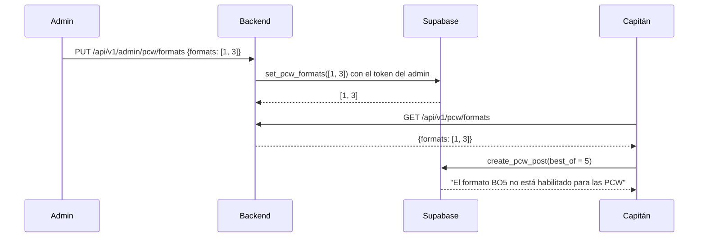

# Formatos de PCW habilitados por el admin: documentación

## Qué hace

Un admin decide qué formatos (BO1, BO3 o BO5) se pueden elegir al publicar una PCW. Al principio están los tres. La regla la hace cumplir la base: `create_pcw_post` rechaza un formato deshabilitado, venga el pedido de la web nueva, de la API o de una llamada directa a Supabase.

Lo ya publicado no cambia: un anuncio abierto o una partida aceptada conserva su formato aunque el admin lo deshabilite después. El servidor de juego tampoco cambia: el plugin lee el formato de cada partida (`matches.best_of`) cuando se vincula con `!match`.

## Reglas

| Regla | Detalle |
|---|---|
| Formatos posibles | BO1, BO3 y BO5 |
| Valor inicial | Los tres habilitados |
| Mínimo | Siempre queda al menos uno |
| Quién cambia | Solo un admin (`profiles.role = 'admin'`) |
| Anuncios abiertos y partidas aceptadas | Conservan su formato. `accept_pcw` copia el formato del anuncio sin volver a validarlo |
| Torneos | Fuera de este requerimiento: el formato lo va a decidir el creador del torneo |

## Datos

**`pcw_config`**: una sola fila (`id = 1`), como `elo_config`.

| Columna | Qué guarda |
|---|---|
| `best_of` | Formatos habilitados, ordenados y sin repetidos (`{1,3,5}` al principio). `check`: de 1 a 3 valores, todos de `{1,3,5}` |
| `updated_at` | Último cambio |
| `updated_by` | Admin que hizo el último cambio |

RLS: cualquiera (anónimo o con sesión) la puede leer. Nadie puede escribirla directamente; solo a través de `set_pcw_formats`.

## Funciones de Supabase

| Función | Qué hace |
|---|---|
| `set_pcw_formats(p_best_of int[])` | Solo admin. Ordena, quita repetidos, valida y guarda; devuelve la lista guardada. Errores: "Solo un administrador puede cambiar los formatos de PCW", "Los formatos válidos son BO1, BO3 y BO5", "Tiene que quedar al menos un formato habilitado". Un anónimo ni siquiera la puede ejecutar |
| `create_pcw_post` | Además de exigir 1, 3 o 5, rechaza un formato que no esté en `pcw_config`: "El formato BO5 no está habilitado para las PCW" |

## Endpoints

| Endpoint | Quién | Respuesta |
|---|---|---|
| `GET /api/v1/pcw/formats` | Cualquiera, sin sesión | `200 { "formats": [1, 3, 5] }` (ordenado, `Cache-Control: no-store`) |
| `PUT /api/v1/admin/pcw/formats` | Admin | Body `{ "formats": [1, 3] }`. `200` con la lista guardada. `400 VALIDATION_ERROR` (lista vacía, valores que no son 1, 3 o 5, más de 3), `400 BUSINESS_RULE` (mensaje de la base), `401` sin sesión, `403` si no es admin |

Los dos están en la OpenAPI (`/api/docs`), en las etiquetas **PCW** y **Admin**.

## Dónde está cada cosa

| Qué | Archivo / ubicación |
|---|---|
| Migración | `supabase/replanteo/08_formatos_pcw.sql` |
| Inversa | `docs/bitacora/2026-10-14-replanteo-modelo-datos/reversas/08_formatos_pcw.sql` |
| Pruebas de la migración | `docs/bitacora/2026-10-14-replanteo-modelo-datos/pruebas/08_formatos_pcw.sql` (corren con `correr.sh`) |
| Rutas | `web/backend/src/routes/pcw.ts` |
| Esquemas (zod/OpenAPI) | `web/backend/src/schemas/pcw.ts` |
| Pruebas del backend | `web/backend/test/unit/pcw-routes.test.ts` y `web/backend/test/integration/pcw.test.ts` |
| Lo que tiene que hacer la web nueva | `docs/frontend/2026-10-14-decisiones-para-frontend.md` |
