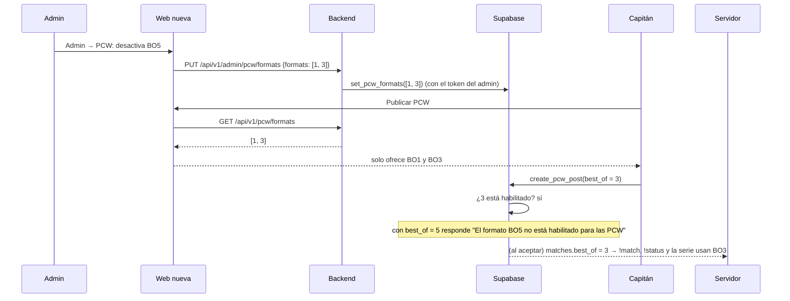

# Plan: formatos de PCW habilitados por el admin (BO1, BO3, BO5)

> Planeación original. Estado: **propuesta**, pendiente de aprobación.

Hoy quien publica una PCW elige BO1, BO3 o BO5 sin restricción (`create_pcw_post` acepta 1, 3 o 5). Al aceptarla, el formato pasa a la partida (`matches.best_of`), y el servidor ya lo respeta: `csstv_match_lookup` lo manda al plugin, `!status` lo muestra y `csstv_link_game` cierra la serie cuando un equipo gana `best_of / 2 + 1` mapas.

Lo que falta es que **el admin decida qué formatos se pueden elegir** en las PCW. Este plan agrega esa configuración en la base y sus endpoints en el backend.

Producción no se toca hasta el corte, igual que el resto del replanteo: la migración va en `supabase/replanteo/` como `08`.

## Decisiones tomadas

| Tema | Decisión | Por qué |
|---|---|---|
| Qué se configura | La lista de formatos permitidos para **PCW**: cualquier combinación de BO1, BO3 y BO5 | Pedido de Daniel |
| Valor inicial | **Los tres habilitados** | Decisión de Daniel. Al aplicar la migración nada cambia hasta que el admin desactive alguno |
| Mínimo | Siempre tiene que quedar **al menos un formato** habilitado | Si no, nadie podría publicar una PCW |
| Quién lo cambia | Solo un **admin** | Pedido de Daniel |
| Dónde se controla | **En la base** (`create_pcw_post`), no solo en la web | Vale venga de donde venga el pedido (web nueva, API o una llamada directa) |
| PCW que ya existen | **No cambian.** Un anuncio publicado o una partida aceptada conserva su formato aunque el admin lo desactive después | Los equipos ya acordaron ese formato. Cambiarlo a la fuerza confundiría |
| Aceptar un anuncio | Se acepta con el formato del anuncio, aunque ya no esté habilitado | Misma razón: el formato se fijó al publicar |
| Torneos | **Fuera de este plan.** El formato de una partida de torneo lo decide el creador del torneo, cuando se planee la creación de torneos | Decisión de Daniel: es más complejo y todavía no se profundiza |
| Servidor | **No cambia.** El plugin 2.0.0 ya lee el BO de cada partida | El formato viaja con la partida, no con la configuración |

## 1. El flujo completo

## 2. Base de datos (`supabase/replanteo/08_formatos_pcw.sql`)

1. **Tabla `pcw_config`**, de una sola fila, como `elo_config`:

   | Columna | Tipo | Detalle |
   |---|---|---|
   | `id` | `smallint` | Siempre 1 (`check (id = 1)`) |
   | `best_of` | `int[]` | Formatos habilitados. Por defecto `{1,3,5}`. `check`: no vacío, sin repetidos y solo valores de `{1,3,5}` |
   | `updated_at` | `timestamptz` | Última modificación |
   | `updated_by` | `uuid` | Admin que la cambió |

   La migración inserta la fila con los tres formatos.
2. **RLS:** cualquiera puede leer (la web muestra los formatos aunque no haya sesión); nadie escribe directo.
3. **`set_pcw_formats(p_best_of int[])`:** `security definer`. Solo un admin (`is_admin()`). Ordena, quita repetidos, valida y guarda con `updated_at` y `updated_by`. Mensajes: "Solo un administrador puede cambiar los formatos de PCW", "Tiene que quedar al menos un formato habilitado", "Los formatos válidos son BO1, BO3 y BO5".
4. **`create_pcw_post`:** además del chequeo actual (1, 3 o 5), rechaza un formato que no esté en `pcw_config.best_of`: "El formato BO5 no está habilitado para las PCW". Se cambia con `pg_temp.reemplazar`, con un comentario único `-- (replanteo 08)`, como en las migraciones anteriores.
5. **Inversa** (`reversas/08_formatos_pcw.sql`): borra la tabla y la función, y deja `create_pcw_post` como estaba.
6. **Pruebas** (`pruebas/08_formatos_pcw.sql`, dentro de un rollback):
   - La fila inicial tiene `{1,3,5}`.
   - Un no admin no puede cambiarla; un admin sí.
   - Rechaza una lista vacía, un 2 o un 7. Los repetidos se limpian.
   - Con `{1,3}`: publicar BO5 falla con el mensaje; BO1 y BO3 funcionan.
   - Un anuncio BO5 publicado antes de desactivar BO5 se puede aceptar, y la partida queda BO5.
   - Un anónimo puede leer `pcw_config` pero no escribirla.

   Corre en el ciclo de `correr.sh` (aplicar, segunda aplicación que aborta, inversa idéntica, reaplicar). El ensayo del ELO se repite aunque esta migración no lo toca.

## 3. Backend (`web/backend`)

| Endpoint | Quién | Qué hace |
|---|---|---|
| `GET /api/v1/pcw/formats` | Cualquiera | `{ "formats": [1, 3, 5] }`, leído de `pcw_config` |
| `PUT /api/v1/admin/pcw/formats` | Admin (`requireUser` + `requireAdmin`) | Body `{ "formats": [1, 3] }`. Llama a `set_pcw_formats` con el token del admin y devuelve la lista guardada |

- **Validación con zod:** arreglo de 1 a 3 elementos, cada uno 1, 3 o 5. Los errores de la base se traducen al formato de error de la API, con el mensaje de la base.
- **Documentación:** los dos endpoints van en la OpenAPI (`/api/docs`).
- **Pruebas:**
  - Unitarias: validación y respuestas.
  - De integración contra la Supabase local: admin y no admin, lista inválida, lectura anónima.
  - Se mantiene la cobertura mínima del 60 %.
- **Tipos:** `pnpm db:types` después de aplicar la `08` en local.

Estos son los primeros endpoints de PCW. Los de publicar y aceptar PCW van en la entrega de endpoints de dominio y van a usar la misma validación de la base.

## 4. Web

- **Web vieja:** no se toca. Sigue ofreciendo los tres formatos y contra producción nada cambia hasta el corte. Después del corte, si alguien elige un formato deshabilitado, la base lo rechaza con su mensaje.
- **Web nueva:** el formulario de publicar PCW ofrece solo los formatos de `GET /api/v1/pcw/formats`. Admin → PCW tiene tres casillas (BO1, BO3, BO5) y no deja desmarcar la última.
- **Resumen para el frontend** (`docs/frontend/2026-10-14-decisiones-para-frontend.md`): se suma una fila con esto.

## 5. Requisitos antes de empezar

- **Aprobación de este plan.**
- La Supabase local con 01 a 07 (ya funcionando).

## 6. Orden de implementación

1. **Base:** `08_formatos_pcw.sql`, con su prueba y su inversa. Pasar `correr.sh` completo y repetir el ensayo del ELO.
2. **Backend:** tipos regenerados, los dos endpoints, sus pruebas y la OpenAPI.
3. **Documentación:**
   - `DOCUMENTACION.md` y `GUIA_IMPLEMENTACION.md`.
   - Fila de la `08` en `supabase/replanteo/README.md`.
   - Resumen para el frontend.
   - `docs/PENDIENTES.md`: la `08` entra en el corte.

No lleva changelog propio para los jugadores: se suma una línea al de 2.0.0 ("El admin decide qué formatos, BO1, BO3 o BO5, se pueden elegir al publicar una PCW").
