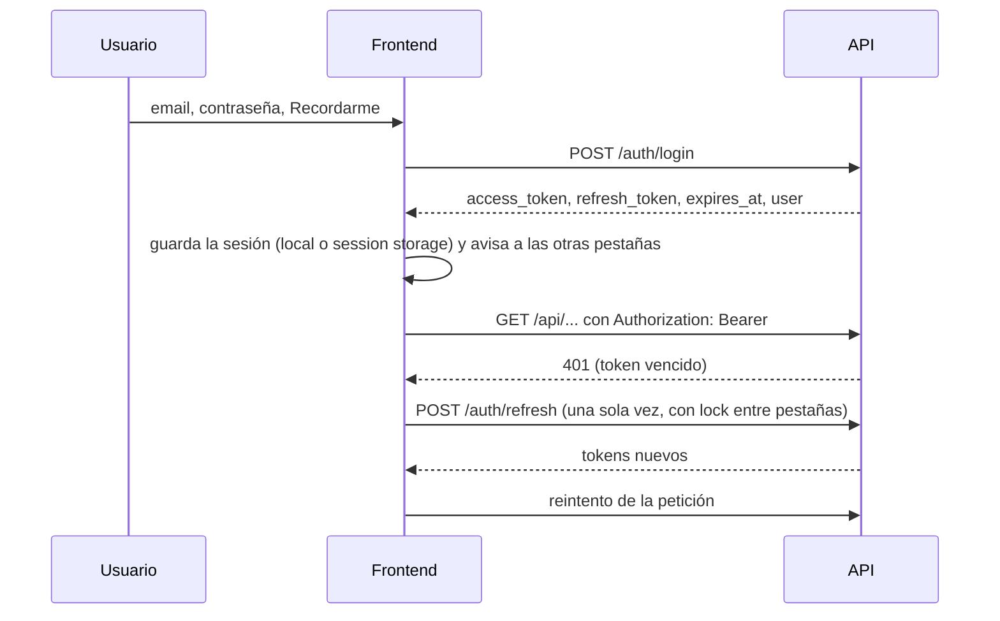
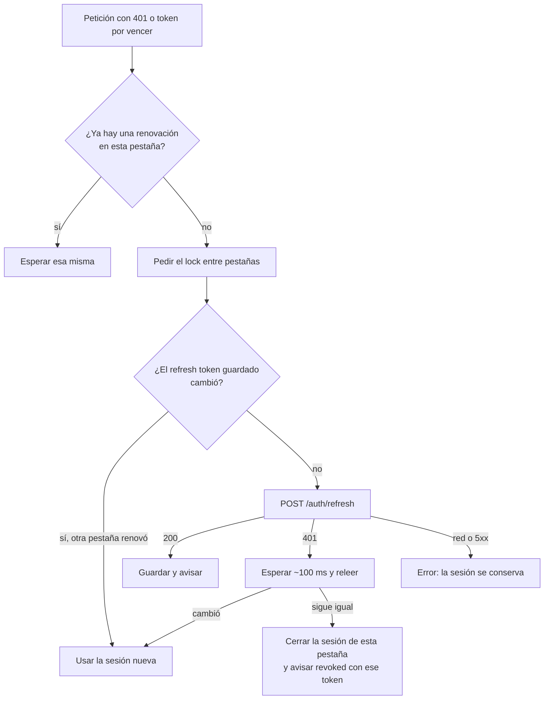

# Auth del frontend nuevo: documentación

## Qué hace

El frontend nuevo (`web/frontend`, Vite + React + TypeScript) maneja la cuenta del usuario hablando **solo con la API** de `web/backend`: registro, confirmación de email, login, sesión persistente, renovación de tokens, logout y los pasos opcionales del registro (datos personales, redes y avatar). No usa `supabase-js` ni la clave pública de Supabase.

La API entrega un `access_token` de 1 hora y un `refresh_token` **de un solo uso**. El frontend los guarda según "Recordarme", los comparte entre pestañas y renueva una sola vez aunque varias peticiones o pestañas lo necesiten a la vez. Las rutas se protegen por sesión y por rol antes de dibujarse.

## Pantallas y rutas

| URL | Acceso | Qué hay |
|---|---|---|
| `/` | Todos | Landing provisoria: "Ingresar" y "Crear cuenta", o "Ir al panel" con sesión |
| `/ingresar?redirect=&aviso=` | Sin sesión | Email, contraseña y "Recordarme" (marcado por defecto). `aviso` muestra "cuenta confirmada" o "enlace inválido" |
| `/registro` | Sin sesión | Email, contraseña y alias, con la disponibilidad del alias en vivo y el aviso del SteamID |
| `/registro/confirmar` | Sin sesión | "Revisa tu correo", con el email si viene en el estado de navegación o un texto genérico si se recargó |
| `/panel` | Con sesión | Provisoria: alias, email, rol y fecha de registro |
| `/completar-perfil?paso=datos\|redes\|avatar` | Con sesión | Pasos opcionales, cada uno con "Omitir" |
| `/admin` | Rol `admin` | Provisoria, para comprobar la guarda de rol. Con otro rol muestra un 403 |

Las rutas son archivos de `web/frontend/src/routes/`: `_auth` agrupa las páginas sin sesión, `_app` las que exigen sesión y `_app/_admin` las de admin. El diseño de todas es provisorio hasta que lleguen los artifacts.

## Sesión

### Dónde se guarda

| "Recordarme" | Storage | Qué pasa al cerrar el navegador |
|---|---|---|
| Marcado | `localStorage` | La sesión sigue |
| Sin marcar | `sessionStorage` | La sesión se pierde |

La clave es `csstv.session` y guarda `accessToken`, `refreshToken` y `expiresAt` (en milisegundos; la API manda `expires_at` en segundos Unix). Al cambiar de modo se borra la copia del otro storage. El registro guarda siempre en `localStorage`.

### Varias pestañas

Las pestañas se avisan por `BroadcastChannel('csstv:auth')`:

| Aviso | Qué hace la pestaña que lo recibe |
|---|---|
| `hello` | Si tiene sesión, la comparte. Lo manda una pestaña nueva sin sesión guardada (`sessionStorage` no se comparte entre pestañas) |
| `session` | Adopta la sesión (login o renovación en otra pestaña). En el modo sin recordarme guarda su propia copia |
| `logout` | Cierra la sesión (logout explícito en otra pestaña) |
| `revoked` | Cierra la sesión **solo si tiene ese mismo refresh token**. Así una pestaña que ya renovó no se cierra por el aviso de otra |

La espera por otras pestañas (unos 150 ms) solo la hacen las guardas; las páginas públicas se dibujan enseguida.

### Renovación única

La espera ante un 401 cubre el caso del modo sin recordarme: cada pestaña tiene su copia en `sessionStorage`, y el aviso de la que renovó puede llegar después de que la otra obtenga el lock.

### Peticiones (`authFetch`)

1. Si el token vence en menos de 60 segundos, renueva antes de pedir (también antes del logout, para que el servidor revoque el refresh token).
2. Agrega `Authorization: Bearer`, salvo en login, registro y refresh.
3. Ante un 401 renueva **una vez** y reintenta **una vez**, con el mismo cuerpo. Login, registro, refresh y logout no se reintentan.
4. Si la renovación falla, la sesión se cierra y la petición se reintenta una vez **sin** `Authorization`: una ruta pública sigue respondiendo como visitante.

### Guardas

| Guarda | Regla |
|---|---|
| `requireAuth` | Sin sesión (o sesión vencida) manda a `/ingresar?redirect=<ruta actual>`. Un error de red o un 500 **no** manda al login: se muestra "No se pudo conectar" con Reintentar |
| `requireGuest` | Con sesión, sale a `redirect` (si es seguro) o a `/`. Con la API caída deja ver la página |
| `requireRole(...)` | Si el rol no alcanza, lanza `ForbiddenError` y el layout `_admin` muestra el 403 |
| `safeRedirect` | Solo acepta rutas internas. Rechaza `//…`, `/\…`, caracteres de control, `\`, URLs absolutas, esquemas y rutas que se normalizan a `//…` (como `/..//evil.com`) |

El usuario actual vive en TanStack Query (`['auth', 'me']`, `GET /auth/me`); si no hay sesión, la consulta devuelve `null` sin llamar a la API. `AuthSync` borra los datos privados de la caché cuando la sesión se cierra y re-ejecuta las guardas si el cambio vino de otra pestaña o de una sesión vencida.

### Confirmación del email

El backend manda el link del correo a `FRONTEND_URL`, y Supabase vuelve con los tokens en el fragmento (`#access_token=…&type=signup`) o con un error (`#error_code=otp_expired`). Al arrancar, el frontend:

- **descarta los tokens sin usarlos,** para que un link ajeno no deje a alguien logueado con la cuenta de otro;
- **limpia la URL con `replaceState`,** para que no queden en la barra ni en el historial;
- **manda a `/ingresar`** con el aviso de "cuenta confirmada" o "enlace inválido".

## Errores

Se decide qué mostrar por `error.code`, nunca por el texto (`src/api/errors.ts`):

| `code` | Se muestra |
|---|---|
| `VALIDATION_ERROR` | En el campo de `details[].path`; si no corresponde a un campo, como error general |
| `INVALID_CREDENTIALS` | "Email o contraseña incorrectos." |
| `EMAIL_NOT_CONFIRMED` | "Confirma tu email antes de iniciar sesión. Revisa tu correo." |
| `RATE_LIMITED` | Cuenta regresiva con `Retry-After` y botón deshabilitado |
| `BUSINESS_RULE`, `CONFLICT`, `INVALID_FILE`, `FILE_TOO_LARGE` | El mensaje del backend tal cual |
| `INTERNAL` | Mensaje genérico con el `requestId` |
| `NETWORK` (propio del frontend) | "No se pudo conectar con el servidor." |

## Formularios

Las reglas de zod copian las del backend: email hasta 254 caracteres, contraseña de 6 a 72, alias de 2 a 24 sin `<` ni `>`, y para el perfil las mismas listas de países y roles y las mismas expresiones de Steam, FACEIT y Discord. Las listas están atadas al schema generado: si el backend agrega un país o un rol, el typecheck falla.

**Alias en vivo:** consulta `GET /api/v1/aliases/{alias}/available` con una espera de 400 ms y muestra "Disponible" o el motivo (`length`, `chars`, `blocked`, `taken`). Si la verificación falla por red o por un error del servidor, no muestra nada y no bloquea el registro: la API vuelve a validar al enviar.

**Pasos opcionales:** envían solo los campos completados; si no hay ninguno, no llaman a la API. El avatar se recorta a 256×256, siempre en JPEG y sin pasar de 1 MB, antes de subirlo.

## Dónde está cada cosa

| Qué | Archivo |
|---|---|
| Reglas para trabajar en el frontend y pendientes | `web/frontend/CLAUDE.md` |
| Contrato con el backend | `docs/frontend/contract.md` |
| Cliente tipado y `unwrap` | `web/frontend/src/api/client.ts` |
| Tipos de la API (generados) | `web/frontend/src/api/schema.d.ts` |
| Errores y mensajes | `web/frontend/src/api/errors.ts` |
| Sesión y pestañas | `web/frontend/src/auth/tokenStore.ts` |
| Renovación única | `web/frontend/src/auth/refresh.ts` |
| Peticiones con Bearer | `web/frontend/src/auth/authFetch.ts` |
| Usuario actual y mutaciones de auth | `web/frontend/src/auth/queries.ts` |
| Guardas | `web/frontend/src/auth/guards.ts` |
| Sincronía con Query y el router | `web/frontend/src/auth/AuthSync.tsx` |
| Redirecciones seguras | `web/frontend/src/auth/redirect.ts` |
| Link de confirmación del email | `web/frontend/src/auth/callback.ts` |
| Formularios | `web/frontend/src/features/auth/` |
| Perfil (esquemas y mutaciones) | `web/frontend/src/features/profile/` |
| Recorte del avatar | `web/frontend/src/lib/image.ts` |
| Rutas | `web/frontend/src/routes/` |
| Pruebas unitarias | `*.test.ts(x)` junto a cada archivo, utilidades en `web/frontend/src/test/` |
| Pruebas de punta a punta | `web/frontend/e2e/` (Playwright) |
