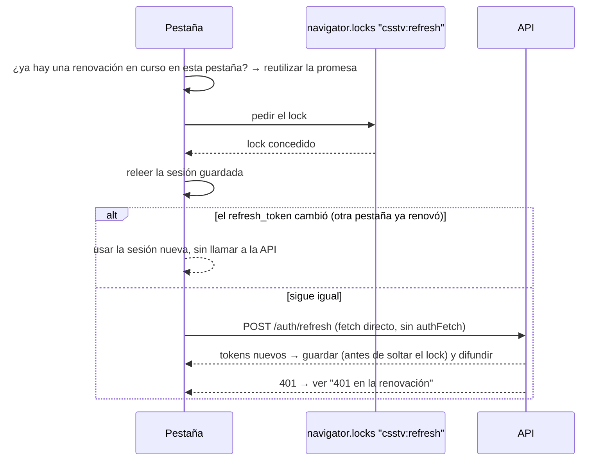

# Plan: auth del frontend nuevo (landing, login, registro y layouts)

> Planeación original. Estado: **aprobado** el 2026-10-15 (con las correcciones de la revisión incorporadas antes de aprobar). No se edita: los cambios durante la implementación están en [GUIA_IMPLEMENTACION.md](GUIA_IMPLEMENTACION.md).

## Contexto

El frontend nuevo (rama `feat/frontend-fase-1`) arranca con la autenticación. Según `contract.md` (2026-10-15), el frontend **habla solo con la API**: no usa `supabase-js` ni la clave pública. La API entrega tokens Bearer (access de 1 hora y refresh **de un solo uso**), sin cookies, con errores en un formato fijo (`error.code`, `details[].path`, `requestId`) y roles `user`, `organizer` y `admin`.

El objetivo es que la lógica de sesión quede sólida y probada antes de trabajar lo visual. El diseño viene después, con los artifacts del usuario.

### Decisiones confirmadas

| Tema | Decisión |
|---|---|
| Router | TanStack Router, con las guardas en `beforeLoad` (no React Router) |
| Datos del servidor | TanStack Query para `/auth/me`, la disponibilidad del alias y las mutaciones |
| Estado de la sesión | Zustand: solo los tokens y la preferencia "Recordarme". El usuario vive en Query |
| Cliente de la API | `openapi-typescript` (genera `schema.d.ts`) + `openapi-fetch` (con `authFetch` como `fetch`) |
| Formularios | react-hook-form + zod + componentes Field de shadcn |
| Dónde se guarda la sesión | "Recordarme": marcado va a localStorage, sin marcar a sessionStorage. Mejora futura más abajo |
| Estructura | El frontend se mueve de `web/` a `web/frontend/` (monorepo con `web/backend`) |

## Requisito previo

`src/api/schema.d.ts` se genera desde `GET /api/openapi.json`. Para eso hace falta la API corriendo en local (o el `openapi.json`). La rama `feat/backend-api-fase-1` no está en este clon: el usuario tiene que traerla o levantar la API y pasarme la URL. **No toco nada de `web/backend`; solo lo leo.**

## Paso 0: mover el frontend y crear CLAUDE.md

- **Mover la carpeta entera, no `web/*`** (el `*` no incluye `.gitignore`, `.prettierrc` ni `.prettierignore`): `git mv web web-tmp`, después crear `web/` y `git mv web-tmp web/frontend`. Así se mueven también los archivos ocultos. Después, `pnpm install` (`node_modules` y `dist` están ignorados).
  - Revisado: el repo no tiene CI, configuración de Vercel ni script de despliegue que apunte a `web/`, y fuera de `web/` no hay referencias a esa ruta. El despliegue al VPS todavía no existe; cuando se arme, va a apuntar a `web/frontend/dist`.
- `web/frontend/CLAUDE.md`, con lo que genera un `/init` más estas reglas:
  - **Alcance:** cuando se trabaja en el frontend, solo se modifica `web/frontend/`. El resto del repo (backend, `supabase/`, `server/`, `cloudflare/`, el `index.html` viejo) solo se lee y se consulta.
  - **Comentarios:** siempre en español, cortos y solo cuando ayudan a entender algo que no es obvio. Nada de comentarios largos ni en inglés.
  - Comandos (`pnpm dev`, `build`, `lint`, `typecheck`, `test`, `gen:api`), stack, estructura, la regla de errores por `code` y que `schema.d.ts` y `routeTree.gen.ts` no se editan a mano.
- `.env.example` con `VITE_API_URL=http://localhost:<puerto>`. `src/lib/env.ts` lo valida con zod al arrancar y falla con un mensaje claro si falta.

**Dependencias nuevas:**
- **Producción:** `openapi-fetch`, `zustand`, `react-hook-form`, `zod`, `@hookform/resolvers`.
- **Desarrollo:** `openapi-typescript`, `vitest`, `jsdom`, `@testing-library/react`, `@testing-library/user-event`, `msw`.
- **shadcn:** `field`, `input`, `label`, `checkbox`, `card`, `alert`, `sonner`, `select`, `dropdown-menu`, `avatar`, `progress`.

## Estructura

Tomo tu propuesta y la adapto a TanStack Router: las páginas son archivos de `routes/`, y las guardas son funciones de `beforeLoad` en lugar de componentes.

```
web/frontend/src/
  api/
    schema.d.ts          ← generado (pnpm gen:api), no se edita
    client.ts            ← createClient<paths>({ baseUrl: env.API_URL, fetch: authFetch })
    errors.ts            ← ApiError (status, code, message, details, requestId, retryAfter) y mensajes por code
  auth/
    tokenStore.ts        ← Zustand vanilla: sesión + persistencia local/session + sincronización entre pestañas
    refresh.ts           ← renovación única (en la pestaña y entre pestañas)
    authFetch.ts         ← Bearer, renovación anticipada y un solo reintento tras 401
    queries.ts           ← meQueryOptions, useMe, useLogin, useSignup, useLogout, aliasAvailability
    guards.ts            ← requireAuth, requireGuest, requireRole(...roles) y safeRedirect
    AuthSync.tsx         ← conecta el store con Query y el router (logout en otra pestaña, sesión vencida)
    schemas.ts           ← zod con las reglas del contrato (email, password, alias, perfil)
  features/auth/         ← LoginForm, SignupForm, AliasField, pasos opcionales, AvatarStep
  lib/
    env.ts · image.ts    ← validación del entorno; recorte del avatar a 256×256 y control de 1 MB
  routes/                ← ver "Rutas"
```

No hace falta un `AuthProvider` con contexto: el usuario se obtiene con `useMe()` (Query) y las acciones son mutaciones. Así hay una sola fuente de verdad y el router accede a lo mismo desde `context.queryClient`.

## Flujo de sesión

### `tokenStore.ts`

- **Estado:** `session: { accessToken, refreshToken, expiresAt } | null` y `remember: boolean`.
- **Persistencia:** con `remember` en localStorage, si no en sessionStorage, siempre bajo la clave `csstv.session`. Al cambiar de modo se borra la otra.
- **Sincronización entre pestañas con `BroadcastChannel('csstv:auth')`:** cada cambio (login, renovación, logout) se difunde a las demás pestañas.
  - **Los avisos de sesión revocada llevan el `refresh_token` que murió.** Una pestaña solo borra su sesión si tiene ese mismo token. Así una pestaña con una sesión ya renovada nunca se cierra por el aviso de otra.
  - Una pestaña nueva sin sesión guardada pregunta si alguna tiene una. **Esa espera no bloquea las rutas públicas:** la página se dibuja enseguida y se actualiza si llega una sesión. Solo `requireAuth` espera la respuesta, hasta unos 150 ms.
- **`expiresAt` en milisegundos:** si la respuesta trae `expires_in`, se calcula como `Date.now() + expires_in * 1000`, que no depende del reloj del equipo. Si solo viene `expires_at`, se verifica la unidad en la OpenAPI (Supabase usa segundos) y se convierte.
- **Lecturas siempre del storage, no del estado en memoria,** cuando se decide algo dentro del lock de renovación.
- **Uso fuera de React:** el store es *vanilla*, así `authFetch` lo lee sin hooks. En los componentes se usa con `useStore`.

### `refresh.ts`: renovación única



**401 en la renovación.** En el modo "sin recordarme" cada pestaña tiene su propio sessionStorage, y el aviso de otra pestaña puede no haber llegado todavía cuando esta obtiene el lock. Por eso, ante un 401:

1. Se cede un turno (unos 100 ms) para procesar los avisos pendientes y se vuelve a leer la sesión.
2. Si el `refresh_token` guardado **cambió**, se usa la sesión nueva: otra pestaña ya renovó.
3. Solo si **sigue siendo el que se usó**, se borra la sesión de esta pestaña y se difunde un aviso de revocación con ese token. Las demás pestañas lo ignoran si su token es otro.

En el modo "Recordarme" el paso 2 se resuelve siempre al releer, porque localStorage se escribe antes de soltar el lock.

Si el navegador no tiene `navigator.locks`, queda solo la deduplicación dentro de la pestaña.

### `authFetch.ts`

1. Si hay sesión y `expiresAt` vence en menos de 60 s, renueva antes de pedir. Esto evita la mayoría de los 401.
2. Clona el `Request` antes de enviarlo, para poder reintentar con el mismo cuerpo.
3. Agrega `Authorization: Bearer` si hay token. Las rutas públicas lo aceptan y devuelven más datos.
4. Ante un 401 en una ruta que no sea `/auth/*`, con token enviado: renueva **una vez** y reintenta **una vez**. Nunca entra en bucle.
5. **Si la renovación falla:** la sesión se borra y la petición se reintenta **una vez sin `Authorization`**. Si la ruta es pública (una ficha, un torneo), la página sigue funcionando como visitante. Si la ruta exige sesión, el 401 llega a la guarda o a la pantalla, y `AuthSync` actualiza el estado.

### `errors.ts`

- `client.ts` envuelve las respuestas: si `error` viene con el formato del contrato, lanza un `ApiError`.
- Un `ApiError` también puede ser `network` (la API no responde), con su propio mensaje.

| `code` | Comportamiento |
|---|---|
| `VALIDATION_ERROR` | `applyFieldErrors(form, err)` hace `setError` por cada `details[].path` |
| `BUSINESS_RULE`, `CONFLICT` | Muestra el `message` tal cual |
| `INVALID_CREDENTIALS` | "Email o contraseña incorrectos" |
| `EMAIL_NOT_CONFIRMED` | "Confirma tu email" |
| `RATE_LIMITED` | Lee `Retry-After` y deshabilita el envío con una cuenta regresiva |
| `INTERNAL` | Mensaje genérico con el `requestId` |

### `queries.ts` y `AuthSync.tsx`

- **`meQueryOptions`:** clave `['auth', 'me']`, `staleTime` de 5 minutos. **El `queryFn` devuelve `null` si no hay sesión** en el `tokenStore`, sin llamar a la API. No se usa `enabled` porque `ensureQueryData` lo ignora.
- **Login:** guarda los tokens y `remember`, carga el `user` de la respuesta con `setQueryData` (sin pedir `/auth/me` otra vez), llama a `router.invalidate()` y navega al `redirect`.
- **Logout:** `POST /auth/logout` (si falla, sigue igual), borra la sesión, `queryClient.clear()` (no quedan datos privados en caché), difunde el cambio y navega a `/`.
- **`AuthSync`:** cuando la sesión pasa a `null` por otro motivo (otra pestaña o renovación fallida), hace lo mismo que el logout, sin llamar a la API.

### `guards.ts`

- **`requireAuth`:** `await context.queryClient.ensureQueryData(meQueryOptions)`. Distingue dos casos:
  - **Sin sesión** (`null`) o un `ApiError` 401: `throw redirect({ to: '/ingresar', search: { redirect: location.href } })`.
  - **Cualquier otro error** (red, 500): se relanza, y el `errorComponent` del layout muestra "No se pudo conectar" con un botón Reintentar. Nunca se manda al login a alguien con sesión porque la API esté caída.
- **`requireGuest`:** si ya hay sesión, manda al `redirect` o a `/`.
- **`requireRole('admin')` o `requireRole('organizer', 'admin')`:** como `beforeLoad` solo puede lanzar errores o redirecciones, lanza un `ForbiddenError` propio. El `errorComponent` del layout `_admin` lo detecta y muestra la pantalla 403. Cualquier otro error lo pasa al manejo general.
- **`safeRedirect`:** solo acepta rutas internas. Rechaza lo que empieza con `//` o con `/\` (los navegadores tratan `\` como `/`), las URLs absolutas y los esquemas (`javascript:`, `https:`), para evitar redirecciones abiertas.

## Rutas

Las URLs van en español, como la web vieja. El código, en inglés.

| Archivo | URL | Guarda | Contenido |
|---|---|---|---|
| `index.tsx` | `/` | — | Landing (provisoria) con accesos a Ingresar y Registrarse, o "Ir al panel" si hay sesión |
| `_auth.tsx` | — | `requireGuest` | Layout de las páginas de cuenta |
| `_auth/ingresar.tsx` | `/ingresar?redirect=` | | Email, contraseña y "Recordarme" (marcado por defecto) |
| `_auth/registro.tsx` | `/registro` | | Email, contraseña y alias con validación en vivo |
| `registro.confirmar.tsx` | `/registro/confirmar` | — | "Revisa tu correo", con el email recibido por el estado de navegación, no en la URL. Si se recarga y el estado se pierde, muestra un texto genérico ("Te enviamos un correo para confirmar tu cuenta") |
| `_app.tsx` | — | `requireAuth` | Layout con sesión: header con alias y rol, menú de cuenta y Salir |
| `_app/panel.tsx` | `/panel` | | Página provisoria con los datos de `useMe()` |
| `_app/completar-perfil.tsx` | `/completar-perfil?paso=datos\|redes\|avatar` | | Pasos opcionales del registro, cada uno con "Omitir" |
| `_app/_admin.tsx` + `_app/_admin/admin.tsx` | `/admin` | `requireRole('admin')` | Página provisoria para probar la guarda de rol |

## Formularios

- **Reglas de `schemas.ts`:**
  - email: hasta 254 caracteres;
  - contraseña: de 6 a 72;
  - alias: de 2 a 24, sin `<` ni `>`, sin espacios en los bordes;
  - perfil: nombre real hasta 60 (letras, espacios, `.`, `'`, `-`), país y rol con los valores del `schema.d.ts`, Discord de 2 a 40 sin espacios.
- **Alias en vivo:** `GET /api/v1/aliases/{alias}/available` con una espera de 400 ms al tipear, el `signal` de Query para cancelar la consulta anterior y caché por valor. El `reason` (`length`, `chars`, `blocked`, `taken`) se traduce a un mensaje. Al enviar, un `409` o un `400` con `path = "tag"` marca el campo.
- **Registro:**
  - Con `needsConfirmation`, va a `/registro/confirmar`.
  - Con sesión, la guarda en localStorage y va a `/completar-perfil?paso=datos`.
- **Pasos opcionales:**
  - `PATCH /api/v1/me/profile` envía solo los campos completados. Si no hay ninguno, no llama a la API y avanza.
  - Avatar: recorte a 256×256 con canvas, **siempre a JPEG** (Safari antiguo no genera WebP con `canvas.toBlob` y devuelve PNG sin avisar). Se verifica el `type` del blob resultante y el límite de 1 MB antes de `POST /api/v1/me/avatar` (multipart, campo `file`).
- **Aviso del registro:** para entrar a un equipo hay que tener el SteamID vinculado, y eso lo hace un admin.

## Pruebas (Vitest + MSW + Testing Library)

La lógica de sesión es la parte crítica, así que va con pruebas unitarias:

jsdom no trae `navigator.locks` ni un `BroadcastChannel` útil entre "pestañas": las pruebas usan mocks de los dos, que permiten simular dos pestañas con storages separados.

- **`tokenStore`:** persistencia local o session según `remember`, borrado y difusión entre pestañas. Un aviso de revocación con un token distinto del propio se ignora. La conversión de `expires_in` y `expires_at` a milisegundos.
- **`refresh`:**
  - diez 401 al mismo tiempo producen **una sola** llamada a `/auth/refresh`;
  - si otra "pestaña" ya renovó, no se llama a la API;
  - un 401 en la renovación con el token vigente borra la sesión;
  - **carrera en "sin recordarme":** la pestaña B obtiene el lock antes de procesar el aviso de A, renueva con el token viejo y recibe 401. B termina usando la sesión nueva de A, y A sigue con su sesión.
- **`authFetch`:** renovación anticipada, un solo reintento con el mismo cuerpo, sin bucle, que las rutas `/auth/*` no se reintentan, y que tras una renovación fallida la petición pública se reintenta sin `Authorization` y responde bien.
- **`errors`:** mapeo por `code`, `Retry-After` y `applyFieldErrors`.
- **`guards`:** sin sesión redirige al login; un 500 o un error de red **no** redirige; un rol insuficiente lanza `ForbiddenError`.
- **`safeRedirect`:** casos válidos y casos de redirección abierta (`//evil.com`, `/\evil.com`, `https://…`, `javascript:`).
- **Formularios:** el login muestra el error de credenciales, el alias muestra "tomado" y el registro con confirmación navega a "Revisa tu correo".

## Seguridad y mejoras futuras

- **Tokens:** nunca van en URLs ni en logs. Los devtools solo se cargan en desarrollo. No se usa `dangerouslySetInnerHTML`. La caché se limpia al salir.
- **Despliegue (VPS):** recomiendo una cabecera CSP con `connect-src` limitado a `api.<dominio>`. La documento en el CLAUDE.md para cuando se configure el servidor.
- **Mejora de la sesión (pendiente, requiere cambios en el backend):** pasar el `refresh_token` a una cookie `httpOnly; Secure; SameSite=Strict` del dominio de la API, y dejar el access token solo en memoria. Con eso un XSS ya no podría robar la sesión persistente. El diseño de `tokenStore` y `refresh` aísla ese cambio a esos dos archivos.
- **Fuera de alcance de esta fase, pero hay que resolverlo antes del corte:** la página de destino del link de confirmación del email y la recuperación de contraseña. Sin la primera, el registro con confirmación no funciona de punta a punta: el link del correo lleva a la Site URL de Supabase, que hoy probablemente sea la web vieja o un 404. Hay que definir con el backend la URL de destino y el endpoint, y dejarlo anotado como pendiente en el CLAUDE.md.

## Orden de trabajo

1. Paso 0: mover el frontend, crear CLAUDE.md, `.env`, instalar dependencias y agregar los componentes de shadcn.
2. `pnpm gen:api` y la capa `api/` (cliente y errores).
3. Núcleo de `auth/` (tokenStore, refresh, authFetch) con sus pruebas.
4. `queries`, `guards`, `AuthSync` y las rutas con sus layouts.
5. Formularios: login, registro, confirmación y pasos opcionales.
6. Verificación y commit en `feat/frontend-fase-1`.

## Verificación

- `pnpm typecheck`, `pnpm lint`, `pnpm test` y `pnpm build` en verde.
- **Con la API local** (`pnpm dev` y la skill `run` o el navegador):
  - registro con alias tomado y con alias libre;
  - login con contraseña incorrecta y con credenciales correctas;
  - recargar la página y seguir logueado;
  - token vencido (forzando `expiresAt` en el pasado): renueva sin que se note;
  - dos pestañas: logout en una cierra la otra, y una renovación no invalida a la otra, en los dos modos de "Recordarme";
  - "Recordarme" desmarcado: cerrar el navegador cierra la sesión;
  - sesión que muere en una página pública: la página sigue cargando como visitante;
  - API apagada con sesión: el layout muestra "No se pudo conectar" y no manda al login;
  - `/admin` con un usuario común muestra 403;
  - `/ingresar?redirect=//evil.com` y `/ingresar?redirect=/\evil.com` redirigen a `/`;
  - un visitante sin sesión ve la landing sin esperar.
