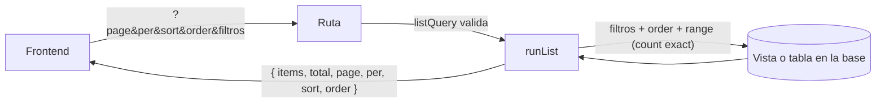

# Paginación, filtros y orden en el servidor para todos los GET: documentación

## Qué hace

Requisito obligatorio de Daniel (2026-10-15): **toda consulta `GET` que devuelve una lista pagina, filtra y ordena en el servidor.** La API tiene 39 `GET`. 29 son listados y siguen una convención única; los otros 10 devuelven un solo objeto (perfil, fichas, configuración).

La base hace el trabajo: el backend arma la consulta de PostgREST (filtros, `order` y `range`) sobre tablas o sobre las vistas de la migración `11`. Nada se pagina ni se ordena en memoria.

## Convención

| Parámetro | Regla |
|---|---|
| `page` | Desde 1 (por defecto 1) |
| `per` | De 1 a 100 (por defecto 20); hasta 200 en las partidas y tablas de un torneo |
| `sort` | Lista cerrada por endpoint; otro valor da `400 VALIDATION_ERROR` |
| `order` | `asc` o `desc`, con un valor por defecto por endpoint |
| `q` | Texto libre, sin mayúsculas ni tildes (columna `search` de cada vista) |
| Filtros | Propios de cada endpoint; booleanos `true` o `false`; fechas `from` y `to` en ISO 8601 |

- **Respuesta:** siempre `{ items, total, page, per, sort, order }`.
- **Orden estable:** cada listado suma un desempate fijo (el id), así las páginas no se mezclan.
- **Nulos:** al ordenar van al final.
- **Excepción, el chat:** pagina por **cursor** (`before`, `after` y `limit`, hasta 100) y responde `{ items, has_more, limit }`, del más viejo al más nuevo. Con mensajes nuevos llegando, la paginación por página correría los resultados.

La tabla completa de filtros y órdenes de cada endpoint está en `docs/frontend/contract.md`, sección 1, "Listados".

## Detalles sin listas que crecen

| Detalle | Qué devuelve | Dónde quedaron sus listas |
|---|---|---|
| `GET /players/{id}` | Datos, ELO, stats, equipos actuales, datos personales | `/players/{id}/map-stats`, `/medals`, `/teams` (historial), `/matches` |
| `GET /teams/{id}` | Datos, capitán, récord, `viewer` | `/teams/{id}/members` (plantel y ex integrantes), `/matches?team={id}` |
| `GET /events/{id}` | Configuración, estado, campeón, empate pendiente, `viewer` | `/events/{id}/registrations`, `/matches` (llaves), `/standings` (grupos y suizo) |
| `GET /matches/{id}` | Sin cambios: rosters (hasta 10 más invitados), mapas de la serie (hasta 5), jugadores de un mix y veto son fijos y cortos | — |

**`/me/pcw` se dividió en dos:** `/me/pcw/post` devuelve el anuncio abierto (un objeto) y `/me/pcw/matches`, las PCW (un listado).

**`ETag`:** el detalle de partida y de torneo, y las partidas y las tablas de un torneo, responden con `ETag` y devuelven `304` si nada cambió.

## Vistas de la migración `11`

| Vista | Para qué |
|---|---|
| `match_list` | Partidas sin `link_code`, con nombres de equipos y torneo, `search`, `player_ids` (quienes jugaron, también en los mapas de una serie), `at` (jugada o programada), `last_round` (para el nombre de la fase) y `stage_order` (orden de la llave) |
| `event_list` | Torneos con equipos inscritos, campeón, alias del organizador y `search` |
| `event_registrations_view` | Inscritos con siembra, cantidad de jugadores y `search` |
| `event_standings` | Grupos (con `event_group_order`) y suizo (récord, Buchholz, rondas) con su posición |
| `team_ranking` | Ranking con puntos y posición en los dos modos (solo torneos o con PCW), con `rank()` |
| `team_members_view` | Planteles con alias, ELO, rol, fechas, si es el capitán y el equipo |
| `pcw_post_list` | Anuncios con el bando, el equipo con el que juega, el alias de quien publicó y `search` |
| `admin_user_list`, `admin_team_requests` | Para el admin: corren como su dueño (porque `profiles` solo deja leer el propio) y filtran por `is_admin()`. Un usuario común las ve vacías |

Todas son `security_invoker`, salvo las dos de admin.

## Backend

- **`src/lib/list.ts`:**
  - `listQuery(campos, orden por defecto, máximo)` arma el esquema `page`/`per`/`sort`/`order`.
  - `runList` aplica el orden (con sus columnas y el desempate) y la paginación, y devuelve filas y total.
  - `envelope` arma la respuesta.
  - `Envelope(item)` es el esquema de la respuesta.
  - Además, `boolParam` y `dateParam` para los filtros.
- **Cada ruta de lista** suma sus filtros con `.extend(...)` y los aplica antes de `runList`.

## Dónde está cada cosa

| Qué | Archivo |
|---|---|
| Migración, inversa y pruebas | `supabase/replanteo/11_listados.sql`, `docs/bitacora/2026-10-14-replanteo-modelo-datos/reversas/11_listados.sql` y `…/pruebas/11_listados.sql` |
| Helper de listados | `web/backend/src/lib/list.ts` (pruebas en `test/unit/list.test.ts`) |
| Rutas | `web/backend/src/routes/*.ts` (todas las de lista) |
| Convención y tabla de filtros para el frontend | `docs/frontend/contract.md`, sección 1 |
