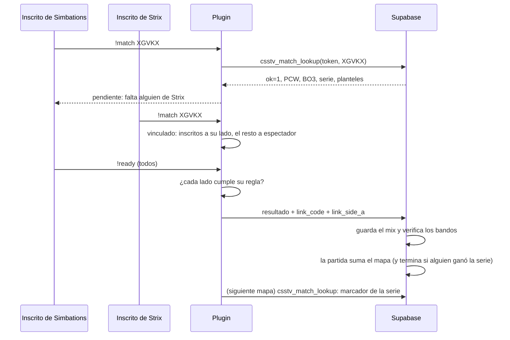
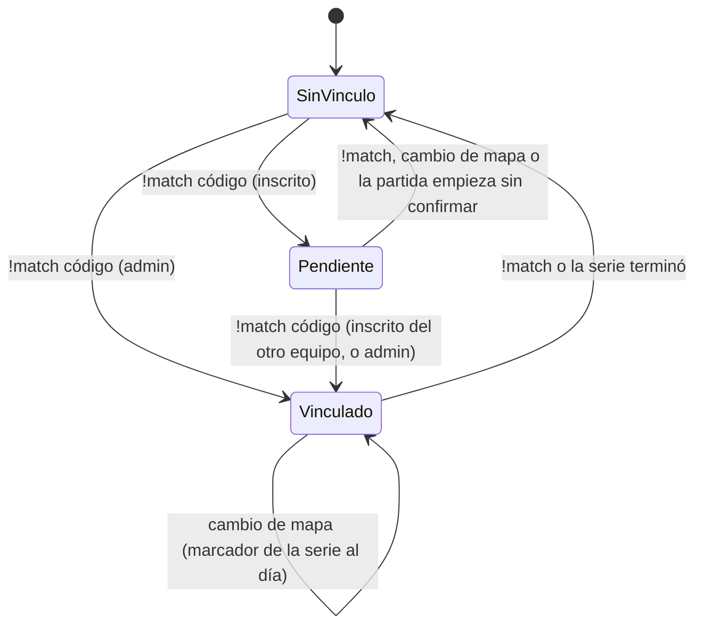

# `!match` y `!status`: documentación

## Qué hace

Cada partida de **torneo** o **PCW** de la web tiene un código de 5 caracteres (`matches.link_code`). En el servidor, los jugadores **vinculan** el mix a esa partida con `!match <código>`: un inscrito de un equipo propone, un inscrito del otro equipo confirma (o un admin vincula solo) y el plugin arma los lados con los planteles de la web. Al terminar, el juego se guarda como siempre (un mix con stats, demo y ELO) y además **suma el mapa** a la partida de la web. En una serie (BO3 o BO5) el vínculo sigue de un mapa al siguiente hasta que un equipo gana.

La base vuelve a verificar todo al recibir el resultado: que cada bando sea del equipo que el plugin dice y que se cumpla la regla del tipo de partida. Si algo no cuadra, el juego queda como **mix común** y la partida de la web no cambia.

`!status` es un comando para cualquiera (también espectadores) que muestra cómo está configurada la partida: estado, formato, inicio, pausas, `!gg`, vínculo y demo.

Es parte del **plugin 2.0.0** y de la migración **`supabase/replanteo/07_match_vincular.sql`**. Las dos cosas se despliegan recién en el corte del replanteo.



## Quién puede vincular y desvincular

| Acción | Quién | Cuándo |
|---|---|---|
| Proponer (`!match <código>`) | Un **inscrito** de cualquiera de los dos equipos: está en `team_members` (activo) y tiene su SteamID en `players.steam_id` | Solo en el calentamiento |
| Confirmar (`!match <código>`, el mismo) | Un inscrito **del otro equipo** | Solo en el calentamiento, con el vínculo pendiente |
| Vincular solo | Un admin (acceso a `sm_live`, flag `b`) | Solo en el calentamiento |
| Desvincular (`!match`) | Un inscrito de cualquiera de los dos equipos, o un admin | Siempre. Durante la partida, el juego se guarda como mix común |

Mensajes de rechazo: un jugador sin inscripción ("Solo pueden vincular jugadores inscritos en Simbations o en Strix (o un admin)"), el mismo equipo que propuso ("Ya lo propuso tu equipo: falta que confirme alguien de Strix…"), un código mal formado, un código inexistente o una partida que ya terminó (el mensaje lo arma la base).



Mientras el vínculo está pendiente o activo, el recordatorio del calentamiento lo repite en el chat ("Vínculo pendiente: … Falta que confirme alguien de Strix con !match XGVKX" / "Partida vinculada: … !status para ver los detalles").

## Armado de los lados y reglas

Al confirmarse el vínculo:

- **Cada inscrito** pasa al lado de su equipo (`team1` de la partida empieza de CT) y no puede pasarse al rival.
- **El resto** va a espectador. Al entrar, cada jugador elige el lado de su equipo y el plugin controla los cupos.
- **`!swap`** (admin) invierte qué equipo es CT.
- Un inscrito que se conecta durante el calentamiento va al lado de su equipo. El plugin acomoda a todos juntos unos segundos después de la última entrada, para que en un cambio de mapa los dos equipos puedan cambiar de lado sin trabarse con el tope de 5.

| Regla | Torneo | PCW |
|---|---|---|
| Jugadores por lado | 5 | Hasta 5 |
| Inscritos por lado | 5 | Al menos 3 |
| Stand-ins por lado (no inscritos, sin cuenta necesaria) | 0 | Hasta 2 |
| Para inscribirse en la web | 5 jugadores en el plantel (trigger en `tournament_registrations`) | 4 jugadores con cuenta para publicar o aceptar (`pcw_make_side`) |

Las reglas cuentan solo a los jugadores del plantel **que están jugando en ese lado**: los suplentes que no juegan no importan (un plantel de 7 juega con cualquier combinación de sus jugadores). `!ready` no arranca hasta que cada lado cumple su regla, y dice qué falta ("Todos listos, pero la partida vinculada todavía no puede empezar: Simbations necesita al menos 3 jugadores de su plantel en su lado (hay 2)"). `!live` (admin) arranca igual, con un aviso ("Atención: la partida vinculada no cumple las reglas… Si no cuadra, al terminar se guarda como mix"). Si la partida empieza con el vínculo pendiente, se descarta y se juega como mix común.

Con el vínculo activo, los nombres de los equipos del mix son los de la web: el chat, el marcador y el resultado dicen "Simbations" y "Strix".

## Datos

**Columnas nuevas de `matches`:**

| Columna | Qué guarda |
|---|---|
| `link_code` | Torneo y PCW: el código para `!match`. Cinco caracteres de `ABCDEFGHJKLMNPQRSTUVWXYZ23456789` (sin 0, O, 1 ni I), único. Se genera solo al crear la partida (trigger `matches_link_code`). Un mix no puede tener |
| `parent_match_id` | Mix vinculado: la partida de torneo o PCW a la que pertenece |
| `parent_side1` | Mix vinculado: qué equipo de la partida padre (1 = `team1`, 2 = `team2`) jugó en el bando 1 del mix |

**La partida de la web acumula los mapas** en `maps`, con un objeto por mapa: `{"map": "dust2", "r1": 0, "r2": 2, "game_id": "<id del mix>"}`. `r1` y `r2` son las rondas de `team1` y `team2`. A partir de ahí:

- `score1` y `score2` son los **mapas ganados** por cada equipo.
- `status` pasa a `live` con el primer mapa y a `finished` cuando un equipo llega a `best_of / 2 + 1` mapas ganados; ahí también se completa `winner`.
- El mix vinculado lleva en `side1_name` y `side2_name` el nombre de cada equipo.

## Funciones de Supabase

| Función | Quién la llama | Qué hace |
|---|---|---|
| `csstv_match_lookup(p_token, p_code)` | El plugin (anon key + token del servidor) | Devuelve texto con una línea `clave=valor` por dato: `ok`, `kind`, `title`, `best_of`, `score1`, `score2`, `team1`, `team2`, `t1`, `t2` (planteles como `STEAM_0:X:Y` separados por coma), `max_standins`, `min_roster`, `code`. Con un error: `ok=0` y `error=<mensaje para el chat>` |
| `csstv_steam2(steam64)` | `csstv_match_lookup` | Convierte un SteamID64 a `STEAM_0:X:Y`. `null` si no es un SteamID64 |
| `csstv_link_game(p_game, p_code, p_side_a)` | `csstv_ingest` | Vincula un mix terminado: verifica los bandos contra los planteles (si `p_side_a` es `null`, lo deduce por mayoría) y la regla del tipo de partida; suma el mapa a la partida y la cierra si alguien ganó la serie. Devuelve `false` (con un `notice`) si no cuadra |
| `csstv_new_link_code()` | Trigger `matches_link_code` | Genera un código libre |
| `tournament_registrations_plantel()` | Trigger de `tournament_registrations` | Rechaza la inscripción de un equipo con menos de 5 jugadores activos |

`csstv_ingest` lee `link_code` y `link_side_a` del resultado y, si el mix terminó, llama a `csstv_link_game`. Un reenvío del mismo resultado no suma el mapa dos veces, porque el mix ya tiene `parent_match_id`.

**Formato de la respuesta.** PostgREST devuelve el `text` como string JSON (`"ok=1\nkind=pcw…"`) y no acepta `Accept: text/plain` (responde 406). El plugin le saca las comillas y desescapa el texto (`Link_UnescapeJsonString`).

## Plugin

| Pieza | Qué hace |
|---|---|
| `csstv/match.inc` | `!match`: consulta (`Link_Lookup`, una a la vez, por System2), proponer y confirmar, desvincular, armado (`Link_Arrange`), control de `jointeam` (`Cmd_MatchJoinTeam`), regla para `!ready` (`Match_SidesOk`), y el código y el lado que viajan en el resultado |
| `csstv/status.inc` | `!status` (`sm_status`) |
| `csstv/json.inc` | Agrega `link_code` y `link_side_a` al resultado cuando la partida estaba vinculada |
| `csstv_reporter.sp` | Versión 2.0.0, ganchos (`Match_Init`, `Status_Init`, `Match_OnMapReady`, `Match_OnClientJoin`, `Match_OnSwap`, `Match_ReadyAllows`, `Match_OnMatchStart`, `Match_ApplyTeamNames`, `Match_Reset`), recordatorio del calentamiento y refresco de la serie al volver al calentamiento |

**Identidad de los jugadores.** El plugin compara el SteamID de cada jugador (`STEAM_0:X:Y`; `STEAM_1` se toma como `STEAM_0`) con los planteles de la consulta. En la build de pruebas (`CSSTV_DEBUG`), los bots tienen un SteamID falso derivado del nombre.

**`link_side_a`.** El equipo A del mix es el que empezó de CT. El plugin manda qué equipo de la partida (1 o 2) fue el A, y la base lo verifica.

**Series.** Al cambiar de mapa (`OnConfigsExecuted`) y unos segundos después de volver al calentamiento, el plugin vuelve a consultar el código. Si la partida sigue abierta, actualiza el marcador de la serie y los planteles y, en el calentamiento, vuelve a armar los lados: cada equipo queda en el lado donde está la mayoría de sus inscritos (después del medio tiempo suele ser el contrario al del inicio), los inscritos sueltos pasan a su lado y los stand-ins se quedan si entran en sus cupos. Si ya terminó o se canceló, avisa y desvincula.

## `!status`

Seis líneas, solo para quien lo pide:

```
[v34frag] Estado: calentamiento · 9/9 listos (!ready)
[v34frag] Formato: MR15 (30 rondas) · prórroga MR12 con $10000
[v34frag] Inicio: !ready con faka (ronda de cuchillo), LO3, mínimo 8 jugadores
[v34frag] Pausas: 2 por equipo de 60 s (o !unpause de los dos) · !gg con 8 rondas abajo
[v34frag] Vinculado a PCW: Simbations vs Strix · BO3 · serie 0-0 · código XGVKX
[v34frag] Demo: se graba al empezar la partida
```

- **Estado:** calentamiento (con los listos), LO3, faka, en vivo (marcador, ronda y prórroga), medio tiempo o terminada; agrega "EN PAUSA" si corresponde.
- **El resto** sale de los cvars (`csstv_maxrounds`, `csstv_overtime`, `csstv_ot_*`, `csstv_ready_knife`, `csstv_lo3`, `csstv_min_players`, `csstv_pause_*`, `csstv_gg_min_diff`, `csstv_demo`) y del estado del vínculo.
- **La línea del vínculo** puede decir: vinculado, pendiente (con el equipo que falta), "Sin vincular: se guarda como mix" o, durante la partida, el vínculo con el que empezó.

`sm_csstv_status` (RCON, técnico: cola y licencia) sigue igual.

## Dónde está cada cosa

| Qué | Archivo / ubicación |
|---|---|
| Migración (columnas, lookup, vínculo, reglas de plantel) | `supabase/replanteo/07_match_vincular.sql` |
| Inversa de la migración | `docs/bitacora/2026-10-14-replanteo-modelo-datos/reversas/07_match_vincular.sql` |
| Pruebas de la migración | `docs/bitacora/2026-10-14-replanteo-modelo-datos/pruebas/07_match_vincular.sql` (corren con `correr.sh`) |
| `!match` | `server/addons/sourcemod/scripting/csstv/match.inc` |
| `!status` | `server/addons/sourcemod/scripting/csstv/status.inc` |
| Resultado con `link_code` y `link_side_a` | `server/addons/sourcemod/scripting/csstv/json.inc` |
| Datos de prueba para el servidor local | `docs/bitacora/2026-10-15-match-y-status/pruebas/servidor_local.sql` |
| Buscar un comando dentro de un `.smx` | `docs/bitacora/2026-10-15-match-y-status/pruebas/smx_grep.py` |
| Comandos para jugadores y admins | `docs/GUIA_SERVIDOR.md` (Comandos y "Vincular a un torneo o PCW") |
| Lo que tiene que mostrar la web | `docs/frontend/2026-10-14-decisiones-para-frontend.md` |
