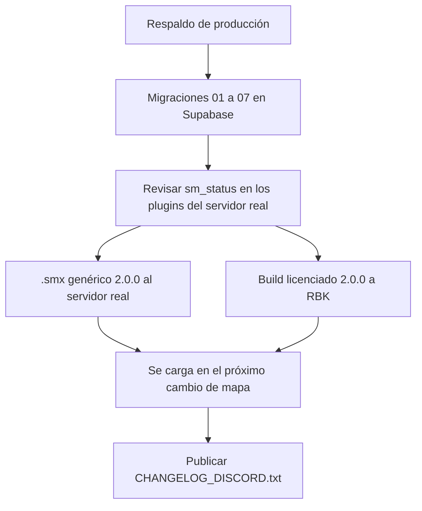

# `!match` y `!status`: guía de implementación

## Estado

Probado con bots en el servidor local, apuntado a la Supabase local (2026-10-15). **Sin desplegar y sin commit:** la migración `07` y el plugin 2.0.0 se despliegan en el corte del replanteo, en el servidor real y en RBK en la misma tanda.

## Archivos

| Archivo | Cambio |
|---|---|
| `supabase/replanteo/07_match_vincular.sql` | Revisada según este plan: lookup en texto con planteles y reglas, `csstv_steam2`, `csstv_link_game` con `p_side_a` verificado y la regla del tipo de partida, nombres de los equipos en el mix vinculado, ingesta con `link_side_a`, trigger de 5 jugadores para inscribirse a un torneo y 4 con cuenta en `pcw_make_side` |
| `docs/bitacora/2026-10-14-replanteo-modelo-datos/reversas/07_match_vincular.sql` | Inversa de la `07` revisada |
| `docs/bitacora/2026-10-14-replanteo-modelo-datos/pruebas/07_match_vincular.sql` | Pruebas de la `07` revisada (ver Pruebas) |
| `server/addons/sourcemod/scripting/csstv/match.inc` | Nuevo: `!match` |
| `server/addons/sourcemod/scripting/csstv/status.inc` | Nuevo: `!status` |
| `server/addons/sourcemod/scripting/csstv/json.inc` | `link_code` y `link_side_a` en el resultado |
| `server/addons/sourcemod/scripting/csstv_reporter.sp` | Versión 2.0.0; ganchos del vínculo; `!ready` espera las reglas del vínculo; recordatorio del calentamiento; refresco de la serie al volver al calentamiento |
| `web/backend/src/db/types.ts` | Tipos regenerados con la `07` |
| `docs/bitacora/2026-10-15-match-y-status/pruebas/servidor_local.sql` | Datos de prueba para la Supabase local: servidor, equipos Simbations y Strix con los SteamID falsos de los bots, una PCW BO3 y una final de torneo BO1 |
| `docs/bitacora/2026-10-15-match-y-status/pruebas/smx_grep.py` | Busca un texto dentro de un `.smx` (para revisar que ningún plugin registre `sm_status`) |
| `docs/GUIA_SERVIDOR.md` | `!status`, `!match` y la sección "Vincular a un torneo o PCW" |
| `docs/frontend/2026-10-14-decisiones-para-frontend.md` | Quién ve el código, reglas de plantel y el matchmaking eliminado |
| `docs/bitacora/2026-10-14-replanteo-modelo-datos/GUIA_IMPLEMENTACION.md` | Nota de revisión del paso 8 y paso 9 hecho |
| `supabase/replanteo/README.md` | Fila de la `07` |
| `docs/bitacora/2026-10-15-match-y-status/PRUEBAS_MANUALES.md` | Casos que quedan para probar con jugadores reales, cuando la web nueva esté más avanzada |
| `docs/bitacora/2026-10-15-match-y-status/CHANGELOG_DISCORD.txt` | Changelog 2.0.0 para los jugadores (se publica en el corte) |

`server/addons/sourcemod/plugins/csstv_reporter.smx` **no se actualizó**: sigue siendo la 1.8.0, la que corre hoy en el servidor real. La 2.0.0 se compila en el corte.

## Despliegue (pendiente: va en el corte)



1. **Base:** aplicar `supabase/replanteo/01` a `07`, en orden, dentro del corte (ver `supabase/replanteo/README.md`). La `07` necesita la `05` (`team_members`).
2. **`sm_status` en el servidor real:** bajar los `.smx` que solo están allá (`IGN`, `grenadedrop`, `spectatorswitch`, `CM_PickupWeapon`, `SendFileExploitFixV3.3`) y correr:

   ```bash
   python -I docs/bitacora/2026-10-15-match-y-status/pruebas/smx_grep.py sm_status <carpeta>/*.smx
   ```

   Ninguno tiene que decir `SÍ`. En los del servidor local (los de SourceMod, ClientMod, KACR y los de ExtremeHost) ya se revisó y no aparece.
3. **Plugin, nuestro servidor:** compilar el `.smx` genérico, **sin** `CSSTV_DEBUG`, con `spcomp` 1.8 (ver "Recompilar el plugin" en `docs/GUIA_SERVIDOR.md`). Subirlo por SFTP (`SFTP_CSS_*`), con el respaldo de la 1.8.0 en `plugins/disabled/`. No recargar con una partida en curso.
4. **Plugin, RBK:** `server/build_licenciado.sh <license_key> <slug>` y subirlo por su acceso (`SERVER1_*`). Nunca el genérico.
5. **Verificar en cada servidor:**
   - `sm_csstv_status` dice `v2.0.0`.
   - `!status` responde.
   - `!match ZZZZZ` responde "No hay ninguna partida con ese código", lo que confirma que la consulta llega a la base.
6. **Changelog:** publicar `CHANGELOG_DISCORD.txt`.
7. **Al terminar:** actualizar `docs/PENDIENTES.md` y la fila del índice, nombrando cada servidor.

El plugin 2.0.0 **necesita** la `07`: sin `csstv_match_lookup`, `!match` responde que no puede consultar la web. Lo demás del plugin funciona igual.

## Pruebas

### Base (Supabase local)

`docs/bitacora/2026-10-14-replanteo-modelo-datos/pruebas/correr.sh` aplica cada migración del replanteo, corre su prueba, verifica que una segunda aplicación aborte y que la inversa deje la estructura idéntica (tablas, funciones y triggers). **Pasa completo con 01 a 07** (última corrida: 2026-10-15, con el cambio de los nombres).

`pruebas/07_match_vincular.sql` cubre:
- **Códigos:** automáticos y con el formato correcto; un mix no acepta código.
- **Lookup:**
  - El texto con títulos de torneo y PCW, planteles en `STEAM_0:X:Y`, reglas y código.
  - Código en minúscula.
  - Token inválido, código inexistente y partida terminada.
  - `csstv_steam2`.
- **Plantel con suplentes:** Beta tiene 7 en el plantel; el lookup trae los 7 y juegan 5.
- **Torneo BO1 con los bandos cruzados:** queda vinculado con `parent_side1 = 2` y los nombres de los equipos; la partida queda terminada con su ganador; las stats cuentan una vez; un reenvío no suma el mapa.
- **Torneo que no cumple:** con un stand-in o con el lado declarado al revés, queda como mix y la partida no se toca. Sin `link_side_a`, el lado se deduce por mayoría.
- **PCW BO3:** con 3 inscritos y 2 stand-ins por lado, el mapa 1 deja la serie `live` 1-0 y el mapa 2 la termina 2-0. Con 2 inscritos queda como mix.
- **Reglas de la web:** inscripción a un torneo con 4 jugadores (rechazada) y con 5 (aceptada); PCW con 3 jugadores con cuenta (rechazada) y con 4 (aceptada).

El ensayo del ELO (`pruebas/ensayo_elo.sh`, con la copia de producción) dio **idéntico** con 01 a 07 antes del último ajuste. El ajuste solo cambia `side1_name` y `side2_name` de los mixes vinculados, que en producción no existen todavía, así que no se volvió a correr.

### Plugin (servidor local, con bots)

**Preparación:**
- Build de depuración (`CSSTV_DEBUG`) instalada en el servidor local, con el cfg apuntado a la Supabase local (`csstv_api_url` local, anon key local y token `tok-servidor-local`).
- Base local reseteada con 01 a 07 y cargada con `pruebas/servidor_local.sql`.
- 13 bots renombrados con `sm_rename`: Simba1 a Simba5, Strix1 a Strix5 y Stand1 a Stand3. Con `CSSTV_DEBUG`, el SteamID falso se calcula con el nombre actual.
- Los comandos de los bots se ejecutaron con `csstv_debug_fakecmd`, y los equipos se vieron con un plugin auxiliar de prueba (`zz_teams`, solo en el servidor local y borrado al terminar).

| Caso | Resultado |
|---|---|
| Un no inscrito (Stand1) escribe `!match` | Rechazado: "Solo pueden vincular jugadores inscritos en Simbations o en Strix (o un admin)" |
| Código mal formado (`ABC`) / inexistente (`ZZZZZ`) | "El código tiene 5 letras o números…" / "No hay ninguna partida con ese código" |
| Simba1 propone la PCW | Pendiente, con aviso en el chat; `!status` lo muestra como pendiente |
| Simba2 (mismo equipo) y Stand3 (no inscrito) intentan confirmar | Rechazados, cada uno con su mensaje |
| Strix1 confirma | Vinculado. Los 10 inscritos quedan en su lado (estaban mezclados entre CT y T) y los 3 stand-ins van a espectador |
| Stand1 entra con Simbations completo | "El lado de Simbations ya tiene 5 jugadores" |
| Strix1 intenta pasarse a CT | "Sos de Strix: tu equipo juega de T" |
| Tercer stand-in (Stand3) con 2 ya adentro | "Simbations ya tiene sus 2 stand-ins" |
| Todos listos con 2 inscritos y 2 stand-ins | `!ready` no arranca: "Simbations: faltan 1 inscritos". El mensaje se cambió después (ver la fila de la segunda tanda) |
| `!status` en el calentamiento | Las seis líneas, con "Vinculado a PCW: Simbations vs Strix · BO3 · serie 0-0 · código XGVKX" |
| Con 3 inscritos y 2 stand-ins, todos listos | Arranca, con los nombres de los equipos de la web |
| Mapa 1 (Strix gana 2-0) | El mix queda vinculado (`parent_side1 = 1`, Stand1 y Stand2 como invitados) y la PCW queda `live` 0-1 |
| Cambio de mapa | El vínculo sigue y `!status` dice "serie 0-1" |
| Mapa 2 (Simbations gana) | PCW `live` 1-1 |
| Mapa 3: Stand1 intenta desvincular en vivo / Strix2 desvincula | Rechazado / "al terminar se guarda como un mix común"; el juego queda como mix sin padre y la serie sigue 1-1 |
| Un admin vincula solo | Vinculado sin confirmación ("confirmado por Stand3") |
| Mapa 4 (Strix gana) | PCW `finished` 1-2, ganador Strix, 3 mapas |
| Vuelta al calentamiento con la serie terminada | "La partida vinculada … ya no está abierta: Esa partida ya terminó o fue cancelada. Se desvincula." |
| Torneo forzado con `!live` y un stand-in | Aviso al empezar; la base no lo vincula: la partida de torneo sigue `upcoming` y el juego queda como mix con Stand1 de invitado |

**Segunda tanda (2026-10-15, después de las dudas de Daniel):**

| Caso | Resultado |
|---|---|
| Todos listos con 2 jugadores del plantel y 2 stand-ins | "Simbations necesita al menos 3 jugadores de su plantel en su lado (hay 2)" |
| Fin de un juego de la serie con Simbations de T después del medio tiempo | El refresco deja a cada equipo donde quedó ("Strix juega de CT y Simbations de T"), los 2 stand-ins siguen en su lado y Strix1 no puede pasarse a T. Antes del arreglo, el plugin seguía creyendo que Simbations era CT y `!ready` se habría bloqueado en el mapa siguiente (en la primera tanda los lados se acomodaron a mano y no se vio) |

Lo que falta probar con jugadores reales está en [`PRUEBAS_MANUALES.md`](PRUEBAS_MANUALES.md).

**No se probó con bots:**
- **Un stand-in que entra solo a su lado** (el `jointeam` que el plugin deja pasar). Cualquier `jointeam` de un bot que procesa el motor tira el servidor, también sin el plugin (ver Incidentes). Los stand-ins se metieron con `!team`. El camino permitido solo devuelve `Plugin_Continue`.
- **Un inscrito que se conecta con el vínculo activo** (`Match_OnClientJoin`): los bots se conectan con el nombre de su perfil y se renombran después.
- **`!status` en pausa.** En vivo se vio la línea del vínculo.
- **Proponer y confirmar en el torneo:** el camino es el mismo que en la PCW. El vínculo del torneo lo hizo un admin (ver Incidentes).

Al terminar se restauraron el cfg, el `.smx` 1.7.0 (83946 bytes), la licencia, `admins_simple.ini` y `admin_overrides.cfg` del servidor local, que quedó apagado y con la cola vacía.

## En qué se apartó del plan

- **`Accept: text/plain` no sirve:** PostgREST responde 406. El plugin recibe el string JSON y lo desescapa. El plan dejaba las dos opciones abiertas.
- **`!status` en su propio archivo** (`csstv/status.inc`), una de las dos opciones del plan.
- **Nombres en el mix vinculado:** el plan no lo decía. La ingesta nombra los bandos "Equipo <nick>", así que el mix vinculado quedaba "Equipo Simbations". Ahora `csstv_link_game` les pone el nombre de cada equipo. Un mix sin vincular (o que la base rechaza) sigue con "Equipo <nombre>".
- **Recordatorios:** el recordatorio periódico del calentamiento también muestra el vínculo pendiente o activo. No estaba en el plan.
- **Un admin también puede confirmar** un vínculo pendiente, además de vincular solo.

## Incidentes durante las pruebas

- **El cfg no se pudo editar con un heredoc:** las barras invertidas del regex se rompían en el shell. Se resolvió con un script en archivo.
- **El servidor tomó la interfaz de Docker** (`172.24.0.1`) en vez de la VPN, así que RCON se usó por esa dirección.
- **Crash con `jointeam` de bots:** cualquier `jointeam` de un bot que procesa el motor tira el servidor. Se reprodujo con `csstv_reporter` descargado, así que es un límite de los bots de CS:S y no del plugin. Los bots se movieron con `!team`, que usa `ChangeClientTeam`.
- **Admin por nombre:** un admin por nombre en `admins_simple.ini` sin contraseña hace que SourceMod eche al bot con ese nombre. Se usó un override temporal de `sm_live` sin flags. Al sacarlo, `sm_reloadadmins` no le devolvió el flag al comando, así que en el resto de esa sesión cualquier jugador contaba como admin para `!match`. Por eso el vínculo del torneo lo hizo Strix2 solo. Se reinicia con el servidor. Los dos archivos se restauraron.
- **Mensaje de `!ready`:** "faltan 1 inscritos" se prestaba a confusión con los suplentes. Pasó a "necesita al menos 3 jugadores de su plantel en su lado (hay 2)", probado en la segunda tanda.
- **Lados en el mapa siguiente de una serie:** el plugin no volvía a armar los lados (el plan lo pedía). Se arregló con `Link_AdoptSides` y `Link_Arrange(true)` en el refresco, y el acomodo de quien entra pasó a hacerse para todos juntos. Probado con bots al terminar un juego; el cambio de mapa real queda en las pruebas manuales.

## Cómo revertir

- **Antes del corte:** no hay nada desplegado. Alcanza con descartar los cambios sin commit.
- **Después del corte, base:** aplicar `docs/bitacora/2026-10-14-replanteo-modelo-datos/reversas/07_match_vincular.sql`. Borra los códigos y los vínculos (los mixes quedan como mixes comunes) y vuelve a la ingesta y a `pcw_make_side` de la `06`.
- **Después del corte, plugin:** volver a la 1.8.0 desde `plugins/disabled/` en el servidor real, y a la build licenciada 1.8.0 en RBK, en la misma tanda. La 1.8.0 no manda `link_code`, así que no necesita revertir la base.
