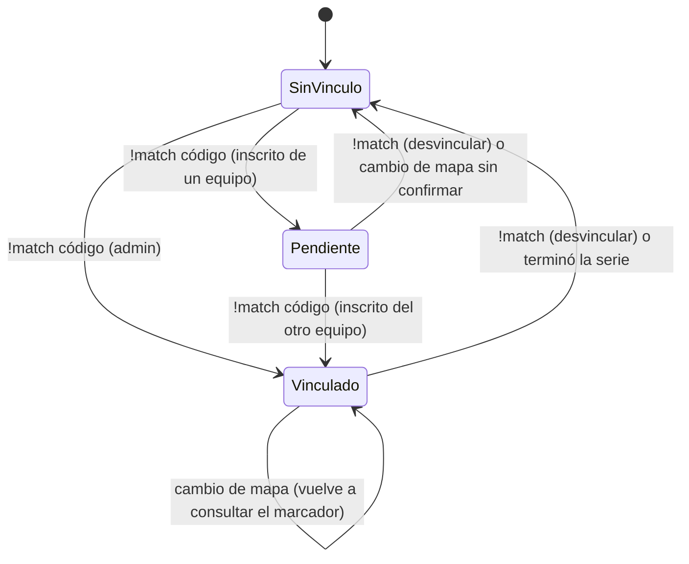

# Plan: `!match` (vincular una partida del servidor a un torneo o PCW) y `!status`

> Planeación original. Estado: **propuesta**, pendiente de aprobación.

La fase de replanteo (`2026-10-14-replanteo-modelo-datos`, sección 2.5) dejó planteado que una partida jugada en el servidor se pueda vincular a una partida de torneo o PCW con `!match <código>`, para que esos partidos sumen stats, ELO y resultado. La primera versión (migración `07_match_vincular.sql`, sin commit) resolvía la parte de la base, pero dejaba en el aire cómo funciona en el servidor:
- quién puede vincular cuando no hay un admin;
- qué pasa con los suplentes y los stand-ins;
- cómo se arman los equipos;
- cómo se desvincula.

Este plan define el flujo completo en el servidor, ajusta la base y suma **`!status`**, un comando para que cualquiera vea cómo está configurada la partida.

Producción no se toca hasta el corte, igual que en el replanteo: las migraciones van en `supabase/replanteo/` y el plugin nuevo se sube con el resto.

## Decisiones tomadas

| Tema | Decisión | Por qué |
|---|---|---|
| Quién vincula | **Uno propone y el otro equipo confirma.** Cualquier jugador **inscrito** en uno de los dos equipos (en su plantel, con SteamID vinculado) escribe `!match <código>`. El vínculo queda **pendiente** hasta que un inscrito **del otro equipo** escriba el mismo `!match <código>`. Un **admin** puede vincular solo, sin confirmación | Casi nunca hay un admin. Pedir los dos capitanes es frágil (el capitán puede no jugar o no estar). Un inscrito de cada lado alcanza para que los dos equipos estén de acuerdo, y nadie puede vincular un mix cualquiera a un partido oficial por su cuenta |
| Quién ve el código | En la web, **solo los integrantes de los dos equipos** (y admin). En el servidor, `!status` lo muestra | El código no da poder por sí solo, porque hace falta la confirmación del otro equipo |
| Cuándo se puede vincular | Solo **antes de que todos estén listos**: en el calentamiento, hasta que arranca por `!ready`, o hasta que un admin la arranca con `!live` | Una vez empezada, los equipos ya están armados |
| Desvincular | **`!match` sin código** desvincula siempre. Lo puede hacer un inscrito de cualquiera de los dos equipos o un admin. Si la partida ya empezó, avisa que al terminar se guarda como mix común | No tiene riesgo: como mucho, el juego queda como mix |
| Armado de equipos | Con el vínculo confirmado, el plugin **pone a cada inscrito en el lado de su equipo** y no lo deja pasarse al rival. Los que no están en ninguno de los dos planteles van a **espectador** y entran solos al lado que les corresponde, dentro de los cupos | Simbations contra Strix se arma solo. Los stand-ins saben a qué equipo van |
| Cupos por lado | **5 jugadores por lado** como máximo | Formato 5 contra 5 |
| Torneo | **Sin stand-ins:** cada lado juega solo con inscritos de su equipo. Para **inscribir un equipo en un torneo** hacen falta **5 jugadores** en su plantel | Decisión de Daniel |
| PCW | Para **publicar o aceptar** una PCW hacen falta **4 inscritos** en el roster. En el servidor, cada lado tiene hasta **2 stand-ins**, que no necesitan cuenta en la web: al menos 3 inscritos y 5 en total | Decisión de Daniel |
| Inicio | Con un vínculo activo, `!ready` no arranca hasta que **cada lado cumple su regla**. Torneo: 5 inscritos de su equipo. PCW: hasta 5 jugadores, con al menos 3 inscritos. `!live` (admin) arranca igual, pero el mensaje avisa si no se cumple | Un partido oficial no empieza mal armado. El admin puede forzarlo |
| Series | El vínculo **se mantiene entre mapas** hasta que la serie termina (BO3 o BO5) o alguien lo desvincula. Al cambiar de mapa, el plugin vuelve a consultar el marcador de la serie y vuelve a armar los equipos | Nadie tiene que repetir `!match` en cada mapa |
| Qué equipo es cada bando | El **plugin lo sabe**, porque armó los lados, y lo manda en el resultado. La base lo **verifica** contra la mayoría de inscritos. Si no coincide, el juego queda como mix común y la partida oficial no se toca | Ya no hay que adivinarlo al final. La verificación evita un plugin desconfigurado o un juego mal armado |
| Cómo se guarda | Como en la primera versión: **el juego es su propia fila** (mix con stats, demo y ELO) **vinculada** a la partida oficial, que **acumula el resultado mapa por mapa** | Funcionan las series, cada mapa conserva su demo y las stats y el ELO no se cuentan dos veces |
| `!status` | Comando nuevo para **cualquiera**, incluidos espectadores. Muestra el estado, el formato, el inicio, las pausas, `!gg`, el vínculo y la demo | Hoy un jugador no tiene forma de ver cómo está configurada la partida. `sm_csstv_status` (RCON, técnico) se queda como está |
| Formato de la consulta | La consulta del plugin devuelve **texto de líneas `clave=valor`**, no JSON | El plugin no tiene lector de JSON (SourceMod 1.8, el de RBK, no lo trae) y hoy lee las respuestas buscando texto |
| Versión del plugin | **2.0.0** | Depende del esquema del replanteo (`winner_side`, bandos y `team_members`). Se despliega solo en el corte, en el servidor real y en RBK en la misma tanda |

## 1. El flujo completo

```mermaid
sequenceDiagram
  participant S as Jugador de Simbations
  participant X as Jugador de Strix
  participant P as Plugin
  participant DB as Supabase
  S->>P: !match K7Q2M
  P->>DB: csstv_match_lookup(token, K7Q2M)
  DB-->>P: PCW · Simbations vs Strix · BO3 · 1-0 · planteles
  P-->>S: "Pendiente: falta que confirme alguien de Strix"
  X->>P: !match K7Q2M
  P->>P: vínculo confirmado
  P->>P: inscritos a su lado · el resto a espectador · nombres de los lados
  Note over P: los stand-ins entran solos (hasta 2 por lado en PCW, ninguno en torneo)
  S->>P: !ready (todos)
  P->>P: ¿cada lado cumple su regla? → cuchillo → LO3 → partida
  P->>DB: ingest_server_match(payload + link_code + qué equipo jugó en el bando a)
  DB->>DB: guarda el juego (mix: stats, demo, ELO)
  DB->>DB: verifica los bandos contra la mayoría de inscritos
  DB->>DB: la partida suma el mapa; si alguien ganó la serie, termina
  P->>DB: (siguiente mapa) csstv_match_lookup → marcador de la serie
```

**Estados del vínculo en el plugin:**



## 2. Base de datos (ajustes a `supabase/replanteo/07_match_vincular.sql`)

`07` todavía no tiene commit: se ajusta en lugar de sumar otra migración.

**Se queda de la primera versión:**
- `matches.link_code` (5 caracteres sin ambiguos, automático en torneo y PCW).
- `parent_match_id` y `parent_side1`.
- `csstv_link_game`, que suma el mapa a la partida y la cierra cuando alguien gana la serie.
- El llamado desde `csstv_ingest`.

**Cambios:**

1. **`csstv_match_lookup` devuelve texto, una línea `clave=valor` por dato:**

   ```
   ok=1
   kind=pcw
   title=PCW: Simbations vs Strix
   best_of=3
   score1=1
   score2=0
   team1=Simbations
   team2=Strix
   t1=76561198000000001,76561198000000002,...   (SteamID64 del plantel activo de team1)
   t2=76561198000000101,...
   max_standins=2                               (0 en torneo)
   min_roster=3                                 (5 en torneo)
   code=K7Q2M
   ```

   - **El `title`:**
     - Torneo: `Titan 3 · Semifinal: Simbations vs Strix`, con el nombre del torneo (`events.name`) y la etapa (`matches.stage`).
     - PCW: `PCW: Simbations vs Strix`.
   - **Errores:** van como `ok=0` y `error=<mensaje para el chat>` ("No hay ninguna partida con ese código", "Esa partida ya terminó", "La partida todavía no tiene los dos equipos"). Así el plugin no tiene que interpretar códigos HTTP.
   - **Formato de la respuesta:** PostgREST devuelve un resultado `text` como string JSON. El plugin lo pide con `Accept: text/plain` para recibirlo tal cual. Si eso no funciona en System2, el plugin desescapa el `\n` del string. Se decide al implementar, probándolo.
2. **El resultado indica qué equipo jugó en el bando a.** El plugin agrega `link_side_a` (1 = `team1`, 2 = `team2`) al payload. `csstv_link_game` deja de adivinar:
   - **Verifica** contra la mayoría de inscritos que la orientación declarada no esté invertida. Si la mayoría dice lo contrario, o no hay inscritos de los dos lados, el juego queda como mix común y avisa (`notice`).
   - **Verifica la regla del tipo de partida** con los jugadores que tienen stats en el juego:
     - **Torneo:** todos los de cada bando tienen que ser inscritos de su equipo (sin stand-ins).
     - **PCW:** al menos 3 inscritos por bando.

     Si no se cumple, queda como mix común. Es la segunda barrera; la primera es el plugin al dar `!ready`.
3. **Reglas de inscripción en la web**, en la base para que valgan venga de donde venga:
   - **Inscripción a un torneo:** el equipo tiene que tener **al menos 5 jugadores activos** en `team_members`. Lo controla un trigger en `tournament_registrations`.
   - **Publicar o aceptar una PCW:** el roster tiene que tener **al menos 4 jugadores con cuenta** (`p_players`). Se ajustan `pcw_make_side`, que hoy acepta de 1 a 7 entre jugadores e invitados, y los mensajes de error. Los invitados declarados al crear la PCW (`teams.guests`) siguen permitidos como referencia, pero **en el servidor cuentan como stand-ins**, porque no se los puede identificar por SteamID.
4. **Pruebas** (`pruebas/07_match_vincular.sql`). Se suman a las de la primera versión:
   - El formato de texto del lookup (con título de torneo y de PCW, planteles y reglas).
   - `link_side_a` coherente, invertido (queda como mix) y sin inscritos.
   - Torneo con un stand-in (queda como mix).
   - PCW con 3 inscritos y 2 stand-ins (se vincula) y con 2 inscritos (queda como mix).
   - Inscripción a un torneo con 4 jugadores (rechazada) y con 5 (aceptada).
   - PCW con 3 jugadores con cuenta (rechazada) y con 4 (aceptada).

   Siguen corriendo el ciclo de `correr.sh` y el ensayo del ELO.

## 3. Plugin (`csstv_reporter` 2.0.0)

**Archivo nuevo `csstv/match.inc`** (vínculo) y `!status` en `csstv/qol.inc` o en un `csstv/status.inc` aparte.

**Comandos:**

| Comando | Quién | Qué hace |
|---|---|---|
| `!match <código>` | Inscrito de cualquiera de los dos equipos, o admin | Sin vínculo: consulta y queda **pendiente**; con un admin, queda **vinculado**. Pendiente, si lo escribe alguien del otro equipo: **vinculado**. Solo antes de que todos estén listos |
| `!match` | Inscrito de los dos equipos, o admin | Desvincula. Si la partida ya empezó: "al terminar se guarda como mix" |
| `!status` | Cualquiera | Muestra el estado (ver abajo) |

**Al confirmar el vínculo:**
1. **Nombres de los lados:** se ponen con los de los equipos, igual que con `!team`.
2. **Lados de los inscritos:** cada inscrito presente pasa al lado de su equipo. Por ejemplo, `team1` a CT y `team2` a T; después el cuchillo decide quién elige lado.
3. **El resto, a espectador:** al cambiar de equipo, el plugin controla:
   - que un inscrito no se pase al rival;
   - que nadie entre a un lado con 5;
   - que un no inscrito no entre si ese lado ya tiene sus stand-ins (2 en PCW, 0 en torneo).
4. **Mensaje** en el chat para todos: "Vinculado a PCW: Simbations vs Strix (BO3, 1-0). Los stand-ins entren al lado de su equipo".

**Inicio:**
- **Con `!ready`:** si hay vínculo, además del mínimo de jugadores de siempre, cada lado tiene que cumplir su regla. Si no, el plugin dice qué falta ("Strix: faltan 2 inscritos").
- **Con `!live`** (admin): arranca igual, con un aviso.
- **Un vínculo pendiente** (sin confirmar) **no impide arrancar**, pero se descarta y el juego queda como mix común, con aviso.

**Durante la partida:** sigue `csstv_lock_teams`. Si alguien se desconecta y vuelve, vuelve a su lado.

**Al terminar:** el payload lleva `link_code` y `link_side_a`. Si la serie sigue (BO3 o BO5), el vínculo se mantiene y en el próximo mapa el plugin vuelve a consultar y a armar los equipos. Si terminó, se borra.

**`!status`**, para cualquiera:

```
[v34frag] Estado: calentamiento · 7/10 listos (!ready)
[v34frag] Formato: MR15 (30 rondas) · prórroga MR12 con $10000
[v34frag] Inicio: !ready con faka (ronda de cuchillo), LO3, mínimo 8 jugadores
[v34frag] Pausas: 2 por equipo de 60 s · !gg con 8 rondas abajo
[v34frag] Vinculado a PCW: Simbations vs Strix · BO3 · serie 1-0 · código K7Q2M
          (o "Pendiente: falta que confirme alguien de Strix (código K7Q2M)")
          (o "Sin vincular: se guarda como mix")
[v34frag] Demo: grabando
```

- **Durante la partida:** en lugar de "calentamiento", muestra el marcador, la mitad o la prórroga en curso, y si hay pausa.
- **Origen de los datos:** los cvars que ya existen (`csstv_maxrounds`, `csstv_overtime`, `csstv_ot_maxrounds`, `csstv_ot_startmoney`, `csstv_ready_knife`, `csstv_lo3`, `csstv_min_players`, `csstv_pause_*`, `csstv_gg_min_diff`, `csstv_demo`) y el estado del vínculo.
- **Antes de usar el nombre:** revisar en `docs/PLUGINS_EXTERNOS.md` y en los plugins del servidor real que ninguno registre ya `sm_status`.

**Compatibilidad:** se mantiene la compilación para SourceMod 1.8 (RBK) y 1.10 (servidor real). La consulta usa System2, como la licencia y los envíos.

## 4. Web y backend

- **Web vieja:** no se toca. No muestra el código; el vínculo está pensado para la web nueva.
- **Backend:** cuando se hagan los endpoints de partidas, el detalle de una partida de torneo o PCW devuelve `link_code` **solo** si quien consulta es integrante de uno de los dos equipos o admin, junto con los juegos vinculados (`parent_match_id`). Va en la entrega de los endpoints de dominio, no en esta.
- **Resumen para el frontend** (`docs/frontend/2026-10-14-decisiones-para-frontend.md`):
  - El código lo ven solo los integrantes de los dos equipos.
  - El flujo de proponer y confirmar.
  - `!status`.
  - Las reglas de 5 inscritos para torneos y 4 para PCW.

## 5. Pruebas

- **Base:** `correr.sh` (ciclo de las migraciones, con la inversa idéntica), las pruebas de `07` ampliadas y el ensayo del ELO (idéntico).
- **Plugin:** en el **servidor local** (`E:\CSS DEDICATED SERVER`) **apuntado a la Supabase local**.
  - **Preparación:**
    - Un servidor y su token creados en la base local.
    - Dos equipos con planteles de SteamIDs de bots (`csstv_include_bots 1`, como en pruebas anteriores).
    - Una PCW y una partida de torneo.
  - **Casos:**
    - Proponer y confirmar con dos "jugadores" (`csstv_debug_fakecmd`).
    - Un admin solo.
    - Intento desde un no inscrito (rechazado).
    - Desvincular.
    - Armado automático de los lados y stand-ins en espectador.
    - Cupos (6.º jugador y 3.er stand-in rechazados).
    - `!ready` que no arranca si falta un inscrito.
    - BO3 con dos mapas: el vínculo se mantiene y la serie termina.
    - `!status` en el calentamiento, en la partida y en pausa.
  - **Al terminar,** el cfg del servidor local vuelve a como estaba.
- **Cuidados del servidor local:** hoy **manda a la Supabase real**. Antes de cada prueba se verifica que el cfg apunte a la local, se vacía `data/csstv/queue/`, y se usa `csstv_send 0` cuando no se quiere enviar.

## 6. Requisitos antes de empezar

- **Aprobación de este plan.**
- Docker y la Supabase local (ya funcionando).
- El servidor local de pruebas con SourceMod 1.10 y la build de depuración (ya se usó en 1.6.0 a 1.8.0).
- **Permiso para cambiar temporalmente el cfg del servidor local** para que apunte a la Supabase local.

## 7. Orden de implementación

1. **Base:** ajustar `07` (lookup en texto con planteles y reglas, `link_side_a` verificado, regla del tipo de partida, 5 jugadores para inscribirse a un torneo, 4 para una PCW), con sus pruebas, su inversa y el ensayo del ELO.
2. **Plugin, `!status`:** es lo más simple y sirve para ver el estado mientras se prueba lo demás.
3. **Plugin, `!match`:** consulta, proponer y confirmar, desvincular y mensajes.
4. **Plugin:** armado automático de los lados, cupos, stand-ins y regla para `!ready`.
5. **Plugin:** payload con `link_code` y `link_side_a`, y vínculo entre mapas en series.
6. **Pruebas con bots** contra la Supabase local, y cfg del servidor local restaurado.
7. **Documentación:** `DOCUMENTACION.md`, `GUIA_IMPLEMENTACION.md`, `docs/GUIA_SERVIDOR.md` (los comandos nuevos), el resumen para el frontend y `CHANGELOG_DISCORD.txt` (`v34frag 2.0.0 --  Changelog`), que se publica recién en el corte.
