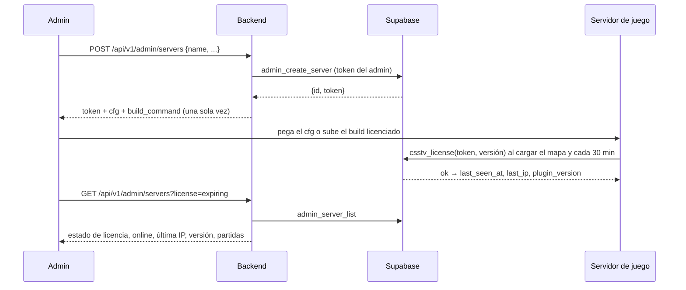
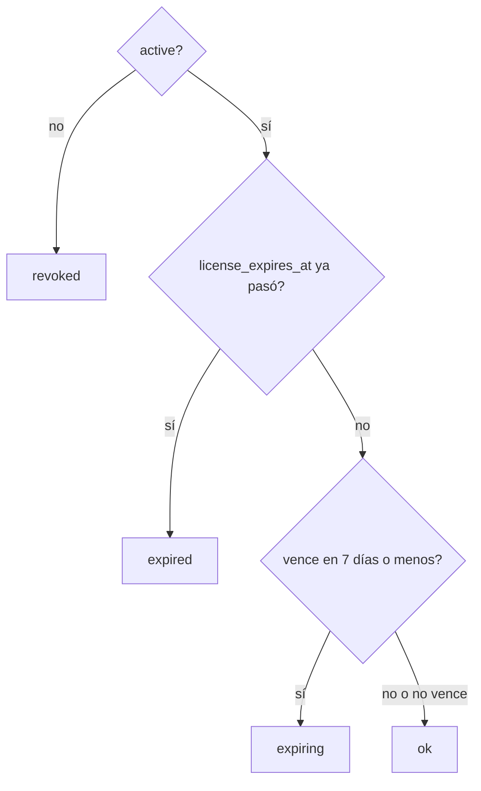

# Endpoints de admin de servidores: documentación

## Qué hace

El admin gestiona los servidores de juego (`game_servers`) desde la API nueva, en `/api/v1/admin/servers`:
- Alta con el token, las líneas del cfg y el comando del build licenciado.
- Edición del nombre, la dirección para "Conectar", el id del panel de Pterodactyl, el vencimiento de la licencia y la IP permitida.
- Revocar, reactivar y generar un token nuevo.
- Borrar un servidor que no tiene partidas.
- Listado paginado, con filtros por estado de licencia y por "en línea".

El plugin no cambia: la licencia sigue funcionando como desde la 1.5.0 (`csstv_license` y `csstv_check_token`, ver [`2026-10-13-licencia-servidores`](../2026-10-13-licencia-servidores/DOCUMENTACION.md)).



## Endpoints

Todos piden sesión de admin (`requireUser` + `requireAdmin`) y usan el token del admin, así que la RLS "servidores: admin gestiona" sigue mandando.

| Endpoint | Qué hace |
|---|---|
| `GET /api/v1/admin/servers` | Listado. Filtros: `q`, `active`, `license`, `online`, `has_panel`. `sort`: **`name` asc**, `created_at`, `last_seen_at`, `license_expires_at`, `matches` |
| `GET /api/v1/admin/servers/{id}` | Un servidor. `404` si no existe |
| `POST /api/v1/admin/servers` | Alta. `201` con `{ id, token, cfg, build_command }`. Nombre repetido: `409` |
| `PATCH /api/v1/admin/servers/{id}` | Edita los campos enviados (`null` o `""` borra) y `active`. Devuelve el servidor |
| `POST /api/v1/admin/servers/{id}/token` | Token nuevo (`rotate_server_token`): el anterior deja de servir y el servidor queda activo |
| `DELETE /api/v1/admin/servers/{id}` | `204`. Con partidas, `400 BUSINESS_RULE` "Este servidor tiene partidas: revocalo en vez de borrarlo" |

### Respuesta del alta y del token nuevo

```json
{
  "id": "4f0c…",
  "token": "csstv_…",
  "cfg": "csstv_api_url \"https://<proyecto>.supabase.co/rest/v1/rpc/ingest_server_chunk\"\ncsstv_api_key \"<anon key>\"\ncsstv_server_token \"csstv_…\"",
  "build_command": "server/build_licenciado.sh 4f0c… servidor-rbk"
}
```

- `cfg` usa `SUPABASE_URL` y `SUPABASE_ANON_KEY` de la configuración del backend (la anon key es pública).
- `build_command` lleva el id del servidor y un nombre corto sacado del nombre: minúsculas, sin tildes, con guiones (`shortName`).

### Validaciones

| Campo | Regla |
|---|---|
| `name` | De 2 a 40 caracteres, único sin distinguir mayúsculas ni espacios de los bordes |
| `connect_address` | `host:puerto` (el `check` que ya existía) |
| `panel_server_id` | De 8 a 36 letras, números o guiones (el `check` que ya existía) |
| `license_expires_at` | ISO 8601 con zona horaria. Sin valor, no vence |
| `allowed_ip` | IPv4 o IPv6, sin máscara. Sin valor, cualquier IP |

El esquema de la API valida antes de llamar a la base, y la base hace cumplir lo mismo con sus `check`.

## Estado de la licencia y "en línea"



- **`online`:** `last_seen_at` de hace menos de 35 minutos. `csstv_check_token` actualiza `last_seen_at` en cada validación (al cargar cada mapa y cada 30 minutos) y en cada subida de resultados.
- Un servidor `expiring` todavía juega; uno `expired` o `revoked`, no.

## Base de datos (`supabase/replanteo/12_servidores.sql`)

| Qué | Detalle |
|---|---|
| `game_servers_name_key` | Índice único sobre `lower(trim(name))` |
| `game_servers_name_len` | `check`: nombre de 2 a 40 caracteres |
| `is_ip(text)` | IPv4 o IPv6 sin máscara |
| `game_servers_allowed_ip_format` | `check`: `allowed_ip` nula o `is_ip` |
| `admin_create_server(...)` | Solo admin. Devuelve `(id, token)`; guarda solo el hash. Nombre repetido: error `23505` con "Ya hay un servidor con ese nombre" |
| Trigger `game_servers_no_borrar_con_partidas` | No deja borrar un servidor con partidas |
| Vista `admin_server_list` | `security_invoker`: solo la ve el admin. Sin `token_hash`, con `license_state`, `online`, `has_panel`, `matches`, `last_match_at` y `search` |
| `game_servers_public` | Solo activos con licencia vigente (la lista de `GET /api/v1/servers`) |
| `match_schedule` | Rechaza un servidor revocado o vencido: "Ese servidor no existe, no está activo o tiene la licencia vencida" |

`create_server_token` y `rotate_server_token` quedan como estaban.

La migración aborta si hay nombres repetidos o IPs permitidas inválidas. En la copia de producción del 2026-10-14 hay 3 servidores, sin nombres repetidos y sin IP permitida cargada.

## Qué no cubre

- Los tokens del Worker de demos (`demo_workers`): van con "demos desde el admin".
- El estado en vivo desde el panel de Pterodactyl (CPU, jugadores, reiniciar): se decidió no hacerlo por ahora.

## Dónde está cada cosa

| Qué | Archivo |
|---|---|
| Migración, inversa y pruebas | `supabase/replanteo/12_servidores.sql`, `docs/bitacora/2026-10-14-replanteo-modelo-datos/reversas/12_servidores.sql` y `…/pruebas/12_servidores.sql` |
| Esquemas | `web/backend/src/schemas/servers.ts` |
| Rutas | `web/backend/src/routes/admin-servers.ts` |
| Pruebas | `web/backend/test/unit/servers-routes.test.ts` y `web/backend/test/integration/servers.test.ts` |
| Contrato para el frontend | `docs/frontend/contract.md`, sección 9, "Servidores (admin)" |
