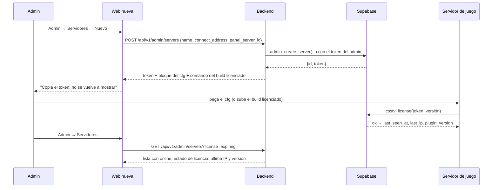
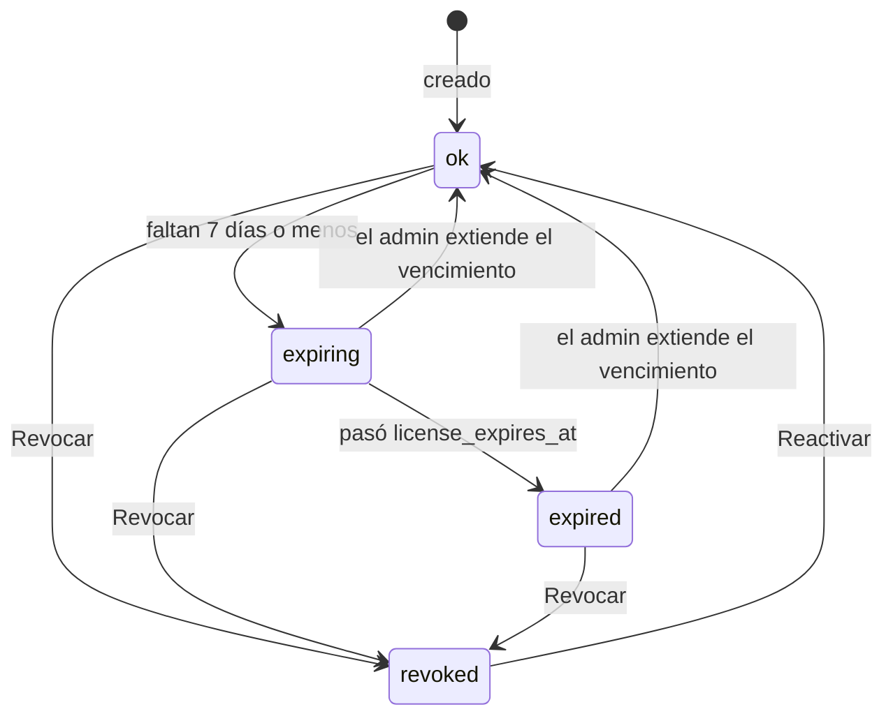

# Plan: endpoints de admin de servidores (tokens, licencias y panel)

> Planeación original. Estado: **propuesta**, pendiente de aprobación.

Hoy el admin gestiona los servidores desde la web vieja (Admin → Servidores), que escribe directo en `game_servers` y llama a `create_server_token` y `rotate_server_token`. Puede:
- Crear un servidor y ver su token una sola vez.
- Generar un token nuevo.
- Poner el vencimiento de la licencia y la IP permitida.
- Revocar y reactivar.

`connect_address` (la IP para el botón "Conectar") y `panel_server_id` (el id de Pterodactyl, que el Worker de demos usa para bajar las demos) **no tienen pantalla**: se cargan a mano con SQL.

Este plan pasa todo eso a la API nueva, con el listado paginado de siempre, y suma lo que faltaba. Producción no se toca hasta el corte: la migración va en `supabase/replanteo/` como `12`.

## Decisiones tomadas

| Tema | Decisión | Por qué |
|---|---|---|
| Qué cubre | Servidores de juego (`game_servers`): alta, edición, token, licencia, IP permitida, revocar, borrar, dirección de conexión e id del panel | Lo que lista `PENDIENTES.md` como "admin de servidores (tokens, licencias, panel)" |
| Qué no cubre | Los tokens del Worker de demos (`demo_workers`) y la configuración del ELO | Van en "demos desde el admin" y en "configuración del ELO", que tienen su propio plan |
| Token | Se sigue guardando **solo el hash**. El token se muestra una sola vez, al crear y al regenerar | Como hoy. Si se filtra la base, los tokens no sirven |
| Respuesta al crear o regenerar | El token, el bloque listo para pegar en el cfg del servidor (`csstv_api_url`, `csstv_api_key`, `csstv_server_token`) y el comando del build licenciado con el id del servidor | Hoy el id hay que buscarlo con SQL para `server/build_licenciado.sh` |
| Licencia y IP | Mismas reglas que hoy (`csstv_check_token`): vencimiento opcional, IP opcional. **No cambia nada en el plugin** | El plugin 2.0.0 está congelado y ya valida contra estas columnas |
| Estado de la licencia | Calculado en la base: `revoked`, `expired`, `expiring` (vence en 7 días o menos) u `ok` | Para filtrar y mostrar avisos sin cálculo en el frontend |
| "En línea" | `online = true` si el servidor validó la licencia en los últimos 35 minutos (`last_seen_at`) | El plugin valida al cargar cada mapa y cada 30 minutos. No hace falta el panel |
| Nombre | De 2 a 40 caracteres y **único sin distinguir mayúsculas** | Hoy se pueden repetir y en la lista no se distinguen |
| Borrar | **Solo un servidor sin partidas.** Con partidas, se revoca | Borrarlo dejaría sus partidas sin servidor (`on delete set null`) y el Worker no podría bajar sus demos pendientes |
| Servidores para asignar partidas | `GET /api/v1/servers` y `assign_match` (migración `10`) usan solo los **activos con licencia vigente** | Hoy un servidor vencido aparece para asignar, y ahí no se puede jugar |
| Dónde se controla | Las reglas (nombre único, borrar sin partidas) en la base; los formatos (IP, dirección, id del panel) también, con los `check` que ya existen más uno para la IP | Vale venga de donde venga el pedido |

## 1. El flujo completo

## 2. Base de datos (`supabase/replanteo/12_servidores.sql`)

1. **Nombre único:** índice único sobre `lower(trim(name))`. La migración **aborta** si hay nombres repetidos, con la lista, como la `09` con los alias. Antes se revisa la copia de producción (solo el conteo).
2. **Check de `allowed_ip`:** `null` o una IPv4/IPv6 válida (`allowed_ip::inet` sin máscara). La migración aborta si alguna fila no lo cumple.
3. **`admin_create_server(p_name, p_connect_address, p_panel_server_id, p_license_expires_at, p_allowed_ip)`:** `security definer`, solo admin. Devuelve `(id, token)`, porque `create_server_token` devuelve solo el token y el id hace falta para el build licenciado. `create_server_token` se deja como está.
4. **`rotate_server_token`:** se mantiene igual (devuelve el token nuevo y reactiva el servidor).
5. **Borrar solo sin partidas:** trigger `before delete` en `game_servers` que falla con "Este servidor tiene partidas: revocalo en vez de borrarlo" si hay alguna en `matches`.
6. **Vista `admin_server_list`** (`security_invoker`, así la RLS "servidores: admin gestiona" ya la limita al admin): todas las columnas menos `token_hash`, más:
   - `license_state` (`revoked`, `expired`, `expiring`, `ok`).
   - `online`.
   - `matches` (cantidad) y `last_match_at`.
   - `search` (nombre, dirección, IPs y versión, sin mayúsculas ni tildes).
7. **`game_servers_public` y `assign_match`:** solo activos y con licencia vigente. Se cambian con `pg_temp.reemplazar` y un comentario único `-- (replanteo 12)`, como en las anteriores.
8. **Inversa** (`reversas/12_servidores.sql`) y **pruebas** (`pruebas/12_servidores.sql`, dentro de un rollback):
   - Un no admin no puede crear ni ve la vista; el admin sí.
   - El token devuelto valida con `csstv_license`; el hash guardado no es el token.
   - Nombre repetido (con otras mayúsculas) falla; IP inválida falla.
   - Estados de licencia: sin vencimiento, a 3 días, vencida, revocado.
   - `online` con `last_seen_at` de hace 10 y de hace 60 minutos.
   - Borrar con partidas falla; sin partidas, borra.
   - Un servidor vencido no sale en `game_servers_public` y `assign_match` lo rechaza.

   Corre en el ciclo de `correr.sh` con 01 a 12.

## 3. Backend (`web/backend`)

Todo con `requireUser` + `requireAdmin`, con el token del admin (la RLS sigue mandando). Tag `Admin`.

| Endpoint | Qué hace |
|---|---|
| `GET /api/v1/admin/servers` | Listado con la convención de siempre. Filtros: `q`, `active`, `license` (`ok`, `expiring`, `expired`, `revoked`), `online`, `has_panel`. `sort`: **`name` asc**, `created_at`, `last_seen_at`, `license_expires_at`, `matches` |
| `GET /api/v1/admin/servers/{id}` | Un servidor, con los mismos campos. `404` si no existe |
| `POST /api/v1/admin/servers` | Body: `name` (obligatorio), `connect_address`, `panel_server_id`, `license_expires_at`, `allowed_ip`. `201` con `{ id, token, cfg, build_command }` |
| `PATCH /api/v1/admin/servers/{id}` | Cualquiera de: `name`, `connect_address`, `panel_server_id`, `license_expires_at`, `allowed_ip` (`null` borra), `active` (revocar o reactivar) |
| `POST /api/v1/admin/servers/{id}/token` | Token nuevo; el anterior deja de funcionar al instante. Responde `{ id, token, cfg, build_command }` |
| `DELETE /api/v1/admin/servers/{id}` | `204`. `400 BUSINESS_RULE` si tiene partidas |

- **`cfg`:** las tres líneas del cfg con la URL de Supabase y la anon key que el backend ya tiene en su configuración. **`build_command`:** `server/build_licenciado.sh <id> <nombre-corto>`, con el nombre corto sacado del nombre del servidor.
- **Errores:** nombre repetido `409 CONFLICT`; formatos inválidos `400 VALIDATION_ERROR` (se validan también en el esquema, con el mismo mensaje que la base).
- **Pruebas:** unitarias de los esquemas y del armado de `cfg` y `build_command`; de integración contra la base local con el ciclo completo (crear, validar el token con `csstv_license`, listar con cada filtro y orden, editar, regenerar y ver que el viejo deja de servir, revocar, borrar con y sin partidas, y un usuario común con `403`).

## 4. Contrato del frontend (`docs/frontend/contract.md`)

- Fila de `GET /api/v1/admin/servers` en la tabla de listados (sección 1).
- Sección de admin: "Servidores" con los endpoints, el aviso de que el token se muestra una sola vez y qué mostrar por estado de licencia.
- Sacar "admin de servidores" de "Lo que todavía no está definido".
- Fila en el registro de decisiones.

## 5. Propuesta para decidir: estado en vivo desde el panel

Con `panel_server_id` y la API de Pterodactyl (`PTERO_PANEL_*`, la misma que usa el Worker de demos), el backend podría mostrar si el servidor está prendido, CPU, memoria y jugadores conectados, y un botón para reiniciarlo.

- **Contras:** solo sirve para nuestro servidor (RBK está en otro panel, sin acceso por API); el backend tendría la clave del panel, que permite apagar el servidor; y reiniciar desde la web choca con la regla de no reiniciar con un mix en curso.
- **Propuesta:** **no hacerlo ahora.** `online` (por `last_seen_at`) alcanza para saber si el servidor está vivo, y vale para todos los servidores. Si más adelante hace falta, va con su propio plan.

## 6. Requisitos antes de empezar

- Base local con 01 a 11 (`pnpm db:reset` en `web/backend`).
- Revisar en la copia de producción (`~/.v34frag/prod-copy/`) que no haya nombres de servidor repetidos ni IPs inválidas en `allowed_ip` (solo conteos). Después, `pnpm db:reset`.
- Nada que instalar.

## 7. Orden de implementación

1. Migración `12`, inversa y pruebas; `correr.sh` con 01 a 12.
2. Tipos regenerados (`src/db/types.ts`).
3. Esquemas y rutas (`src/schemas/servers.ts`, `src/routes/admin-servers.ts`), y registrar la ruta.
4. Pruebas unitarias y de integración; `pnpm typecheck` y la cobertura.
5. Contrato, `supabase/replanteo/README.md`, la documentación del replanteo (fila 12), `PENDIENTES.md` (corte con 01 a 12) y el índice de la bitácora.
6. `DOCUMENTACION.md` y `GUIA_IMPLEMENTACION.md` de esta bitácora.
