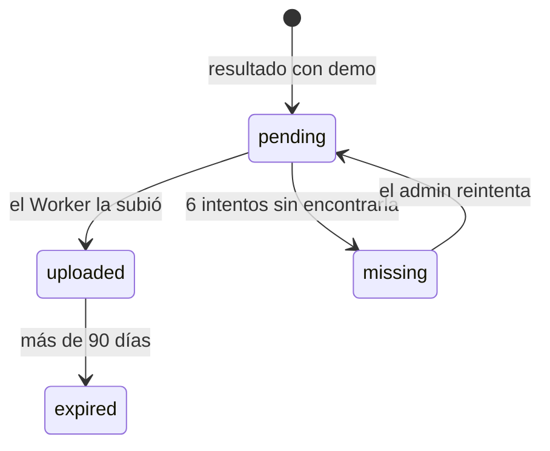
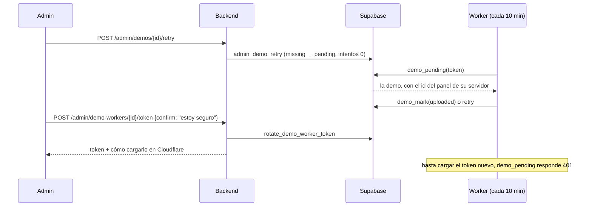

# Demos desde el admin: documentación

## Qué hace

El admin ve y gestiona las demos de los mixes (y de cada mapa de una PCW o partida de torneo jugada con `!match`) desde la API nueva:
- **Resumen:** cantidad por estado, espacio en R2, la pendiente más vieja y si el Worker está corriendo.
- **Listado:** cada partida con demo, con estado, tamaño, intentos, vencimiento, servidor y link de descarga.
- **Reintentar** una demo perdida (`missing`): vuelve a la cola del Worker.
- **Tokens del Worker de demos** (`demo_workers`): alta, token nuevo (con doble confirmación), revocar, reactivar y borrar.

El Worker, R2 y el plugin no cambian. Cómo se graban y se suben las demos: [`2026-10-12-demos-r2-worker`](../2026-10-12-demos-r2-worker/DOCUMENTACION.md).

## Endpoints

Todos piden sesión de admin y usan su token.

| Endpoint | Qué hace |
|---|---|
| `GET /api/v1/admin/demos/summary` | El resumen |
| `GET /api/v1/admin/demos` | Listado. Filtros: `status`, `server`, `kind`, `from`, `to`, `q`. `sort`: **`played_at` desc**, `demo_size`, `demo_attempts`, `demo_uploaded_at`, `expires_at` |
| `POST /api/v1/admin/demos/{matchId}/retry` | Reintentar. `204`, o `400 BUSINESS_RULE` con el motivo |
| `GET /api/v1/admin/demo-workers` | Listado. Filtros: `q`, `active`, `online`. `sort`: **`name` asc**, `created_at`, `last_seen_at` |
| `POST /api/v1/admin/demo-workers` | Alta. `201` con `{ id, token, secret_command }`. Nombre repetido: `409` |
| `PATCH /api/v1/admin/demo-workers/{id}` | `name` o `active`. Devuelve el Worker |
| `POST /api/v1/admin/demo-workers/{id}/token` | Token nuevo. Pide `confirm: "estoy seguro"` |
| `DELETE /api/v1/admin/demo-workers/{id}` | `204` |

### Listado de demos

| Campo | Detalle |
|---|---|
| `demo_status` | `pending`, `uploaded`, `missing` o `expired` (las partidas sin demo no aparecen) |
| `demo_size` | Bytes |
| `expires_at` | `demo_uploaded_at` + 90 días, solo las subidas |
| `demo_url` | La descarga del Worker (`<DEMO_BASE_URL>/demo/<id>`), solo las subidas, armada como en el detalle de partida |
| `server` | `{ id, name, has_panel }`; `has_panel` dice si tiene `panel_server_id` |
| `can_retry` | `missing` y servidor con id del panel |

### Reintentar

| Estado | Resultado |
|---|---|
| `missing`, servidor con id del panel | Pasa a `pending` con `demo_attempts = 0` |
| `missing`, servidor sin id del panel | "El servidor de esta partida no tiene id del panel: el Worker no puede bajar la demo" |
| `pending` | "La demo ya está en la cola del Worker" |
| `uploaded` | "La demo ya está subida" |
| `expired` | "La demo venció: ya no está en R2 ni en el servidor" |

Si el archivo ya no está en el servidor (lo borra `csstv_demo_keep`), el Worker vuelve a agotar los 6 intentos y la demo queda otra vez `missing`.

### Workers de demos

- El token se guarda solo como hash y se muestra una sola vez.
- `secret_command` explica cómo cargarlo: en `cloudflare/demo-worker`, `pnpm exec wrangler secret put DEMO_WORKER_TOKEN`, en la cuenta de Cloudflare de Agus.
- **Token nuevo con doble confirmación:** el anterior deja de servir al instante, así que el Worker no sube demos hasta que se carga el nuevo. El campo `confirm` es el mismo que el del recálculo del ELO (`confirmField` en `schemas/common.ts`).
- `online`: usó su token en los últimos 25 minutos. El Worker corre cada 10 y en cada corrida llama a `demo_pending`.

## Base de datos (`supabase/replanteo/14_demos_admin.sql`)

| Qué | Detalle |
|---|---|
| `demo_workers_name_key` y `demo_workers_name_len` | Nombre único sin distinguir mayúsculas, de 2 a 40 caracteres |
| `admin_create_demo_worker(p_name)` | Solo admin. Devuelve `(id, token)` |
| `rotate_demo_worker_token(p_worker)` | Solo admin. Token nuevo y el Worker queda activo |
| `admin_demo_retry(p_match)` | Solo admin. Las reglas de la tabla de arriba |
| `admin_demo_list` | Partidas con demo, con servidor, vencimiento y `search` |
| `admin_demo_worker_list` | Workers sin `token_hash`, con `online` |
| `admin_demo_summary` | Una fila: cantidad por estado, bytes subidos, pendiente más vieja y Worker en línea |

Las tres vistas corren como su dueño y filtran por `is_admin()`, como las de admin de la `11`: un usuario común las ve vacías. `create_demo_worker_token` queda como está.

## Qué no cubre

- Borrar una demo antes de que venza y correr el Worker a mano: el backend no tiene acceso a R2 ni la clave de administración del Worker.
- Cambiar los 90 días de vencimiento: están en el cron del Worker y en la regla de R2.

## Dónde está cada cosa

| Qué | Archivo |
|---|---|
| Migración, inversa y pruebas | `supabase/replanteo/14_demos_admin.sql`, `docs/bitacora/2026-10-14-replanteo-modelo-datos/reversas/14_demos_admin.sql` y `…/pruebas/14_demos_admin.sql` |
| Esquemas | `web/backend/src/schemas/demos.ts` (y `confirmField` en `schemas/common.ts`) |
| Rutas | `web/backend/src/routes/admin-demos.ts` |
| Pruebas | `web/backend/test/unit/demos-routes.test.ts` y `web/backend/test/integration/demos.test.ts` |
| Contrato para el frontend | `docs/frontend/contract.md`, sección 9, "Demos (admin)" |
