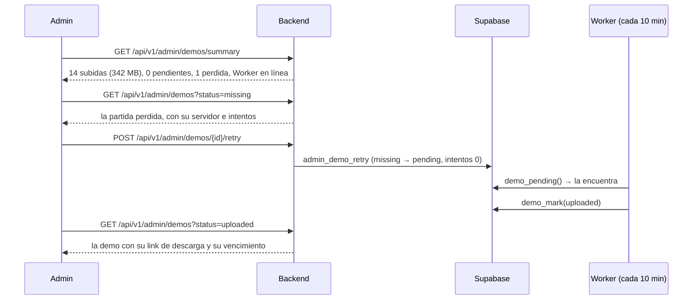
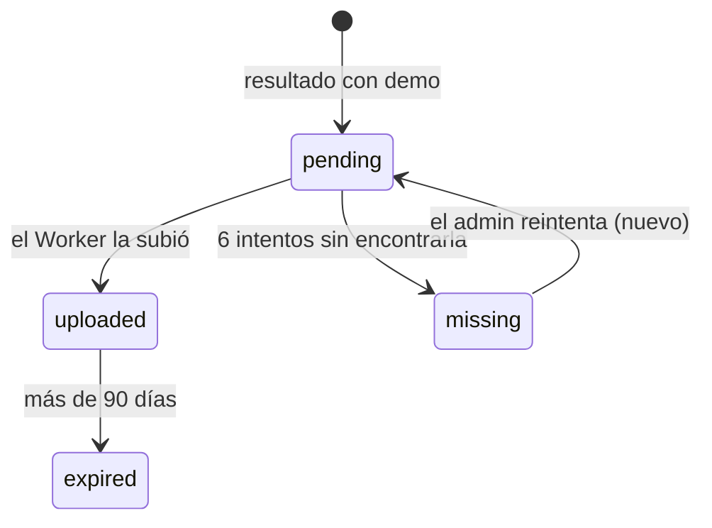

# Plan: demos desde el admin

> Planeación original. Estado: **propuesta**, pendiente de aprobación.

Las demos de los mixes (y de cada mapa de una PCW o partida de torneo jugada con `!match`) las graba el plugin y las sube el Worker de Cloudflare a R2 cada 10 minutos. Ver [`2026-10-12-demos-r2-worker`](../2026-10-12-demos-r2-worker/DOCUMENTACION.md). Cada partida tiene un estado de demo: `pending`, `uploaded`, `missing` o `expired`.

Hoy el admin **no tiene nada de esto en la web**:
- El token del Worker se crea con SQL.
- No hay forma de ver qué demos están pendientes o se perdieron, ni cuánto ocupan.
- Una demo que quedó `missing` (por ejemplo, porque el panel no respondía durante la hora de reintentos) no se puede volver a intentar.

En la copia de producción del 2026-10-14 hay 14 demos subidas (342 MB) y un Worker activo.

Este plan agrega todo eso a la API. La migración va en `supabase/replanteo/` como `14`, y se aplica en el corte.

## Decisiones tomadas

| Tema | Decisión | Por qué |
|---|---|---|
| Qué cubre | Panel de demos (resumen y listado), reintentar una demo perdida y los tokens del Worker de demos (`demo_workers`) | Lo que quedó pendiente como "demos desde el admin" |
| Resumen | Cantidad por estado, espacio ocupado en R2, la pendiente más vieja y si el Worker está en línea | Para ver de un vistazo si algo anda mal |
| Listado | Cada partida con demo (no `none`): estado, tamaño, intentos, fecha de subida, **fecha de vencimiento** (subida + 90 días), servidor y link de descarga (`demo_url`, armado por la API como en el detalle de partida) | Con la convención de listados (paginación, filtros y orden en el servidor) |
| Reintentar | Solo una demo `missing` vuelve a `pending` con los intentos en 0; el Worker la busca otra vez en los próximos 10 minutos | Si el archivo sigue en el servidor, se recupera. Una `expired` no: R2 ya la borró |
| Reintentar sin id del panel | Se rechaza: "El servidor de esta partida no tiene id del panel: el Worker no puede bajar la demo" | Sin `panel_server_id` el Worker no la ve (`demo_pending` la filtra) y quedaría `pending` para siempre |
| Tokens del Worker | Igual que los de los servidores: alta con el token (se muestra una sola vez), token nuevo, revocar, reactivar y borrar. Nombre único | Hoy se crean con SQL y no hay forma de rotarlos |
| Token nuevo | **Pide doble confirmación**, como el recálculo del ELO: el Worker deja de funcionar hasta que se carga el token nuevo en Cloudflare (`wrangler secret put DEMO_WORKER_TOKEN`, en la cuenta de Agus). La respuesta trae ese comando | Rotarlo por error frena la subida de las demos |
| "En línea" del Worker | Usó su token en los últimos 25 minutos (corre cada 10) | Si deja de correr, el resumen lo avisa |
| Vencimiento | Sigue fijo en **90 días** (cron del Worker y regla de R2) | Cambiarlo es tocar el Worker y R2, fuera de este plan |
| Borrar una demo antes de tiempo, o correr el Worker a mano desde la web | **Fuera de este plan** | El backend no tiene acceso a R2 ni la clave de administración del Worker. Darle esas claves no vale la pena para algo que no se pidió |

## 1. El flujo completo

## 2. Base de datos (`supabase/replanteo/14_demos_admin.sql`)

1. **Nombre único** de `demo_workers` (sin distinguir mayúsculas) y `check` del largo (2 a 40). Aborta si hay repetidos.
2. **`admin_create_demo_worker(p_name)`:** solo admin; devuelve `(id, token)`. `create_demo_worker_token` queda como está.
3. **`rotate_demo_worker_token(p_worker)`:** solo admin; token nuevo y el Worker queda activo.
4. **`admin_demo_retry(p_match)`:** solo admin; solo desde `missing`, y solo si el servidor de la partida tiene `panel_server_id`. Pasa a `pending` con `demo_attempts = 0`.
5. **Vistas para el admin** (filtradas por `is_admin()`, como las de la `11`):
   - `admin_demo_list`: partidas con demo; estado, tamaño, intentos, `demo_uploaded_at`, `expires_at`, servidor (nombre y si tiene id del panel), mapa, fecha, tipo, bandos, partida padre y `search`.
   - `admin_demo_worker_list`: Workers sin `token_hash`, con `online`.
   - `admin_demo_summary`: una fila con la cantidad por estado, los bytes subidos (sin las vencidas), la pendiente más vieja y si algún Worker activo está en línea.
6. **Inversa y pruebas** (dentro de un rollback):
   - Un usuario común no ve las vistas ni llama a las funciones.
   - Alta y token nuevo del Worker; el token valida con `demo_pending` y el viejo deja de servir.
   - Nombre repetido.
   - Reintentar: `missing` pasa a `pending`; `uploaded`, `expired` o un servidor sin id del panel, no.
   - Resumen y vencimiento.

   `correr.sh` con 01 a 14.

## 3. Backend (`web/backend`)

Todo con `requireUser` + `requireAdmin`. Tag `Admin`.

| Endpoint | Qué hace |
|---|---|
| `GET /api/v1/admin/demos/summary` | El resumen |
| `GET /api/v1/admin/demos` | Listado. Filtros: `status` (`pending`, `uploaded`, `missing`, `expired`), `server`, `kind`, `from`, `to`, `q`. `sort`: **`played_at` desc**, `demo_size`, `demo_attempts`, `demo_uploaded_at`, `expires_at` |
| `POST /api/v1/admin/demos/{matchId}/retry` | Reintentar. `400` con el motivo si no se puede |
| `GET /api/v1/admin/demo-workers` | Listado. Filtros: `active`, `online`, `q`. `sort`: **`name` asc**, `created_at`, `last_seen_at` |
| `POST /api/v1/admin/demo-workers` | Alta. `201` con `{ id, token, secret_command }` |
| `PATCH /api/v1/admin/demo-workers/{id}` | `name` o `active` (revocar o reactivar) |
| `POST /api/v1/admin/demo-workers/{id}/token` | Token nuevo. Pide `confirm: "estoy seguro"`. Responde como el alta |
| `DELETE /api/v1/admin/demo-workers/{id}` | `204` |

- `secret_command`: `pnpm exec wrangler secret put DEMO_WORKER_TOKEN` (en `cloudflare/demo-worker`), con el aviso de que se pega el token cuando lo pide.
- **Pruebas:** unitarias (esquemas, armado de `demo_url` y `expires_at`, rutas con PostgREST simulado) y de integración contra la base local (resumen, filtros y orden, reintentar en cada estado, ciclo del token del Worker con `demo_pending`, permisos).

## 4. Contrato del frontend

- Filas de los dos listados en la sección 1.
- Sección "Demos (admin)" en la 9: qué mostrar en el resumen (aviso si hay pendientes viejas, perdidas o el Worker no está en línea) y la doble confirmación del token nuevo.
- Sacar "demos" de "Lo que todavía no está definido".
- Registro de decisiones.

## 5. Requisitos antes de empezar

- Base local con 01 a 13.
- Nada que instalar. No se toca el Worker ni Cloudflare.

## 6. Orden de implementación

1. Migración `14`, inversa y pruebas; `correr.sh` con 01 a 14; tipos.
2. Esquemas y rutas (`src/schemas/demos.ts`, `src/routes/admin-demos.ts`).
3. Pruebas; `pnpm typecheck` y la cobertura.
4. Contrato, `PENDIENTES.md`, README y documentación del replanteo, e índice de la bitácora.
5. `DOCUMENTACION.md` y `GUIA_IMPLEMENTACION.md`.
