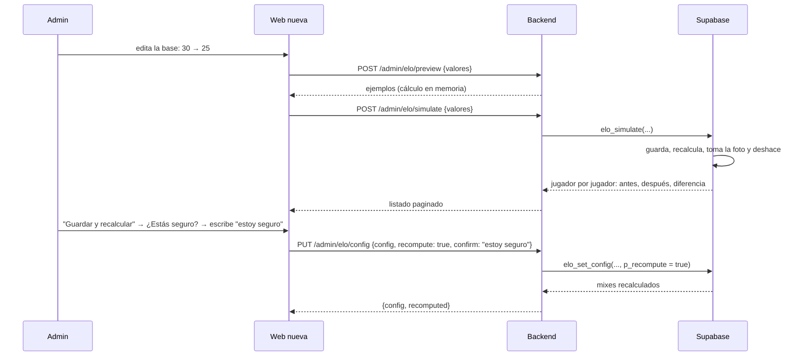

# Endpoints de configuración del ELO y recálculo: documentación

## Qué hace

La configuración del ELO de los mixes (`elo_config`) se lee y se cambia desde la API nueva:
- Cualquiera lee los valores vigentes.
- El admin ve una **vista previa** con ejemplos mientras edita.
- El admin **simula** el recálculo: ve cómo quedaría cada jugador sin guardar nada.
- El admin guarda (vale para los mixes nuevos) y, si quiere, **recalcula** todo el historial.

**Recalcular pide doble confirmación:** el frontend pregunta si está seguro y pide escribir `estoy seguro`, y la API exige ese texto en `confirm`.

El motor del ELO (`elo_apply_match`) no cambia. El recálculo usa `elo_recompute_all`, que también vuelve a aplicar los ajustes manuales de la migración `20261015210000_elo_ajustes.sql` (bitácora `2026-10-15-ajustes-elo`, de otra sesión).

## Endpoints

| Endpoint | Quién | Qué hace |
|---|---|---|
| `GET /api/v1/elo/config` | Cualquiera | `{ config, updated_at, updated_by }`. Sin fila en `elo_config`, los valores por defecto. `updated_by` (`{ id, alias }`) solo para un admin |
| `POST /api/v1/admin/elo/preview` | Admin | Ejemplos con los valores enviados. No toca la base |
| `POST /api/v1/admin/elo/simulate` | Admin | Listado de cómo quedaría cada jugador. Filtros `q` y `changed`; `sort`: **`abs_delta` desc**, `delta`, `elo_after`, `elo_before`, `name`; desempate por SteamID |
| `PUT /api/v1/admin/elo/config` | Admin | `{ config, recompute, confirm }`. Responde `{ config, recomputed }` (`null` si no recalculó) |
| `POST /api/v1/admin/elo/recompute` | Admin | `{ confirm }`. Responde `{ recomputed }` |

### Valores

| Valor | Rango | Qué es |
|---|---|---|
| `base` | 5 a 100 | ELO que gana o pierde cada uno con equipos parejos |
| `bonus_max` | 0 a 20 | Tope del bonus o castigo por rendimiento |
| `bonus_factor` | 0 a 50 (con decimales) | Bonus por cada punto de rating sobre o bajo 1,00 |
| `elo_floor` | 0 a 1000 | Nadie baja de este ELO |
| `start_elo` | 100 a 5000, no menor que `elo_floor` | ELO de un jugador nuevo |
| `min_pct` | 1 a 100 | Con menos de este % de las rondas, el ELO no cambia |
| `full_pct` | `min_pct` a 100 | Desde este % de las rondas cuenta completo |

El esquema de la API valida los rangos con un mensaje por campo. La base los vuelve a validar (`elo_set_config`).

### Doble confirmación

`confirm` tiene que ser `estoy seguro`, sin distinguir mayúsculas ni espacios en los bordes. Lo piden:
- `PUT /api/v1/admin/elo/config` con `recompute: true`.
- `POST /api/v1/admin/elo/recompute`.

Sin el texto, o con otro, la respuesta es `400 VALIDATION_ERROR` en el campo `confirm`, y la base no se llama. Guardar sin recalcular no lo pide.

## Vista previa

La calcula el backend (`src/services/elo.ts`) con las fórmulas de `elo_apply_match` para equipos parejos (probabilidad 0,5):

| Ejemplo | Qué muestra |
|---|---|
| `even` | Rating 1,00: gana `+base`, pierde `−base` |
| `high_rating` | Rating 1,40: con bonus |
| `low_rating` | Rating 0,60: con castigo |
| `new_player` | `start_elo` y su nivel |
| `floor` | `elo_floor` |
| `participation` | 10, 20 y 27 de 30 rondas: porcentaje, peso y cambio (`null`: no llega al mínimo) |

Cálculo de un jugador:
1. **Peso** (`elo_weight`): 0 con menos de `min_pct` %, 1 desde `full_pct` %, y rondas jugadas sobre el total en el medio.
2. **Bonus:** `(rating − 1) × bonus_factor` redondeado y limitado a `±bonus_max`.
3. **Cambio:** `(±base + bonus) × peso` redondeado. Quien gana suma al menos 1 y quien pierde resta al menos 1.

**Redondeo como Postgres.** El bonus se calcula con `numeric`: los empates se alejan del cero (−2,5 → −3), y se corrige el error de coma flotante de JavaScript. El cambio con peso parcial se calcula con `double precision`: los empates van al par (12,5 → 12, 13,5 → 14).

## Simulación (`supabase/replanteo/13_elo_simulacion.sql`)

`elo_simulate(base, bonus_max, bonus_factor, floor, start_elo, min_pct, full_pct)`, `security definer` y solo para un admin:
1. Toma una foto de `player_elo` (ELO y partidas de cada SteamID).
2. Dentro de un bloque: llama a `elo_set_config(..., recompute = true)` con los valores propuestos (con sus validaciones), toma la foto de después y lanza un error propio (`V3401`).
3. Atrapa ese error: Postgres deshace todo lo del bloque (configuración, ELO, stats de los mixes) y suelta los bloqueos que tomó el recálculo.
4. Devuelve, por cada SteamID de las dos fotos:
   - `player_id` y `name` (el de la ficha, o el último nombre que usó en el juego).
   - `elo_before` y `elo_after` (`null` si no tiene o no tendría ELO).
   - `delta`, `abs_delta`, `matches_before`, `matches_after`, `changed` y `search`.

Mientras simula, bloquea `player_elo` igual que un recálculo. Con 13 mixes en producción tarda menos de un segundo. Cada página del listado vuelve a simular.

## Dónde está cada cosa

| Qué | Archivo |
|---|---|
| Migración, inversa y pruebas | `supabase/replanteo/13_elo_simulacion.sql`, `docs/bitacora/2026-10-14-replanteo-modelo-datos/reversas/13_elo_simulacion.sql` y `…/pruebas/13_elo_simulacion.sql` |
| Vista previa y valores por defecto | `web/backend/src/services/elo.ts` |
| Esquemas | `web/backend/src/schemas/elo.ts` |
| Rutas | `web/backend/src/routes/elo.ts` |
| Pruebas | `web/backend/test/unit/elo.test.ts` y `web/backend/test/integration/elo.test.ts` |
| Contrato para el frontend | `docs/frontend/contract.md`, secciones 8c y 9 ("ELO (admin)") |
