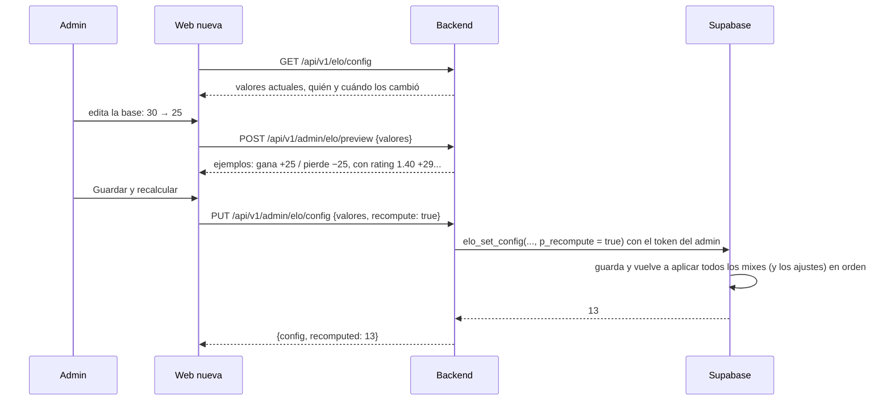

# Plan: endpoints de configuración del ELO y recálculo

> Planeación original. Estado: **propuesta**, pendiente de aprobación.

Hoy el admin configura el ELO desde la web vieja (Admin → Servidores → ELO): edita los siete valores de `elo_config`, ve un ejemplo calculado en el navegador y guarda con `elo_set_config`, con o sin recálculo. Además tiene un botón "Recalcular" que llama a `elo_recompute_all`.

Este plan pasa eso a la API nueva. **La base ya tiene todo** (`elo_config`, `elo_set_config`, `elo_recompute_all`), así que en principio no hace falta migración: es solo backend y contrato.

## Decisiones tomadas

| Tema | Decisión | Por qué |
|---|---|---|
| Qué se configura | Los siete valores de hoy: `base`, `bonus_max`, `bonus_factor`, `elo_floor`, `start_elo`, `min_pct` y `full_pct` | Es lo que el motor usa (`elo_apply_match`). El cálculo no cambia |
| Rangos | Los mismos de la base: base de 5 a 100; bonus máximo de 0 a 20; factor de 0 a 50; mínimo de 0 a 1000; inicial de 100 a 5000 y no menor que el mínimo; participación de 1 a 100 y completo entre el mínimo y 100 | Se validan en el esquema de la API (con mensajes claros) y la base los vuelve a validar |
| Quién lee | **Cualquiera**, sin sesión | La tabla ya es de lectura pública y sirve para una página "Cómo se calcula el ELO" |
| Quién cambia y recalcula | Solo un admin, con su token | Las funciones ya lo controlan |
| Guardar | Los cambios valen para los **mixes nuevos**. Con `recompute: true`, además se recalcula todo el historial en la misma llamada | Como hoy |
| Recálculo | **Síncrono**: la respuesta trae cuántos mixes se aplicaron | En la copia de producción del 2026-10-14 hay 13 mixes terminados: tarda menos de un segundo. Si algún día tarda mucho, se pasa a una tarea en segundo plano |
| Ejemplo ("vista previa") | **Lo calcula la API**: con los valores que el admin está editando, devuelve los mismos ejemplos que la web vieja (equipos parejos, ganar con rating 1.40, jugador nuevo, participación de 20 de 30 rondas) | Así la fórmula no se copia en el frontend. Es un cálculo en memoria, sin tocar la base |
| Ajustes manuales de ELO | **Fuera de este plan** | Los maneja otra sesión (`2026-10-15-ajustes-elo`). Su migración ya hace que `elo_recompute_all` respete los ajustes, así que un recálculo desde la API no los pierde |

## 1. El flujo completo

## 2. Backend (`web/backend`)

| Endpoint | Quién | Qué hace |
|---|---|---|
| `GET /api/v1/elo/config` | Cualquiera | Los siete valores, `updated_at` y `updated_by` (alias del admin, solo si quien pide es admin) |
| `PUT /api/v1/admin/elo/config` | Admin | Body: los siete valores (todos obligatorios, como `elo_set_config`) y `recompute` (por defecto `false`). Responde `{ config, recomputed }`; `recomputed` es `null` si no se recalculó |
| `POST /api/v1/admin/elo/recompute` | Admin | Recalcula todo con la configuración actual. Responde `{ recomputed }` |
| `POST /api/v1/admin/elo/preview` | Admin | Body: los siete valores. Responde los ejemplos, sin guardar nada |

**Ejemplos de la vista previa** (las mismas fórmulas que `elo_apply_match` y la web vieja):

| Ejemplo | Cálculo |
|---|---|
| Equipos parejos | Gana `+base`, pierde `−base` |
| Gana con rating 1.40 | `base + min(bonus_max, round(0.4 × bonus_factor))` |
| Pierde con rating 0.60 | `−base + max(−bonus_max, round(−0.4 × bonus_factor))`, como máximo −1 |
| Jugador nuevo | Empieza con `start_elo` (y su nivel) |
| Participación | Con menos de `min_pct` % de las rondas, 0; desde `full_pct` %, completo; en el medio, proporcional. Ejemplo con 20 de 30 rondas |
| Piso | Nadie baja de `elo_floor` |

- **Errores:** valores fuera de rango, `400 VALIDATION_ERROR` con el campo; un no admin, `403`.
- **Recálculo:** bloquea `player_elo` mientras corre (lo hace la base). Un resultado que llega en ese momento espera y se aplica después.
- **Pruebas:** unitarias de los esquemas, de la vista previa (cada ejemplo, bordes de la participación y del piso) y de las rutas con PostgREST simulado; de integración contra la base local: lectura anónima, `403` a un usuario común, guardar sin recalcular, guardar y recalcular con un mix sembrado (el ELO cambia según la base nueva), recalcular solo, y dejar la configuración como estaba al terminar.

## 3. Base de datos

**Sin migración**, salvo que en la implementación aparezca algo que falte. Los mensajes de `elo_set_config` usan el código `22023`, que el backend traduce a un mensaje genérico; por eso la validación con mensaje claro se hace en el esquema de la API, antes de llamar a la base.

## 4. Contrato del frontend (`docs/frontend/contract.md`)

- Sección 8c (ELO): los endpoints y qué mostrar en "Cómo se calcula el ELO".
- Sección 9 (Admin): fila "ELO" con la configuración, la vista previa y el recálculo, y el aviso de pedir confirmación antes de recalcular.
- Sacar "configuración del ELO" de "Lo que todavía no está definido".
- Fila en el registro de decisiones.

## 5. Propuesta para decidir: simular el recálculo antes de aplicarlo

Además de los ejemplos, la API podría **simular** el recálculo con los valores nuevos y devolver cómo quedaría cada jugador (ELO actual, ELO nuevo y diferencia) sin guardar nada: recalcula dentro de un bloque que se deshace al final.

- **A favor:** el admin ve el impacto real (por ejemplo, "kyansuke pasa de 1180 a 1120") antes de recalcular a todos.
- **En contra:** mientras simula bloquea `player_elo` igual que un recálculo (hoy, menos de un segundo), y es una función nueva en la base (migración `13`).
- **Propuesta:** **hacerlo**, como `POST /api/v1/admin/elo/simulate`, paginado y ordenado por la diferencia. Si preferís no tener una migración más, queda afuera y alcanza con los ejemplos.

## 6. Requisitos antes de empezar

- Base local con 01 a 12.
- Nada que instalar.

## 7. Orden de implementación

1. Esquemas (`src/schemas/elo.ts`) y la vista previa (`src/services/elo.ts`).
2. Rutas (`src/routes/elo.ts`) y registrarlas.
3. Si se aprueba la simulación: migración `13`, inversa y pruebas; `correr.sh` con 01 a 13; tipos regenerados; endpoint.
4. Pruebas unitarias y de integración; `pnpm typecheck` y la cobertura.
5. Contrato, `PENDIENTES.md` y el índice de la bitácora (y, con la `13`, el README y la documentación del replanteo).
6. `DOCUMENTACION.md` y `GUIA_IMPLEMENTACION.md`.
