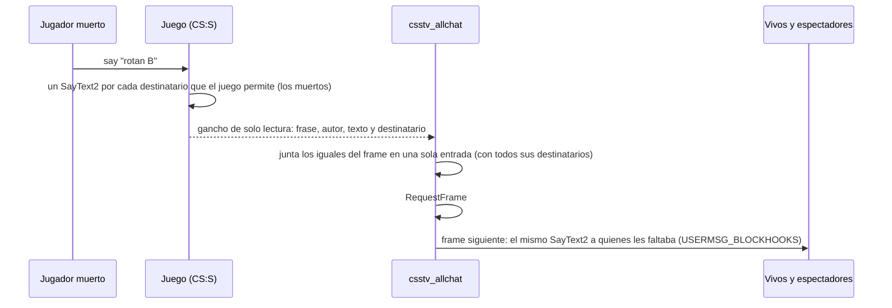

# Chat de texto para vivos y muertos (`csstv_allchat`): documentación

## Qué hace

`csstv_allchat` (1.0.1) hace que **todos lean el chat de texto, vivos o muertos**:

| Quién escribe | Chat | Lo lee |
|---|---|---|
| Cualquiera (vivo, muerto o espectador) | Global | Todos |
| Jugador de CT o T (vivo o muerto) | Equipo | **Solo su equipo** (vivos y muertos); los espectadores no |
| Espectador | Equipo | Los espectadores |

- Es un plugin **aparte** de `csstv_reporter` y funciona con la 1.8.0 y la 2.0.0.
- No tiene licencia: el mismo `.smx` va en nuestro servidor y en RBK.
- La **voz** no la toca este plugin: la manejan los cfg de fase (ver "Voz").

## Cómo funciona

1. **Gancho de solo lectura** sobre `SayText2`:
   - Lee autor, frase (`Cstrike_Chat_*`) y parámetros (nombre y texto).
   - No modifica ni bloquea nada.
   - Solo toma el chat de jugadores: frases `Cstrike_Chat_All*`, `_CT*`, `_T*` y `_Spec`.
2. **El juego manda un `SayText2` por cada destinatario.** Los mensajes iguales del mismo frame (mismo autor, frase y texto) se juntan en una sola entrada con la unión de sus destinatarios. Así cada línea se procesa una vez.
3. **En el frame siguiente** calcula quién debería leerla según la tabla y se la manda a quienes no la recibieron.
   - Mismo mensaje: se ve igual que el chat normal, con `*DEAD*` y los colores de ClientMod.
   - Va con `USERMSG_BLOCKHOOKS`, así ningún otro plugin lo vuelve a procesar.
4. **Nunca abre un mensaje dentro del gancho.** El plugin "DeadChat" (AlliedMods, hilo 74130), que probó Kyan, sí lo hacía. Los logs de errores del servidor real del 2026-10-15, de 21:39 a 21:43, muestran:
   - `Unable to execute a new message, there is already one in progress` en su `SayText2PostHook`.
   - Un envío de nuestro `csstv_reporter` que falló en esos mismos segundos.

   Fue la noche del mix caído.

**Lo que respeta solo:** un jugador silenciado (`sm_gag`) o un mensaje que bloquea el antiflood no generan `SayText2`, así que no hay nada que reenviar.

## Configuración

| Cvar | Por defecto | Qué hace |
|---|---|---|
| `csstv_allchat` | `1` | `0` lo apaga al instante (chat normal del juego) sin descargar el plugin |
| `csstv_allchat_version` | `1.0.1` | Solo lectura |

**Build de depuración** (`spcomp csstv_allchat.sp ALLCHAT_DEBUG=`):
- Escribe en el log cada mensaje capturado y a quién lo reenvía.
- Agrega `csstv_allchat_say <userid> <say|say_team> <texto>`, para hacer hablar a un bot.

## Voz

Decisión de Daniel (2026-10-16): **en el calentamiento se escuchan todos; en la partida, solo el propio equipo, vivos y muertos.**

Lo hacen los cfg que `csstv_reporter` ejecuta en cada fase:

| Archivo | Cuándo | Voz |
|---|---|---|
| `cfg/csstv/warmup.cfg` | Al cargar el mapa y al terminar o cancelar una partida | `sv_alltalk 1` |
| `cfg/csstv/live.cfg` | Antes del LO3 | `sv_alltalk 0`, `sm_deadtalk 2` |
| `cfg/csstv/end.cfg` | Al terminar la partida | `sv_alltalk 1` |

- `sv_alltalk 0`: cada uno escucha a su equipo.
- `sm_deadtalk 2` (de `basecomm`): los muertos hablan con sus compañeros vivos.
- `sm_deadtalk 1` no se usa: los muertos hablarían también con el equipo rival.

Esto reemplaza el punto 7.1 de `PENDIENTES.md` (que pedía `sm_deadtalk 0`).

## Dónde está cada cosa

| Qué | Dónde |
|---|---|
| Código | `server/addons/sourcemod/scripting/csstv_allchat.sp` |
| Compilado | `server/addons/sourcemod/plugins/csstv_allchat.smx` (1.0.1: 7808 bytes, md5 `7ee903912264b7425e7d91517606e20a`) |
| Cfg de partida | `server/cfg/csstv/live.cfg` (en los servidores, `cstrike/cfg/csstv/live.cfg`) |
