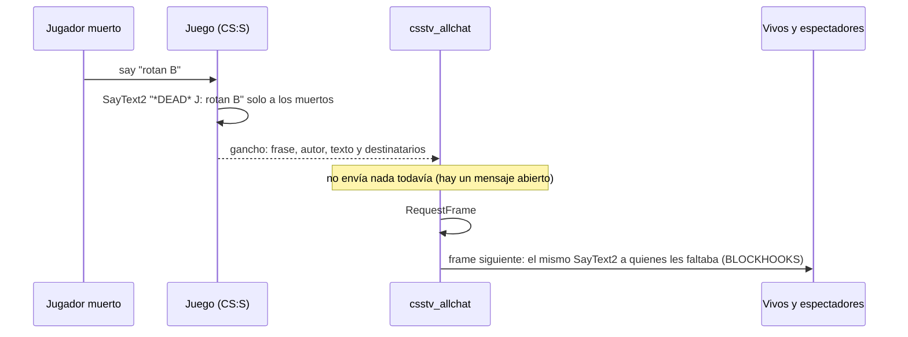

# Plan: chat de texto para todos, vivos y muertos (`csstv_allchat`)

> Planeación original. Estado: **propuesta**, pendiente de aprobación.

## El problema

En CS:S, el chat de texto depende de si el jugador está vivo:
- Lo que escribe un **muerto** (o un espectador) solo lo leen los muertos y los espectadores.
- El chat de equipo de un muerto solo lo leen sus compañeros muertos.

Daniel quiere que **todos lean todo, siempre, vivos o muertos**:
- **Chat global:** lo leen todos.
- **Chat de equipo:** lo leen su equipo y los espectadores.

Kyan probó un plugin de AlliedMods ("DeadChat", hilo 74130) y el servidor se cayó al usar `!pause`. Los logs de errores del servidor real del **2026-10-15, de 21:39 a 21:43**, muestran la causa:
- `Unable to execute a new message, there is already one in progress` en `SayText2PostHook` de ese plugin.
- Reenvía el mensaje de chat **dentro** del gancho del mensaje original, mientras el mensaje original sigue abierto.
- En esos segundos también falló un envío de nuestro `csstv_reporter` (los avisos de `!pause` usan el mismo tipo de mensaje), por el mensaje que el otro plugin dejaba abierto.
- Esa noche es la del mix caído que se compensó con el ajuste de ELO (`2026-10-15-ajustes-elo`).

El plugin ya no está en el servidor real (revisado por SFTP, solo lectura, el 2026-10-16).

## Decisiones tomadas

| Tema | Decisión | Por qué |
|---|---|---|
| Plugin propio | **`csstv_allchat.smx`, aparte de `csstv_reporter`** | Los servidores corren la 1.8.0 y la 2.0.0 de esta rama no está desplegada. Aparte, se sube ya sin arrastrar la 2.0.0, y funciona con las dos |
| Licencia | **Sin licencia**: el mismo `.smx` para nuestro servidor y RBK | Daniel, 2026-10-16 |
| Cómo funciona | Escucha el mensaje de chat que manda el juego (`SayText2`), **sin modificarlo ni bloquearlo**, y anota a quién le llegó. **En el frame siguiente** se lo manda, igual, a quienes les faltaba según las reglas | Mandarlo en el frame siguiente evita abrir un mensaje dentro de otro, que fue lo que causó el crash |
| Formato | Se reenvía el **mismo mensaje** (misma frase del juego, mismo autor, mismo texto, con `*DEAD*` si estaba muerto) | Se ve igual que el chat normal, con colores de ClientMod incluidos |
| Qué se reenvía | Solo el chat de **jugadores** (las frases `Cstrike_Chat_*` del juego) | No toca los mensajes de otros plugins. Los de `csstv_reporter` ya van marcados para que nadie los procese |
| Envíos propios | Marcados con `USERMSG_BLOCKHOOKS` | Ningún otro plugin los vuelve a procesar, ni este |
| Chat bloqueado | Si otro plugin bloquea un mensaje (un jugador silenciado con `sm_gag`, el antiflood), no hay mensaje que reenviar | Respeta los silencios sin hacer nada especial |
| Interruptor | Cvar `csstv_allchat 1` (0 lo apaga sin descargar el plugin) | Para desactivarlo rápido desde el panel si algo falla |

### Reglas

| Quién escribe | Chat | Lo lee |
|---|---|---|
| Cualquiera (vivo, muerto o espectador) | Global | **Todos** |
| Jugador de CT o T (vivo o muerto) | Equipo | **Su equipo (vivos y muertos) y los espectadores** |
| Espectador | Equipo | Los espectadores |

## Voz (decidido por Daniel el 2026-10-16: opción B)

**En el calentamiento se escuchan todos; en la partida, solo el propio equipo, vivos y muertos.**

Ya lo hacen los cfg que ejecuta `csstv_reporter` en cada fase (1.8.0 y 2.0.0). Revisado por SFTP, solo lectura, el 2026-10-16:

| Archivo | Cuándo se ejecuta | Servidor real | RBK |
|---|---|---|---|
| `cfg/server.cfg` | Al arrancar | `sv_alltalk 1` | `sv_alltalk 1` |
| `cfg/csstv/warmup.cfg` | Al cargar el mapa y al terminar o cancelar una partida | `sv_alltalk 1` | `sv_alltalk 1` |
| `cfg/csstv/live.cfg` | Antes del LO3 | `sv_alltalk 0`, `sm_deadtalk 2` | `sv_alltalk 0` (**falta `sm_deadtalk 2`**) |
| `cfg/csstv/end.cfg` | Al terminar la partida | `sv_alltalk 1` | `sv_alltalk 1` |

- `sv_alltalk 0`: cada uno escucha a su equipo. `sm_deadtalk 2` (de `basecomm`, cargado en los dos): los muertos hablan con sus compañeros vivos.
- **Falta:** agregar `sm_deadtalk 2` al `live.cfg` de RBK (con copia previa) y al del repo (`server/cfg/csstv/live.cfg`).
- **El punto 7.1 de `PENDIENTES.md` queda reemplazado:** decía `sm_deadtalk 0` y ahora es `2` en partida. La voz no necesita código.

## 1. El flujo

## 2. El plugin (`server/addons/sourcemod/scripting/csstv_allchat.sp`)

- `HookUserMessage(SayText2, …, intercept = false)`. Lee autor, chat, frase y hasta 4 parámetros, y guarda los destinatarios en una cola chica.
- En `RequestFrame`, para cada mensaje en cola:
  - Calcula quién debería leerlo según las reglas: chat global si la frase es `Cstrike_Chat_All*`, de equipo si es `Cstrike_Chat_CT*`, `_T*` o `_Spec`.
  - Se lo manda con `StartMessage(…, USERMSG_RELIABLE | USERMSG_BLOCKHOOKS)` a quienes no lo recibieron.
- Ignora:
  - Mensajes sin autor o con una frase que no es de chat de jugadores.
  - Bots como destinatarios.
  - Su propio reenvío (lo marca `BLOCKHOOKS`).
- No toca timers, pausas, equipos ni comandos: no comparte estado con `csstv_reporter`.
- Compila con el compilador de SourceMod 1.10 (el de los dos servidores), sin `include` de terceros.
- **Build de depuración** (`ALLCHAT_DEBUG`): escribe en el log a quién reenvía cada mensaje. Así se prueba con bots, que no reciben mensajes.

## 3. Pruebas en el servidor local

El servidor local envía a la Supabase real: `csstv_send 0` después de cada carga del cfg y la cola vacía antes de reiniciar.

1. Con `csstv_reporter` **1.8.0** (la de los servidores) y después con la **2.0.0**:
   - Bots vivos y muertos de los dos equipos y un espectador.
   - Chat global y de equipo desde cada estado (`csstv_debug_fakecmd`): el log de depuración muestra los destinatarios esperados en cada caso de la tabla de reglas.
2. **El caso del crash:**
   - `!pause` y `!unpause` mientras hay chat de muertos.
   - Varios mensajes seguidos y comandos del plugin (`!ready`, `!hp`, `!status`).
   - `errors_*.log` sin ningún `already one in progress` ni `Could not send a usermessage`.
3. Con un cliente real (Daniel), si se puede: ver en el juego un mensaje de un muerto estando vivo.
4. `sm_gag` a un bot: su chat no se reenvía.

## 4. Despliegue (a mano, los dos servidores en la misma tanda)

1. Subir `csstv_allchat.smx` a `cstrike/addons/sourcemod/plugins/`:
   - **Servidor real** por `SFTP_CSS_*`.
   - **RBK** por `SERVER1_*`.
   - El mismo archivo en los dos (sin licencia). El script aborta si el archivo ya existe, y después de subirlo lo vuelve a bajar y compara el md5.
2. **Se carga solo en el próximo cambio de mapa.** No se fuerza con una partida en curso.
3. Voz: agregar `sm_deadtalk 2` al `cfg/csstv/live.cfg` de RBK, con copia previa del archivo. El del servidor real ya lo tiene.
4. Verificar en cada servidor, en el log del próximo mapa:
   - Que el plugin cargó (`sm plugins list` en la consola del panel, si Daniel lo corre).
   - Que el log de errores no tiene errores de mensajes.
5. Changelog para Discord.

**Revertir:** mover el `.smx` a `plugins/disabled/` (se descarga en el próximo mapa), o `csstv_allchat 0` al instante.

## 5. Orden

1. Este plan aprobado.
2. Plugin, build de depuración y pruebas locales con la 1.8.0 y la 2.0.0.
3. Commit en esta rama (`feat/backend-api-fase-1`).
4. Subida a los dos servidores, verificación y changelog.
5. `DOCUMENTACION.md`, `GUIA_IMPLEMENTACION.md` y `PENDIENTES.md` (con el punto 7.1 actualizado).
