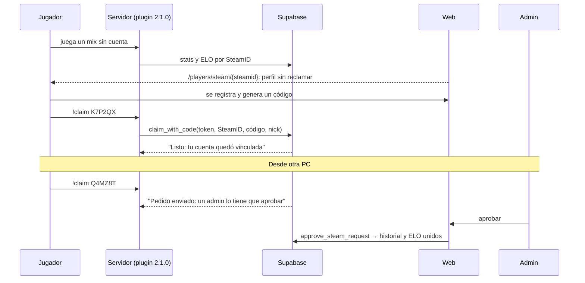

# Perfiles sin reclamar, `!claim` y varios SteamID por ficha: documentación

## Qué hace

| Pieza | Qué es |
|---|---|
| **Perfil sin reclamar** | Un SteamID que jugó y no es de ninguna ficha tiene una página pública armada con sus partidas: nicks que usó, ELO, stats, stats por mapa e historial. **No se crea ninguna ficha** y **no va al ranking** |
| **`!claim <código>`** | La cuenta genera un código en la web. El jugador lo escribe en el servidor, y el servidor vincula su SteamID a la cuenta |
| **Primer SteamID** | Se vincula al instante. Si la cuenta no tenía ficha, se crea (con su alias) y recibe todo el historial de ese SteamID. Funciona aunque nunca haya jugado |
| **SteamID adicionales** | Para otra PC u otro servidor. El usuario los pide con el mismo `!claim` y **los aprueba un admin**. Tope configurable (1 a 4, por defecto 3) |
| **Un solo ELO por ficha** | Todos los SteamID de una ficha mueven el mismo ELO. Aprobar, quitar o cambiar el principal recalcula el ELO de todos |
| **Reclamos viejos** | Se borraron (tabla y endpoints). Los 28 aprobados de producción pasan al registro de reclamos como historia |

Por ahora están hechas la base (migración `15`) y la API. El comando `!claim` del servidor sale con el **plugin 2.1.0**, todavía sin hacer, en la misma tanda que la 2.0.0 del corte.

## Modelo

| Qué | Dónde |
|---|---|
| SteamID **principal** | `players.steam_id` (como siempre: lo que pregunta "¿tiene SteamID?" sigue igual) |
| SteamID **adicionales** | `player_extra_steam_ids` (`steam_id` es la clave) |
| Todos juntos | Vista `player_steam_all` (`player_id`, `steam_id`, `is_primary`) |
| Pedidos de adicional | `steam_requests` (`pending`, `approved`, `rejected`, `expired`). Un pendiente reserva el SteamID; vence a los 30 días |
| Tope | `claim_config.max_steam_ids` (1 a 4, por defecto 3) |
| Códigos | `claim_codes` (6 caracteres sin 0/O/1/I/L, 10 minutos, hasta 5 por hora) |
| Registro | `claim_log`: cada `!claim`, aceptado o no, con servidor y nick |

**Un SteamID, una sola ficha:**
- El trigger `steam_unico` impide que un SteamID sea principal de una ficha y adicional de otra, y que haya adicionales sin principal.
- `claim_with_code` y `link_steam_id` además rechazan un SteamID reservado por el pedido pendiente de otra ficha.

**Por qué el tope llega solo a 4:** `!match` le manda al plugin todos los SteamID de cada jugador del plantel, en una lista que el plugin guarda en 1024 caracteres. Con 10 jugadores por lado, entran 4 SteamID por jugador. Ni el admin puede pasar de 4.

## Casos de `!claim`

| La ficha de la cuenta… | El SteamID… | Resultado |
|---|---|---|
| no existe | nunca jugó | Se crea la ficha vacía con ese SteamID |
| no existe | tiene historial sin ficha | Se crea la ficha con todo su historial |
| no existe | es de una ficha sin cuenta | Esa ficha pasa a la cuenta |
| existe sin SteamID | libre | Pasa a ser su principal, con su historial |
| existe con SteamID | libre | Pedido de adicional (pendiente) |
| existe | ya es suyo | "Tu cuenta ya está vinculada a este SteamID" |
| existe | es de otra ficha | "Ese SteamID es de otra ficha: pedile a un admin que lo revise" |
| — | es de la ficha de otra cuenta | "Ese SteamID pertenece a otra cuenta" |
| — | reservado por otra cuenta | "Ese SteamID tiene un pedido pendiente de otra cuenta" |
| llegó al tope | — | "Llegaste al máximo de SteamID: pedíselo a un admin" |

Además:
- Código inválido, vencido o usado.
- Más de 5 fallos del mismo SteamID en 10 minutos.
- Servidor sin licencia vigente.
- SteamID inválido (`STEAM_ID_LAN`, bots).

`claim_with_code` responde siempre sin error HTTP (`{ ok, pending, message, alias }`), como `csstv_license`. Así el plugin distingue un "no" de una falla de red. Un error inesperado se registra y responde "No se pudo vincular: probá de nuevo en un rato".

## Un solo ELO por ficha

El ELO sigue guardándose por SteamID (`player_elo`), pero con una **clave**:
- La clave es `elo_key(steam)`: el SteamID principal de la ficha si el SteamID es adicional, o el mismo SteamID si no.
- `elo_apply_match` la usa para juntar a los jugadores, y `elo_apply_adjustment` también: un ajuste manual a un adicional mueve el ELO de la ficha.
- La ficha lee el ELO por su principal (`player_overview`), así que no cambia.

| Acción | Recalcula el ELO de todos |
|---|---|
| Vincular el primer SteamID | No (la clave es él mismo) |
| Aprobar o agregar un adicional con partidas o ajustes | Sí |
| Quitar un SteamID de una ficha con varios | Sí |
| Cambiar el principal | Sí (cambia la clave) |

**Comprobado con la copia de producción:** sin SteamID adicionales, el ELO, las partidas y las stats quedan idénticos con el motor nuevo (32 SteamID, 135 filas de mixes).

**Límite conocido:** si después de aprobar un adicional la misma ficha aparece con dos SteamID en una misma partida (dos PCs a la vez), el motor le aplica esa partida dos veces. Aprobar ya rechaza un SteamID que compartió una partida con la ficha; si pasa después, lo corrige un admin quitando el SteamID.

## Endpoints

| Endpoint | Quién | Qué hace |
|---|---|---|
| `GET /api/v1/players/steam/{steamid}` | Cualquiera | Perfil sin reclamar, o `{ claimed: true, player_id }` |
| `GET /api/v1/players/steam/{steamid}/matches` y `/map-stats` | Cualquiera | Historial y stats por mapa |
| `GET /api/v1/players/unclaimed` | Cualquiera | Buscar perfiles sin reclamar |
| `GET /api/v1/players/{id}` | Cualquiera | Suma `steam_ids` |
| Detalle de partida | Cualquiera | Cada jugador sin ficha suma `steam_id` |
| `POST` / `GET /api/v1/me/claim-code` | Usuario | Código nuevo; estado (SteamID, tope, último código, pedidos pendientes) |
| `GET /api/v1/me/steam-requests` | Usuario | Sus pedidos |
| `GET /api/v1/admin/steam-requests` | Admin | Pedidos, con `shares_match` |
| `POST /api/v1/admin/steam-requests/{id}/approve` y `/reject` | Admin | Aprobar (recalcula) o rechazar con motivo |
| `GET /api/v1/admin/claims` | Admin | Registro de reclamos |
| `GET` / `PUT /api/v1/admin/steam/config` | Admin | Tope |
| `DELETE /api/v1/admin/steam/{steamid}` y `POST …/primary` | Admin | Quitar o hacer principal |
| `POST /api/v1/admin/steam/link` | Admin | Ahora **suma** el SteamID a la ficha (antes lo reemplazaba); `player_id: null` lo quita |

Se borraron `/api/v1/me/profile-requests` y `/api/v1/admin/profile-requests`.

## Ingesta y `!match`

- `csstv_ingest` asigna cada fila de stats a la ficha de cualquiera de sus SteamID (`steam_owner`).
- `csstv_match_lookup` manda en `t1` y `t2` todos los SteamID de cada jugador del plantel. El plugin 2.0.0 busca el SteamID de quien escribe dentro de la lista, así que reconoce a un jugador desde cualquiera de sus PCs sin cambios. Lo verifica la prueba de la `15` con un torneo real.
- Solo cuentan los SteamID **aprobados**: con un pedido pendiente, `!match` no reconoce a ese jugador desde esa PC (en un torneo no puede jugar con su equipo; en una PCW entra como stand-in).

## Dónde está cada cosa

| Qué | Archivo |
|---|---|
| Migración, inversa y pruebas | `supabase/replanteo/15_claim.sql`, `docs/bitacora/2026-10-14-replanteo-modelo-datos/reversas/15_claim.sql` y `…/pruebas/15_claim.sql` |
| Rutas y esquemas | `web/backend/src/routes/claim.ts`, `web/backend/src/schemas/claim.ts` (y `players.ts`, `matches.ts`, `admin-players.ts`) |
| Pruebas | `web/backend/test/unit/claim-routes.test.ts`, `web/backend/test/integration/claim.test.ts` |
| Contrato para el frontend | `docs/frontend/contract.md`, sección 5b y "SteamID y `!claim` (admin)" |
