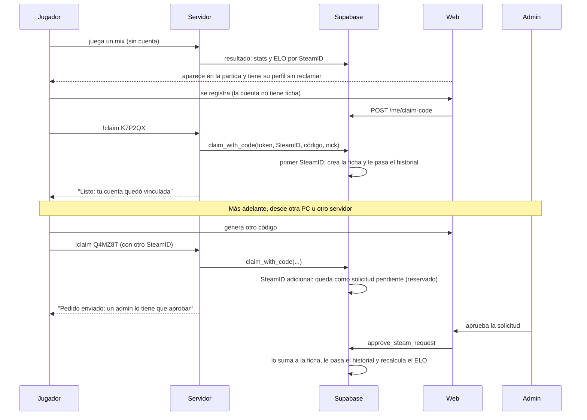
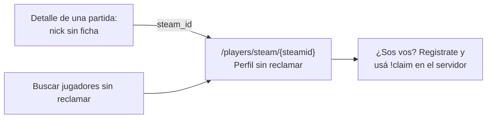
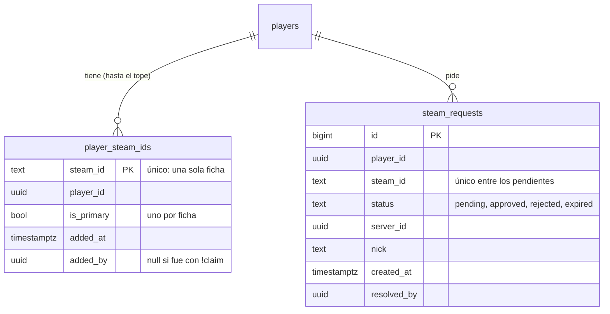

# Plan: perfiles sin reclamar, `!claim` y varios SteamID por ficha

> Planeación original. Estado: **propuesta**, pendiente de aprobación.
>
> Reemplaza al plan [`2026-10-11-reclamo-perfil-servidor`](../2026-10-11-reclamo-perfil-servidor/PLAN.md), que nunca se aprobó y quedó desactualizado por el replanteo del modelo de datos.

## El problema

En el modelo actual hay tres cosas distintas:

| Qué | Dónde vive | Qué tiene | Quién la crea |
|---|---|---|---|
| **Cuenta** | Supabase Auth + `profiles` | Email, contraseña, alias y rol | La persona, al registrarse en la web |
| **Ficha de jugador** | `players` | Nombre, foto, bio, medallas, privacidad, equipos, un SteamID (opcional) y una cuenta (opcional) | Hoy, solo un admin |
| **Identidad de juego** | `match_player_stats` (por partida) y `player_elo` (ELO acumulado), por **SteamID** | Nick usado en cada partida, stats y cambio de ELO | El servidor, solo, en cada mix |

Lo que ya funciona: quien juega un mix sin cuenta ni ficha **aparece igual en la partida**, con el nick que usó, sus stats y su cambio de ELO, y su ELO se acumula por SteamID.

Lo que nunca se definió para el modelo nuevo:
- **Dónde está ese jugador antes de reclamar.** No tiene página: su historial está repartido en cada partida.
- **Cómo vincula su SteamID una cuenta.** Hoy solo lo hace un admin, y desde el replanteo **el SteamID es obligatorio para entrar a un equipo**.
- **Qué pasa si una persona tiene más de un SteamID.** El emulador del servidor da un SteamID por PC, y la configuración puede cambiar entre servidores. Hoy una ficha tiene un solo SteamID.

Datos de la copia de producción del 2026-10-14:
- 40 cuentas, de las cuales 21 no tienen ficha.
- 72 fichas: 15 con cuenta y SteamID, 4 con cuenta sin SteamID y 20 con SteamID sin cuenta (cargadas por admins).
- 33 SteamID jugaron mixes; solo 1 no tiene ficha.
- 28 reclamos viejos, todos aprobados.

## Decisiones tomadas

| Tema | Decisión | Origen |
|---|---|---|
| Dónde está el jugador antes de reclamar | **Perfil sin reclamar por SteamID**: una página pública armada con sus partidas, **sin crear ninguna ficha**. La ficha se crea recién con `!claim` | Daniel, 2026-10-16 |
| Ranking | **Los perfiles sin reclamar no aparecen en el ranking** (ni en la lista de jugadores) | Daniel, 2026-10-16 |
| Ficha automática en el primer mix (plan viejo) | **Descartada** | Consecuencia de lo anterior |
| **Varios SteamID por ficha** | Una ficha puede tener **varios SteamID**. El **primero** se vincula solo con `!claim`. Los **adicionales** los **solicita el usuario** (también con `!claim`, desde la otra PC o el otro servidor) y los **aprueba un admin** | Daniel, 2026-10-16 |
| SteamID único | **Un SteamID pertenece a una sola ficha.** Dos fichas (y por lo tanto dos cuentas) nunca comparten un SteamID, tampoco mientras una solicitud está pendiente | Daniel, 2026-10-16 |
| Fichas que chocan | Si la cuenta tiene una ficha y el SteamID es de otra ficha, **no se fusionan solas**: se rechaza y lo resuelve un admin | Daniel, 2026-10-16 |
| Reclamos viejos (`profile_requests`) | **Se borran** (tabla y endpoints, hoy deprecados). El respaldo es el vínculo directo del admin | Daniel, 2026-10-16 |
| Fichas con SteamID sin cuenta (cargadas por admins) | **Siguen en el ranking**, con el aviso "¿Sos vos? Vinculala con `!claim`". `!claim` les asigna la cuenta | Daniel, 2026-10-16 |
| Cuándo sale el plugin con `!claim` | **En el corte**, como 2.1.0, en la misma tanda que la 2.0.0 (servidor real y RBK) | Daniel, 2026-10-16 |
| Servidores donde se acepta `!claim` | **En cualquier servidor con licencia vigente.** Con varios SteamID por ficha, si RBK le da otro SteamID a la misma persona, se agrega como adicional | Daniel, 2026-10-16 |
| Cuenta registrada que nunca jugó | **Puede usar `!claim`**: se crea su ficha vacía con ese SteamID, y ya puede entrar a un equipo o a un torneo | Propuesta |
| Cómo se prueba la cuenta | Código de un solo uso generado en la web (6 caracteres, sin caracteres confusos, válido 10 minutos). En el juego: `!claim K7P2QX` | Plan viejo; se mantiene |
| Nombre de la ficha creada | El **alias** de la cuenta (regla de la `09`) | Propuesta |
| Identificador público del perfil sin reclamar | El **SteamID64**. No es un secreto: el comando `status` del juego lo muestra a todos los conectados, y las fichas ya lo devuelven | Propuesta |

### Varios SteamID: reglas (confirmadas por Daniel el 2026-10-16)

| # | Tema | Decisión |
|---|---|---|
| 1 | **ELO de una ficha con varios SteamID** | **Un solo ELO por ficha:** todos sus SteamID mueven el mismo ELO. Al aprobar un adicional (o quitar uno) se recalcula el ELO de todos para unir los historiales en orden. Ver la sección 4 |
| 2 | Tope | **3 SteamID por ficha por defecto, configurable por el admin** (de 1 a 10). Bajarlo no les quita SteamID a las fichas que ya tienen más: solo frena nuevas solicitudes. El admin puede agregar por encima del tope |
| 3 | SteamID principal | El primero es el **principal** (el que muestra la ficha). El admin puede cambiar cuál es |
| 4 | Quitar un SteamID | **Solo un admin.** Sus partidas vuelven a quedar como perfil sin reclamar y se recalcula el ELO |
| 5 | El mismo jugador con dos SteamID en una misma partida | **No se aprueba** un adicional que comparta una partida con otro SteamID de la ficha |
| 6 | Solicitud pendiente | **Reserva el SteamID:** nadie más lo puede reclamar hasta que el admin resuelva. **Vence a los 30 días** sin respuesta |

## 1. El flujo completo

**Por qué es seguro:** el código solo lo ve quien inició sesión en esa cuenta, y el SteamID lo manda el servidor (con su token y licencia), no el jugador. Los adicionales, además, pasan por un admin.

## 2. Casos de `!claim`

| La ficha de la cuenta… | El SteamID… | Resultado |
|---|---|---|
| no existe | nunca jugó | Se crea la ficha vacía con ese SteamID como principal |
| no existe | tiene historial sin ficha (perfil sin reclamar) | Se crea la ficha y se le pasa todo el historial |
| no existe | es de una ficha sin cuenta | Esa ficha pasa a ser de la cuenta |
| existe sin SteamID | no es de nadie | Pasa a ser su principal y se le pasa el historial |
| existe con SteamID | no es de nadie | **Solicitud de SteamID adicional**, pendiente de un admin: "Pedido enviado: un admin lo tiene que aprobar" |
| existe con SteamID | ya hay una solicitud pendiente tuya con él | "Ya pediste este SteamID: falta que lo apruebe un admin" |
| existe y llegó al tope (3 por defecto) | — | "Llegaste al máximo de SteamID: pedíselo a un admin" |
| existe | ya es de esa ficha | "Tu cuenta ya está vinculada a este SteamID" |
| existe | es de otra ficha (con o sin cuenta) | Rechazo: "Ese SteamID es de otra ficha: pedile a un admin que lo revise" |
| — | está reservado por la solicitud pendiente de otra cuenta | Rechazo: "Ese SteamID tiene un pedido pendiente de otra cuenta" |
| Código inexistente, vencido o usado | — | "Código inválido o vencido" |
| Más de 5 intentos fallidos de ese SteamID en 10 minutos | — | "Demasiados intentos, esperá unos minutos" |
| El servidor no tiene licencia vigente | — | Rechazo, como la ingesta |

Pasar el historial reusa lo que ya hace `link_steam_id`: las stats de las partidas y los lineups de los mixes. Cada intento, aceptado o no, queda en `claim_log`.

## 3. Perfil sin reclamar

- **Qué es:** un SteamID64 válido (no bots ni `NOSTEAM`) que jugó al menos una partida y **no es de ninguna ficha**. Un SteamID con solicitud pendiente sigue siendo sin reclamar hasta que se apruebe.
- **Qué muestra:**
  - El último nick que usó y los anteriores.
  - ELO, pico y nivel.
  - Stats y stats por mapa.
  - Historial de partidas.
  - Primera y última partida.
  - El cartel "Perfil sin reclamar".
- **No tiene:** foto, bio, medallas, equipos ni privacidad. Eso es de la ficha.
- **Cuando se reclama,** la página responde con el id de la ficha, para que el frontend redirija.
- **No aparece** en la lista de jugadores ni en el ranking.

## 4. Varios SteamID por ficha

### Modelo

- **`player_steam_ids`** es la lista de SteamID de cada ficha. Su clave es el SteamID, así que **un SteamID no puede estar en dos fichas**.
- **Un trigger impide** que un SteamID esté a la vez en una ficha y en una solicitud pendiente de otra.
- **`players.steam_id` se mantiene** como el principal, sincronizado por trigger. Lo que hoy pregunta "¿tiene SteamID?" (equipos, torneos, `has_steam`) sigue funcionando igual.
- **Carga inicial:** los 35 SteamID de hoy pasan a `player_steam_ids` como principales.

### Qué se adapta para buscar "de quién es este SteamID"

| Función o vista | Cambio |
|---|---|
| `csstv_ingest` | Asigna cada fila de stats a la ficha de **cualquiera** de sus SteamID |
| `csstv_match_lookup` (`!match`) | Manda al plugin **todos** los SteamID de cada jugador del plantel, así lo reconoce desde cualquier PC |
| `link_steam_id` | Agrega un SteamID a la lista, en vez de pisar el único |
| `player_overview`, `steam_unlinked` | El ELO de la ficha y la lista de sin reclamar usan la tabla nueva |

### ELO con varios SteamID (regla 1)

El ELO se guarda por SteamID (`player_elo`). Para que una persona tenga **un solo ELO**:
- El motor usa una **clave de ELO**: el SteamID principal de la ficha, o el propio SteamID si no tiene ficha.
- Así, los mixes de cualquiera de sus SteamID mueven el mismo ELO.
- **Al aprobar un adicional (o quitar uno), se recalcula el ELO de todos** (`elo_recompute_all`), para unir los dos historiales en orden. Hoy, con 13 mixes, tarda menos de un segundo.
- El recálculo puede mover un poco los cambios de ELO de otros jugadores en las partidas de esa persona, porque su fuerza pasa a calcularse con un solo historial. Es lo mismo que pasa al cambiar la configuración del ELO.

**Coordinación:** la otra sesión está haciendo los ajustes manuales de ELO (`20261015210000_elo_ajustes.sql`), que también van por SteamID y modifican `elo_recompute_all`. Los ajustes tienen que usar la misma clave de ELO. Esta parte se implementa después de que esa migración esté commiteada y aplicada.

**Alternativa sin recálculo:** cada SteamID conserva su ELO, y la ficha muestra el del principal. Es más simple, pero los mixes jugados desde la otra PC no mueven el ELO de la ficha, y alguien podría tener un segundo ELO "limpio" (smurf).

## 5. Base de datos (`supabase/replanteo/15_claim.sql`)

| Objeto | Qué hace |
|---|---|
| `player_steam_ids` y `steam_requests` | Las tablas de la sección 4, con su carga inicial y triggers |
| `claim_config` | Una fila, como `pcw_config`: `max_steam_ids` (por defecto 3, de 1 a 10). Lectura pública; la cambia un admin con `set_claim_config` |
| Vistas de perfil sin reclamar | Últimos nicks, ELO, stats y stats por mapa por SteamID, con `search`. Lectura pública. Reemplazan a `steam_unlinked` |
| `claim_codes` | `code`, `user_id`, `expires_at`, `used_at`, `used_steam_id`. RLS: cada usuario ve los suyos |
| `claim_log` | Cada intento: SteamID, nick, cuenta, ficha, servidor, resultado y fecha. Solo admin |
| `create_claim_code()` | Usuario con sesión. Borra sus códigos sin usar y crea uno nuevo. Máximo 5 por hora |
| `claim_with_code(token, steam, código, nick)` | La llama el plugin. Valida token y licencia y aplica la tabla de la sección 2. Responde siempre 200 con `{ ok, pending, message, alias }` |
| `approve_steam_request(id)`, `reject_steam_request(id, motivo)` | Solo admin. Aprobar valida el tope de `claim_config`, que el SteamID siga libre y que no comparta partidas con otro SteamID de la ficha; lo suma, le pasa el historial y recalcula el ELO |
| `admin_remove_steam(steam)`, `admin_set_primary_steam(steam)` | Solo admin. Quitar un SteamID (sus partidas vuelven a quedar sin ficha y se recalcula el ELO) o cambiar el principal |
| Vencimiento de solicitudes | Las pendientes de más de 30 días pasan a `expired`, en la misma tarea periódica que vence las PCW a las 48 h |
| Motor del ELO | `elo_apply_match`, `elo_recompute_all` y `elo_simulate` usan la clave de ELO (sección 4) |
| Reclamos viejos | Se borran `profile_requests` y sus funciones |
| Inversa y pruebas | Cada caso de la sección 2, el tope, la reserva, el vencimiento, aprobar y rechazar, partidas compartidas, el ELO unido después de aprobar, quitar un SteamID, `!match` con un SteamID adicional, el perfil sin reclamar antes y después, y los permisos |

## 6. Backend

| Endpoint | Quién | Qué hace |
|---|---|---|
| `GET /api/v1/players/steam/{steamid}` | Cualquiera | Perfil sin reclamar. Si el SteamID ya es de una ficha, `{ claimed: true, player_id }` para redirigir |
| `GET /api/v1/players/steam/{steamid}/matches` y `/map-stats` | Cualquiera | Historial y stats por mapa, con la convención de listados |
| `GET /api/v1/players/unclaimed` | Cualquiera | Buscar perfiles sin reclamar (`q` por nick; `sort`: `last_played`, `matches`, `elo`). No es el ranking |
| `GET /api/v1/players/{id}` | Cualquiera | Suma `steam_ids` (el principal primero) |
| `POST /api/v1/me/claim-code` | Usuario | Código nuevo: `{ code, expires_at, command }` |
| `GET /api/v1/me/claim-code` | Usuario | Estado del último código: `pending`, `used` (vinculado o solicitud creada), `expired` o ninguno |
| `GET /api/v1/me/steam-requests` | Usuario | Sus solicitudes de SteamID adicional y su estado |
| `GET /api/v1/admin/steam-requests` | Admin | Solicitudes, con la convención de listados (pendientes primero). Cada una con el nick, el servidor, las partidas de ese SteamID y si comparte partidas con la ficha |
| `POST /api/v1/admin/steam-requests/{id}/approve` y `/reject` | Admin | Aprobar (recalcula el ELO) o rechazar con motivo |
| `GET /api/v1/admin/claims` | Admin | El registro de reclamos |
| `GET` / `PUT /api/v1/admin/steam/config` | Admin | Tope de SteamID por ficha (`max_steam_ids`) |
| `DELETE /api/v1/admin/steam/{steamid}` y `POST /api/v1/admin/steam/{steamid}/primary` | Admin | Quitar un SteamID o hacerlo principal |
| `POST /api/v1/admin/steam/link` | Admin | Ya existe. Ahora agrega a la lista, sin tope |
| Detalle de partida | Cualquiera | Cada jugador sin ficha suma `steam_id`, para enlazar a su perfil sin reclamar |
| Se borran | — | `/api/v1/me/profile-requests` y `/api/v1/admin/profile-requests` |

## 7. Plugin 2.1.0

- `!claim <código>` en cualquier momento (calentamiento o partida):
  - Valida el formato del código y que el SteamID sea válido.
  - Limita a un pedido cada 10 segundos por jugador.
  - Llama a `claim_with_code` con System2 y su propio pedido.
  - Responde en el chat **solo a ese jugador**, distinguiendo "vinculado" de "pedido enviado".
- `!match` ya recibe todos los SteamID de cada jugador desde `csstv_match_lookup`. Hay que confirmar que el plugin acepte varios SteamID por jugador en la lista; si la 2.0.0 asume uno, se ajusta en la 2.1.0.
- Sin System2 o con `csstv_send 0`, responde que el comando no está disponible.
- Sale en la misma tanda que la 2.0.0: `.smx` genérico al servidor real y build licenciado a RBK.

## 8. Frontend (para el contrato)

- **Mi perfil, tarjeta "Vincular con el servidor":**
  - Botón "Generar código", el código grande, la cuenta regresiva y la instrucción. Consulta el estado cada 5 segundos.
  - Con SteamID: la lista de sus SteamID (el principal marcado) y "¿Jugás desde otra PC u otro servidor? Generá un código y usá `!claim` desde ahí: un admin lo aprueba".
  - Sus solicitudes pendientes, aprobadas o rechazadas (con el motivo).
- **Perfil sin reclamar:** la página y el cartel.
- **Detalle de partida:** el nick sin ficha enlaza al perfil sin reclamar.
- **Al registrarse:** avisar que para entrar a un equipo hay que vincular el SteamID con `!claim`.
- **Admin:** solicitudes de SteamID (aprobar o rechazar, con aviso de que aprobar recalcula el ELO), registro de reclamos, el tope de SteamID por ficha, y en cada ficha quitar un SteamID o cambiar el principal.

## 9. Riesgo conocido

Con el emulador, el SteamID no está garantizado: alguien que use el SteamID de otro podría reclamar su perfil sin reclamar con todo el historial. Ya afecta hoy a las stats y al ELO; el reclamo lo hace más visible. Lo mitigan:
- `claim_log`: quién reclamó qué, desde qué servidor y cuándo.
- Los SteamID adicionales pasan por un admin.
- El admin puede desvincular la cuenta (`PATCH /api/v1/admin/players/{id}` con `user_id: null`) o quitar un SteamID.

## 10. Requisitos antes de empezar

- Aprobación del plan (las reglas de varios SteamID ya están confirmadas).
- La migración de ajustes de ELO de la otra sesión commiteada, para adaptar el motor del ELO sobre ella.
- Base local con 01 a 14.
- Para el plugin: el servidor local de pruebas con la build de depuración (SteamID falso por nombre). Respetar `csstv_send 0` y vaciar la cola (si no, la prueba envía a la Supabase real). `claim_with_code` se prueba contra la base local.

## 11. Orden de implementación

1. Migración `15`: tablas, carga inicial, perfil sin reclamar, códigos y `claim_with_code`, solicitudes, cambios en la ingesta y en `!match`, motor del ELO con la clave, y borrar los reclamos viejos. Inversa y pruebas; `correr.sh` con 01 a 15. Antes y después, la foto del ELO (`ensayo_elo.sh`): sin SteamID adicionales, el ELO tiene que quedar idéntico.
2. Backend: endpoints, borrar los reclamos viejos y actualizar el contrato.
3. Plugin 2.1.0 y su prueba en el servidor local, contra la base local.
4. Despliegue en el corte.
5. Prueba real: una cuenta nueva, sin mixes, usa `!claim` en el servidor real; después pide un SteamID adicional desde otra PC y un admin lo aprueba.
