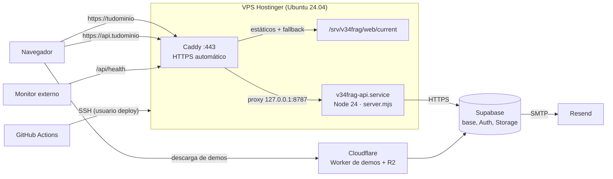
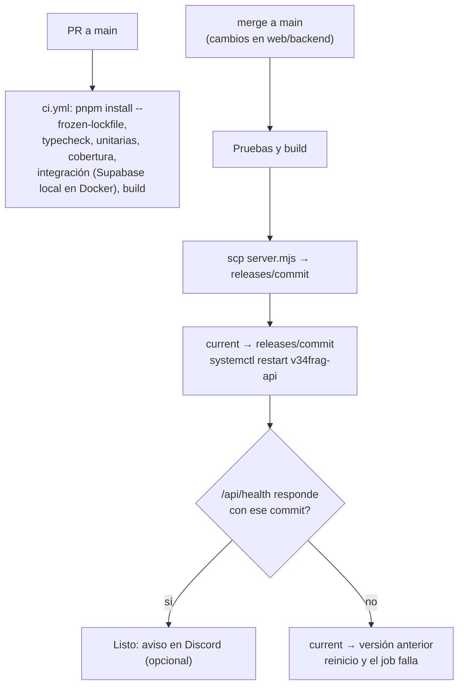
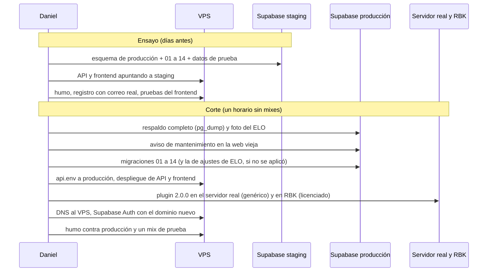

# Plan: despliegue de la web nueva en el VPS (Hostinger)

> Planeación original. Estado: **propuesta**, pendiente de aprobación. **No se implementa todavía** (pedido de Daniel, 2026-10-16).

Daniel decidió el 2026-10-14 alojar la web nueva y la API en un **VPS KVM 1 de Hostinger con dominio propio**. Cloudflare se queda solo con el Worker de demos y R2, y Supabase sigue siendo la base, Auth y Storage. Ver "Cambio de hosting" en [`2026-10-14-backend-base-auth-perfil/GUIA_IMPLEMENTACION.md`](../2026-10-14-backend-base-auth-perfil/GUIA_IMPLEMENTACION.md).

Este plan cubre todo lo que hace falta para que la web nueva quede en producción:
- La preparación del servidor.
- El build y el servicio de la API.
- Caddy con HTTPS, el DNS y el correo de Auth.
- El pipeline desde GitHub, el monitoreo y la reversión.
- **El orden del corte**, porque el backend nuevo solo funciona con la base del replanteo (01 a 14).

Reemplaza la parte de Pages y Workers del plan general [`2026-10-14-web-pages-worker`](../2026-10-14-web-pages-worker/PLAN.md).

## Decisiones tomadas

| Tema | Decisión | Por qué |
|---|---|---|
| Servidor | VPS KVM 1 de Hostinger (1 vCPU, 4 GB, 50 GB NVMe) con **Ubuntu 24.04 LTS** | Ya decidido. Ubuntu LTS tiene Node 24 por NodeSource y Caddy por su repositorio oficial |
| Qué corre en el VPS | **Solo la API (Node) y los archivos del frontend.** La base sigue en Supabase | El VPS queda sin estado: si se rompe, se rehace desde el repo y las variables |
| Dominios | `tudominio` para el frontend y **`api.tudominio`** para la API | Como en el diagrama de la guía del backend. Las rutas del frontend (por ejemplo `/auth/...`) no chocan con las de la API, y cada uno se despliega aparte |
| HTTPS y proxy | **Caddy**: certificados automáticos de Let's Encrypt, proxy a la API y archivos estáticos con fallback a `index.html` | Configuración corta, renueva solo, y ya estaba elegido |
| Proceso de la API | **systemd** (`v34frag-api.service`), un solo proceso, reinicio automático, usuario sin privilegios y endurecimiento de systemd | No suma dependencias (pm2). Un solo proceso mantiene exacto el límite de intentos en memoria |
| Build de la API | **Un solo archivo** `dist/server.mjs` hecho con **esbuild** desde `src/node.ts`, con las dependencias adentro | En el servidor no hace falta pnpm ni `node_modules`: solo Node 24. esbuild ya está autorizado en `allowBuilds` |
| Versiones en el servidor | `releases/<commit>/` y un enlace `current`. Se guardan las últimas 5 | Volver atrás es cambiar el enlace y reiniciar: segundos |
| Pipeline | **GitHub Actions**: en cada PR, tipos y pruebas. Al hacer merge a `main` con cambios en `web/backend`: pruebas, build, subida por SSH, cambio de enlace, reinicio y chequeo de `/api/health` con el commit. **Si falla, vuelve sola a la versión anterior** | Las pruebas bloquean el despliegue, y nadie sube a mano |
| Frontend en el pipeline | Mismo esquema cuando exista `web/frontend` con su build (lo define el equipo de frontend). Caddy sirve la carpeta `current` | Hoy no hay frontend nuevo en el repo |
| Acceso del pipeline | Usuario `deploy` con **llave SSH propia**, que solo puede escribir en `/srv/v34frag` y reiniciar el servicio (`sudoers` limitado) | Si se filtra la llave, no da root |
| Seguridad del servidor | Solo llave SSH (sin contraseña ni root), firewall `ufw` (22, 80 y 443), `fail2ban`, actualizaciones de seguridad automáticas. Node escucha solo en `127.0.0.1` | Lo mínimo para un servidor expuesto |
| Correo de Auth | **SMTP propio** en Supabase Auth (propuesta: **Resend**; alternativa: Brevo) con registros SPF y DKIM en el DNS del dominio | El correo incluido de Supabase manda muy pocos por hora y es solo para pruebas. Sin SMTP propio, la confirmación del registro falla con más de unos pocos usuarios |
| Supabase Auth | `Site URL` y `Redirect URLs` al dominio nuevo | El link del correo de confirmación lleva a `FRONTEND_URL` |
| Proxy de Cloudflare delante | **No, por ahora.** DNS directo al VPS | Menos piezas. Si se agrega, `CLIENT_IP_HEADER` pasa a `cf-connecting-ip` (ya soportado) |
| Monitoreo | `/api/health` desde un monitor externo gratis (propuesta: UptimeRobot) con aviso por correo o Discord, y logs en `journald` | Enterarse de una caída sin mirar el servidor |
| Ensayo antes del corte | **Un proyecto de Supabase de prueba** (staging), gratis, con el esquema de producción más 01 a 14 y **datos de prueba** (sin la copia de producción, que tiene datos personales) | El backend nuevo no corre contra la base de producción hasta el corte. Así se prueba el VPS completo de punta a punta antes |

## 1. Cómo queda



```
/srv/v34frag/
├── api/
│   ├── releases/<commit>/server.mjs
│   ├── current -> releases/<commit>
│   └── api.env            (variables de producción, 600, dueño v34frag)
└── web/
    ├── releases/<commit>/ (build del frontend)
    └── current -> releases/<commit>
```

## 2. Preparación del VPS (una vez)

1. Ubuntu 24.04 desde el panel de Hostinger, con la llave SSH de Daniel.
2. Usuarios:
   - `admin`: el de Daniel, con `sudo`.
   - `deploy`: el del pipeline, sin `sudo` salvo `systemctl restart v34frag-api` y `systemctl reload caddy`.
   - `v34frag`: corre la API, sin shell.
3. SSH:
   - Sin contraseña y sin `root`.
   - El puerto 22 se mantiene: cambiarlo no suma seguridad real y complica el pipeline.
4. Paquetes de seguridad:
   - `ufw` con 22, 80 y 443.
   - `fail2ban` para SSH.
   - `unattended-upgrades` solo con actualizaciones de seguridad.
5. Node 24 (NodeSource) y Caddy (repositorio oficial).
6. `v34frag-api.service`:
   - `User=v34frag` y `EnvironmentFile=/srv/v34frag/api/api.env`.
   - `ExecStart=/usr/bin/node /srv/v34frag/api/current/server.mjs`.
   - `Restart=always`.
   - Endurecimiento: `NoNewPrivileges`, `ProtectSystem=strict`, `ProtectHome`, `PrivateTmp` y `ReadOnlyPaths`.
7. `Caddyfile`:
   - `tudominio`: `root /srv/v34frag/web/current`, `try_files {path} /index.html`, `file_server`, `encode`, caché larga para los archivos con hash y corta para `index.html`.
   - `api.tudominio`: `reverse_proxy 127.0.0.1:8787`.
   - En los dos: cabeceras de seguridad (HSTS) y logs.
8. **Cierre automático de las temporadas** (agregado el 2026-10-21, plan [`2026-10-20-temporadas`](../2026-10-20-temporadas/PLAN.md)):
   - `v34frag-season.service` (`Type=oneshot`, `User=v34frag`, `EnvironmentFile=/srv/v34frag/api/season.env`, `ExecStart=/usr/bin/node /srv/v34frag/api/current/season-tick.mjs`) y `v34frag-season.timer` (`OnCalendar=*:0/10`, `Persistent=true`).
   - Llama a `season_close_due()`: cierra la temporada si venció (con un mix en vivo espera, hasta 6 horas). Escribe en `journald` solo si cierra o espera.
   - `season.env` tiene `SUPABASE_URL` y `SUPABASE_SERVICE_KEY` (permisos 600, dueño `v34frag`). Es aparte de `api.env` para que la API siga sin la clave de servicio.
9. Todo esto queda como **scripts y archivos en el repo** (`deploy/vps/`): `preparar.sh`, `v34frag-api.service`, `v34frag-season.service`, `v34frag-season.timer`, `Caddyfile`, `sudoers-deploy`, `api.env.example` y `season.env.example`, para que el VPS se pueda rehacer igual.

## 3. Variables de producción de la API (`api.env`)

| Variable | Valor |
|---|---|
| `APP_ENV` | `production` |
| `PORT` | `8787` (solo en `127.0.0.1`) |
| `SUPABASE_URL`, `SUPABASE_ANON_KEY` | Del proyecto de producción (la anon key es pública) |
| `FRONTEND_URL` | `https://tudominio` |
| `CORS_ORIGINS` | `https://tudominio` (y `https://www.tudominio` si se usa) |
| `CLIENT_IP_HEADER` | `x-forwarded-for` (Caddy lo reemplaza con la IP real) |
| `DEMO_BASE_URL` | La URL del Worker de demos |
| `GIT_SHA` | El commit, lo pone el pipeline al desplegar |

- No lleva la `service_role` de Supabase: la API actúa siempre con el token del usuario. Solo el cron de las temporadas la usa, desde su propio `season.env` (sección 2, punto 8).
- El archivo vive solo en el VPS, con permisos 600 y dueño `v34frag`.

## 4. Cambios en el repo (cuando se implemente)

| Qué | Detalle |
|---|---|
| `web/backend`: script `build` | esbuild: `src/node.ts` → `dist/server.mjs` y `scripts/season-tick.mts` → `dist/season-tick.mjs` (ESM, plataforma Node 24, con las dependencias y source maps) |
| `web/backend`: script `start` | `node dist/server.mjs` |
| `src/node.ts` | Escuchar solo en `127.0.0.1` en producción (`HOST`), y cerrar ordenado con `SIGTERM` (termina los requests en curso antes del reinicio) |
| Prueba del build | Arrancar `dist/server.mjs` en el CI y pedir `/api/health` |
| `deploy/vps/` | Los archivos de la sección 2 y `desplegar.sh` (subir, enlazar, reiniciar, chequear y volver atrás) |
| `.github/workflows/` | `ci.yml` (PR) y `deploy-api.yml` (merge a `main`); `deploy-web.yml` cuando exista el frontend |
| wrangler 4.151 o superior | De paso, cierra los avisos de seguridad de las dependencias de desarrollo |

## 5. Pipeline



- **Secretos en GitHub** (entorno `production`): la llave SSH de `deploy`, el host y la huella del servidor (`known_hosts`, para no aceptar cualquier servidor).
- El repo es `mchssj/v34frag`: cargar secretos y entornos necesita permisos de administración del repo.
- **Integración en el CI:** la Supabase local corre en Docker en los runners de GitHub. Suma unos minutos al PR, pero es la suite que prueba las reglas de la base.
- **Despliegue manual de emergencia:** `deploy/vps/desplegar.sh <commit>` desde la máquina de Daniel hace lo mismo que el pipeline.

## 6. DNS y correo

| Registro | Valor |
|---|---|
| `A` `tudominio` y `api` (y `www` si se usa) | IP del VPS |
| `AAAA` | IPv6 del VPS, si Hostinger la da |
| SPF, DKIM (y `MX` de retorno) | Los que pida Resend para enviar desde `no-reply@tudominio` |
| DMARC | `p=none` al principio, para ver reportes sin rechazar |

En Supabase Auth:
- SMTP de Resend, con el remitente `v34frag <no-reply@tudominio>`.
- `Site URL` y `Redirect URLs` con `https://tudominio`.
- Revisar la rotación del refresh token y `refresh_token_reuse_interval` (pendiente anotado en `PENDIENTES.md`).
- Plantillas de correo en español: confirmación y cambio de email.

## 7. Ensayo y corte

El backend nuevo necesita las migraciones 01 a 14, y la web vieja deja de funcionar con ellas. Por eso el VPS se prueba primero contra **staging** y la producción cambia toda junta, en una sola tanda.



**Checklist del corte** (va completo en la guía de implementación):
1. Sin mixes en curso: no se recarga el plugin con una partida en curso.
2. Respaldo con `pg_dump` (credenciales `PG_*` del `.env`) y foto del ELO con `foto_elo.sql`.
3. Migraciones 01 a 14 en orden. La `09`, la `10`, la `12` y la `14` abortan solas si encuentran datos que no encajan.
4. Despliegue de la API y del frontend con las variables de producción. `pnpm smoke https://api.tudominio`.
5. **Plugin 2.0.0 en el servidor real y en RBK en la misma tanda** (regla de `CLAUDE.md`), con la 1.8.0 en `plugins/disabled/`.
6. DNS, Supabase Auth (URLs y SMTP) y chequeo del correo de registro.
7. Un mix de prueba: resultado, ELO, demo y `!match`.
8. Changelog en Discord.

**Volver atrás:**
- Hasta el paso 3, no se tocó nada.
- Después:
  - Inversas 14 a 01 en orden, o restaurar el respaldo si algo quedó a medias.
  - El plugin 1.8.0 de `plugins/disabled/`.
  - El DNS a la web vieja.

## 8. Lo que no cubre

- El frontend en sí: su stack y su build los define el equipo de frontend. Este plan solo asume que el build es una carpeta de archivos estáticos.
- Varios procesos o varios servidores: con un solo proceso alcanza, y el límite de intentos en memoria lo necesita así. Si algún día hace falta escalar, el límite pasa a la base o a Redis.
- Cambiar el Worker de demos, R2 o Supabase de plan.

## 9. Requisitos antes de empezar

| Qué | Quién |
|---|---|
| **El dominio**: cuál es, dónde está registrado y si hoy apunta a la web vieja (`FTP_WEB_*`) | Daniel |
| El VPS contratado, con Ubuntu 24.04 y acceso SSH con llave | Daniel |
| Cuenta de Resend (o la alternativa elegida) con el dominio verificado | Daniel |
| Proyecto de Supabase de staging (plan gratis) | Daniel |
| Permisos de administración en `mchssj/v34frag` para secretos y entornos de GitHub | Daniel o el dueño del repo |
| Cuenta en el monitor externo | Daniel |
| Nada que instalar en la máquina de Daniel | — |

## 10. Orden de implementación

1. Repo: `build`, `start`, `HOST` y cierre ordenado en `node.ts`, la prueba del build, `deploy/vps/` y los workflows.
2. VPS: `preparar.sh`, servicio, Caddy (primero con un subdominio de prueba o con la IP), firewall.
3. Staging: proyecto de Supabase con el esquema y datos de prueba; API del VPS apuntando ahí; pipeline de punta a punta (incluida la vuelta atrás automática con un despliegue roto a propósito).
4. DNS del dominio, Resend y Supabase Auth de staging; registro con correo real.
5. Frontend en el VPS contra staging, cuando el equipo de frontend tenga un build.
6. Corte, con la checklist de la sección 7.
7. `DOCUMENTACION.md`, `GUIA_IMPLEMENTACION.md` y `PENDIENTES.md`.
