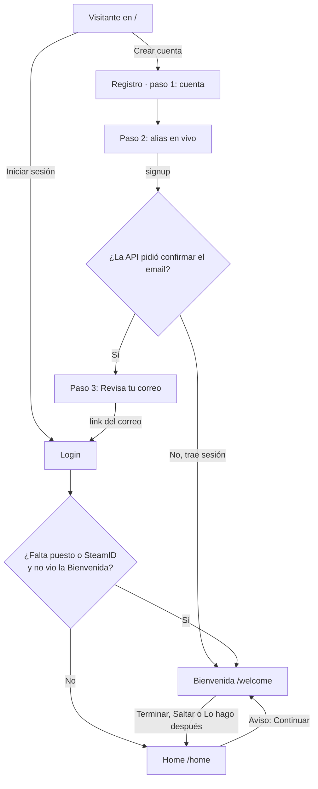
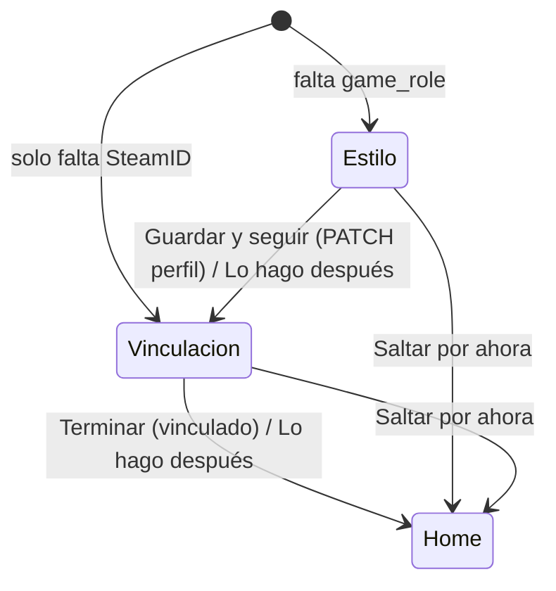

# Diseño de Landing, Login, Registro y Bienvenida: documentación

## Qué hace

El frontend nuevo (`web/frontend`) aplica el diseño de alta fidelidad del handoff `CSSTV/desings/design_handoff_landing_auth/` a la entrada de la plataforma:

- **Landing** (`/`), solo para visitantes;
- **Login** (`/login`);
- **Registro** (`/register`, 3 pasos sin sesión);
- **Bienvenida** (`/welcome`, 2 pasos con sesión, al primer ingreso);
- aviso **"Completa tu perfil"** en el Home (`/home`).

La lógica de sesión, guardas y errores es la de `2026-10-15-frontend-auth`; aquí cambian las vistas, las rutas y el flujo del registro. Los datos que la API ya expone se muestran reales (partidas en vivo, próximo torneo, top 5, mixes). Los que no, salen de un único archivo de valores fijos (`src/config/site.ts`).

## Rutas y guardas

| Ruta | Guarda | Qué pasa |
|---|---|---|
| `/` | `redirectIfSignedIn` | Sin sesión guardada se muestra al instante. Con sesión pide `/auth/me` y va a `/home`; si la API falla, deja ver la landing |
| `/login`, `/register` | `requireGuest` | Con sesión salen al `redirect` seguro o a `/home` |
| `/welcome` | `requireAuth` | Sin sesión van a `/login?redirect=…` |
| `/home` y el resto de `_app` | `requireAuth` | Ídem |

El link de confirmación del email vuelve a `/login?aviso=cuenta-confirmada` (los tokens del fragmento se descartan, `src/auth/callback.ts`).

## Cuándo se muestra la Bienvenida

La API todavía no tiene `onboarding_done`. El criterio, compartido por el login, `/welcome` y el aviso, está en `src/features/onboarding/queries.ts`:

- **Estilo de juego hecho:** el perfil (`GET /api/v1/me/profile`) tiene `game_role`.
- **Vinculación hecha:** `GET /api/v1/me/claim-code` devuelve al menos un `steam_ids`.
- **Se redirige a `/welcome` al entrar** solo si falta algo **y** no se mostró antes en ese navegador (`localStorage` `csstv.welcome-seen.<userId>`, se marca al abrir la Bienvenida).
- **El aviso del Home** se ve mientras falte algo, sin botón de cierre: "Completa tu perfil · {hechos} de 2".

La Bienvenida arranca en el primer paso pendiente.

## Registro

- **Paso 1, cuenta:**
  - email con la expresión del diseño;
  - contraseña de 8 o más caracteres con un medidor de 4 barras (`passwordScore`: largo, mayúscula, número, símbolo);
  - los errores aparecen recién al intentar continuar.
- **Paso 2, alias:**
  - disponibilidad en vivo con `GET /api/v1/aliases/{alias}/available` (espera de 300 ms);
  - los estados "Muy corto" y "No permitido" se resuelven sin la API;
  - vista previa "Así te verán" con el nivel 4.
- **Errores de "Crear cuenta":**
  - un `409` del email vuelve al paso 1 con el campo marcado;
  - un `409` del alias deja el paso 2 con "En uso".
- **Paso 3, Revisa tu correo:** email enmascarado (`maskEmail`). La contraseña se borra del estado al crear la cuenta.
- **Si `signup` trae sesión** (Supabase sin confirmación, como en local): se salta el paso 3 y va a `/welcome`.

## Bienvenida

- **Paso 1:**
  - 6 tarjetas de puesto, que son radios nativos con estilo de tarjeta (Rifler por defecto), y el país (lista del backend, Argentina por defecto);
  - "Guardar y seguir" hace `PATCH /me/profile` con `game_role` y `country`.
- **Paso 2:**
  - código `!claim` en casillas, con tantas como caracteres tenga el código real;
  - cuenta regresiva real con `expires_at`;
  - instrucciones con `connect <ip>` (IP fija, `CLAIM_SERVER`);
  - consulta `GET /me/claim-code` cada 5 s hasta que aparece un SteamID.
- **Reutilización del código:** si hay un `last_code` pendiente y vigente, se reutiliza; si no, se pide uno solo (`POST`, protegido contra el doble montaje). Al vencer aparece "Generar otro código".
- **Toasts del diseño:** "Perfil actualizado", "Puedes vincular tu jugador desde Mi perfil" y "¡Listo! Ya puedes jugar tu primer mix.".

## Login

- **Formulario:** Email y Contraseña, más la casilla **Recordarme** (único agregado al diseño), marcada por defecto.
- **Errores:** se eligen por `code` (`src/api/errors.ts`) y se limpian al escribir. EMAIL_NOT_CONFIRMED muestra "Confirma tu email…"; RATE_LIMITED, una cuenta regresiva; INTERNAL, CONFIG_INVALID y NETWORK, el código de seguimiento con "Reintentar".
- **Tarjeta lateral:** muestra la partida oficial en vivo si la hay, o si no la cantidad de mixes reportados.

## Landing

| Elemento | Fuente |
|---|---|
| Pill "{n} partidas en vivo" | Real: `matches?status=live&per=1` → `total` (se refresca cada minuto) |
| Jugadores, servidores, Discord | Fijos (`src/config/site.ts`) |
| Próximo torneo | Real: `events?status=registration&sort=starts_on&order=asc&per=1`. "Empieza en {n} días" (no hay fecha de cierre). Sin torneo: estado vacío |
| Top 5 por ELO | Real: `players?sort=elo&order=desc&per=5` |

- **Servidores:** "Conectar" abre `steam://connect/<ip>`; la IP se copia con un toast "IP copiada".
- **Navegación:** los links hacen scroll suave a cada sección.
- **Mientras cargan los datos:**
  - el torneo y el top 5 muestran *skeletons* del mismo tamaño;
  - la pill muestra los jugadores y suma las partidas cuando llegan (tiene altura fija, así que no mueve la página);
  - si un dato falla, la landing sigue funcionando: la pill omite las partidas, y el torneo y el ranking dicen que no se pudieron cargar (distinto del estado vacío "Todavía no hay…").

## Sistema visual

| Pieza | Detalle |
|---|---|
| Colores | Los del preset shadcn `b3PBYm`, más `--win` (verde de victorias) en claro y oscuro |
| Radios | `rounded-lg` = radius − 2px (controles), `rounded-xl` = +4px (paneles), `rounded-tile` = +2px, `rounded-hero` = +6px |
| Tipografía | Inter (texto) y Geist Mono (`font-mono`: IPs, códigos, cifras) |
| `leading-design` | El diseño usa `line-height: normal`. Esta utilidad lo aplica en la raíz de cada vista y redefine `--text-*--line-height`, que Tailwind lee por `var()`, para que `text-sm` y similares también lo respeten |
| Tema | Sistema, Claro u Oscuro (botón que cicla). Clave `csstv-theme`; `public/theme-init.js` lo aplica antes del primer render |
| Movimiento | El punto "en vivo" usa `animate-live`, que se desactiva con `prefers-reduced-motion` |

## Dónde está cada cosa

| Qué | Archivo / ubicación |
|---|---|
| Tokens, `leading-design`, animación | `web/frontend/src/index.css` |
| Marca (logo, tema, nivel, en vivo, títulos de sección) | `web/frontend/src/components/brand/` |
| Valores fijos | `web/frontend/src/config/site.ts` |
| Landing | `web/frontend/src/features/landing/`, `src/routes/index.tsx` |
| Datos públicos | `web/frontend/src/features/public/queries.ts` |
| Layout de auth y piezas comunes | `web/frontend/src/features/auth/AuthShell.tsx`, `ui.tsx` |
| Login | `web/frontend/src/features/auth/LoginForm.tsx`, `src/routes/_auth/login.tsx` |
| Registro | `web/frontend/src/features/auth/register/`, `src/routes/_auth/register.tsx` |
| Bienvenida y aviso | `web/frontend/src/features/onboarding/`, `src/routes/welcome.tsx`, `src/routes/_app/home.tsx` |
| Guardas | `web/frontend/src/auth/guards.ts` |
| Mensajes de error | `web/frontend/src/api/errors.ts` |
| Imagen del hero | `web/frontend/src/assets/landing-bg.avif` y `.webp` |
