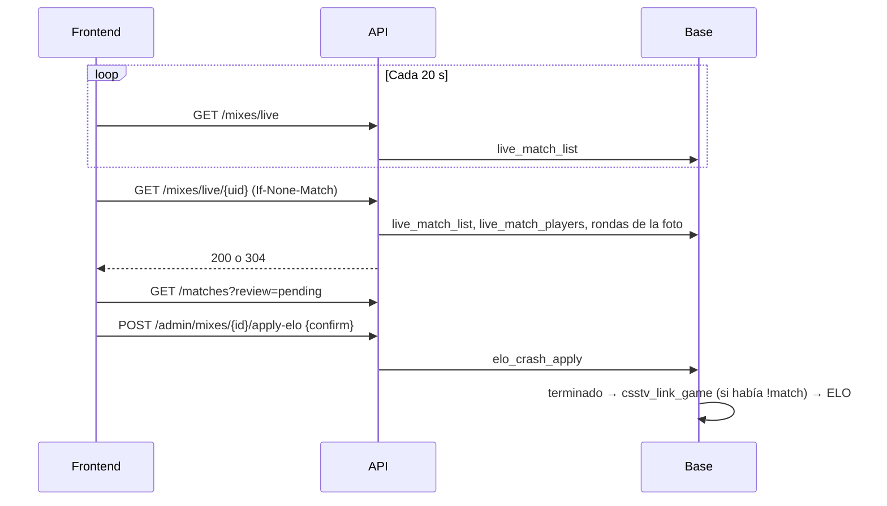
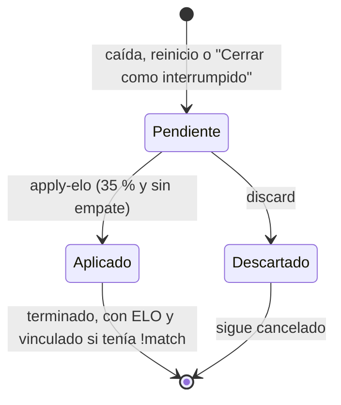

# Mixes en vivo e interrumpidos en la API nueva: documentación

## Qué hace

La API nueva expone lo mismo que la web vieja ya muestra desde el 2026-10-17 (bitácora [`2026-10-17-mixes-en-vivo`](../2026-10-17-mixes-en-vivo/DOCUMENTACION.md)):
- **Mixes en vivo:** los que se están jugando, con marcador, rondas y stats parciales. El servidor manda una foto al final de cada ronda.
- **Mixes interrumpidos:** los que cortó una caída o un reinicio del servidor. Un admin decide si cuentan para el ELO.

Suma dos cosas que la web vieja no tiene:
- Un interrumpido que se jugaba con `!match` se vincula a su partida de torneo o PCW cuando se aprueba.
- El detalle de una partida de torneo o PCW muestra el mapa que se está jugando.

## Estados de un mix interrumpido

| `review` | `status` | `cancel_reason` / `end_reason` |
|---|---|---|
| `pending` | `cancelled` | `cancel_reason = 'crash'` |
| `applied` | `finished` | `end_reason = 'crash'` |
| `discarded` | `cancelled` | `cancel_reason = 'crash'` |
| null | cualquiera | no es un interrumpido |

## Reglas

- **Mínimo para aprobar:** `ceil(max_rounds × 35 / 100)` rondas jugadas y sin empate. La API lo calcula en `review_detail` (`crashMinRounds`, igual que `crash_min_rounds` en la base) y la base lo vuelve a validar al aprobar.
- **Vinculación con `!match`:** la foto trae `link_code` y `link_side_a`, que `csstv_after_ingest` guarda en `match_crashes`. Al aprobar, `elo_crash_apply` llama a `csstv_link_game` antes del ELO, como la ingesta de un mix terminado. Si el juego no cumple las reglas de vinculación (planteles), queda como mix.
  - Ya vinculado, el mix toma los nombres de los equipos de la partida.
  - Si no se aprueba, el organizador puede cargar el resultado a mano (`POST /api/v1/matches/{id}/result`).
- **Mapa en juego de una serie:** `live_match_list.parent_match_id` es la partida de torneo o PCW **abierta** (`upcoming` o `live`) con ese código. El marcador se da vuelta según `parent_side1`, como en `games`.
- **`stale`:** más de 10 minutos sin fotos. Es la condición de `live_match_close` para cerrar un mix como interrumpido.
- **Doble confirmación** para aplicar el ELO: `confirm: "estoy seguro"` (sin distinguir mayúsculas ni espacios en los bordes).
- **Errores:** las funciones avisan con `22023` (una regla) y `P0002` (no existe o ya no está). La API los devuelve como `400 BUSINESS_RULE` y `404 NOT_FOUND` con el mensaje de la función.

## Base de datos (`supabase/replanteo/16_mixes_en_vivo.sql`)

| Objeto | Qué es |
|---|---|
| `match_crashes.link_code`, `link_side_a` | Código de `!match` y lado que traía la foto del interrumpido |
| `csstv_after_ingest` | Guarda esas dos columnas (reemplazo de texto marcado "replanteo 16") |
| `elo_crash_apply` | Llama a `csstv_link_game` si hay código, antes del ELO (reemplazo de texto marcado "replanteo 16") |
| `live_match_list` | Una fila por mix en vivo: servidor, mapa, `score1`, `score2`, `rounds_played`, `max_rounds`, `started_at`, `updated_at`, `stale`, `side1_name`, `side2_name` (como los nombra la ingesta), `parent_match_id`, `parent_side1`, `search` y `player_ids` (con `steam_owner`, que incluye los SteamID adicionales). **Sin `security_invoker`**: lee `matches.link_code`, que el público no ve; solo expone el id de la partida |
| `live_match_players` | Un jugador por fila: `side`, `steam_id`, `player_id`, `game_nick` y stats parciales con `rating` (`csstv_rating`) |
| `match_list` | Suma al final `cancel_reason`, `review` y `review_max_rounds` |

Anon y authenticated solo tienen `select` en las dos vistas nuevas.

## API

| Endpoint | Quién | Respuesta |
|---|---|---|
| `GET /api/v1/mixes/live` | Público | Listado paginado de `LiveMixSummary`. Orden `updated_at` (por defecto, desc) o `started_at`. Filtros `server`, `player`, `map`, `stale`, `q` |
| `GET /api/v1/mixes/live/{uid}` | Público | `LiveMixDetail`: el resumen más `seq`, `rounds` y `players`. `ETag` y `304`; `404` cuando terminó |
| `GET /api/v1/matches` | Público | El resumen suma `cancel_reason` y `review`. Filtro `review` |
| `GET /api/v1/matches/{id}` | Público | Suma `review_detail` (`MixReview`) y `live` (`LiveGameRef`) |
| `POST /api/v1/admin/mixes/{id}/apply-elo` | Admin | `{ confirm }` → `204` |
| `POST /api/v1/admin/mixes/{id}/discard` | Admin | `204` |
| `POST /api/v1/admin/mixes/live/{uid}/close` | Admin | `200 { match_id }` |

## Dónde está cada cosa

| Qué | Archivo |
|---|---|
| Migración | `supabase/replanteo/16_mixes_en_vivo.sql` |
| Inversa y prueba | `docs/bitacora/2026-10-14-replanteo-modelo-datos/reversas/16_mixes_en_vivo.sql` y `pruebas/16_mixes_en_vivo.sql` |
| Esquemas | `web/backend/src/schemas/live.ts` y `src/schemas/matches.ts` (`ReviewStatus`, `MixReview`, `review`, `cancel_reason`, `live`) |
| Servicios | `web/backend/src/services/live.ts` y `src/services/matches.ts` (`crashMinRounds`, `mixReview`) |
| Rutas | `web/backend/src/routes/live.ts` y `src/routes/matches.ts` |
| Pruebas | `web/backend/test/integration/live.test.ts` y `test/unit/live-services.test.ts` |
| Contrato del frontend | `docs/frontend/contract.md`, secciones 0, 8d, 9 y 11 |
