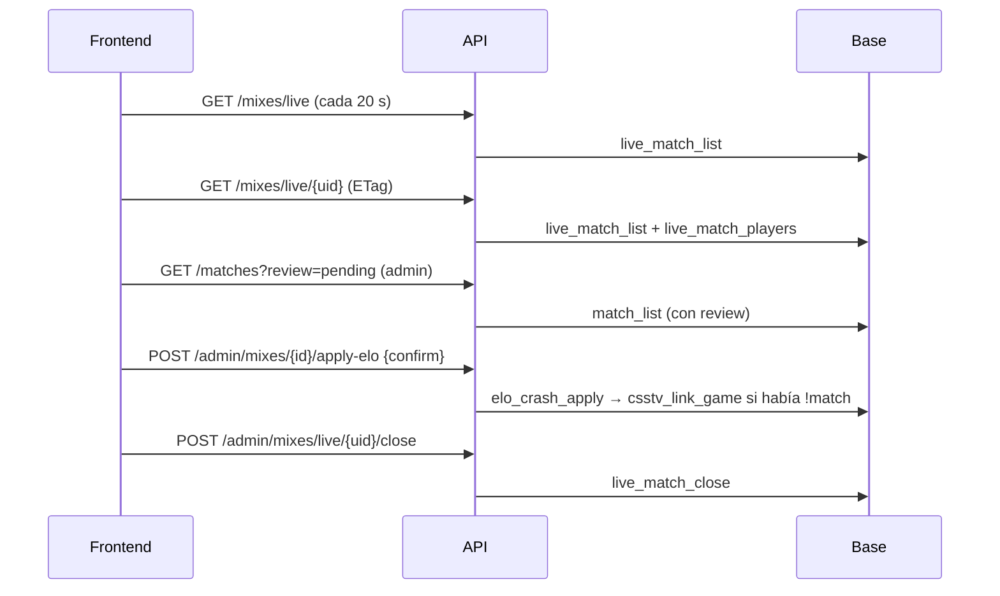

# Plan: mixes en vivo y mixes interrumpidos en la API nueva

> Planeación original. Estado: **aprobado** por Daniel el 2026-10-17 (decisiones de la tabla). Solo local: la migración `16` se aplica en el corte, con las demás del replanteo.

## Decisiones tomadas

| Tema | Decisión | Por qué |
|---|---|---|
| Mix vinculado con `!match` que se interrumpe | Al **aprobar** el ELO, el juego también se vincula a su partida de torneo o PCW. Si no se aprueba, el organizador sigue pudiendo cargar el resultado a mano | Decisión de Daniel. Hoy la vinculación solo se hace con un resultado terminado |
| En vivo de una serie | El detalle de una partida de torneo o PCW muestra el mapa que se está jugando | Decisión de Daniel |
| Aplicar el ELO de un interrumpido | Doble confirmación: `confirm: "estoy seguro"` | Decisión de Daniel. Mismo criterio que el recálculo |
| Listado de interrumpidos | Un filtro `review` en `GET /api/v1/matches`, sin un endpoint aparte | El listado de partidas ya tiene paginación, filtros y orden. La web vieja ya muestra "ELO pendiente" en público |
| Mixes en vivo sin novedades (para "Cerrar como caída") | Campo `stale` y filtro `stale` en el listado en vivo | Mismo motivo: un solo listado |
| Datos de la foto | Vistas en la base (migración `16`) que sacan del JSON los bandos, la búsqueda y los jugadores con su ficha | Para filtrar y ordenar en el servidor, como exige la convención de los GET |
| Vista en vivo sin `security_invoker` | La vista corre con los permisos de su dueño | Necesita leer `matches.link_code` (oculto al público desde la `10`) para encontrar la serie; solo expone el id de la partida |
| Errores de las funciones | La API traduce `22023` a 400 y `P0002` a 404 con el mensaje de la función | Hoy `22023` sale con un mensaje genérico y `P0002` como error interno |

## 1. El flujo completo

## 2. Base de datos: `supabase/replanteo/16_mixes_en_vivo.sql`

- **Verifica antes:** que exista `claim_codes` (`15`) y `live_matches` (migración `20261017120000`), y que la `16` no se haya aplicado.
- **`match_crashes`:** columnas `link_code` y `link_side_a`. `csstv_after_ingest` las guarda desde la foto.
- **`elo_crash_apply`:** después de pasar el mix a terminado, si tiene `link_code` llama a `csstv_link_game`. Va antes del ELO, como en la ingesta. Se cambia con el mecanismo de reemplazos de texto del replanteo, para que la inversa deje la función idéntica.
- **`live_match_list`:**
  - Una fila por mix en vivo: servidor, mapa, marcador, rondas jugadas, rondas del mix, inicio y última foto.
  - `stale`: más de 10 minutos sin fotos.
  - Nombres de los bandos: "Equipo <nick>" o "Mix de <el que más mató>", como la ingesta.
  - Búsqueda, `player_ids` (con `steam_owner`, que incluye los SteamID adicionales), y la partida de torneo o PCW vinculada (`parent_match_id`, `parent_side1`).
- **`live_match_players`:** un jugador por fila, con su ficha (si tiene) y sus stats parciales.
- **`match_list`:** suma al final `cancel_reason`, `review` (`pending`, `applied`, `discarded` o null) y `review_max_rounds`.
- **Inversa** en `docs/bitacora/2026-10-14-replanteo-modelo-datos/reversas/16_mixes_en_vivo.sql` y **pruebas** en `pruebas/16_mixes_en_vivo.sql`. `correr.sh` las toma solas.

## 3. API

| Endpoint | Quién | Qué hace |
|---|---|---|
| `GET /api/v1/mixes/live` | Público | Paginado. Orden `updated_at` (por defecto, desc) o `started_at`. Filtros `server`, `map`, `player`, `stale`, `q` |
| `GET /api/v1/mixes/live/{uid}` | Público | Marcador, rondas (ganador y lado de cada una), jugadores por bando con su ficha. `ETag` y `304` |
| `GET /api/v1/matches` | Público | Resumen con `cancel_reason` y `review`. Filtro nuevo `review` (`pending`, `applied`, `discarded`) |
| `GET /api/v1/matches/{id}` | Público | `review` con rondas jugadas, mínimo y si se puede aprobar. En torneo y PCW, `live`: el juego en curso vinculado, con el marcador en el orden de los bandos de la partida |
| `POST /api/v1/admin/mixes/{id}/apply-elo` | Admin | `confirm: "estoy seguro"`. Llama a `elo_crash_apply` |
| `POST /api/v1/admin/mixes/{id}/discard` | Admin | `elo_crash_discard` |
| `POST /api/v1/admin/mixes/live/{uid}/close` | Admin | `live_match_close`. Devuelve el id de la partida |

## 4. Requisitos antes de empezar

- Supabase local en Docker y `pnpm db:reset` con el replanteo.
- La migración `20261017120000` ya está en `supabase/migrations/` (y en producción).

## 5. Orden de implementación

1. Migración `16`, su inversa y su prueba; `correr.sh` completo.
2. `pnpm db:types`.
3. Esquemas, servicio y rutas.
4. Pruebas unitarias y de integración.
5. `docs/frontend/contract.md` (sección nueva, registro de decisiones, `!claim` pasa a la 2.2.0), README del replanteo, `DOCUMENTACION.md`, `GUIA_IMPLEMENTACION.md`, índice y `docs/PENDIENTES.md`.
