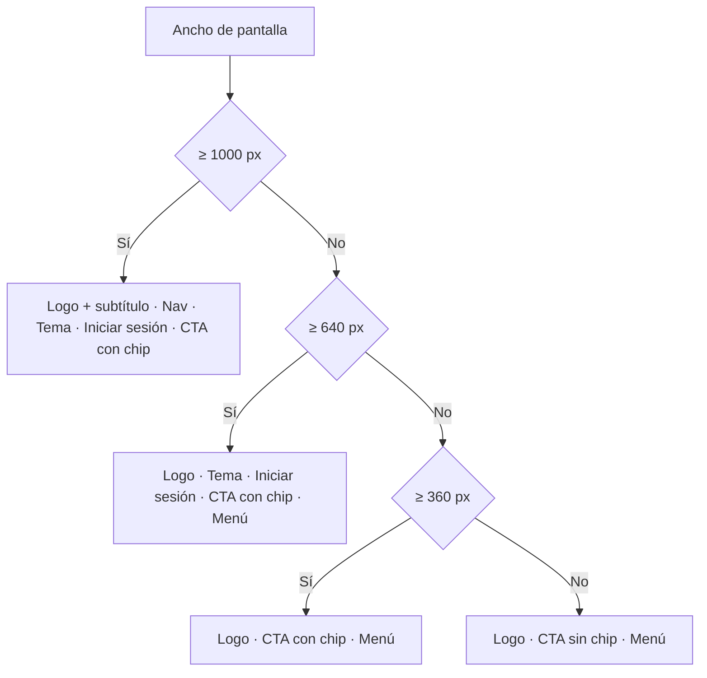

# Header flotante y hero de la landing: documentación

## Qué hace

La landing (`/`) reemplaza la barra sticky con borde inferior por una **barra flotante**: separada del borde de la pantalla, con 1260 px de ancho máximo, el radio de la plataforma, fondo translúcido con desenfoque y sombra suave. El tema se elige con un **selector segmentado** (claro, oscuro, sistema). El CTA "Crear cuenta" lleva un chip con la flecha.

El **hero** ocupa el 88% del alto de la pantalla menos el header y centra su contenido verticalmente, dejando asomar el inicio de la sección siguiente.

Login, Registro, Bienvenida y la app interna **no cambian**: conservan su logo con el cuadro "TV" y su botón de tema que cicla.

## Barra flotante

| Parte | Detalle |
|---|---|
| Contenedor | `<header>` sticky, transparente, `px-4 pt-3.5`: ocupa 70 px de alto |
| Barra | 56 px de alto, 1260 px de ancho máximo, borde de 1 px, radio `--radius`, fondo `background` al 85% con `backdrop-blur` de 12 px y sombra `0 1px 2px / 0 8px 24px -12px` |
| Logo | Solo texto (`Wordmark`): "CSS" + "TV" en primario, 16 px / 800. Lleva arriba con scroll suave |
| Subtítulo | "Counter-Strike Source", 14 px, solo desde 1000 px |
| Nav | "Cómo funciona", "Servidores" y "Competencia" llevan con scroll suave a cada sección (`scroll-margin-top` de 60 px). Solo desde 1000 px |
| Tema | `ThemeSwitch`, desde 640 px |
| Iniciar sesión | Link de texto, desde 640 px |
| CTA | "Crear cuenta" con el chip de la flecha (`bg-black/15`) desde 360 px |
| Menú | Botón `Menu` / `X` por debajo de 1000 px |

Ningún elemento de la barra se parte en dos líneas: todos son `shrink-0 whitespace-nowrap`, y se verificó que entran desde 1000 hasta 1260 px.

## Menú móvil

- **Componente:** el `DropdownMenu` de shadcn (Radix, no modal), alineado al borde derecho interno de la barra y 8 px debajo de ella. Mide 220 px de ancho mínimo, con ítems de 38 px.
- **Contenido:** las tres secciones; elegir una cierra el menú y hace scroll. Por debajo de 640 px también trae "Iniciar sesión" y el tema (un grupo de opciones Claro, Oscuro y Sistema).
- **Cómo se cierra:** con Escape, con un clic fuera o al elegir una opción. También se cierra al agrandar la ventana a 1000 px o más, escuchando el evento `change` de `matchMedia`, y no vuelve a abrirse solo al achicarla otra vez.
- **Teclado:** flechas, Enter y foco de vuelta al botón, como lo resuelve Radix.

## Selector de tema

`ThemeSwitch` es un grupo (`role="group"`, "Tema") con tres botones (`Sun`, `Moon`, `Monitor`) que usan `aria-pressed`, `title` y `aria-label`. El activo lleva `bg-background` y `shadow-sm`. Guarda la elección con el `ThemeProvider` de siempre (clave `csstv-theme`), así que persiste al recargar y la aplica `theme-init.js` antes del render.

## Hero

- **Alto mínimo:** `calc(88svh - 70px)`, con el contenido centrado verticalmente. Se usa `svh` y no `dvh` para que el hero no cambie de alto cuando el navegador del teléfono esconde la barra de direcciones.
- **Contenedor:** `py-24 px-6`. El padding hace de mínimo en pantallas bajas.
- **Lo demás no cambia:** imagen, degradado, pill, título, párrafo y botones.

## Dónde está cada cosa

| Qué | Archivo / ubicación |
|---|---|
| Barra flotante y menú | `web/frontend/src/features/landing/LandingHeader.tsx` |
| Hero | `web/frontend/src/features/landing/Hero.tsx` |
| Selector de tema segmentado | `web/frontend/src/components/brand/ThemeSwitch.tsx` |
| Texto de la marca | `web/frontend/src/components/brand/Wordmark.tsx` (lo usa también `Logo.tsx`) |
| Media queries en React | `web/frontend/src/lib/useMediaQuery.ts` |
| Pruebas | `src/components/brand/ThemeSwitch.test.tsx`, `e2e/landing.spec.ts` |
