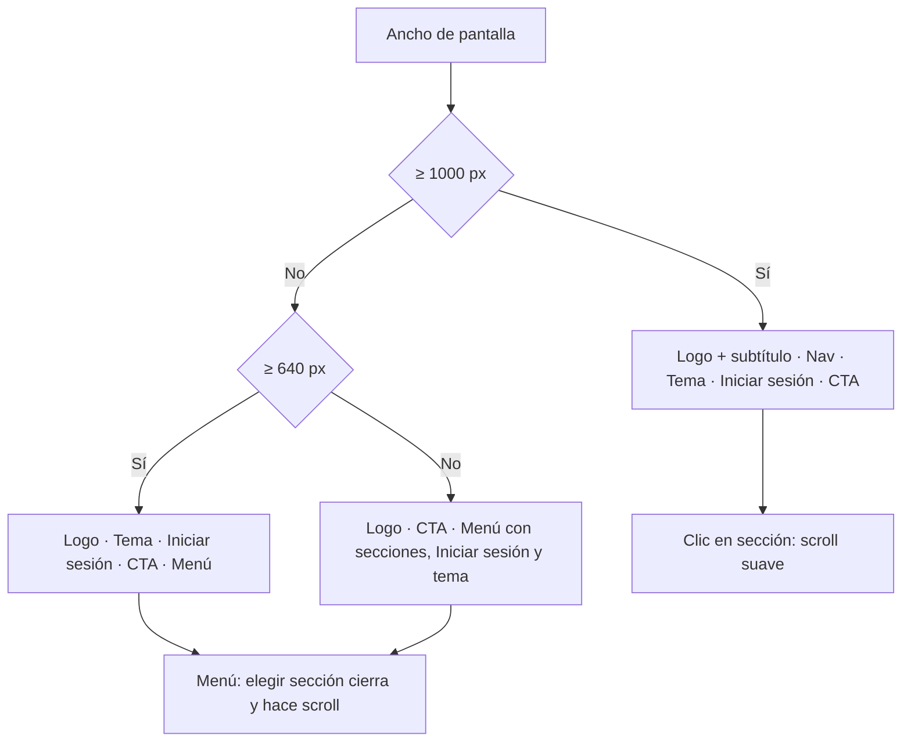

# Plan: header flotante y hero de la landing

> Planeación original. Estado: **aprobado** el 2026-10-17 (spec "Landing: header flotante y hero" de diseño, con las respuestas de Esteban sobre logo, alcance y tema).

## Decisiones tomadas

| Tema | Decisión | Por qué |
|---|---|---|
| Alcance | Solo la landing (`/`). Login, Registro, Bienvenida y la app interna no cambian | Respuesta de Esteban; la spec deja auth como opcional |
| Logo | Solo texto: "CSS" + "TV" en `text-primary`, 16 px / 800 / tracking −0,4 px, y el subtítulo "Counter-Strike Source" (14 px, `muted-foreground`). Sin el cuadro "TV" | Respuesta de Esteban |
| Tema | Toggle segmentado de 3 botones (claro, oscuro, sistema) **solo en la landing**. La app conserva el botón que cicla | Respuesta de Esteban |
| Menú móvil | `DropdownMenu` de shadcn (Radix): Escape, clic fuera y foco resueltos sin código propio. Estado controlado para cerrarlo al pasar a ≥ 1000 px | La spec lo permite y evita reimplementar accesibilidad |
| Pantallas angostas (no está en la spec) | Por debajo de 640 px, el toggle de tema e "Iniciar sesión" pasan al menú desplegable. Por debajo de 400 px, el CTA pierde el chip de la flecha | Con todo en la barra se necesitan unos 530 px; sin esto la landing se desborda en teléfonos (320 a 390 px) |
| Alto del hero | `min-h-[calc(88svh-70px)]` | `svh` no cambia cuando el navegador del móvil esconde la barra de direcciones; `dvh` haría saltar el hero al hacer scroll |
| Offset del scroll | 60 px (`scroll-margin-top`), como dice la spec | Las secciones tienen 88 px de padding arriba: el título nunca queda bajo la barra |

## 1. El flujo completo

## 2. Header flotante

- **Contenedor:** `<header>` sticky, transparente, `px-4 pt-3.5`.
- **Barra:**
  - 1260 px de ancho máximo, 56 px de alto, `gap-3`, `pl-[18px] pr-2`;
  - borde de 1 px y radio `--radius` (no pill);
  - fondo `background` al 85% con `backdrop-blur` de 12 px y la sombra doble de la spec;
  - `relative`, para anclar el menú.
- **Elementos:** logo (scroll arriba), nav (`ml-auto`), tema segmentado, "Iniciar sesión" en texto, CTA "Crear cuenta" con chip `bg-black/15` y `ArrowRight`. Todos `shrink-0 whitespace-nowrap`.
- **Breakpoint de 1000 px** (`min-[1000px]:`): por debajo se ocultan el subtítulo y la nav, aparece un espaciador `ml-auto` y el botón de menú (`Menu` / `X`).
- **Menú:**
  - `min-w-[220px]`, `p-1.5`, radio `--radius`, `shadow-lg`;
  - ítems de 38 px de alto;
  - alineado a la derecha, 8 px debajo de la barra.

## 3. Toggle de tema segmentado

- **Componente:** nuevo `components/brand/ThemeSwitch.tsx`. Es un grupo con `aria-label="Tema"` y tres botones (`Sun`, `Moon`, `Monitor`) con `aria-pressed`, `title` y `aria-label`.
- **Estilo:** contenedor `bg-muted p-[3px]` con radio −2 px; botones de 30 px con radio −4 px; el activo lleva `bg-background shadow-sm`.
- **Persistencia:** usa el `ThemeProvider` existente (clave `csstv-theme`), sin cambios.

## 4. Logo

- **`Wordmark`:** se separa del `Logo` en `components/brand/` para reutilizarlo. El `Logo` (cuadro + wordmark) sigue igual en auth y en la app.
- **Ajuste viejo:** se quita el ancho fijo `lg:w-[77px]`, que solo servía para alinear la nav del header anterior.

## 5. Hero

- **Sección:** `flex items-center` con `min-h-[calc(88svh-70px)]`. Contenedor interno `w-full` con `py-24 px-6`, en lugar de `pt-[88px] pb-20`.
- **Lo demás, igual:** imagen, degradado, pill, título, párrafo y botones.

## 6. Pruebas

- **Unitaria:** `ThemeSwitch` marca el modo activo con `aria-pressed` y cambia el tema.
- **Playwright:**
  - a 390 px, el menú abre, "Servidores" cierra el menú y deja la sección a la vista, y Escape lo cierra;
  - el tema elegido en la landing persiste al recargar.
- **Visual:**
  - capturas en 1440, 1260, 1000, 999, 768, 390 y 320 px, en claro y oscuro;
  - medir que nada se parta en dos líneas entre 1000 y 1260 px;
  - chequeo de desborde horizontal.

## 7. Requisitos antes de empezar

Ninguno: no hay dependencias nuevas (`dropdown-menu` ya está instalado) ni cambios en el backend.

## 8. Orden de implementación

1. `Wordmark` y limpieza del `Logo`.
2. `ThemeSwitch` y su prueba.
3. `LandingHeader` flotante con el menú y sus breakpoints.
4. Hero.
5. Pruebas e2e, capturas, desborde, verificación completa (typecheck, lint, build, `pnpm test`, `pnpm test:e2e`).
6. `DOCUMENTACION.md`, `GUIA_IMPLEMENTACION.md` y la fila del README.
