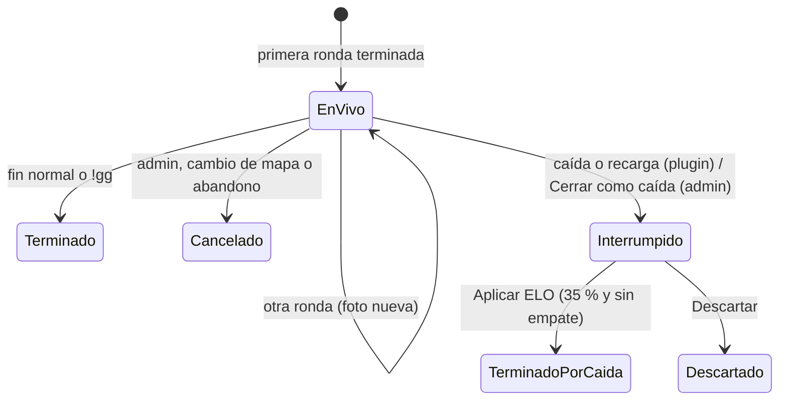

# Mixes en vivo y mixes interrumpidos: documentación

## Qué hace

La lista de mixes de la web muestra también los **mixes que se están jugando**, con el marcador, las rondas jugadas y las estadísticas parciales de cada jugador. El servidor manda una "foto" del mix al final de cada ronda.

Esa foto también sirve si el servidor **se cae a mitad de un mix**. Antes el mix se perdía entero; ahora queda guardado como **interrumpido** con la última ronda que se alcanzó a jugar. Un admin decide si cuenta para el ELO: solo se puede aprobar si se jugó al menos el **35 % de las rondas** del mix y si no iban empatados. Al aprobarlo, el mix pasa a terminado y gana el que iba adelante.

```mermaid
sequenceDiagram
    participant P as Plugin
    participant D as Disco del servidor
    participant B as Supabase
    participant W as Web
    participant A as Admin

    loop Cada ronda terminada
        P->>D: live/<uid>.json
        P->>B: foto (ingest_server_chunk, uid <uid>_vN)
        W->>B: live_matches cada 20 s
    end
    alt Termina o se cancela
        P->>B: resultado final; se borra la foto
    else Caída o recarga del plugin
        P->>B: al volver: la foto como cancelada por "crash"
    else El servidor no vuelve
        A->>B: Cerrar como caída (10 min sin fotos)
    end
    A->>B: Aplicar ELO o Descartar
```

## Estados de un mix



| Estado | En la base | En la web |
|---|---|---|
| En vivo | fila en `live_matches` | sección "En vivo" de Mixes |
| Interrumpido | `matches.status = 'cancelled'`, `cancel_reason = 'crash'`, fila en `match_crashes` sin `decision` | etiquetas "Interrumpida" y "ELO pendiente" |
| Terminado por caída | `status = 'finished'`, `end_reason = 'crash'`, `match_crashes.decision = 'applied'` | etiqueta "Interrumpida", con ganador y ELO |
| Descartado | sigue cancelado, `match_crashes.decision = 'discarded'` | etiqueta "Interrumpida", sin ELO |

## Reglas

- **Foto:** al final de cada ronda que no termina el mix, con al menos 2 jugadores que completaron una ronda. Es el mismo JSON del resultado final, con `"status":"live"` y `"live_seq"` (1, 2, 3…).
- **Orden:** la base guarda una foto solo si su `live_seq` es mayor al guardado. Se usa `live_seq` y no el número de ronda porque con `!rr` el marcador vuelve atrás.
- **Uid de las partes:** `<match_uid>_v<seq>`. `ingest_chunks` tiene `(uid, part)` como clave: si dos fotos usaran el mismo uid, se mezclarían sus partes.
- **Prioridad:** la cola del plugin manda primero los resultados finales y después la foto más nueva. Una foto que la web rechaza no se reintenta (la siguiente la reemplaza).
- **Una foto tardía no revive un mix:** si la partida ya existe, la foto se ignora.
- **Recuperación:** al cargar el plugin, cada archivo de `data/csstv/live/` es un mix cortado. Pasa a la cola como cancelado por `crash`, salvo que su resultado ya esté en `queue/`, `sent/` o `failed/`.
- **Recargar el plugin con un mix en curso** cuenta como una caída: el mix queda interrumpido (antes se perdía).
- **Reinicio o apagado ordenado** (el reinicio del panel, `quit`): el motor termina el mapa antes de cerrar, igual que en un cambio de mapa. Desde la 2.1.1, el fin de mapa no encola el resultado al instante: lo guarda como `live/<uid>.mapchange` junto a la foto y lo encola cuando arranca el mapa siguiente (`Live_FlushMapChange` en `OnMapStart`). Si el mapa siguiente nunca arranca porque el proceso se cerró, al volver `Live_Recover` lo trata como caída.
- **Cambio de mapa real:** sigue quedando "cancelada por cambio de mapa", unos segundos después. Sin foto (`csstv_live 0` o ninguna ronda completa con 2 jugadores) se encola al instante, como antes.
- **Cerrar como caída:** solo un mix sin fotos hace más de 10 minutos. Si después el servidor vuelve y manda la caída, la base devuelve la misma partida.
- **Mínimo para el ELO:** `ceil(max_rounds × 35 / 100)` rondas jugadas (suma del marcador). MR24: 9; MR30: 11; MR3 (6 rondas): 3. La función `crash_min_rounds` y la web usan la misma cuenta.
- **Al aprobar:** el mix cuenta como cualquier terminado: ELO (con el peso por participación de siempre, sobre las rondas jugadas), victorias y estadísticas. "Recalcular ELO" lo incluye.

## Base de datos (`supabase/migrations/20261017120000_mixes_en_vivo.sql`)

| Objeto | Qué es |
|---|---|
| `live_matches` | Última foto de cada mix en curso: `uid`, `server_id`, `server_name`, `seq`, `map`, `score_a`, `score_b`, `max_rounds`, `payload`, `started_at`, `updated_at`. Lectura pública, escritura solo por funciones |
| `match_crashes` | Un mix interrumpido: `match_id`, `max_rounds`, `source` (`plugin` o `admin`), `decision` (`applied`, `discarded` o null), `reviewed_at`, `reviewed_by`. Lectura pública |
| `matches_cancel_reason_check` / `matches_end_reason_check` | Admiten `crash` |
| `ingest_server_chunk` | Redefinida: separa las fotos (`csstv_live_upsert`) de los resultados, y después de `csstv_ingest` llama a `csstv_after_ingest` |
| `ingest_server_match` | Redefinida (`csstv_uploader.py`): también llama a `csstv_after_ingest` |
| `csstv_live_upsert(server, uid, payload)` | Interna: valida y guarda la foto |
| `csstv_after_ingest(match, payload, source)` | Interna: borra la foto y, si es una caída, pone `cancel_reason = 'crash'` y crea la fila de `match_crashes`. `csstv_ingest` no se tocó: guarda un motivo desconocido como `admin` y esta función lo corrige |
| `live_match_close(uid)` | Admin: cierra como caída un mix sin fotos hace 10 minutos |
| `elo_crash_apply(match)` | Admin: valida 35 % y empate, pasa a `finished` con el ganador, recalcula las stats de los jugadores y aplica el ELO |
| `elo_crash_discard(match)` | Admin: lo deja cancelado y marca la revisión |
| `crash_min_rounds(max_rounds)` | Mínimo de rondas para aprobar |

## Plugin (2.1.0)

| Qué | Dónde |
|---|---|
| Foto por ronda, envío, recuperación y estado | `csstv/live.inc` |
| `"status":"live"` y `"live_seq"` en el JSON | `Json_BuildPayload(..., liveSeq)` en `csstv/json.inc` |
| La cola manda la foto cuando no hay resultados | `Http_ProcessQueue` y `Http_OnResponse` en `csstv/http.inc` |
| Foto después de cada ronda, se borra al terminar o cancelar | `OnRoundCompleted`, `FinishMatch` y `CancelMatch` en `csstv_reporter.sp` |

- **cvar `csstv_live`** (1 por defecto): 0 apaga las fotos sin recompilar. Con 0, un mix cortado tampoco se recupera (no hay foto).
- **`sm_csstv_status`** muestra una línea "Fotos en vivo: activadas · foto N (enviada: M)".
- **Log:** las fotos no escriben nada en el chat ni en el log. Un mix recuperado escribe "Partida <uid> interrumpida (caída del servidor o recarga del plugin)…". Los errores de envío van al log de errores.
- **Demo:** un mix interrumpido conserva `demo: true` si se estaba grabando. Como el servidor se cayó, el archivo puede quedar cortado o no estar; en ese caso el Worker lo marca como `missing`.

## Web vieja (`index.html`)

- **Mixes:** sección "En vivo" (servidor, mapa, equipos, marcador, rondas jugadas de las del mix, hace cuánto llegó la última foto). "Ver" muestra las estadísticas parciales. Se refresca cada 20 segundos mientras la página está a la vista; cuando un mix deja de estar en vivo, recarga todo para mostrar su resultado. Un mix sin fotos hace más de 10 minutos se ve atenuado.
- **Lista de mixes y detalle:** "Interrumpida" para los dos casos, "ELO pendiente" mientras falta la revisión, y el texto del estado en el detalle.
- **Admin → Servidores → Mixes interrumpidos:** los pendientes, con rondas jugadas, mínimo y motivo si no se puede aprobar; botones "Aplicar ELO" (deshabilitado si no cumple), "Ver" y "Descartar". Debajo, los mixes en vivo sin novedades hace 10 minutos, con "Cerrar como caída".

## Dónde está cada cosa

| Qué | Archivo / ubicación |
|---|---|
| Migración | `supabase/migrations/20261017120000_mixes_en_vivo.sql` |
| Pruebas de la base | `docs/bitacora/2026-10-17-mixes-en-vivo/pruebas/pruebas_db.sql` |
| Funciones de las pruebas con bots | `docs/bitacora/2026-10-17-mixes-en-vivo/pruebas/lib.sh` |
| Plugin | `server/addons/sourcemod/scripting/csstv/live.inc`, `csstv/json.inc`, `csstv/http.inc`, `csstv_reporter.sp` |
| Fotos en el servidor | `addons/sourcemod/data/csstv/live/<uid>.json` |
| Web | `index.html` (`rLiveMixes`, `pollLive`, `rCrash`, `mixCancelTag`, `mixCrashTag`) |
