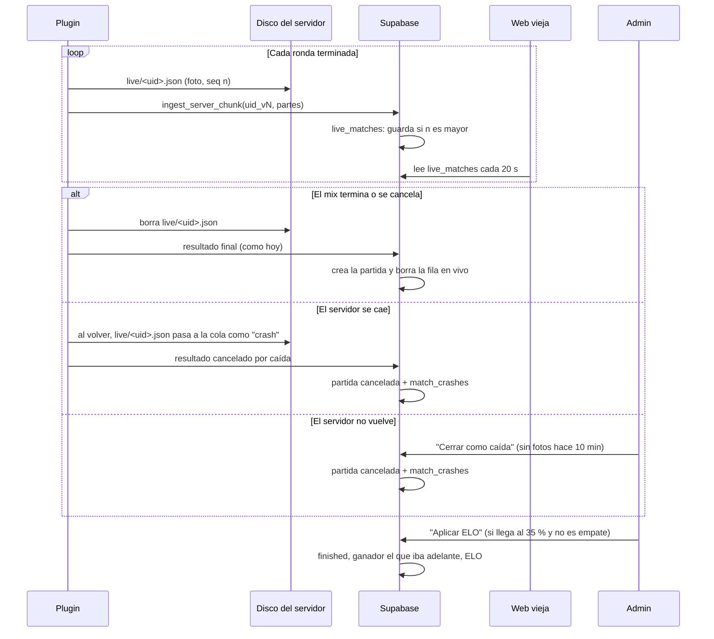
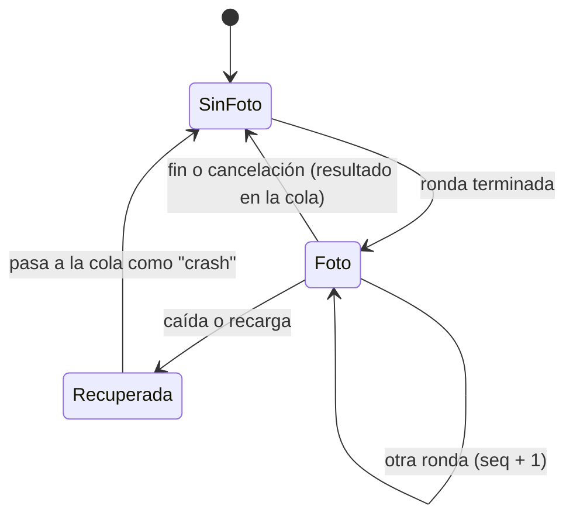

# Plan: mixes en vivo en la web y ELO de un mix interrumpido por una caída

> Planeación original. Estado: **aprobado** por Daniel el 2026-10-17 (decisiones de la tabla). Solo plugin y web vieja (`index.html`), probado en el servidor dedicado local con la Supabase local. **Nada en producción** hasta que Daniel lo pida.

## Decisiones tomadas

| Tema | Decisión | Por qué |
|---|---|---|
| Alcance | Plugin `csstv_reporter` y web vieja (`index.html`), con una migración nueva en `supabase/migrations/` | Pedido de Daniel. El backend nuevo y el frontend nuevo quedan para después |
| Producción | No se toca: ni base, ni web, ni servidores | Pedido de Daniel. Primero se prueba en local |
| Frecuencia de la foto parcial | Al final de **cada ronda** | Decisión de Daniel |
| ELO de un mix interrumpido | Solo con **aprobación de un admin** | Decisión de Daniel. Hoy ninguna cancelada da ELO; si se pudiera tirar el servidor a propósito, el ELO automático premiaría al que va perdiendo |
| Mínimo para aprobar | **35 % de las rondas del mix** (`max_rounds`), redondeado hacia arriba: 9 rondas en un MR24, 11 en un MR30 | Decisión de Daniel |
| Empate en el marcador | No se puede aprobar: no hay ganador | El ELO necesita un resultado |
| Qué pasa al aprobar | El mix pasa a `finished` con `end_reason = 'crash'` y gana el que iba adelante. Cuenta para el ELO, las victorias y las estadísticas, como cualquier mix terminado | Así lo aplican `elo_apply_match` y `elo_recompute_all` sin cambios, y un "Recalcular ELO" da lo mismo |
| Dónde viven los mixes en vivo | Tabla aparte `live_matches`, no filas `live` en `matches` | La web vieja, las vistas y el ELO leen `matches`; una fila a medio jugar los ensuciaría. Además `csstv_ingest` no se toca, porque el replanteo (04, 07 y 15) lo vuelve a definir |
| Versión del plugin | **2.1.0**, sobre la 2.0.0 | Es lo último del plugin. `!claim` pasa a ser la 2.2.0 |
| Interruptor | cvar `csstv_live 1` (0 apaga las fotos sin recompilar) | Si algo falla en el servidor real, se apaga al instante |

## 1. El flujo completo

## 2. Base de datos (`supabase/migrations/20261017120000_mixes_en_vivo.sql`)

**Tablas nuevas:**

| Tabla | Columnas | Lectura |
|---|---|---|
| `live_matches` | `uid` (clave), `server_id`, `server_name`, `seq`, `map`, `score_a`, `score_b`, `max_rounds`, `payload` (la foto completa), `started_at`, `updated_at` | Pública (como `match_player_stats`, que ya muestra lo mismo) |
| `match_crashes` | `match_id` (clave), `max_rounds`, `source` (`plugin` o `admin`), `created_at`, `decision` (`applied`, `discarded` o nada), `reviewed_at`, `reviewed_by` | Pública |

**Restricciones:** `matches.cancel_reason` y `matches.end_reason` admiten `'crash'`.

**Funciones:**

| Función | Quién | Qué hace |
|---|---|---|
| `ingest_server_chunk` (se redefine) | Plugin | Si el JSON armado tiene `status: "live"`: valida que el uid de las partes sea `<match_uid>_v<seq>`, ignora la foto si la partida ya existe o si `seq` no es mayor al guardado, y guarda la fila. Si es un resultado final: igual que hoy, más `csstv_mark_crash` si es una caída y borra la fila en vivo |
| `ingest_server_match` (se redefine) | `csstv_uploader.py` | Lo mismo para el resultado final |
| `csstv_mark_crash(match, payload, source)` | Interna | `cancel_reason = 'crash'` y fila en `match_crashes`. Se hace después de `csstv_ingest`, que convierte un motivo desconocido en `admin` |
| `live_match_close(uid)` | Admin | Una fila sin fotos hace más de 10 minutos pasa a partida cancelada por caída. Con una partida que sigue en curso no deja |
| `elo_crash_apply(match)` | Admin | Valida 35 % y que no sea empate; pasa a `finished`, pone el ganador, recalcula las stats de los jugadores y aplica el ELO |
| `elo_crash_discard(match)` | Admin | La deja cancelada y marca la revisión |

**Por qué el uid de las partes lleva `_v<seq>`:** `ingest_chunks` usa `(uid, part)` como clave. Si dos fotos del mismo mix usaran el mismo uid, se mezclarían sus partes.

**`seq` y no el número de ronda:** con `!rr` el marcador vuelve atrás, y una foto con menos rondas tiene que reemplazar a la anterior.

## 3. Plugin (2.1.0)

Archivo nuevo `csstv/live.inc`, más cambios chicos en `csstv_reporter.sp`, `csstv/json.inc`, `csstv/http.inc` y `csstv/status.inc`.

- **Foto:** después de cada ronda que no termina el mix (en `OnRoundCompleted`), con al menos 2 jugadores con una ronda completa. `Json_BuildPayload` arma lo mismo que el resultado final, con `status: "live"` y `live_seq`. Se escribe en `data/csstv/live/<uid>.json` (se reemplaza la anterior) y se programa el envío.
- **Envío:** la cola manda primero los resultados finales. Si no hay ninguno, manda la foto más nueva que no se haya enviado. Sin mensajes en el chat ni en el log en cada foto; los errores sí van al log de errores. Un rechazo 4xx de una foto se descarta (no hay `failed/` de fotos).
- **Fin o cancelación del mix:** se borra la foto **después** de guardar el resultado en la cola.
- **Al cargar el plugin** (arranque después de una caída o recarga): cada foto de `live/` sin resultado en `queue/` ni en `sent/` pasa a la cola con `"status":"cancelled","cancel_reason":"crash"`. Si ya hay resultado, solo se borra.
- **`sm_csstv_status`:** muestra el estado de las fotos.
- **cvar `csstv_live`** (1 por defecto).

## 4. Web vieja (`index.html`)

- **Mixes:** sección "En vivo" arriba de la lista, con servidor, mapa, equipos, marcador, ronda y hace cuánto llegó la última foto. "Ver" abre la tabla parcial de jugadores. Se refresca cada 20 s mientras la página está a la vista; cuando un mix en vivo desaparece se recarga todo para traer el resultado.
- **Mix cancelado por caída:** "Cancelada (interrumpida: servidor caído)" y, si falta la revisión, "ELO pendiente".
- **Mix aprobado:** etiqueta "Interrumpida" con el marcador y el ganador, y el mismo texto en el detalle.
- **Admin → Servidores:** sección "Mixes interrumpidos" con los pendientes (rondas jugadas, mínimo, "Aplicar ELO" y "Descartar") y los mixes en vivo sin fotos hace más de 10 minutos ("Cerrar como caída").

## 5. Requisitos antes de empezar

- Docker Desktop corriendo con la Supabase local (`web/backend`, `REPLANTEO=0 pnpm db:reset`: esquema de producción más las migraciones pendientes, sin el replanteo).
- El servidor dedicado local apuntado a la Supabase local (URL, anon key local y token `tok-servidor-local`). Hoy su cfg apunta a la Supabase real con `csstv_send 1`: se respalda y se cambia antes de arrancarlo, y se restaura al terminar.
- `spcomp` 1.8 de `E:\CSS DEDICATED SERVER\backup_sourcemod_1.8_2026-10-11` (incluye `system2.inc`).

## 6. Fuera de alcance (se anota en `docs/PENDIENTES.md`)

- **Corte del replanteo:** la `06` borra `recompute_player_stats` y la `04` pasa a `winner_side`. `elo_crash_apply` se tiene que adaptar en el corte, y el backend nuevo necesita sus endpoints (lista en vivo con paginación, filtros y orden, y los de admin).
- **Despliegue** a producción, al servidor real y a RBK (build licenciado), cuando Daniel lo pida.

## 7. Orden de implementación

1. Migración y pruebas SQL en la base local (`pruebas/pruebas_db.sql`).
2. Plugin 2.1.0 y build de depuración.
3. Pruebas con bots en el servidor local: fotos por ronda, `!rr`, fin normal, caída (matar `srcds`) y recuperación, recarga del plugin.
4. Web vieja, servida en local contra la Supabase local.
5. Restaurar el servidor local, `DOCUMENTACION.md`, `GUIA_IMPLEMENTACION.md`, `CHANGELOG_DISCORD.txt`, fila del índice y `docs/PENDIENTES.md`.
