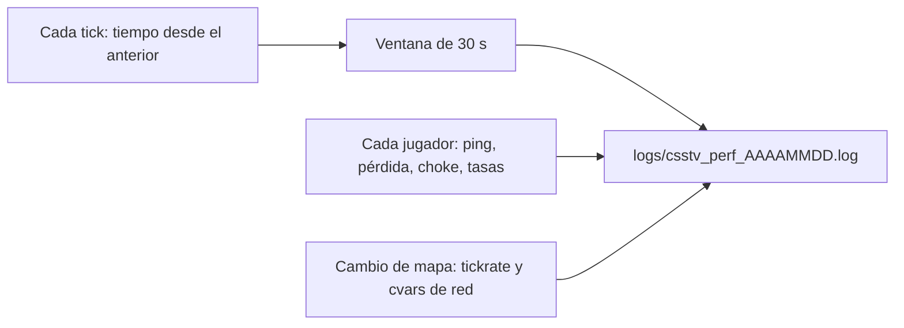

# Diagnóstico de tirones y sonido en el servidor real: documentación

## Qué hace

`csstv_perf` es un plugin de medición, solo para el servidor real (#1). Mide si el servidor procesa sus ticks a tiempo y cómo le llega la red a cada jugador. Sirve para contestar, con datos, si las quejas ("los jugadores aparecen y desaparecen", "no se escuchan los pasos") son del servidor o de la conexión de cada uno. Así se puede comparar antes y después de cada cambio de configuración.

No manda nada a los jugadores ni cambia el juego.



## El log

`addons/sourcemod/logs/csstv_perf_AAAAMMDD.log`, un archivo por día:

```
mapa de_dust2_ob · tickrate 101.0 · fps_max 101 · sv_minrate 80000 · sv_maxrate 120000 · sv_minupdaterate 101 · sv_maxupdaterate 100 · …
servidor · ticks 3029/3030 · tarde >15ms 2 · >20ms 1 · >50ms 0 · peor 23.4 ms · jugadores 10
  Nick [STEAM_0:1:123] ping 48 ms · pérdida 0.0%/0.0% · choke 3.2%/0.0% · rate 30000 · upd 101 · cmd 101
```

| Dato | Qué significa |
|---|---|
| `ticks medidos/esperados` | Si el servidor no llega, los medidos quedan por debajo de los esperados |
| `tarde >X ms` | Ticks que tardaron más de 1,5, 2 y 5 veces el intervalo (con 101 de tickrate: unos 15, 20 y 50 ms) |
| `peor` | El tick más lento de la ventana |
| `pérdida` y `choke` | En el orden saliente/entrante: lo que el servidor manda al jugador y lo que el jugador manda al servidor. Choke saliente alto = el servidor no le alcanza a mandar todo con su `rate` |
| `rate`, `upd`, `cmd` | Lo que pidió el cliente (`rate`, `cl_updaterate`, `cl_cmdrate`) |

La primera ventana después de cargar un mapa incluye la carga y sale con menos ticks: no cuenta.

## Cómo se lee

- **Ticks tarde y peor tick altos en el momento de una queja:** el problema es del servidor (CPU, `fps_max`, plugins).
- **Servidor limpio y un jugador con pérdida o choke:** es la conexión de ese jugador o su ruta (por ejemplo, una VPN).
- **Choke saliente alto en varios jugadores a la vez:** revisar las tasas (`sv_maxrate`, `sv_maxupdaterate`).

## Cvars y comando

| Nombre | Por defecto | Qué hace |
|---|---|---|
| `csstv_perf_interval` | 30 | Segundos entre líneas (0 apaga el log) |
| `csstv_perf_players` | 1 | Una línea por jugador en cada ventana |
| `csstv_perf_fps_max` | 600 | Desde la 1.1.0: `fps_max` que se mantiene aunque otro plugin lo cambie (el del hosting lo pone en 150 en cada mapa). Cada corrección va al log. 0 = no tocarlo |
| `sm_perf` | (admin, RCON) | Muestra la ventana actual en la consola |

## Dónde está cada cosa

| Qué | Archivo |
|---|---|
| Código | `server/addons/sourcemod/scripting/csstv_perf.sp` |
| Compilado | `server/addons/sourcemod/plugins/csstv_perf.smx` |
| En el servidor real | `cstrike/addons/sourcemod/plugins/csstv_perf.smx` |
