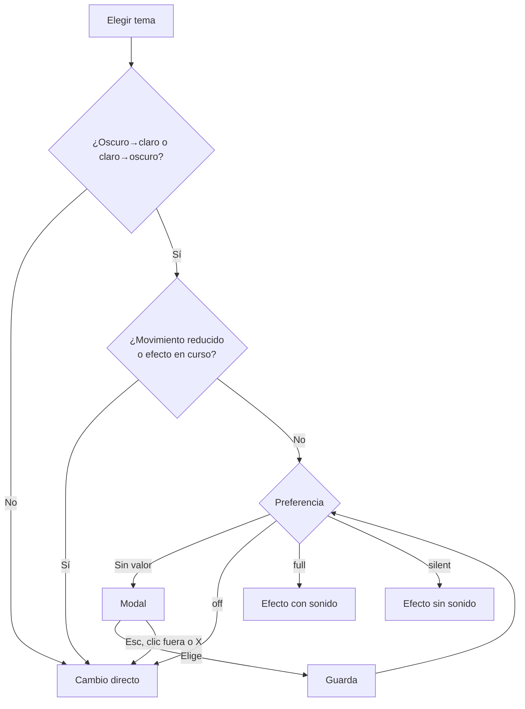

# Efectos al cambiar de tema: documentación

## Qué hace

En la landing, cambiar de tema con el selector del header (o con el menú móvil) lanza un efecto de Counter-Strike:
- **Flashbang**, al elegir Claro desde oscuro: rebotes, estallido, destello blanco a pantalla completa con desenfoque y pitido de aturdimiento. El tema cambia en el pico blanco, a los 0,9 s, y el efecto dura unos 4,5 s.
- **Smoke**, al pasar de claro a oscuro: rebotes, estallido y humo de partículas que tapa la pantalla. El tema cambia con la pantalla tapada y el efecto dura unos 2,6 s.

Cada persona elige si quiere los efectos. La primera vez que un cambio de tema lanzaría uno, se abre un modal que pregunta, con un aviso de fotosensibilidad. Después se puede cambiar con clic derecho sobre el selector (pulsación larga en táctil) o desde el menú móvil.

## Preferencia

| Valor en `localStorage` (`csstv.themeFx`) | Qué pasa |
|---|---|
| `full` | Efecto con sonido |
| `silent` | Efecto sin sonido: no se crea el `AudioContext` |
| `off` | Cambio directo |
| sin valor | El primer cambio con efecto abre el modal. Los menús muestran "Con sonido" marcado, sin guardarlo |

- **Hook:** `useThemeFxPref()` usa `useSyncExternalStore`. Se actualiza en todos los lugares que la muestran y entre pestañas (evento `storage`).
- **Sin storage:** si el navegador bloquea `localStorage`, la elección vale en memoria durante la visita.
- **Movimiento reducido:** con `prefers-reduced-motion` nunca hay modal ni efecto.

## Modal de primer uso

- **Contenido:** el título "Efectos al cambiar de tema", la explicación y el aviso de fotosensibilidad, en una tarjeta ámbar (`Alert` con la variante `warning`, nueva).
- **Botones:** Desactivar, Sin sonido y Activar efectos. El foco inicial va en "Activar efectos".
- **Al elegir:** guarda la preferencia y aplica el tema pendiente, con o sin efecto según lo elegido. Si se cierra con Escape, clic fuera o la X, aplica el tema sin efecto y no guarda nada.
- **Pie:** muestra el atajo que sirve en ese dispositivo. Con mouse, "Clic derecho"; con pantalla táctil, "Mantén presionado"; un dispositivo híbrido ve los dos. Se detecta con `any-pointer`.

## Motor

- **Flashbang y smoke:** port de `theme-fx.reference.js` con los mismos tiempos, sonidos, overlay, `filter` del `body` y canvas de 70 partículas a media resolución.
- **Audio:** cada efecto crea su propio `AudioContext`, con un bus maestro de 0,55, y lo cierra al terminar.
- **Samples:** se precargan una vez desde `THEME_FX_SOUNDS` (`src/config/site.ts`). Solo se aceptan si la respuesta es audio, porque Vite responde `index.html` para un archivo que no existe. Si un sample falta, suena el respaldo sintetizado.
- **Bloqueo:** mientras corre un efecto, otro cambio de tema es directo.
- **Limpieza:** el overlay, el canvas y los estilos del `body` siempre se quitan al terminar. Si el navegador no tiene `AudioContext` o canvas, el tema cambia igual.

## Sonidos

`grenade_hit1.wav` y `sg_explode.wav` son de Counter-Strike: Source (Valve). Están en `web/frontend/public/sounds/` solo en local, ignorados por git. En CI o en producción no existen y suena el sintetizado. **Antes de producción hay que reemplazarlos por audio CC0** y actualizar `THEME_FX_SOUNDS`.

## Dónde está cada cosa

| Qué | Archivo |
|---|---|
| Decisión (pura) | `web/frontend/src/features/theme-fx/decide.ts` |
| Preferencia y opciones | `web/frontend/src/features/theme-fx/pref.ts` |
| Precarga de samples | `web/frontend/src/features/theme-fx/samples.ts` |
| Flashbang y smoke | `web/frontend/src/features/theme-fx/engine.ts` |
| `pickTheme` y modal pendiente | `web/frontend/src/features/theme-fx/useThemeFx.ts` |
| Modal | `web/frontend/src/features/theme-fx/ThemeFxDialog.tsx` |
| Menú contextual | `web/frontend/src/features/theme-fx/ThemeFxContextMenu.tsx` |
| Conexión con el header y el menú móvil | `web/frontend/src/features/landing/LandingHeader.tsx` |
| Rutas de los sonidos | `web/frontend/src/config/site.ts` (`THEME_FX_SOUNDS`) |
| Pruebas | `src/features/theme-fx/*.test.ts`, `e2e/theme-fx.spec.ts` |
