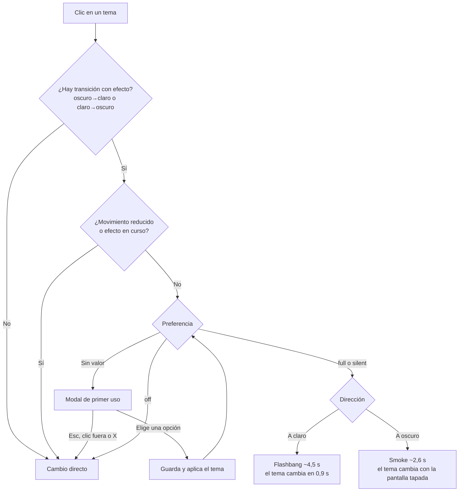

# Plan: efectos al cambiar de tema (flashbang y smoke)

> Planeación original. Estado: **aprobado** el 2026-10-18 (handoff `CSSTV/desings/handoff_efectos_tema/`, con las respuestas de Esteban sobre sonidos, preferencia y alcance).

## Decisiones tomadas

| Tema | Decisión | Por qué |
|---|---|---|
| Alcance | Solo la landing: selector de tema del header y menú móvil. La app interna sigue sin efecto | Respuesta de Esteban |
| Sonidos de Valve | Se usan en local desde `public/sounds/`, con esos dos archivos en `.gitignore`. Sin ellos (CI, producción) suena el respaldo sintetizado | Son de Counter-Strike: Source. Esteban va a buscar reemplazos con menos riesgo y pidió no commitear nada por ahora |
| Rutas de los sonidos | En `src/config/site.ts` (`THEME_FX_SOUNDS`) | Cuando lleguen los reemplazos se cambia en un solo lugar |
| Preferencia | `'full'`, `'silent'`, `'off'` o sin valor, en `localStorage` con la clave `csstv.themeFx`. Hook `useThemeFxPref()` con `useSyncExternalStore`, sincronizado entre pestañas | Handoff, "2 - Preferencia y ajustes" |
| Sincronización con el perfil | No se hace: la API no tiene `preferences.theme_fx`. Queda como pedido al backend | La landing es solo para visitantes, así que hoy no hace falta |
| Mi perfil → Preferencias | Se deja para cuando exista la pantalla Mi perfil, con el hook ya listo | La pantalla todavía no existe en el frontend nuevo |
| Menú contextual | `ContextMenu` de shadcn (Radix): clic derecho, pulsación larga en táctil, teclado, foco y ajuste a la pantalla sin código propio | El handoff lo permite |
| Modal de primer uso | `Dialog` de shadcn | Foco atrapado, Escape, `aria-modal` |

## 1. El flujo completo

Con `silent` no se crea audio.

## 2. Motor de efectos (`src/features/theme-fx/`)

- **Decisión:** `decideFx(...)` es una función pura que devuelve `ask`, `direct`, `flashbang` o `smoke`, para poder probarla.
- **`flashbang` y `smoke`:** port fiel de `theme-fx.reference.js`, con los tiempos, el audio, el overlay, el `filter` del `body` y el canvas de 70 partículas a 0,5×. Cada efecto crea su propio `AudioContext` y lo cierra al terminar.
- **Robustez:**
  - si no hay `AudioContext`, el efecto sigue sin sonido;
  - si un sample no cargó, se usa el sintetizado;
  - el DOM y los estilos del `body` siempre se limpian.
- **Samples:** se precargan una sola vez como `ArrayBuffer` y se comparten entre efectos.
- **`useThemeFx()`:** devuelve `pickTheme(k)`, el estado del modal y su resolución. Mantiene el bloqueo para que no corran dos efectos a la vez.

## 3. Interfaz

- **Modal de primer uso:**
  - textos, botones (`Desactivar`, `Sin sonido`, `Activar efectos`), aviso de fotosensibilidad y pie, como en el handoff;
  - el foco inicial va en "Activar efectos";
  - cerrarlo sin elegir aplica el tema sin efecto y no guarda nada.
- **Menú contextual sobre el selector de tema:**
  - encabezado "Efectos de tema" y tres opciones: Con sonido (`Volume2`), Sin sonido (`VolumeX`) y Desactivados (`Ban`), con check en la activa;
  - `title="Clic derecho: efectos"`;
  - el clic que llega después de una pulsación larga no cambia el tema.
- **Menú móvil:** "Efectos de tema" al final, con las mismas tres opciones.
- **`ThemeSwitch`:** recibe `onPick` (en la landing, `pickTheme`), así que sigue sirviendo sin efectos en otros lugares.

## 4. Pruebas

- **Unitarias:** `decideFx` en todos los casos de la tabla del handoff, y la preferencia (lee, guarda y avisa a otras suscripciones).
- **Playwright:**
  - el primer cambio con efecto abre el modal, y Escape aplica el tema sin guardar;
  - "Activar efectos" guarda `full` y lanza la flashbang (overlay presente y tema claro al terminar);
  - la smoke cambia a oscuro;
  - con `off` el cambio es directo;
  - el clic derecho cambia la preferencia;
  - con movimiento reducido no hay modal ni efecto;
  - el menú móvil tiene las opciones.
- **Manual:** tiempos y sonido en el navegador, en claro y oscuro.

## 5. Requisitos antes de empezar

- Agregar los componentes `dialog` y `context-menu` de shadcn. Usan `radix-ui`, que ya está instalado.
- Copiar los dos `.wav` a `public/sounds/`, que queda ignorada por git.

## 6. Orden de implementación

1. Componentes de shadcn, `.gitignore` y sonidos.
2. Preferencia y `decideFx`, con sus pruebas.
3. Motor (flashbang y smoke) y `useThemeFx`.
4. Modal, menú contextual, menú móvil y conexión con el header.
5. Pruebas e2e, verificación completa y revisión manual.
6. `DOCUMENTACION.md`, `GUIA_IMPLEMENTACION.md`, fila del README y pedidos al backend.
