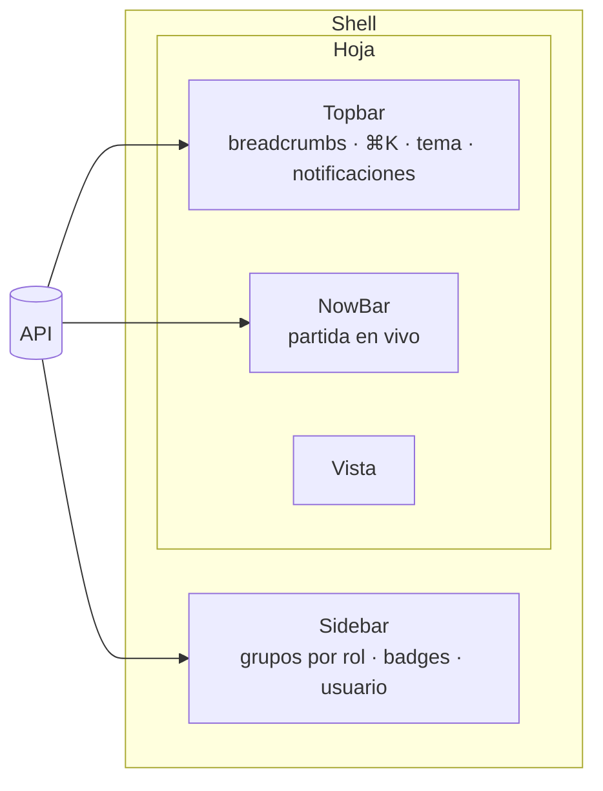
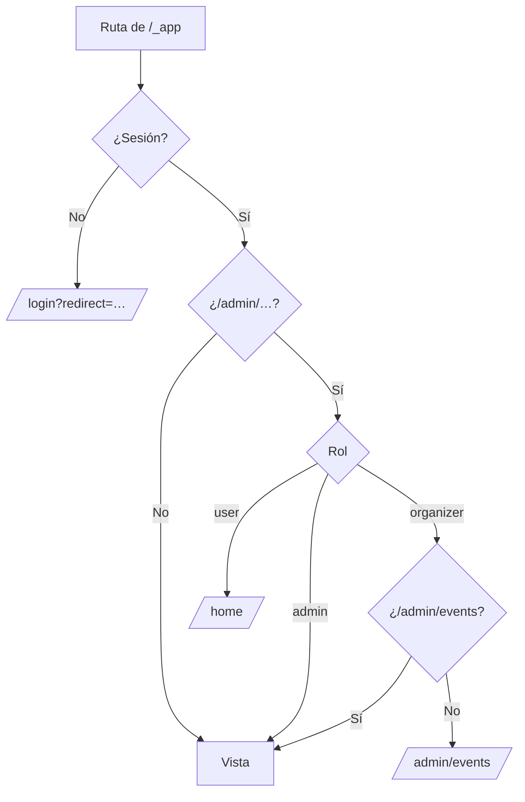

# Layout autenticado (app shell): documentación

## Qué hace

Todas las páginas con sesión (`/_app`) se muestran dentro de un mismo contenedor:
- **Sidebar** a la izquierda, colapsable a íconos;
- **Topbar** arriba, con breadcrumbs, búsqueda, tema y notificaciones;
- **NowBar**, una franja "ahora" con la partida destacada en vivo;
- el **contenido** de la vista, como una "hoja" redondeada sobre el fondo del sidebar.

Las vistas todavía son placeholders (título y "Próximamente"). Se van a implementar de a una con sus handoffs. La landing y el auth siguen con su propio layout, sin shell.

## Rutas

Las URLs están en inglés; lo que se ve está en español.

| Sección | Rutas |
|---|---|
| Jugar | `/home`, `/matches`, `/matches/results`, `/mixes`, `/events`, `/events/$id`, `/pcw`, `/myteam`, `/match/$id` |
| Comunidad | `/ranking`, `/ranking/teams`, `/players`, `/players/compare`, `/player/$nick`, `/teams/$id`, `/hall-of-fame` |
| Cuenta | `/profile` (incluye "Cerrar sesión") |
| Administración | `/admin/events`, `/admin/players`, `/admin/teams`, `/admin/servers`, `/admin/users` |

## Acceso por rol

- **Dónde están las reglas:** en un solo módulo, `src/auth/permissions.ts`: quién ve Administración, a qué secciones entra cada rol y quién recibe notificaciones de capitán. El sidebar, la búsqueda, las notificaciones y la guarda `requireAdminSection` usan esas funciones; ningún componente compara `role` directamente.
- **Provisorio:** los roles de la plataforma están por definir con el equipo (ver la guía).

## Sidebar

- **Componente:** el `Sidebar` de shadcn en variante `inset`: 256 px abierto y 48 px colapsado, con tooltip en cada ícono.
- **Estado:** lo guarda la cookie de shadcn (`sidebar_state`). Sin estado guardado, arranca colapsado en ventanas de menos de 900 px.
- **Atajos:** se colapsa con el botón de la topbar o con Ctrl/⌘ + B (atajo de shadcn).
- **En el teléfono** (menos de 768 px) es un panel lateral que se cierra al navegar.
- **Grupos:** Jugar, Comunidad y Administración (sus ítems según el rol).
- **Ítem activo:** las fichas de jugador y equipo marcan Ranking; una partida marca Mixes o Partidas según su tipo.
- **Badges** (salen de la API; en 0 no se muestran):

  | Ítem | Fuente |
  |---|---|
  | Partidas | `matches?status=live` → total (punto rojo) |
  | PCW | `pcw/posts` → total de anuncios abiertos |
  | Administración → Equipos | `admin/team-requests?status=pending` → total (solo admin) |

- **Pie:** avatar (foto o inicial), alias, rol ("Admin", "Organizador", "Capitán de {equipo}", "Miembro de {equipo}" o "Jugador") y chip de nivel del jugador vinculado. Lleva a Mi perfil.

## Topbar

- **Breadcrumbs** según la ruta (`breadcrumbsFor` en `nav.ts`):
  - los nombres de equipo, torneo o partida salen de la API, con un genérico mientras cargan;
  - los ítems previos son links;
  - el último se corta con puntos suspensivos si no entra.
- **Búsqueda:** botón "Buscar…" con el atajo (⌘K en Mac, Ctrl K en el resto). Por ahora busca solo páginas.
- **Tema:** menú Claro, Oscuro y Sistema, con cambio directo.
- **Notificaciones:** popover de 400 px con tabs (Todas, Sin leer, Solicitudes) y contadores. Las urgentes van destacadas. Las invitaciones y PCW se aceptan o rechazan con un chip y un toast, y las invitaciones tienen "Ver detalle". También permite marcar todo como leído y muestra "Estás al día." cuando no hay nada.
  - PCW y veto solo los ven capitanes y admin.
  - **Sin endpoint todavía:** en desarrollo y pruebas se usan datos de ejemplo; en producción la lista está vacía.

## NowBar

- **Contenido:** "EN VIVO" con la partida destacada (`matches?status=live&per=1`): equipos, torneo o tipo, fase, mapa y BO, más "Conectar" (con la IP del detalle de la partida, `steam://connect/…`) y "Ver sala".
- **Cuándo se oculta:** si no hay partida en vivo o si ya estás en su sala.

## Búsqueda ⌘K

Ctrl/⌘ + K abre el diálogo y se navega con ↑↓ y ↵. Muestra las páginas del sidebar (según el rol), más Resultados, Comparar jugadores y Mi perfil. Sin coincidencias, dice "Sin resultados para "{q}"".

## Global

- **Toasts:** abajo a la derecha, 2,6 s, con `CircleCheck` en `win` para los de éxito. Vale para toda la plataforma.
- **Escape** cierra la búsqueda, los popovers y los diálogos.
- **Al navegar:** el scroll vuelve arriba (`scrollRestoration` del router) y las notificaciones se cierran.

## Dónde está cada cosa

| Qué | Archivo |
|---|---|
| Layout `_app` (shell, atajo ⌘K) | `web/frontend/src/routes/_app.tsx` |
| Guarda de Administración | `web/frontend/src/routes/_app/admin.tsx`, `src/auth/guards.ts` |
| Reglas por rol | `web/frontend/src/auth/permissions.ts` |
| Grupos, ítem activo y breadcrumbs | `web/frontend/src/features/shell/nav.ts` |
| Sidebar | `web/frontend/src/features/shell/AppSidebar.tsx` |
| Topbar y menú de tema | `web/frontend/src/features/shell/Topbar.tsx` |
| NowBar | `web/frontend/src/features/shell/NowBar.tsx` |
| Búsqueda | `web/frontend/src/features/shell/CommandMenu.tsx` |
| Notificaciones | `web/frontend/src/features/shell/notifications/` |
| Datos del shell | `web/frontend/src/features/shell/queries.ts` |
| Placeholders | `web/frontend/src/features/shell/Placeholder.tsx`, `src/routes/_app/*.tsx` |
