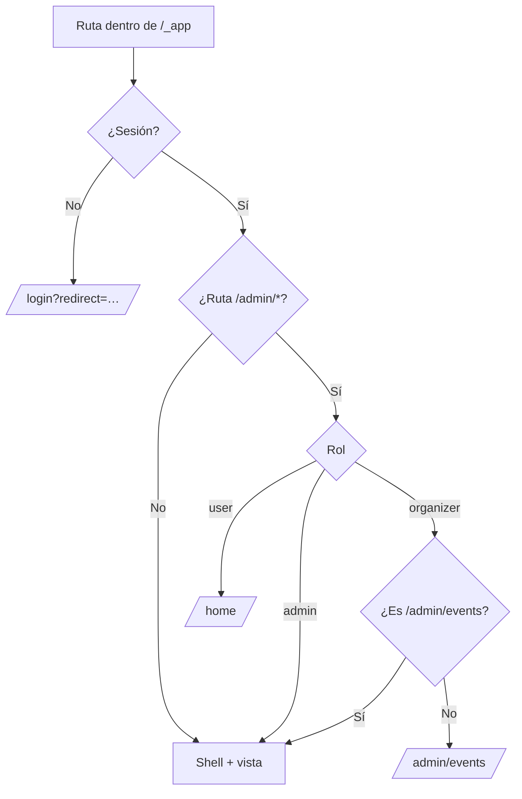

# Plan: layout autenticado (app shell)

> Planeación original. Estado: **aprobado** el 2026-10-18.

Handoff: `CSSTV/desings/handoff_layout_autenticado/` (`Layout autenticado.md`, `tokens.css`, `referencia-visual/CSSTV.dc.html` en `#/home`).

## Decisiones tomadas

| Tema | Decisión | Por qué |
|---|---|---|
| Alcance | Solo el contenedor: sidebar, topbar, NowBar, notificaciones, ⌘K, toasts y guardas. Cada vista es un placeholder con su título | Handoff |
| Sidebar | `Sidebar` de shadcn (`variant="inset"`, `collapsible="icon"`): 256 px abierto, 48 px colapsado, estado en su cookie y panel lateral (Sheet) por debajo de 768 px. Arranca colapsado si no hay estado guardado y la ventana mide menos de 900 px | Respuesta de Esteban: usar lo que trae shadcn; la regla de 900 px es del handoff |
| Notificaciones | Hook `useNotifications()` con un mock tipado **solo en desarrollo y pruebas**. En un build de producción devuelve una lista vacía ("Estás al día.") hasta que exista el endpoint | Respuesta de Esteban: que nadie vea notificaciones falsas |
| Búsqueda ⌘K | Solo páginas hasta que exista `GET /search` | Respuesta de Esteban |
| Cerrar sesión | En el placeholder de Mi perfil, como en el diseño (sección Cuenta) | El shell no tiene otro lugar para salir |
| Tema | Dropdown con cambio directo (sin flashbang ni smoke), usando el mismo hook de la landing para conectarlos después | Handoff |
| Tokens | `tokens.css` coincide con nuestro `index.css`: el preset ya trae `--sidebar-*` y `--win` ya estaba | Comparado línea por línea |
| URLs | En inglés; el español va en lo visible (menú, títulos, breadcrumbs). Administración: `/admin/events`, `/admin/players`, `/admin/teams`, `/admin/servers` y `/admin/users` en lugar de `cadm`, `padm`, `tadm`, `sadm` y `uadm` (siglas del prototipo). También `/ranking/teams` y `/hall-of-fame` en lugar de `/ranking/equipos` y `/palmares`. La ruta vieja `/admin` desaparece | Pedido de Esteban |

## 1. El flujo completo

## 2. Rutas (placeholders)

Bajo `_app`:
- **Vistas:** `/home` (se conserva su contenido actual), `/matches`, `/matches/results`, `/mixes`, `/events`, `/events/$id`, `/pcw`, `/myteam`, `/ranking`, `/ranking/teams`, `/teams/$id`, `/players`, `/players/compare`, `/player/$nick`, `/match/$id`, `/hall-of-fame` y `/profile`.
- **Administración:** `/admin/events`, `/admin/players`, `/admin/teams`, `/admin/servers` y `/admin/users`.

Cada placeholder muestra su título y "Próximamente". Al cambiar de ruta, el scroll vuelve arriba y se cierran los popovers.

## 3. Shell

- **Estructura:** fondo `--sidebar` y el contenido como una "hoja" redondeada, separada 8 px del borde (`SidebarInset`).
- **Sidebar:**
  - cabecera con el cuadro "TV", el wordmark y "Comunidad Counter-Strike: Source";
  - grupos Jugar, Comunidad y Administración (este último por rol);
  - ítem activo según la ruta (las fichas de `player`, `players` y `teams` marcan Ranking; `match/$id` marca Mixes o Partidas);
  - tooltip al estar colapsado;
  - pie con avatar, alias, rol ("Capitán de {equipo}", "Miembro de {equipo}", "Organizador" o "Admin") y chip de nivel.
- **Topbar:** toggle, separador, breadcrumbs según la ruta, botón "Buscar… ⌘K", tema (dropdown) y notificaciones.
- **NowBar:**
  - "EN VIVO" con la partida destacada (`matches?status=live&per=1`), "Ver sala" y "Conectar";
  - "TU PRÓXIMA", con su countdown, queda lista para cuando exista el endpoint;
  - se oculta si no hay partida o si ya estás en su sala.
- **Notificaciones:** popover de 400 px con tabs (Todas, Sin leer, Solicitudes) y contadores, ítems urgentes destacados, Aceptar y Rechazar con chip y toast, marcar todo como leído y estado vacío. El `InviteDialog` se arma con los datos de la invitación.
- **CommandMenu:** ⌘K o Ctrl+K, grupo Páginas (las del sidebar más Resultados y Comparar jugadores), navegación con teclado, pie con atajos y estado vacío.
- **Toaster:** `sonner` abajo a la derecha, 2,6 s, con `CircleCheck` en `win`.
- **Un solo popover a la vez;** Escape cierra todo.

## 4. Datos

| Elemento | Fuente |
|---|---|
| Alias y rol | `/auth/me` |
| Equipo (capitán o miembro) y jugador | `GET /api/v1/me/profile` (`teams`, `player`) |
| Nivel | `GET /api/v1/players/{player.id}` (`level`); sin jugador vinculado, sin chip |
| Partidas en vivo (badge) | `matches?status=live&per=1` → `total` |
| PCW abiertas (badge) | `pcw/posts?per=1` → `total` |
| Equipos pendientes (badge admin) | `admin/team-requests?per=1` → `total` |
| Torneos pendientes de revisar (badge) | Sin fuente clara: se oculta hasta definirla con el backend |
| Breadcrumbs con nombres | La consulta de la vista (equipo, torneo, partida), con el id mientras carga |

Un contador en 0, o que falla, no muestra badge.

## 5. Componentes nuevos de shadcn

`sidebar` (con `tooltip`, `sheet`, `skeleton` y el hook `use-mobile`), `popover`, `command` (agrega `cmdk`, una dependencia nueva que respeta la política de 7 días) y `breadcrumb`.

## 6. Pruebas

- **Unitarias:** ítem activo por ruta, breadcrumbs por ruta, guardas por rol (admin, organizador, usuario) y la lógica de notificaciones (tabs, marcar leídas, resolver).
- **Playwright:**
  - el shell aparece en `/home`;
  - el sidebar se colapsa y recuerda el estado;
  - la navegación marca el ítem activo;
  - ⌘K abre la búsqueda y navega;
  - el tema cambia desde la topbar;
  - un usuario común no ve Administración y `/admin/players` lo manda a `/home`; un organizador en `/admin/players` vuelve a `/admin/events`;
  - cerrar sesión desde Mi perfil;
  - el panel lateral se abre en el teléfono.
- **Visual:** capturas contra `CSSTV.dc.html#/home` en 1440 y 390 px, en claro y oscuro, abierto y colapsado.
- **Pruebas que cambian:** las e2e actuales que usan el menú del usuario ("Salir") pasan a usar Mi perfil.

## 7. Pendiente de definir: roles de la plataforma

Hay que definir con el equipo cómo se manejan los roles. Hoy conviven dos niveles:
- **Rol de cuenta** en `user.role`: `user`, `organizer` o `admin`.
- **Roles por contexto**, que dicta la API en `viewer`: capitán o miembro de un equipo (`is_captain`, `is_member`), gestor de un torneo (`can_manage`), quién veta en una partida (`can_veto`).

Falta decidir:
- qué roles existen (por ejemplo, si capitán es un rol de cuenta o solo de equipo, o si hay moderador);
- qué puede ver y hacer cada uno en cada pantalla;
- cómo se asignan y quién los asigna;
- cómo lo refleja el frontend: un módulo central de permisos en lugar de comparar `role` en cada componente.

Este layout aplica solo lo que ya está acordado: Administración para organizador y admin, y dentro de ella `/admin/events` es la única sección del organizador.

## 8. Pedidos al backend

1. `GET /search?q=` (jugadores, equipos y torneos en una sola respuesta).
2. Notificaciones: listado, marcar como leída, marcar todas y contadores.
3. Próxima partida del usuario (para "TU PRÓXIMA").
4. Contador de torneos o resultados pendientes de revisar (badge de Administración).
5. Opcional: el nivel del jugador dentro de `/me/profile`, para no hacer una segunda consulta.

## 9. Orden de implementación

1. Componentes de shadcn y rutas placeholder con sus guardas.
2. Sidebar (grupos, rol, activo, pie) y shell.
3. Topbar: breadcrumbs, tema, búsqueda y notificaciones.
4. NowBar.
5. Toaster, Escape y un popover a la vez.
6. Pruebas, capturas y verificación completa.
7. `DOCUMENTACION.md`, `GUIA_IMPLEMENTACION.md` y la fila del README.

## Ampliación (2026-10-18, pedido de Esteban)

Agregado después de aprobar el plan, a pedido de Esteban.

1. **Sidebar colapsado:** en escritorio, el contenido quedaba a 72 px del borde, porque la variante `inset` de shadcn suma 16 px al riel y 8 px más al contenido. El diseño pide un riel de 48 px en total, con el contenido pegado. Se ajusta en `components/ui/sidebar.tsx`.
2. **Fechas con `date-fns`:** reemplaza el código propio de fechas:
   - leer `AAAA-MM-DD` en hora local;
   - fecha corta y "Empieza en N días" en la landing;
   - "Vence en N minutos o segundos" en la Bienvenida;
   - "hace X" y "ayer" en las notificaciones.

   Los temporizadores de segundos (límite de intentos, código `!claim`) siguen igual: son relojes con redondeo hacia arriba y la librería no ahorra código ahí.
3. **Toasts con `sileo`:** descartado. La política de confianza de pnpm lo bloquea: las versiones 0.0.1 a 0.0.3 se publicaron con procedencia verificable y las siguientes no, aunque todas salieron desde la misma cuenta del autor. Esteban decidió seguir con `sonner`, que ya usa shadcn y pasa todos los controles.