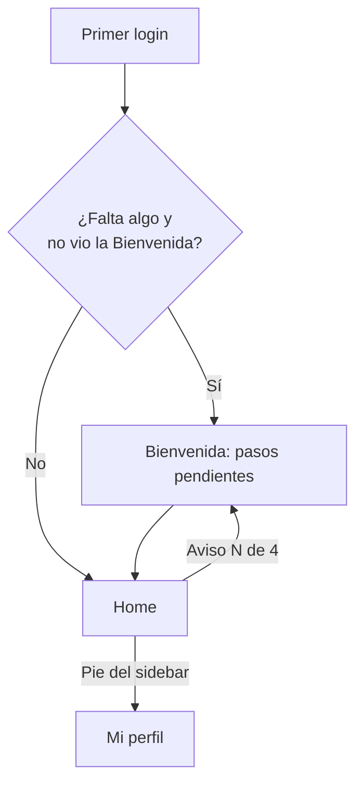
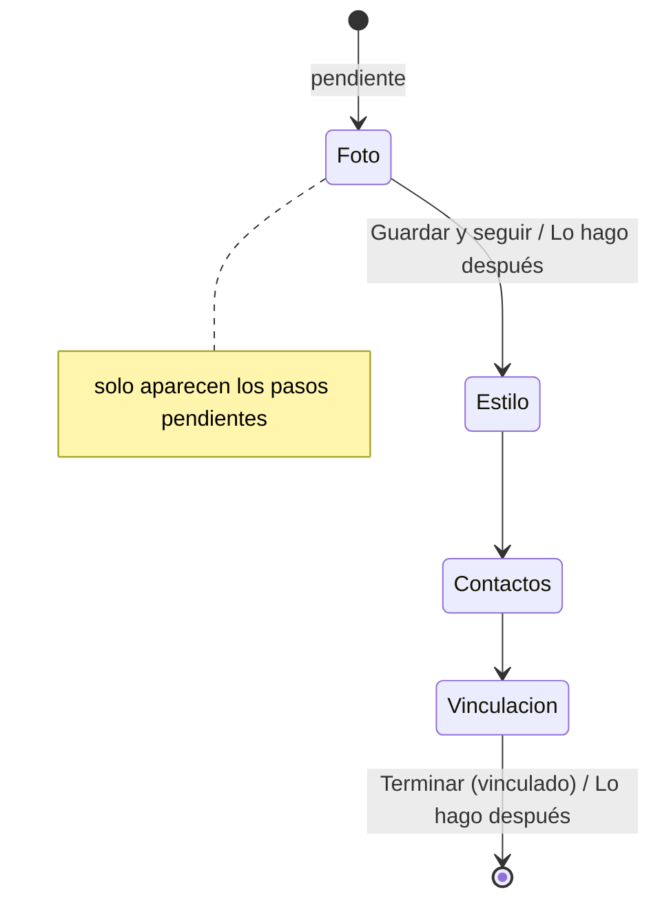

# Bienvenida de 4 pasos y Mi perfil: documentación

## Qué hace

Los datos del perfil se completan en dos lugares que comparten componentes y reglas:
- **Bienvenida (`/welcome`)**, al primer ingreso: foto y nombre, estilo de juego, contactos y vinculación del jugador. Todos son opcionales y solo se muestran los pasos que faltan.
- **Mi perfil (`/profile/*`)**, en cualquier momento: alias, datos, privacidad, vinculación y cuentas conectadas, preferencias y cuenta.

El aviso del Home ("Completa tu perfil · N de 4") lleva a la Bienvenida mientras falte algo.

## Cuándo un paso está hecho

| Paso | Hecho si… |
|---|---|
| Foto y nombre | Hay avatar o nombre real, **o** se tocó "Guardar y seguir" en ese paso (aunque esté vacío) |
| Estilo de juego | Hay puesto (`game_role`) |
| Contactos | Hay Discord, Steam o FACEIT, **o** se tocó "Guardar y seguir" en ese paso |
| Vinculación | Hay al menos un SteamID vinculado (`GET /me/claim-code`) |

- **Guardado vacío:** se recuerda por cuenta en el navegador (`localStorage` `csstv.onboarding.<id>`) hasta que la API guarde el progreso por paso.
- **Dónde está la lógica:** `onboardingFrom` y `welcomeSteps`, en `src/features/onboarding/queries.ts`.
- **Qué pasos se muestran:** solo los pendientes, en orden. El último dice "Guardar y terminar". Si no falta nada (se entra por la URL), se muestran los tres editables.

## Bienvenida: pasos

- **Foto y nombre:** la foto se elige con clic o arrastrándola, se encuadra en un diálogo (arrastre y zoom) y al confirmar se recorta a 256×256 (`cropAvatar`) y se sube. El nombre es opcional, de hasta 60 caracteres. Debajo hay una vista previa de cómo te ven.
- **Estilo de juego:** sin cambios.
- **Contactos:** Discord, Steam y FACEIT con sus íconos (Simple Icons), más la nota de visibilidad. Se guardan solo los campos completados.
- **Vinculación:** sin cambios (`ClaimStep`).

## Mi perfil

| Sección | URL | Qué hace |
|---|---|---|
| Perfil | `/profile` | **Alias:** disponibilidad en vivo, mensajes del diseño y `PUT /me/alias` (una vez cada 15 días). Después de cambiarlo queda bloqueado, con "Podrás cambiarlo el…". **Datos:** avatar, email (solo lectura), nombre real, país (con bandera) y puesto, guardados con `PATCH /me/profile` |
| Privacidad | `/profile/privacy` | Muestra la privacidad actual del jugador vinculado, sin poder cambiarla (hoy solo la cambia un admin) |
| Vinculación | `/profile/link` | **Jugador:** estado vinculado o no, "Generar código", `!claim {código}` con "Copiar" y el sondeo cada 5 s mientras hay un código vigente. **Cuentas conectadas:** link del perfil de Steam (informativo), Discord y FACEIT. "Guardar cuentas" (un campo vacío borra el dato) |
| Preferencias | `/profile/preferences` | Tema y efectos al cambiar de tema, con el aviso de fotosensibilidad. Con movimiento reducido, los efectos quedan deshabilitados |
| Cuenta | `/profile/account` | Registro, última conexión, rol, equipos, partidas jugadas y "Cerrar sesión" |

- **Navegación:** en escritorio, lateral y fija; en el teléfono, una fila con scroll horizontal. Vinculación lleva un punto si no hay jugador vinculado.
- **Breadcrumbs:** "Mi perfil › {sección}".
- **"Ver perfil público":** aparece solo con jugador vinculado.

## Validaciones (`src/features/profile/schemas.ts`)

| Campo | Regla |
|---|---|
| Discord | 2 a 32 caracteres (minúsculas, números, `_` y `.`). Se quita el `#1234` y se pasa a minúsculas |
| Steam | Solo el link del perfil (`steamcommunity.com/id/…` o `/profiles/…`, con o sin `https://` y `www`), guardado como `https://steamcommunity.com/…`. Es informativo: el SteamID se vincula con `!claim` |
| FACEIT | Nick, o link `faceit.com/{idioma}/players/{nick}`, del que se guarda el nick |
| Nombre real | Opcional, hasta 60 caracteres, solo letras, espacios, punto, apóstrofe y guion |
| Avatar | JPEG, PNG o WebP; recorte a 256×256 y compresión a 1 MB como máximo |

## Dónde está cada cosa

| Qué | Archivo |
|---|---|
| Pasos y "hecho" | `web/frontend/src/features/onboarding/queries.ts` |
| Bienvenida | `web/frontend/src/features/onboarding/WelcomeFlow.tsx`, `PhotoStep.tsx`, `ContactsStep.tsx`, `Greeting.tsx` |
| Código de !claim compartido | `web/frontend/src/features/onboarding/claim.ts` |
| Aviso del Home | `web/frontend/src/features/onboarding/ProfileBanner.tsx` |
| Mi perfil (layout y secciones) | `web/frontend/src/features/profile/ProfileLayout.tsx`, `sections/*.tsx`, `src/routes/_app/profile*.tsx` |
| Avatar y contactos | `web/frontend/src/features/profile/AvatarPicker.tsx`, `ContactFields.tsx` |
| Mensajes del alias | `web/frontend/src/features/profile/alias.ts` |
| Íconos de marca | `web/frontend/src/components/brand/BrandTile.tsx` |
| Consultas | `web/frontend/src/features/profile/queries.ts` (`playerDetailOptions`, `useChangeAlias`) |
