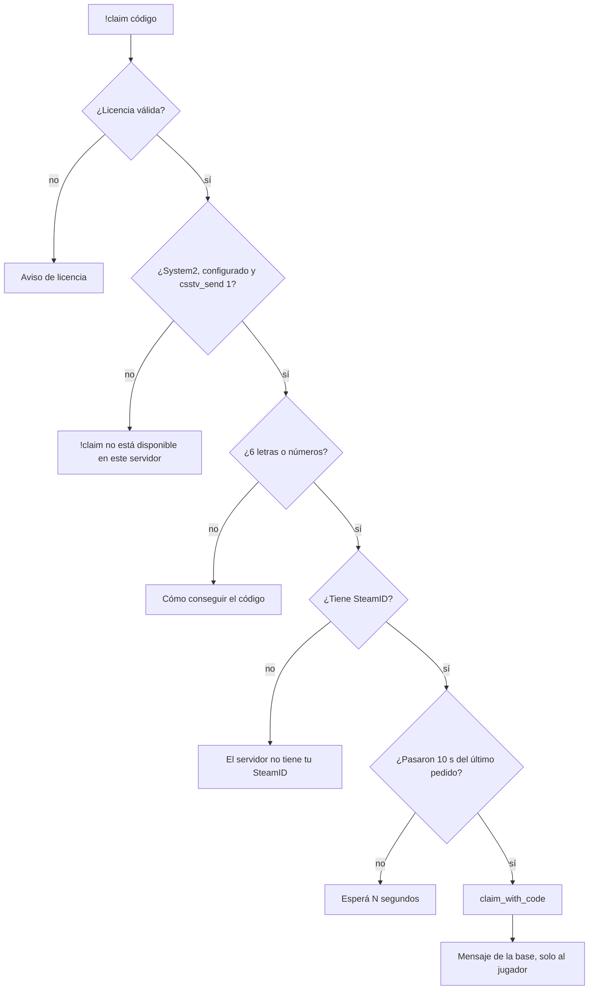

# Plugin 2.2.0 con `!claim`: documentación

## Qué hace

`!claim <código>` vincula el SteamID con el que el jugador está conectado a su cuenta de la web. El código lo genera la cuenta en Mi perfil: 6 letras o números, vale 10 minutos y se usa una sola vez. Las reglas (primer SteamID al instante, adicionales con aprobación de un admin, tope, reservas, intentos) las aplica la base con `claim_with_code`; el plugin solo manda el pedido y muestra la respuesta. Las reglas completas están en [`2026-10-16-claim-steamid`](../2026-10-16-claim-steamid/DOCUMENTACION.md).

## Lo que ve el jugador

Todo llega **solo a quien escribió el comando**:

| Caso | Mensaje | Color |
|---|---|---|
| Vinculado | "Listo: tu cuenta quedó vinculada (cuenta Alias)" | Verde |
| Ya estaba | "Tu cuenta ya está vinculada a este SteamID (cuenta Alias)" | Verde |
| SteamID adicional | "Pedido enviado: un admin lo tiene que aprobar" | Amarillo |
| Pedido repetido | "Ya pediste este SteamID: falta que lo apruebe un admin" | Amarillo |
| Rechazos | Código inválido o vencido, máximo de SteamID, SteamID de otra cuenta o de otra ficha, pedido pendiente de otra cuenta, demasiados intentos, licencia | Rojo |
| La web no responde | "No se pudo consultar la web (sin conexión / error del servidor). Probá de nuevo." | — |

## Detalles

- **Cuándo:** en cualquier momento, también durante la partida. No cambia nada del mix.
- **Código:** se acepta en minúsculas (se pasa a mayúsculas).
- **Límite:** un pedido cada 10 segundos por jugador; la base además corta a los 5 intentos fallidos de un SteamID en 10 minutos.
- **SteamID:** el que da el juego, normalizado a `STEAM_0:X:Y`. El nick va al registro de reclamos (`claim_log`) para que el admin vea desde qué nombre se pidió.
- **Log:** cada respuesta queda en el log de SourceMod: `!claim de Nick [STEAM_0:X:Y]: mensaje`. El código no se escribe.
- **`!match` con varios SteamID:** no hizo falta cambiarlo. La base manda todos los SteamID de cada jugador del plantel, y el plugin busca al jugador en esa lista, así que lo reconoce desde cualquiera.

## Dónde está cada cosa

| Qué | Archivo |
|---|---|
| Comando y respuesta | `server/addons/sourcemod/scripting/csstv/claim.inc` |
| Registro e inicio | `server/addons/sourcemod/scripting/csstv_reporter.sp` (`Claim_Init`, `Claim_ClientReset`, versión `2.2.0`) |
| Lo que responde la base | `claim_with_code` en `supabase/replanteo/15_claim.sql` |
| Prueba con bots | `pruebas/claim.sh` |
