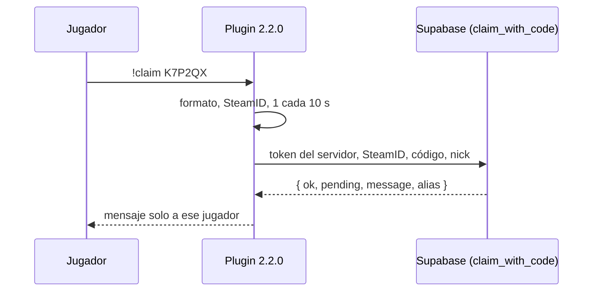

# Plan: plugin 2.2.0 con `!claim`

> Planeación original. Estado: **aprobado** por Daniel el 2026-10-18 ("haz el plugin 2.2.0 con !claim").

Es la parte del plugin del plan [`2026-10-16-claim-steamid`](../2026-10-16-claim-steamid/PLAN.md) (sección 7), que ahí se llamaba 2.1.0: ese número quedó para los mixes en vivo. La base (`claim_with_code`, replanteo `15`) y el backend ya están hechos.

## Qué hace

## Decisiones

| Tema | Decisión | Origen |
|---|---|---|
| Cuándo | En cualquier momento: calentamiento o partida | Plan del 2026-10-16 |
| Formato del código | 6 letras o números; se pasa a mayúsculas. Sin código, el comando explica cómo conseguirlo | Plan del 2026-10-16 |
| Límite | Un pedido cada 10 segundos por jugador. Varios jugadores pueden reclamar a la vez | Plan del 2026-10-16 |
| Respuesta | Solo al jugador, con el `message` de la base. Verde si quedó vinculado, amarillo si es un pedido pendiente, rojo si no | Plan del 2026-10-16 (colores: propuesta) |
| No disponible | Sin System2, sin configurar o con `csstv_send 0`: "no disponible en este servidor". Sin licencia: el aviso de licencia, como `!match` | Plan del 2026-10-16 |
| SteamID | El que da el juego (`STEAM_0`/`STEAM_1`); sin SteamID válido (LAN, pendiente) no se pide nada | Propuesta |
| Logs | Cada pedido y su resultado al log de SourceMod (sin el código) | Propuesta |
| `!match` con varios SteamID | Ya funciona: el plantel llega como lista de SteamID y se busca cada jugador en ella. No hace falta cambio | Revisión del código |

## Archivos

- `server/addons/sourcemod/scripting/csstv/claim.inc` (nuevo) y su `#include` e inicio en `csstv_reporter.sp`; versión `2.2.0`.
- `!status` y la ayuda no cambian.

## Pruebas

En el servidor local, con la build `CSSTV_DEBUG` (bots con SteamID falso) y el cfg apuntado a la Supabase **local** con el replanteo 01 a 18. Los bots escriben con `csstv_debug_fakecmd`. Casos:
- Código bueno con una cuenta sin ficha: queda vinculada.
- El mismo SteamID otra vez: "ya está vinculada".
- Otro bot con un código nuevo de la misma cuenta: pedido pendiente.
- Código vencido o inventado, formato malo, sin código.
- Dos pedidos en menos de 10 s.
- `csstv_send 0`.
- Token inválido (licencia).

Después se restaura el servidor local tal como estaba.

## Despliegue

**En el corte**, no antes: con la base vieja `claim_with_code` no existe. Genérico al servidor real (`SFTP_CSS_*`) y licenciado a RBK (`SERVER1_*`), en la misma tanda.
