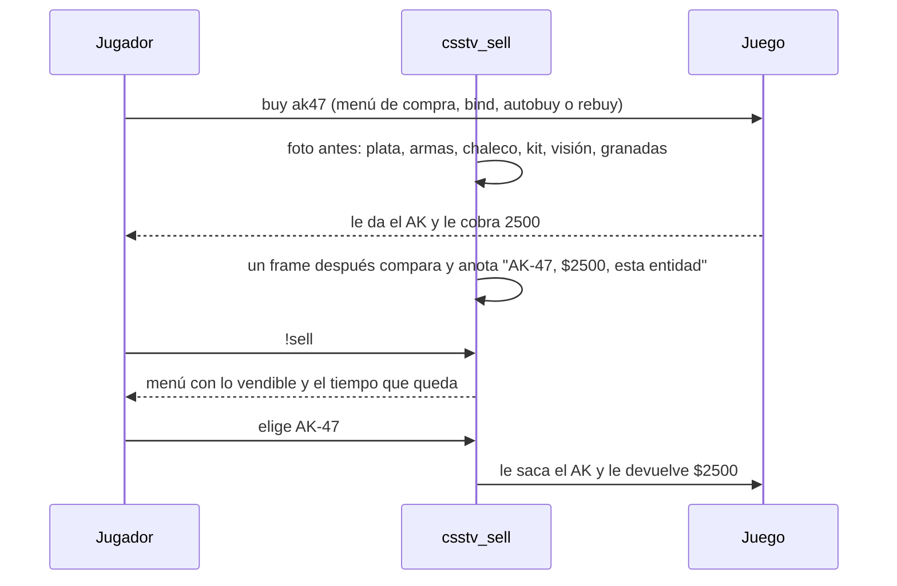
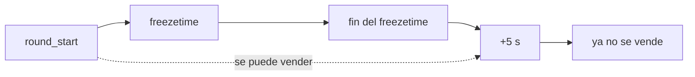

# `!sell`, vender lo comprado en la ronda: documentación

## Qué hace

`csstv_sell` es un plugin aparte, como `csstv_allchat`. Con `!sell` el jugador abre un menú con **lo que compró en esta ronda y sigue siendo suyo**, y al elegir algo se lo saca y le devuelve **lo que pagó**. `!sell all` vende todo sin abrir el menú (sirve para un bind).

Se puede vender desde que empieza la ronda hasta **5 segundos después del fin del freezetime**, en cualquier parte del mapa. No toca a `csstv_reporter` ni depende de él: si está cargado, usa su prefijo (`csstv_chat_tag`) y su modo de colores (`csstv_chat_colors`).



## Cómo sabe qué compraste

- Escucha `buy`, `autobuy` y `rebuy`. En esta versión del juego las balas no se compran aparte, así que `buyammo1` y `buyammo2` no se escuchan.
- **Antes del comando** saca una foto del jugador: plata, el arma de las ranuras 1 y 2 (la entidad), chaleco y casco, kit, visión nocturna y la cantidad de cada granada.
- **Un frame después** compara. Lo que apareció queda anotado con su precio:
  - Si fue una sola cosa, el precio es la plata que se descontó.
  - Si fueron varias (`autobuy`, `rebuy` o un bind con varios `buy`) y la tabla de precios de v34 suma lo mismo que se descontó, se usa la tabla.
  - Si la suma no coincide, la plata se reparte en orden con la tabla y la última cosa se lleva lo que sobra. Así nunca se devuelve más de lo que se pagó.
- Si la plata no bajó, no se anota nada. Lo que se levanta del piso no pasa por un comando de compra, así que nunca se anota.
- Lo anotado se borra al empezar cada ronda (también con `mp_restartgame`) y cuando el jugador se conecta.

## Cuándo algo se puede vender

| Ítem | Se vende si… | Al venderlo |
|---|---|---|
| Arma (ranura 1 o 2) | Es la misma entidad que compraste, está en tu ranura y eres su dueño (no la tiraste ni la levantó otro) | Se borra. **No vuelve** el arma que el juego tiró al comprarla (por ejemplo, la USP al comprar una Deagle). Si la tenías en la mano, pasas a la mejor que te quede |
| Chaleco, casco o los dos | El chaleco y el casco siguen exactamente como quedaron después de la compra (no te dañaron) | Vuelven a como estaban antes de la compra |
| Kit de desactivación | Lo sigues teniendo | Se saca |
| Visión nocturna | La sigues teniendo | Se apaga y se saca |
| Granadas | Te quedan más de las que tenías antes de comprar | Se venden de a una. Si era la última, se borra la granada |

- **Un arma disparada se vende igual** (decisión de Daniel).
- Si compras dos armas de la misma ranura en la misma ronda, solo se puede vender la última. La primera quedó en el piso.
- Las granadas se cuentan contra las que tenías antes de la primera compra de la ronda. Si tenías 1 flash, compraste otra y lanzaste una, no queda ninguna para vender.

## La ventana de venta



- El fin del freezetime es `m_fRoundStartTime` de las reglas del juego. La pausa táctica de `csstv_reporter` lo corre hacia adelante, así que **la ventana se alarga sola con la pausa**.
- Al terminar la ronda (`round_end`) se cierra hasta la ronda siguiente.
- Los 5 segundos se cambian con `csstv_sell_window`.

## El menú

```
Vender (te quedan 7 s)
1. AK-47 - $2500
2. Chaleco + casco - $1000
3. Flash (x2) - $200 c/u
4. Vender todo - $3900
0. Salir
```

- Cada fila vende una unidad y el menú se vuelve a abrir con lo que queda.
- El título se actualiza cada segundo. Si el freezetime se alargó por una pausa larga (más de 60 s por delante), dice "hasta 5 s después del freezetime" en lugar de la cuenta.
- El menú se cierra solo cuando termina la ventana, cuando ya no queda nada para vender, si el jugador muere y al terminar la ronda.

## Mensajes

Todos van por chat solo al jugador, con el prefijo `[v34frag]` y los colores de los demás plugins (RGB para quien usa ClientMod).

| Caso | Mensaje |
|---|---|
| Venta | `Vendiste AK-47: +$2500.` (con `!sell all` y varias cosas: `Vendiste todo: +$4200.`) |
| Llegó al tope de plata | `Vendiste AWP: +$100 (llegaste al tope de $16000).` |
| Nada para vender | `No compraste nada en esta ronda que puedas vender.` |
| Fuera de la ventana | `Ya no se puede vender: solo hasta 5 s después del freezetime.` |
| Muerto o espectador | `Solo los jugadores vivos pueden vender.` |
| Elegiste algo que ya no tienes | `Ya no tienes AK-47 para vender.` |
| Plugin apagado | `!sell está desactivado en este servidor.` |

## Variables y comandos

| Nombre | Valor por defecto | Qué hace |
|---|---|---|
| `csstv_sell` | `1` | `0` lo apaga: `!sell` responde que está desactivado y no se anotan compras |
| `csstv_sell_window` | `5` | Segundos después del fin del freezetime en los que todavía se puede vender |
| `csstv_sell_version` | `1.0.0` | Versión |
| `sm_sell` (`!sell`, `/sell`) | | Abre el menú. Con `all` o `todo`, vende todo |

**Solo en la build de depuración** (`SELL_DEBUG=`): `csstv_sell_fakecmd`, `csstv_sell_fakebuy` y `csstv_sell_dump`, y el log de compras y respuestas. Se describen en la guía.

## Dónde está cada cosa

| Qué | Archivo / ubicación |
|---|---|
| Código | `server/addons/sourcemod/scripting/csstv_sell.sp` |
| Compilado (sin depuración) | `server/addons/sourcemod/plugins/csstv_sell.smx` |
| En los servidores | `cstrike/addons/sourcemod/plugins/csstv_sell.smx` (pendiente de subir) |
| Pruebas con bots | `docs/bitacora/2026-10-18-plugin-sell/pruebas/sell.sh` y `resultado.txt` |
| Changelog para jugadores | `docs/bitacora/2026-10-18-plugin-sell/CHANGELOG_DISCORD.txt` |
