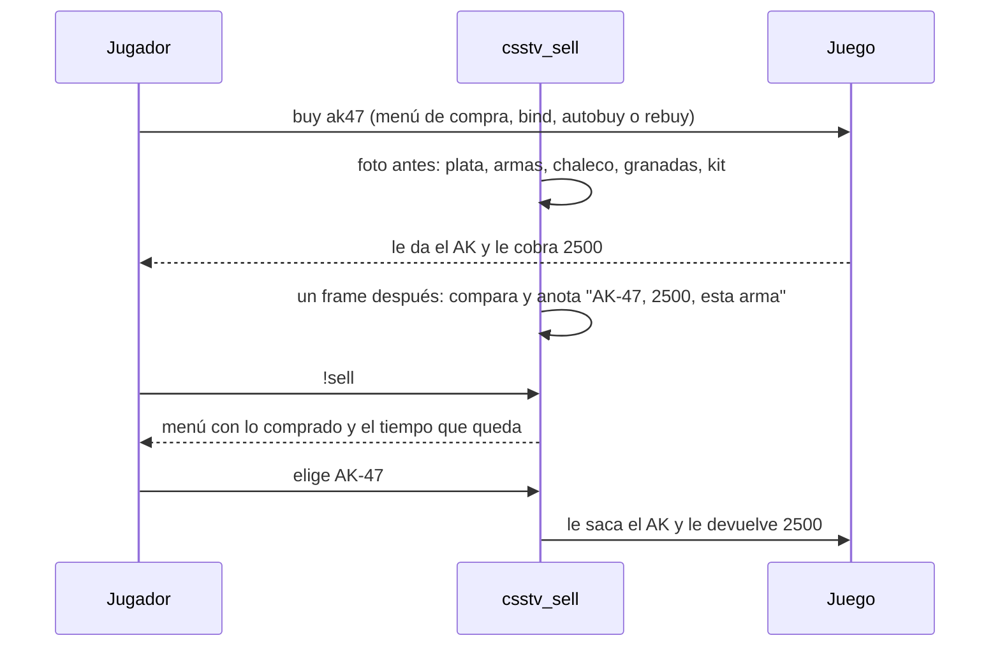

# Plan: `!sell`, vender lo comprado en la ronda

> Planeación original. Estado: **propuesta**, pendiente de aprobación.

## El pedido

El PO pidió "un menú interactivo que muestre todo tu inventario de la ronda y que puedas devolver lo que compraste en la ronda". Daniel lo precisó el 2026-10-18:
- El menú muestra **solo lo comprado en esta ronda**, no todo el inventario: lo que trajiste de la ronda anterior o levantaste del piso no se vende.
- Se puede vender **hasta 5 segundos después de que termina el freezetime** (con 15 s de freezetime, 20 s en total).

## Decisiones tomadas

| Tema | Decisión | Origen |
|---|---|---|
| Qué se vende | Solo lo comprado en esta ronda y que **sigue siendo tuyo** | Daniel |
| Ventana de venta | Desde que empieza la ronda hasta 5 s después del fin del freezetime | Daniel |
| Pausa táctica | La pausa alarga el freezetime, así que la ventana se alarga con ella: se cuenta desde el fin real del freezetime | Propuesta (sale sola de la regla de Daniel) |
| Cuánto devuelve | **Lo que pagaste**, completo (no un porcentaje). Sale de la diferencia de plata al comprar, no de una tabla, así que vale aunque el servidor cambie precios | Propuesta |
| Tope de plata | La devolución no pasa de 16 000 | Propuesta (tope de CS:S) |
| Plugin aparte | `csstv_sell.smx`, como `csstv_allchat`: no toca el plugin de los mixes (congelado hasta el final) y se puede apagar solo | Propuesta |
| Dónde funciona | En cualquier ronda con compra: calentamiento y partida. En la ronda de cuchillo no hay compras, así que no hay nada que vender | Propuesta |
| Comandos | `!sell` abre el menú; `!sell all` vende todo sin menú (sirve para un bind) | Propuesta |
| Despliegue | En los dos servidores (real y RBK) en la misma tanda, como manda `CLAUDE.md`. Sin licencia, como `csstv_allchat` | Regla del proyecto |

## 1. El flujo completo



## 2. Cómo sabe qué compraste

- Escucha los comandos de compra: `buy`, `autobuy`, `rebuy`, `buyammo1` y `buyammo2` (los mismos que ya escucha la ronda de cuchillo).
- **Antes del comando** saca una foto del jugador:
  - Plata.
  - El arma de cada ranura (entidad).
  - Chaleco y casco, kit de desactivación, visión nocturna.
  - Cantidad de cada granada.
- **Un frame después** compara y anota cada cosa nueva con lo que costó:
  - Si es una sola, el precio es la plata que se le descontó.
  - Con `autobuy` o `rebuy` (varias a la vez) se reparte con la tabla de precios de v34, comprobando que la suma dé la plata descontada.
- Lo anotado se borra al empezar cada ronda.

## 3. El menú

```
Vender (te quedan 7 s)
1. AK-47 ............ $2500
2. Chaleco + casco .. $1000
3. Granada HE ....... $300
4. Flash (x2) ....... $400
5. Vender todo ...... $4200
0. Salir
```

- Cada fila vende eso solo. El menú se vuelve a abrir al momento con lo que queda.
- Fuera de la ventana: "Ya no se puede vender: solo hasta 5 s después del freezetime".
- Sin compras: "No compraste nada en esta ronda".
- Muerto o espectador: no se puede.
- Mensajes por chat solo al jugador, con los colores de los demás plugins.

## 4. Cuándo algo deja de ser vendible

| Ítem | Se puede vender si… |
|---|---|
| Arma | Sigue siendo tuya (no la tiraste, ni la levantó otro) |
| Chaleco | Tiene todavía lo que compraste (no te dañaron) |
| Casco comprado aparte ($350) | Lo seguís teniendo |
| Granada | No la tiraste (se vende de a una) |
| Kit y visión nocturna | Los seguís teniendo |

## 5. Lo que hay que decidir

| Tema | Opciones | Propuesta |
|---|---|---|
| **El arma que reemplazaste** | Al comprar un rifle o una pistola, el juego tira al piso la que tenías (por ejemplo, la USP del CT al comprar una Deagle). Al vender: (a) no se devuelve; (b) si sigue en el piso sin dueño, vuelve a tus manos | **(b)**: si no, vender la Deagle te deja sin pistola |
| **Disparar en los 5 s** | Pasado el freezetime ya se puede disparar. (a) Se vende igual; (b) un arma con balas gastadas ya no se vende | **(b)**: evita usar el arma y devolverla |
| **Las balas (`buyammo`)** | En v34 las balas se compran aparte. (a) No se venden; (b) se devuelven junto con el arma | **(a)**: en la prueba con bots se verifica si un arma comprada ya trae las balas. Si no las trae, se replantea |
| **Zona de compra** | (a) Vender en cualquier lado dentro de la ventana; (b) solo en la zona de compra, como al comprar | **(a)**: la ventana ya es corta |

## 6. Pruebas

En el servidor local con bots: compran con `buy` y `autobuy`, y venden con `!sell all` (los bots no pueden usar menús), con `csstv_reporter` apartado para no tocar producción.

Casos:
- Una sola compra; `autobuy`.
- Chaleco dañado; granada tirada; arma tirada y levantada por otro.
- Afuera de la ventana; con pausa.
- Tope de 16 000.
- El arma reemplazada.

**El menú** lo prueba Daniel con jugadores reales.

## 7. Orden de implementación

1. Aprobación de este plan y de las decisiones de la sección 5.
2. `server/addons/sourcemod/scripting/csstv_sell.sp` y su compilado, con el `spcomp` 1.8.
3. Pruebas con bots en el servidor local.
4. Subida a los dos servidores en la misma tanda; carga en el próximo cambio de mapa.
5. Prueba del menú con jugadores, `DOCUMENTACION.md`, `GUIA_IMPLEMENTACION.md`, `CHANGELOG_DISCORD.txt` y `PENDIENTES.md`.
