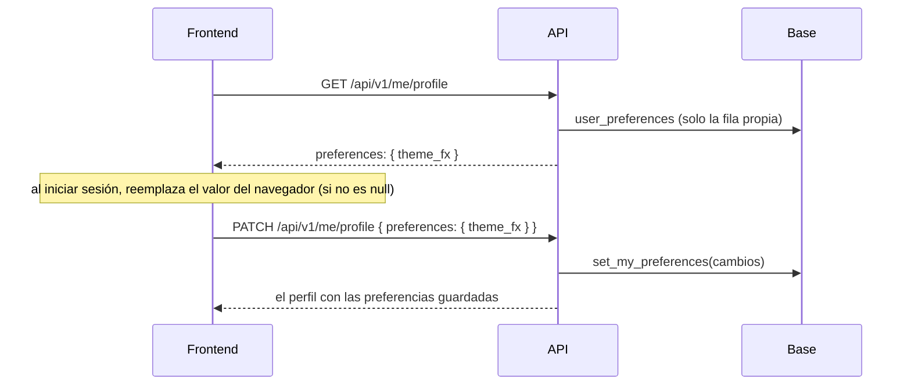

# Preferencias de la cuenta (`preferences.theme_fx`): documentación

## Qué hace

La cuenta guarda las preferencias del usuario para que se mantengan entre dispositivos. La primera es `theme_fx`, que dice si el frontend muestra los efectos al cambiar de tema (flashbang al pasar a claro, humo al pasar a oscuro):

| Valor | Significado |
|---|---|
| `"full"` | Efectos con sonido |
| `"silent"` | Efectos sin sonido |
| `"off"` | Efectos desactivados |
| `null` | Todavía no eligió (por defecto) |

Van dentro de un objeto `preferences`, así se pueden sumar otras sin cambiar el contrato.

## Reglas

- **Lectura:** `GET /api/v1/me/profile` siempre trae `preferences` con todas sus claves. `theme_fx` es `null` si no eligió, si no hay fila o si la base tuviera un valor desconocido.
- **Cambio:** `PATCH /api/v1/me/profile` acepta `preferences: { theme_fx }`.
  - Solo cambian las claves enviadas, y `null` borra una.
  - Otro valor, o una clave desconocida dentro de `preferences`, da `400 VALIDATION_ERROR`, sin tocar la base.
  - Se puede mandar junto con los otros campos del perfil.
- **Privacidad:** la fila de cada cuenta solo la ve y la cambia el propio usuario (RLS). Ni otros usuarios ni anon tienen acceso. Por eso no está en `profile_details`, que otros pueden leer según la privacidad del jugador.
- **Borrar la cuenta** borra sus preferencias.

## Base de datos (`supabase/replanteo/18_preferencias.sql`)

| Objeto | Qué es |
|---|---|
| `user_preferences` | `user_id` (clave, → `auth.users`, se borra con la cuenta), `preferences jsonb` (objeto) y `updated_at`. Restricciones: es un objeto, y `theme_fx`, si está, es `full`, `silent` u `off` |
| Políticas | Ver, crear y editar solo la propia. `authenticated` tiene `select`, `insert` y `update`; `anon`, nada |
| `set_my_preferences(p_changes jsonb)` | Crea o une la fila del usuario que llama: `preferencias || cambios` sin las claves en `null`. Corre con los permisos de quien llama (aplica la RLS) y devuelve lo guardado |

## API

| Endpoint | Cambio |
|---|---|
| `GET /api/v1/me/profile` | `preferences: { theme_fx }` (esquema `Preferences`) |
| `PATCH /api/v1/me/profile` | `preferences` opcional (esquema `PreferencesPatch`, estricto). Si viene, llama a `set_my_preferences` |

## Dónde está cada cosa

| Qué | Archivo |
|---|---|
| Migración | `supabase/replanteo/18_preferencias.sql` |
| Inversa y prueba | `docs/bitacora/2026-10-14-replanteo-modelo-datos/reversas/18_preferencias.sql` y `pruebas/18_preferencias.sql` |
| Esquemas | `web/backend/src/schemas/profile.ts` (`THEME_FX`, `Preferences`, `PreferencesPatch`) |
| Ruta | `web/backend/src/routes/me.ts` |
| Pruebas | `web/backend/test/unit/me-routes.test.ts` y `test/integration/me.test.ts` |
| Contrato del frontend | `docs/frontend/contract.md`, sección 2 |
