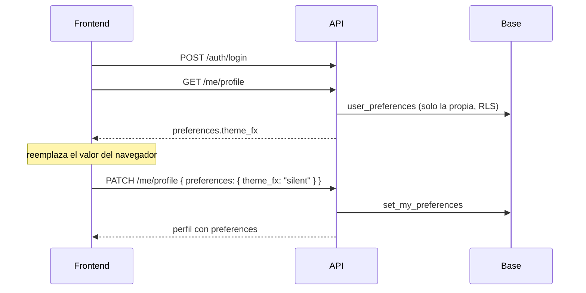

# Plan: preferencias de la cuenta (`preferences.theme_fx`)

> Planeación original. Estado: **aprobado**: es el pedido del equipo de frontend que pasó Daniel el 2026-10-18, con sus valores, endpoints y criterios. Solo local: la migración `18` sale en el corte.

## Decisiones tomadas

| Tema | Decisión | Origen |
|---|---|---|
| Campo | `preferences.theme_fx`: `"full"` (efectos con sonido), `"silent"` (sin sonido), `"off"` (desactivados) o `null` (todavía no eligió) | Pedido del frontend |
| Endpoints | `GET /api/v1/me/profile` lo devuelve en `preferences`; `PATCH /api/v1/me/profile` acepta `preferences.theme_fx` (uno de los tres valores o `null` para borrarlo). Otro valor: `400` | Pedido del frontend |
| Objeto `preferences` | Para sumar preferencias más adelante sin cambiar el contrato | Pedido del frontend |
| Dónde se guarda | Tabla nueva `user_preferences` (una fila por cuenta, `preferences jsonb`), no en `profile_details` | `profile_details` la pueden leer otros según la privacidad del jugador; las preferencias son solo del usuario |
| Permisos | RLS: el propio usuario lee, crea y cambia su fila; nadie más | Criterio del pedido ("igual que el resto de me/profile") |
| Guardado | `set_my_preferences(changes)` une los cambios con lo guardado: una clave en `null` se borra y las demás no se tocan | Así un cambio no pisa otras preferencias futuras |
| Validación | La API valida con Zod (valores y claves conocidas; una clave desconocida es `400`). La base además tiene una restricción con los valores de `theme_fx` | Doble seguro, como el resto del esquema |
| Código del error | `400` con `VALIDATION_ERROR` (el código que usa toda la API) | El pedido dice `VALIDATION`; se aclara en el contrato |

## 1. Flujo

## 2. Base: `supabase/replanteo/18_preferencias.sql`

- Tabla `user_preferences(user_id uuid pk → auth.users on delete cascade, preferences jsonb not null default '{}', updated_at)`.
  - Restricción: `preferences` es un objeto y `theme_fx`, si está, es `full`, `silent` u `off`.
- RLS: ver, crear y editar la propia; `anon` no tiene permisos.
- `set_my_preferences(p_changes jsonb) returns jsonb` (con los permisos de quien llama, así aplica la RLS): inserta o une, borra las claves en `null` y devuelve lo guardado.
- Inversa y prueba en la bitácora del replanteo.

## 3. API

- `MyProfile.preferences: { theme_fx: "full" | "silent" | "off" | null }`. Siempre viene el objeto con todas sus claves: `null` si no eligió o no hay fila.
- `ProfilePatch.preferences`: objeto estricto con `theme_fx` opcional. Si llega `preferences`, se llama a `set_my_preferences`.

## 4. Orden

1. Migración `18`, inversa, prueba; `correr.sh`.
2. `pnpm db:types`, esquemas y ruta.
3. Pruebas unitarias y de integración.
4. Contrato, README del replanteo, documentación, índice y pendientes.
