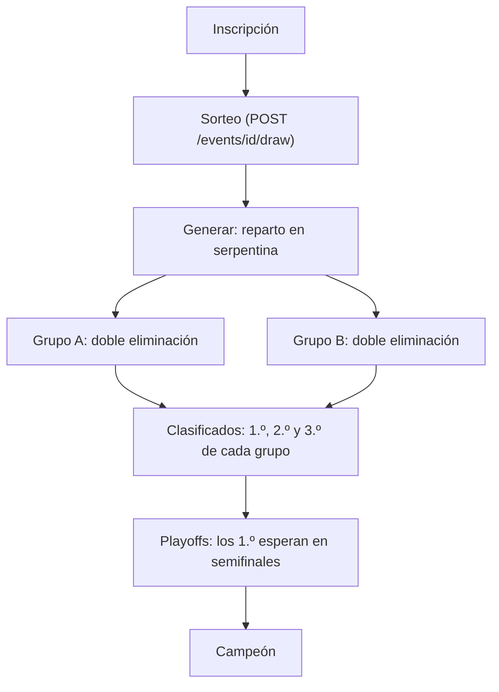
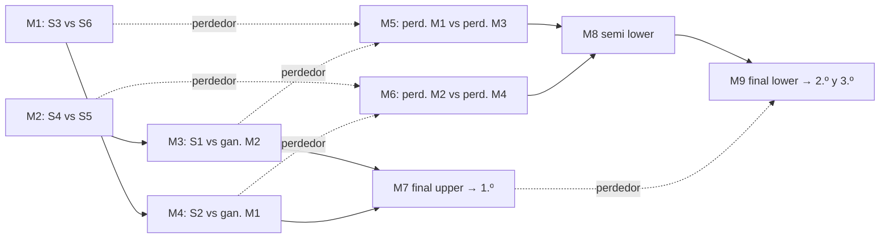

# Plantilla "Grupos de doble eliminación + playoffs" (`groups_double`): documentación

## Qué hace

Un torneo con esta plantilla reparte a los equipos en grupos. Cada grupo juega una **doble eliminación**: un equipo queda afuera con su segunda derrota. De cada grupo salen 2 o 3 clasificados a unos **playoffs de eliminación simple**.

El formato por defecto es el que definió Daniel:
- 12 equipos en 2 grupos de 6.
- Grupos BO3; clasifican 3 por grupo.
- Cuartos y semifinales BO3, final BO5.

También suma el **sorteo de la siembra**, que sirve para todas las plantillas: con grupos, decide el grupo y el lugar dentro del grupo.

Diagrama con un ejemplo completo: https://claude.ai/artifact/3zRgeGRrE8VS7VUAcuy13y

## Cuadro de un grupo (6 equipos)

## Reglas

- **Tamaños:**
  - De 1 a 8 grupos, de 4 a 8 equipos por grupo.
  - Clasifican 2 o 3 por grupo, y siempre hay playoffs.
  - `event_generate` rechaza otra cantidad de inscritos: "Con 2 grupos hacen falta entre 8 y 16 equipos".
- **Reparto:** en serpentina por la siembra, como la plantilla `groups`. Con la siembra sorteada, todo queda al azar.
- **Cuadro de cada grupo:**
  - Es la llave de doble eliminación del motor (de 4 u 8 lugares), sin gran final.
  - Los lugares vacíos son libres para los primeros de la siembra. Con 6, S1 y S2 pasan directo a la ronda 2 del upper.
  - Los libres del lower se resuelven solos cuando bajan los perdedores.
  - Los que pierden la ronda 2 del upper bajan **cruzados** (`pos = cantidad + 1 - pos`), para que nadie repita rival enseguida. La plantilla `double` no cruza.
- **Puestos del grupo** (`event_group_double_standings`):
  - 1.º: gana la final del upper.
  - 2.º: gana la final del lower.
  - Los demás, por la ronda del lower en que sumaron la segunda derrota: más tarde, mejor puesto. El que pierde la final del lower es el 3.º.
  - Los eliminados en la misma ronda comparten puesto.
  - Estado: `active` mientras sigue en carrera, `qualified` o `eliminated`. No hay empates ni puntos.
- **Playoffs:**
  - Los clasificados se ordenan como en `groups` (todos los 1.º, después los 2.º, después los 3.º) y van a `event_build_ko`.
  - Con 2 grupos y 3 clasificados, en una llave de 8 con 2 libres:
    - Cuartos: 2.º B vs 3.º A y 2.º A vs 3.º B.
    - Semifinales: 1.º A con el ganador de 2.º B–3.º A, y 1.º B con el otro.
  - `event_group_clashes` no ve estos grupos (mira la etapa `group`) y siempre queda ese orden, que es el que aprobó Daniel.
- **Sorteo** (`event_draw`):
  - Solo el organizador o un admin, y antes de generar el fixture.
  - Mezcla `events.seeds` al azar con todos los inscritos, y guarda `drawn_at` y `drawn_by`.
  - Esa marca solo la pone `event_draw`. El disparador `events_draw_guard` la borra si la siembra cambia por otro lado (a mano, una inscripción o una baja) e impide escribirla a mano.

## Base de datos (`supabase/replanteo/17_grupos_doble.sql`)

| Objeto | Qué es |
|---|---|
| `events.template` | Admite `groups_double` |
| `events.drawn_at`, `drawn_by` | Marca del sorteo |
| `event_stage_teams.stage` | Admite `group_double` (los equipos de cada grupo; así no aparecen en las tablas de `groups`) |
| `event_config` | Valores por defecto y validaciones de `groups_double` |
| `event_build_group_double` | Reparto y cuadro de cada grupo (`matches.stage` `group_upper` y `group_lower`, con `grp`) |
| `event_group_double_standings` | Tabla de cada grupo: puesto, victorias, derrotas, rondas y estado |
| `event_group_double_team` | El clasificado de un puesto (lo usa `event_group_qualifiers`) |
| `event_group_qualifiers`, `event_progress`, `event_generate` | Reemplazos de texto marcados "replanteo 17": puestos del cuadro, playoffs al terminar los grupos y la generación |
| `event_draw`, `events_draw_guard` | Sorteo y protección de su marca |
| `match_list` | `stage_order` ordena las etapas nuevas con los grupos |
| `event_standings` | Suma las filas `group_double` |

## API

| Endpoint | Cambio |
|---|---|
| `POST /api/v1/events`, `PATCH /api/v1/events/{id}` | `template: "groups_double"` y su `config` (`groups`, `advance`, `bo_group`, `playoffs`) |
| `POST /api/v1/events/{id}/draw` | Nuevo: sorteo. Responde `{ seeds, drawn_at }`. `403` si no es el organizador ni un admin; `400` si ya se generó el fixture |
| `GET /api/v1/events/{id}` | `draw: { at, by: { user_id, alias } }` o null |
| `GET /api/v1/events/{id}/standings` | `stage: "group_double"` (filtro y filas) |
| `label` de las partidas | "Grupo A · upper · ronda 1", "Grupo A · final del upper", "Grupo B · lower · ronda 2", "Grupo B · final del lower" |

## Dónde está cada cosa

| Qué | Archivo |
|---|---|
| Migración | `supabase/replanteo/17_grupos_doble.sql` |
| Inversa y prueba | `docs/bitacora/2026-10-14-replanteo-modelo-datos/reversas/17_grupos_doble.sql` y `pruebas/17_grupos_doble.sql` |
| API | `web/backend/src/schemas/events.ts`, `src/routes/events.ts` y `src/services/stages.ts` |
| Pruebas de la API | `web/backend/test/integration/groups-double.test.ts` y `test/unit/tournament-services.test.ts` |
| Contrato del frontend | `docs/frontend/contract.md`, sección 8b |
