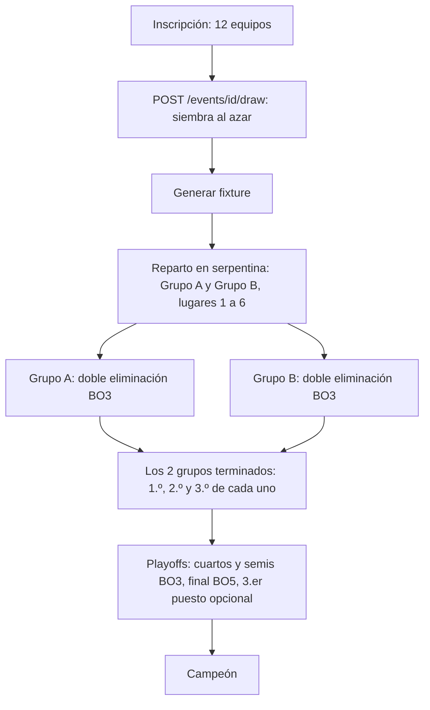

# Plan: plantilla de torneo "Grupos de doble eliminación + playoffs" (`groups_double`)

> Planeación original. Estado: **propuesta**, pendiente de aprobación. Solo base (replanteo) y API nueva: la web vieja no tiene el motor de torneos. Diagrama del formato con un ejemplo: https://claude.ai/artifact/3zRgeGRrE8VS7VUAcuy13y

## Decisiones tomadas

| Tema | Decisión | Origen |
|---|---|---|
| Nombre | `groups_double` en la base y la API; "Grupos de doble eliminación + playoffs" en la web | Daniel, 2026-10-18 |
| Plantilla nueva | No es una opción de `groups`: la fase de grupos es otro cuadro, sin tabla de puntos ni desempates | Propuesta aceptada por Daniel |
| Cuadro de cada grupo | Doble eliminación sin final del grupo. Un equipo queda eliminado con su segunda derrota | Daniel |
| Puestos del grupo | 1.º: gana la final del upper. 2.º: gana la final del lower. 3.º: pierde la final del lower | Daniel |
| Libres | Con 6 equipos, los lugares 1 y 2 del grupo pasan directo a la segunda ronda del upper | Daniel |
| Series | Grupos BO3; cuartos y semifinales BO3; final BO5; 3.er puesto opcional, BO3. Son los valores por defecto y el organizador los puede cambiar, como en las otras plantillas | Daniel |
| Playoffs | Eliminación simple. Los 1.º esperan en semifinales: 1.º A vs ganador de "2.º B vs 3.º A"; 1.º B vs ganador de "2.º A vs 3.º B" | Daniel |
| Sorteo | Se sortea todo: los grupos y el lugar dentro de cada grupo | Daniel |

## Decisiones propuestas (a confirmar)

| Tema | Propuesta | Por qué |
|---|---|---|
| Cómo se sortea | Endpoint nuevo `POST /api/v1/events/{id}/draw` (organizador o admin, antes de generar): mezcla la siembra al azar en el servidor. Se puede repetir hasta generar el fixture. Sirve para todas las plantillas | Hoy la siembra se carga a mano (`PUT /events/{id}/seeds`). Con la siembra al azar, el reparto en serpentina deja al azar los grupos y el lugar dentro de cada grupo |
| Registro del sorteo | Se guarda quién y cuándo sorteó (`events.drawn_at`, `events.drawn_by`) y la web lo muestra | Transparencia: que los equipos vean que no se acomodó a mano |
| Tamaños admitidos | De 1 a 8 grupos, de 4 a 8 equipos por grupo, clasifican 2 o 3 por grupo (por defecto: 2 grupos y 3 clasificados). Grupos de distinto tamaño (por ejemplo 13 equipos en 2 grupos) llevan más libres en el más chico | El cuadro de doble eliminación ya admite de 2 a 8 con libres. Con 2 clasificados quedan el 1.º y el 2.º |
| Cruce al bajar al lower | Los perdedores de la segunda ronda del upper bajan cruzados (el de arriba con los de abajo), para que nadie repita rival enseguida | Es lo que muestra el diagrama aprobado. La doble eliminación actual no cruza: con 6 equipos se podía repetir el cruce de la primera ronda |
| Grupo de un solo equipo clasificado o un solo grupo | Con 1 grupo, los clasificados van igual a playoffs; no se admite clasificar 1 | Simplifica: siempre hay playoffs |

## 1. El flujo completo

## 2. Base de datos: `supabase/replanteo/17_grupos_doble.sql`

- **`events.template`:** admite `groups_double`. `event_config` valida y completa la configuración:
  - `groups`, `advance` (2 o 3) y `bo_group`.
  - `playoffs`: `bo` 3, `bo_semi` 3, `bo_final` 5, `third_place` false y `bo_third` 3.
- **`event_build_group_double`:**
  - Reparte en serpentina (como `groups`, en `event_stage_teams`).
  - Arma en cada grupo un cuadro de doble eliminación con `stage = 'group_upper'` y `'group_lower'` y su `grp`. Usa los libres de la llave actual y el cruce al bajar.
  - Sin gran final.
- **`event_group_double_order(event, grp)`:** puestos del grupo salidos del cuadro (1.º, 2.º y 3.º, y los eliminados ordenados por la ronda en que cayeron).
- **Avance:**
  - `event_progress`: cuando terminan todos los grupos, arma los playoffs con los clasificados.
  - Los clasificados se ordenan como en `groups`: todos los 1.º, después los 2.º y después los 3.º. Eso da el cruce aprobado.
  - El campeón sale de la final de los playoffs.
- **`event_generate`:** valida los tamaños y llama a la función nueva.
- **Sorteo:**
  - `event_draw(event)` mezcla `events.seeds` al azar con todos los inscritos.
  - Solo el organizador o un admin, y solo en `registration`.
  - Guarda `drawn_at` y `drawn_by`.
- **Vistas:**
  - `match_list.stage_order` ordena las etapas nuevas con los grupos.
  - Vista `event_group_double_standings` para la tabla de cada grupo: puesto, victorias, derrotas y estado (`alive`, `qualified`, `eliminated`).
- **Inversa** y **prueba** en la bitácora del replanteo, como las demás.

## 3. API

| Qué | Cambio |
|---|---|
| Esquemas de torneo | `template` suma `groups_double`; su `config` con los valores por defecto |
| `POST /api/v1/events/{id}/draw` | Nuevo. Devuelve la siembra sorteada |
| `GET /api/v1/events/{id}/standings` | En `groups_double`, la tabla de cada grupo con puesto y estado |
| Nombre de la fase (`label`) | "Grupo A · upper · ronda 1", "Grupo A · final del upper", "Grupo B · lower · ronda 2", "Grupo B · final del lower" |
| Detalle del torneo | `drawn_at` y quién sorteó |

## 4. Requisitos antes de empezar

- Supabase local con el replanteo 01 a 16.
- Confirmar las decisiones propuestas.

## 5. Orden de implementación

1. Migración `17`, inversa y prueba (el ejemplo del diagrama de punta a punta: sorteo, los dos grupos, playoffs y campeón); `correr.sh` completo.
2. `pnpm db:types`; esquemas, rutas y `stageLabel`.
3. Pruebas unitarias y de integración.
4. Contrato del frontend (plantillas, sorteo, novedades y registro de decisiones), README del replanteo, `DOCUMENTACION.md`, `GUIA_IMPLEMENTACION.md`, índice y `docs/PENDIENTES.md`.
