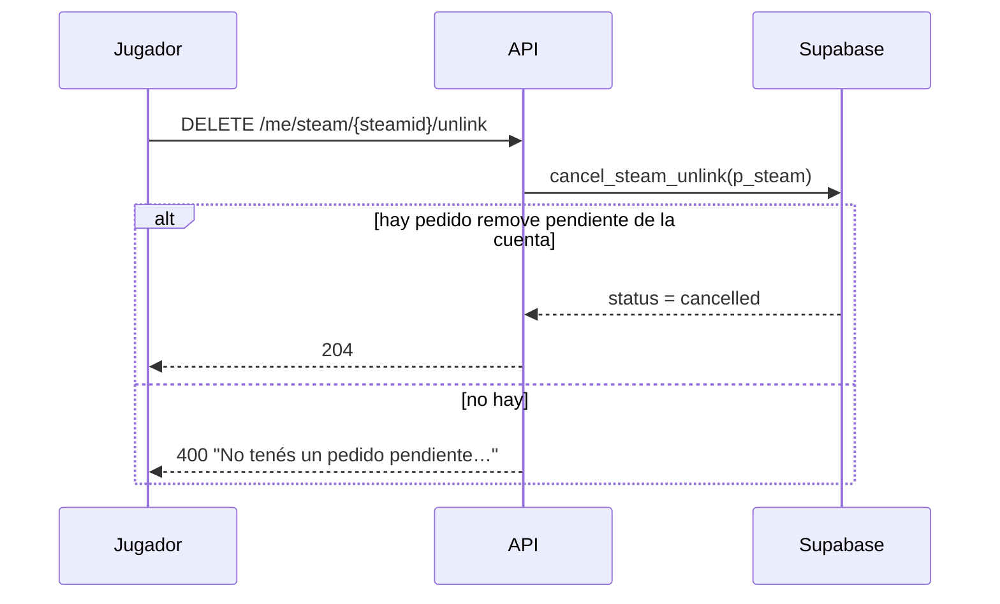
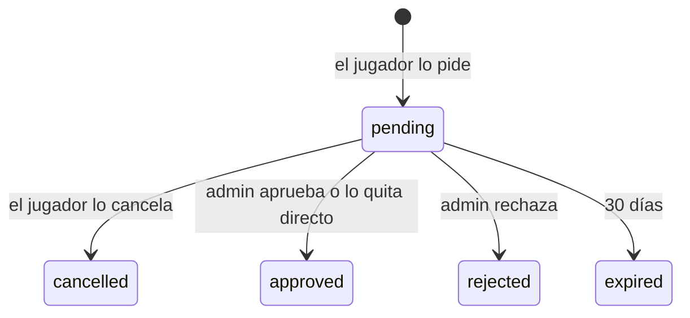
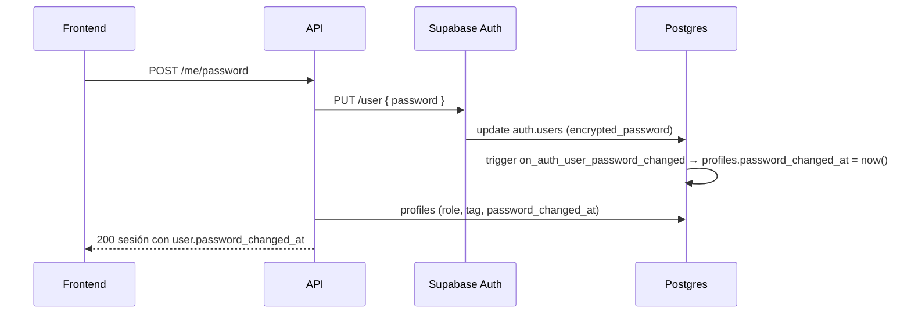

# Cancelar el pedido de desvincular un SteamID y fecha del último cambio de contraseña: documentación

## Qué hace

Tres agregados al backend de la web nueva para Mi perfil:

| Qué | Dónde |
|---|---|
| El jugador **cancela su pedido de desvincular** un SteamID mientras sigue pendiente | `DELETE /api/v1/me/steam/{steamid}/unlink` |
| La **fecha del último cambio de contraseña** | `password_changed_at` en el usuario (`GET /auth/me`, sesiones, `GET /api/v1/me/profile`) |
| **`/auth/me` con una sesión cerrada responde `401`**, no `500` (bug reportado por el frontend el 2026-10-19) | `fromAuthError` en `web/backend/src/lib/errors.ts` |

El detalle para el frontend está en [`docs/frontend/contrato/`](../../frontend/contrato/README.md): `jugadores.md` (5b), `cuenta.md` (2), `admin.md` (9) y `api.md` (1).

## 1. Cancelar el pedido de desvincular

| Regla | Detalle |
|---|---|
| Qué se cancela | El pedido `remove` **pendiente** de ese SteamID, creado por la cuenta que llama. Los pedidos de SteamID adicional (`add`, de `!claim`) no se cancelan |
| Qué queda | El pedido no se borra: `status = 'cancelled'`, `resolved_at` y `resolved_by` (el propio jugador). El SteamID sigue en la ficha |
| Después | Se puede volver a pedir y el SteamID puede ser principal otra vez (el pedido pendiente ya no lo bloquea) |
| Errores (`400`) | Sin pedido pendiente: también si ya lo aprobó o rechazó un admin, si venció o si es de otra cuenta. Sin sesión: `401` |
| Admin | Lo ve en la bandeja con `status: cancelled` (después de los pendientes). Aprobarlo o rechazarlo da `400` ("La solicitud ya no está pendiente (cancelled)") |

## 2. Fecha del último cambio de contraseña

- **La escribe la base, no la API:** el trigger `on_auth_user_password_changed` (`after update of encrypted_password on auth.users`, solo si el valor cambió) llama a `handle_password_change`. Cuenta cualquier cambio: `POST /api/v1/me/password`, el futuro "Olvidé mi contraseña" o un cambio desde el panel de Supabase. Un login u otro cambio en `auth.users` no la toca.
- **Dónde vive:** `profiles.password_changed_at`. El usuario solo puede leer `profiles` (la RLS no le deja cambiarla).
- **`null`:** no la cambió desde que existe la columna. Las cuentas nuevas también arrancan en `null` (la contraseña del registro no cuenta como cambio). No hay de dónde sacar los cambios anteriores.
- **Dónde sale:** `AuthUser.password_changed_at`, que la API arma en `toAuthUser` (`services/account.ts`) con `profileOf`. Por eso aparece en `GET /auth/me`, en `user` de cada sesión (signup, login, refresh y la respuesta del cambio de contraseña) y en `user` de `GET /api/v1/me/profile`.

## 3. `/auth/me` con una sesión cerrada

Al cambiar la contraseña se cierran las otras sesiones. El otro dispositivo sigue con un `access_token` sin vencer, y `GET /auth/me` (que consulta a Auth con `auth.getUser`) respondía `500 INTERNAL`: Auth contesta `403 session_not_found`, pero supabase-js lo convierte en `AuthSessionMissingError` con `status: 400` y sin `code`, y `fromAuthError` no lo reconocía. El frontend quedaba trabado en "Algo salió mal".

Ahora `fromAuthError` trata `AuthSessionMissingError` como `401 UNAUTHORIZED` ("La sesión no es válida o venció. Inicia sesión de nuevo."), y el frontend vuelve al login solo. Los dos usos de `getUser` pasan por ahí: `GET /auth/me` y `POST /api/v1/me/password` cuando el token no trae el correo.

Las demás rutas validan el token localmente (JWKS) y lo siguen aceptando hasta que vence (como mucho 1 hora); después el refresh da `401`. No cambió.

## Datos

| Tabla / columna | Qué guarda |
|---|---|
| `steam_requests.status` | Suma `cancelled` (lo canceló el jugador) |
| `profiles.password_changed_at` | Último cambio de contraseña; `null` si no la cambió desde el replanteo `22` |

## Funciones de Supabase

| Función | Quién | Qué hace |
|---|---|---|
| `cancel_steam_unlink(p_steam)` | Usuario | Pasa a `cancelled` su pedido `remove` pendiente de ese SteamID |
| `handle_password_change()` | Trigger de `auth.users` | Guarda `now()` en `profiles.password_changed_at` |

## Dónde está cada cosa

| Qué | Archivo / ubicación |
|---|---|
| Migración | `supabase/replanteo/22_cancelar_desvincular_password.sql` |
| Inversa | `docs/bitacora/2026-10-14-replanteo-modelo-datos/reversas/22_cancelar_desvincular_password.sql` |
| Pruebas SQL | `docs/bitacora/2026-10-14-replanteo-modelo-datos/pruebas/22_cancelar_desvincular_password.sql` |
| Ruta para cancelar | `web/backend/src/routes/claim.ts` (`cancelUnlink`), `schemas/claim.ts` (`STEAM_REQUEST_STATES`) |
| Fecha de la contraseña | `web/backend/src/schemas/auth.ts` (`AuthUser`), `services/account.ts` (`profileOf`, `toAuthUser`), `routes/me.ts` |
| Sesión cerrada | `web/backend/src/lib/errors.ts` (`fromAuthError`) |
| Pruebas | `web/backend/test/unit/claim-routes.test.ts`, `auth-routes.test.ts`, `errors.test.ts`; `test/integration/claim.test.ts`, `auth.test.ts` |
