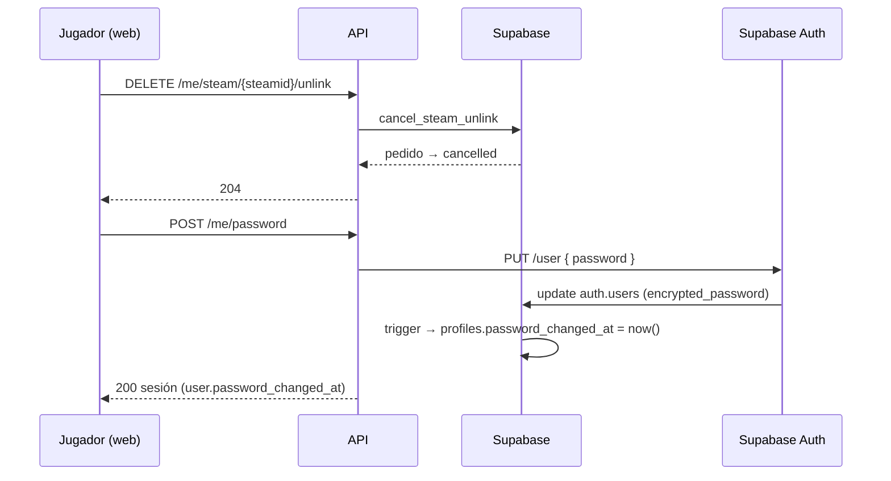
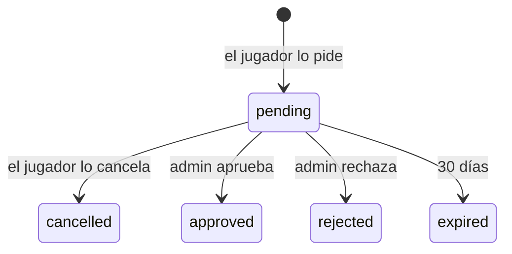

# Plan: cancelar el pedido de desvincular un SteamID y fecha del último cambio de contraseña

> Planeación original. Estado: **aprobado** por Daniel el 2026-10-19 (pedido directo: "quedan pendientes cancelar el pedido de desvincular steamid, la fecha del último cambio de contraseña"). Las decisiones marcadas como "Propuesta de Claude" no las eligió él.

## El pedido

Dos cosas que le faltan al frontend en Mi perfil:

1. **Cancelar el pedido de desvincular un SteamID** mientras sigue pendiente (lo creó `POST /api/v1/me/steam/{steamid}/unlink`, replanteo `21`).
2. **La fecha del último cambio de contraseña**, para mostrarla junto al formulario de `POST /api/v1/me/password`.

## Decisiones tomadas

| Tema | Decisión | Origen |
|---|---|---|
| Endpoint para cancelar | `DELETE /api/v1/me/steam/{steamid}/unlink`, el inverso del `POST`. Va por SteamID porque la lista de Mi perfil (`GET /api/v1/me/claim-code`) trae `unlink_pending` por SteamID y no el id del pedido | Propuesta de Claude |
| Qué pasa con el pedido | **No se borra:** queda con el estado nuevo `cancelled` y la fecha en `resolved_at`. El admin lo ve en la bandeja como cancelado y el jugador en su historial | Propuesta de Claude |
| Qué pedidos se cancelan | Solo los de desvincular (`kind: remove`), que es lo pedido. Los de SteamID adicional (`add`, de `!claim`) siguen igual | |
| Sin pedido pendiente | `400` con el mensaje de la base ("No tenés un pedido pendiente para desvincular ese SteamID"), también si ya lo aprobó o rechazó un admin | |
| Dónde se guarda la fecha de la contraseña | `profiles.password_changed_at`. El usuario solo puede leer `profiles` (no la puede cambiar a mano, a diferencia de `profile_details`) | Propuesta de Claude |
| Quién la escribe | Un **trigger en `auth.users`** cuando cambia `encrypted_password`, no la ruta de la API. Así cuenta cualquier cambio: `POST /api/v1/me/password`, el futuro "Olvidé mi contraseña" o un cambio desde el panel de Supabase | Propuesta de Claude |
| Cuentas existentes | `null` = no la cambió desde que se guarda la fecha. No hay de dónde sacar los cambios anteriores. Al registrarse queda en `null` (la contraseña del registro no cuenta como cambio) | Propuesta de Claude |
| Dónde la ve el frontend | En `AuthUser` (`password_changed_at`): sale en `GET /auth/me`, en `user` de cada sesión (login, refresh y la respuesta del cambio de contraseña) y en `user` de `GET /api/v1/me/profile` | Propuesta de Claude |

## 1. El flujo

## 2. Base de datos: replanteo `22_cancelar_desvincular_password.sql`

- `steam_requests.status` admite `cancelled`.
- `cancel_steam_unlink(p_steam)`: el pedido `remove` pendiente de ese SteamID, de la cuenta que llama, pasa a `cancelled` (`resolved_at` y `resolved_by`).
- `profiles.password_changed_at` y el trigger `on_auth_user_password_changed` (`after update of encrypted_password on auth.users`), con la función `handle_password_change`.
- Inversa en `docs/bitacora/2026-10-14-replanteo-modelo-datos/reversas/22_cancelar_desvincular_password.sql` (borra los pedidos cancelados) y pruebas SQL en `pruebas/`.

## 3. API

| Endpoint | Cambio |
|---|---|
| `DELETE /api/v1/me/steam/{steamid}/unlink` | Nuevo. `204` |
| `GET /api/v1/me/steam-requests`, `GET /api/v1/admin/steam-requests` | `status` puede ser `cancelled` (también en el filtro) |
| `AuthUser` (`/auth/me`, sesiones, `GET /api/v1/me/profile`) | Suma `password_changed_at` |

## 4. Documentación

- Contrato del frontend: `jugadores.md` (5b), `cuenta.md`, `admin.md`, novedades del `README.md` y `decisiones.md`.
- `supabase/replanteo/README.md` con la fila de la `22`.
- `PENDIENTES.md` y el índice de la bitácora.

## 5. Requisitos antes de empezar

- Docker prendido para la Supabase local.

## 6. Orden de implementación

1. Migración `22`, su inversa y sus pruebas SQL.
2. `pnpm db:reset` y `pnpm db:types`.
3. Esquemas, rutas y `toAuthUser`.
4. Pruebas unitarias y de integración.
5. Contrato del frontend, bitácora y pendientes.
