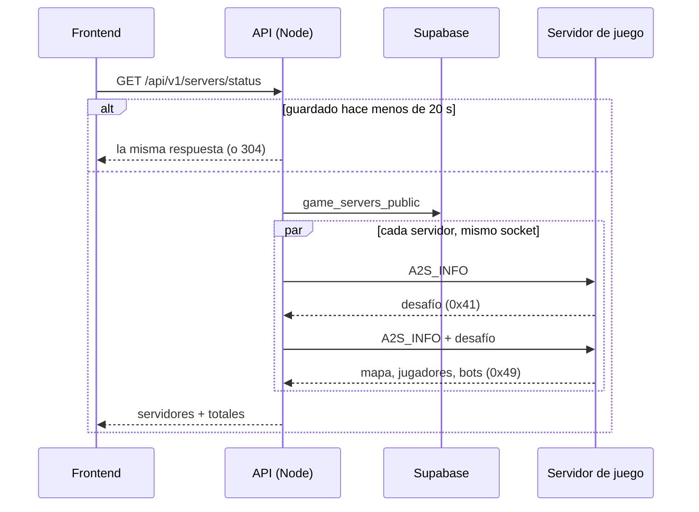
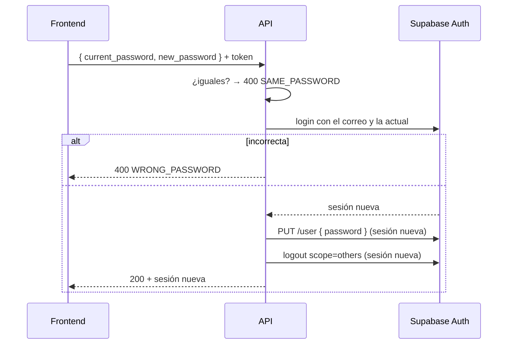

# Estado de los servidores, cambio de contraseña y mis partidas: documentación

Cuatro agregados al backend de la web nueva y un cambio en cómo se documenta el contrato para el frontend. El detalle para el frontend está en [`docs/frontend/contrato/`](../../frontend/contrato/README.md).

| Qué | Endpoint | Dónde en el contrato |
|---|---|---|
| Estado de los servidores | `GET /api/v1/servers/status` (público) | [`partidas.md`](../../frontend/contrato/partidas.md), sección 8e |
| Cambiar la contraseña | `POST /api/v1/me/password` | [`cuenta.md`](../../frontend/contrato/cuenta.md), sección 2 |
| Mis partidas | `GET /api/v1/me/matches` | [`cuenta.md`](../../frontend/contrato/cuenta.md), sección 2 |
| Partidas de un servidor | `GET /api/v1/matches?server=<id>` | [`api.md`](../../frontend/contrato/api.md), "Listados" |

## 1. Estado de los servidores

- **Qué servidores:** los de `game_servers_public` (activos, con licencia vigente).
- **Cómo lo sabe:** consulta **A2S_INFO** por UDP, la misma del navegador de servidores del juego. No toca el plugin.
- **El desafío:** el servidor real responde primero con un desafío (`0x41`) atado al **puerto de origen**: el segundo envío tiene que salir del mismo socket. El servidor local de pruebas no lo pide. Por eso el envío UDP es una conversación (`UdpExchange` abre un socket, corre los envíos y lo cierra).
- **Jugadores:** `players - bots`. SourceTV cuenta como bot, así que no infla el número.
- **Sin respuesta en 1,5 s** (todo, desafío incluido): `online: false` y los datos en `null`. Uno no frena a los demás: se consultan a la vez.
- **Sin `connect_address`:** no se consulta y queda `online: false`.
- **Caché de 20 s en memoria**, una por app. Mientras una consulta está en curso, los pedidos que llegan esperan esa misma. Si falla la base, no se guarda el error.
- **`ETag`:** responde `304` con el mismo `If-None-Match`.
- **Solo en Node:** `node.ts` le pasa a la app el envío UDP (`lib/udp-node.ts`, `node:dgram`). Sin él (el Worker), `501 NOT_AVAILABLE`.

## 2. Cambiar la contraseña

- **Por qué un login antes:** comprueba la actual y da una sesión recién creada, que cumple si Supabase exige una sesión reciente para cambiar la contraseña. No hace falta la clave de servicio.
- **Las otras sesiones:** `logout?scope=others` con la sesión nueva cierra todas las demás, incluida la que hizo el pedido. El frontend guarda la sesión que devuelve la respuesta.
- **Errores:**
  - `400 WRONG_PASSWORD`: la actual no es correcta.
  - `400 SAME_PASSWORD`: la nueva es igual a la actual, ya sea por la comparación propia o porque Supabase la rechaza.
  - `400 VALIDATION_ERROR`: la nueva es corta o Supabase la considera débil.
  - `401`: sin sesión.
  - `429`: límite de intentos.
  - `500`: Auth falló. En ese caso no se cierran las otras sesiones.
- **Si falla el cierre de las otras sesiones:** la contraseña ya quedó cambiada, así que responde `200` igual y lo registra en el log.
- **Límite:** 5 intentos por minuto **por cuenta**, con la regla `password` de `RATE_RULES` y el binding `RL_PASSWORD` en Workers. `rateLimit` acepta ahora una clave propia (por defecto, la IP).
- **Correo de la cuenta:** sale del token; si no viene, se lo pide a Auth.

## 3. Mis partidas y partidas por servidor

- **`GET /api/v1/me/matches`:**
  - Busca la ficha de la cuenta (`players.user_id`) y responde lo mismo que `GET /api/v1/players/{id}/matches`, porque comparten la función `playerMatches`.
  - Sin ficha: `200` con la lista vacía.
- **`GET /api/v1/matches?server=<id>`:**
  - Filtra `match_list.server_id`, que suma la migración **`19`** del replanteo (`supabase/replanteo/19_listado_servidor.sql`).
  - La inversa borra y recrea la vista, porque `create or replace` no puede quitar columnas y no hay vistas que dependan de ella.

## 4. Documentación de varios SteamID por cuenta

Ya estaba en el contrato (secciones 0, 5, 5b, 9 y el registro de decisiones) y en la bitácora de `!claim`. Se agregó donde faltaba:
- **`docs/MODELO_DATOS.md`:**
  - `players.steam_id` es el principal.
  - La sección "Después del corte" cubre ahora las migraciones `01` a `19`, con la fila "SteamID por ficha" y el diagrama de `player_extra_steam_ids` y `steam_requests`.
- **Contrato:**
  - Fila "SteamID de una cuenta" en `modelo-datos.md`.
  - Resumen "Una cuenta puede tener varios SteamID" en `jugadores.md`.
- **OpenAPI de Mi perfil:** `player` se vincula con `!claim`, y `player.steam_id` es el principal.

## 5. Contrato por módulos

`docs/frontend/contract.md` (777 líneas) pasó a `docs/frontend/contrato/`:

| Archivo | Secciones |
|---|---|
| `README.md` | Índice, estado, novedades (0) y lo no definido (10) |
| `api.md` | 1 |
| `cuenta.md` | 2 y 4 |
| `modelo-datos.md` | 3 |
| `jugadores.md` | 5 y 5b |
| `equipos.md` | 6 y 7 |
| `partidas.md` | 8, 8c, 8d y 8e (nueva) |
| `torneos.md` | 8b |
| `admin.md` | 9 |
| `decisiones.md` | 11 |

- **Las secciones conservan su número**, así que las referencias de la bitácora vieja ("`contract.md`, sección 5b") siguen sirviendo.
- **`contract.md` quedó como aviso**, con la tabla de cada sección a su archivo.
- **Las referencias internas** ("sección 5b") son enlaces al archivo que corresponde.
- **El contenido es el mismo:** se comprobó línea por línea que no se perdió nada, y que todos los enlaces apuntan a archivos que existen.

## Dónde está cada cosa

| Qué | Archivo |
|---|---|
| A2S (pedido, lectura, desafío, direcciones) | `web/backend/src/lib/a2s.ts` |
| Envío UDP de Node | `web/backend/src/lib/udp-node.ts` (excluido del `tsconfig` de Workers) |
| Estado y caché | `web/backend/src/services/servers.ts` |
| Ruta del estado | `web/backend/src/routes/servers.ts` |
| Contraseña | `web/backend/src/routes/auth.ts`, `schemas/auth.ts` (`PasswordChangeBody`), `lib/ratelimit.ts` |
| Mis partidas | `web/backend/src/routes/players.ts` (`myMatches`, `playerMatches`) |
| Filtro por servidor | `web/backend/src/routes/matches.ts`, `schemas/matches.ts`, `supabase/replanteo/19_listado_servidor.sql` |
| Consulta A2S a mano | `web/backend/scripts/a2s-probe.mts` (`pnpm exec tsx scripts/a2s-probe.mts host:puerto`) |
