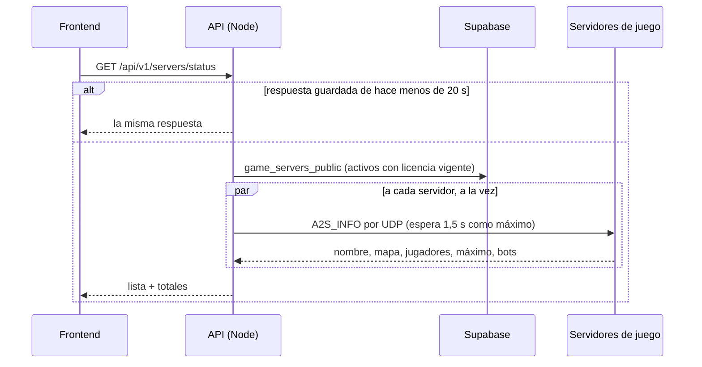
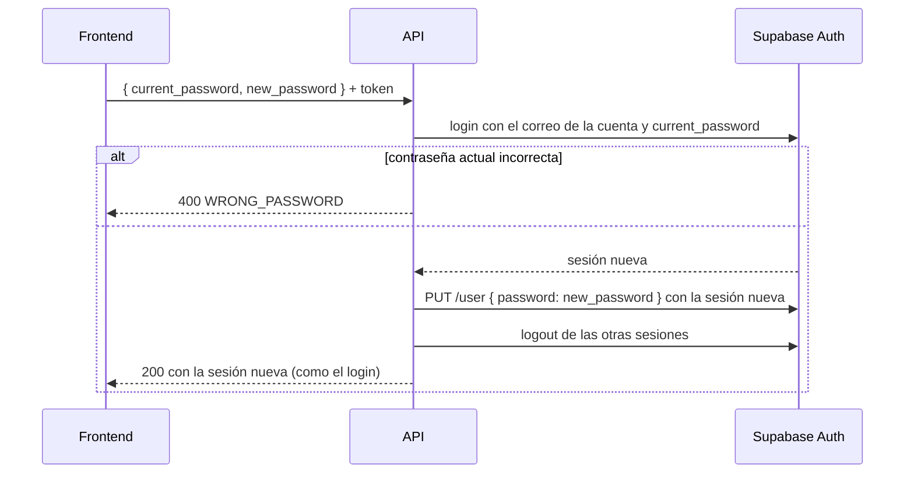

# Plan: estado de los servidores, cambio de contraseña y mis partidas

> Planeación original. Estado: **aprobado** por Daniel el 2026-10-19, con la partición del contrato por módulos (sección 5) y el cierre de las otras sesiones al cambiar la contraseña.

## El pedido

Daniel revisó el backend de la web nueva el 2026-10-19 y pidió:
1. Un endpoint que diga cuántos servidores hay activos y cuántos jugadores tiene cada uno.
2. Cambiar la contraseña. El resto de los datos de la cuenta ya se cambia con `PATCH /api/v1/me/profile`; el SteamID se vincula solo con `!claim`.
3. Un endpoint con las partidas del usuario con sesión y otro con todas las partidas jugadas en los servidores.
4. Que la documentación general diga que una cuenta puede tener varios SteamID. Y revisar si conviene partir la documentación en archivos por módulo.

## Lo que ya existe

| Pedido | Hoy | Falta |
|---|---|---|
| 1 | `GET /api/v1/admin/servers?online=true` (solo admin; "en línea" = validó la licencia en los últimos 35 min) y `GET /api/v1/servers` (con sesión; nombre y dirección) | Saber si está prendido **ahora** y cuántos jugadores tiene |
| 2 | Nada | Cambiar la contraseña con la sesión iniciada |
| 3 | `GET /api/v1/players/{id}/matches` (con el `player.id` de Mi perfil) y `GET /api/v1/matches` | Un `/me/matches` directo y filtrar `GET /api/v1/matches` por servidor |

## Decisiones tomadas

| Tema | Decisión | Origen |
|---|---|---|
| Cómo saber los jugadores | El backend le pregunta a cada servidor con la consulta estándar de Source (**A2S_INFO** por UDP, la del navegador de servidores del juego). **Sin tocar el plugin**, que está congelado, y sirve igual para RBK | Propuesta aceptada por Daniel el 2026-10-19 |
| "Olvidé mi contraseña" | **Fuera de este plan**: necesita el envío de correos (Resend), que está en el plan del VPS sin aprobar. Queda anotado en `PENDIENTES.md` | Propuesta aceptada por Daniel el 2026-10-19 |
| Mis partidas | `GET /api/v1/me/matches`, igual que el del jugador | Propuesta aceptada por Daniel el 2026-10-19 |
| Todas las partidas | `GET /api/v1/matches` ya es ese listado; se le suma el filtro `server` | Propuesta aceptada por Daniel el 2026-10-19 |

## 1. Estado de los servidores: `GET /api/v1/servers/status`



**Respuesta** (público, sin sesión):

```json
{
  "servers": [
    { "id": "…", "name": "v34frag #1", "address": "ip:27062", "online": true,
      "map": "de_inferno", "players": 10, "max_players": 12, "bots": 0 }
  ],
  "totals": { "servers": 2, "online": 2, "players": 14 },
  "checked_at": "2026-10-19T03:10:00Z"
}
```

- **Qué servidores:** los de `game_servers_public` (activos, con licencia vigente y con `connect_address`). Sin dirección no se pueden consultar: van con `online: false`.
- **Jugadores:** los humanos (`players - bots`). SourceTV cuenta como bot, así que no infla el número.
- **Servidor que no responde en 1,5 s:** `online: false` y `map`, `players` y `max_players` en `null`. No hace fallar al resto.
- **Caché de 20 s en memoria:** la página puede consultar seguido sin que el backend dispare consultas UDP con cada visita. Con `ETag`, como los otros endpoints que se consultan seguido.
- **Desafío de A2S:** desde 2020 los servidores nuevos piden un desafío (responden `0x41` con un número que hay que reenviar). Un servidor v34 probablemente no lo pide, pero se maneja igual.
- **Solo en Node:** usa `node:dgram`. En el Worker (que ya no es el destino del despliegue) responde `501`.
- **No es una lista:** son 2 o 3 servidores y la respuesta es una foto completa, así que no lleva paginación. Es la única excepción a la convención de listados, y queda anotada en el contrato.

**Archivos:**
- `web/backend/src/lib/a2s.ts`: la consulta A2S_INFO, con el desafío, el tiempo máximo y la lectura de la respuesta.
- `web/backend/src/services/servers.ts`: arma la lista y guarda la caché.
- `web/backend/src/routes/servers.ts`: la ruta.

## 2. Cambiar la contraseña: `POST /api/v1/me/password`



| Tema | Decisión |
|---|---|
| Pide la contraseña actual | Sí: si alguien deja la sesión abierta en otra PC, no le pueden cambiar la contraseña |
| Por qué un login antes de cambiarla | Comprueba la actual, y además Supabase puede exigir una sesión reciente para cambiar la contraseña ("Secure password change"); la sesión recién creada cumple |
| Las otras sesiones | **Se cierran todas** (otras PCs y el celular). La respuesta trae la sesión nueva (`access_token`, `refresh_token`, `expires_at`) y el frontend la reemplaza |
| Reglas de la nueva | Las mismas del registro: de 6 a 72 caracteres, y distinta de la actual (`400 SAME_PASSWORD`) |
| Límite | 5 intentos por minuto por cuenta (regla nueva en `RATE_RULES`, también en `wrangler.toml`): frena a quien prueba contraseñas con una sesión robada |
| Errores | `400 VALIDATION_ERROR` (forma), `400 WRONG_PASSWORD`, `400 SAME_PASSWORD`, `401` sin sesión, `429` |
| Sin clave de servicio | Todo con la sesión del usuario: no hace falta `SUPABASE_SERVICE_KEY` |

**Archivos:**
- `web/backend/src/routes/auth.ts` (o `me.ts`).
- `web/backend/src/schemas/auth.ts`.

## 3. Partidas

### 3.1 `GET /api/v1/me/matches` (con sesión)

- **Igual que `GET /api/v1/players/{id}/matches`:** los mismos filtros (`kind`, `result`, `map`, `from`, `to`), el mismo orden (`played_at`, `rating`, `kills`, `elo_delta`) y la misma respuesta, con mis stats de cada partida.
- **Sin ficha** (la cuenta nunca usó `!claim`): lista vacía con `total: 0`, no un error, para que el frontend muestre "Vinculá tu cuenta con `!claim` para ver tus partidas".
- **Código:** reusa el código del endpoint del jugador; solo cambia de dónde sale el id.

### 3.2 `GET /api/v1/matches?server=<id>`

- **Filtro nuevo** por servidor. El resto ya existe: tipo (mix, PCW, torneo), estado, torneo, equipo, jugador, mapa, fechas y búsqueda.
- **"Todas las partidas jugadas en los servidores"** es `GET /api/v1/matches?status=finished`, con `server` para uno en particular.
- Si `match_list` no trae el id del servidor como columna filtrable, se le suma en una migración `19` del replanteo (con su inversa y su prueba en `correr.sh`).

## 4. Documentación: varios SteamID por cuenta

**Dónde ya está** (desde el 2026-10-16):
- `docs/frontend/contract.md`: secciones 0, 5, 5b y 9, y el registro de decisiones.
- La bitácora [`2026-10-16-claim-steamid`](../2026-10-16-claim-steamid/DOCUMENTACION.md).
- `supabase/replanteo/README.md` (fila de la `15`).

**Dónde falta o está atrasado:**

| Archivo | Problema | Cambio |
|---|---|---|
| `docs/MODELO_DATOS.md` | `players.steam_id` figura como "UNIQUE", que da a entender un SteamID por jugador. La sección "Después del corte" solo resume el replanteo `01` a `10` | Resumir el `11` a `18`, con una fila "SteamID por ficha": antes uno (`players.steam_id`); después el principal más los adicionales (`player_extra_steam_ids`, vista `player_steam_all`), con tope en `claim_config` y aprobación del admin. Un SteamID es de una sola ficha y hay un solo ELO por ficha |
| `docs/frontend/contract.md`, sección 3 (antes y después) | No tiene la fila de los SteamID | Fila "SteamID": antes uno, lo vinculaba un admin; después varios, el primero con `!claim` y los adicionales con aprobación del admin |
| `web/backend/src/schemas/profile.ts` (OpenAPI de Mi perfil) | `player` dice "lo vincula un admin al aprobar un reclamo" (de antes de `!claim`), y su `steam_id` no aclara que es solo el principal | Texto al día: se vincula con `!claim`; `steam_id` es el principal; todos están en `GET /api/v1/me/claim-code` (`steam_ids`) |

## 5. Documentación por módulos (para decidir)

**Cómo está hoy:**
- `docs/frontend/contract.md` tiene **777 líneas** en un solo archivo.
- Cada cambio del backend toca ese archivo en tres lugares: su sección, las novedades y el registro de decisiones.
- Para trabajar en un módulo (por ejemplo, torneos) hay que leerlo entero o buscar la sección.

**Propuesta: partirlo por módulo** en `docs/frontend/contrato/`:

| Archivo | Contenido (secciones de hoy) |
|---|---|
| `README.md` | Índice con el estado de cada módulo, las novedades y lo que falta definir (0 y 10) |
| `api.md` | Cómo se consume la API: sesión, errores, listados (1) |
| `cuenta.md` | Cuenta, Mi perfil, alias, preferencias (2 y 4) |
| `jugadores.md` | Jugadores, perfiles sin reclamar, `!claim`, varios SteamID (5 y 5b) |
| `equipos.md` | Equipos, plantel y ranking (6 y 7) |
| `partidas.md` | Partidas, `!match`, PCW, ELO y mixes en vivo (8, 8c y 8d) |
| `torneos.md` | Torneos, plantillas y sorteo (8b) |
| `admin.md` | Admin (9) |
| `modelo-datos.md` | Qué cambia respecto de la web vieja (3) |
| `decisiones.md` | El registro de decisiones (11), en un solo lugar |

**Por qué conviene:**
- **Para trabajar en un módulo** basta con leer un archivo de 60 a 150 líneas en lugar de 777. Esto vale para el equipo de frontend y para Claude, que gasta menos contexto.
- **Los cambios quedan acotados:** una entrega toca su archivo, el índice y el registro de decisiones.
- **No se pierde nada:** el contenido es el mismo, solo se reparte; los enlaces internos se ajustan.

**En contra:**
- Quien quiera leerlo de corrido tiene que abrir varios archivos.
- El equipo de frontend tiene que saber que cambió la ubicación: se deja `contract.md` como un aviso con el enlace al índice.

`docs/MODELO_DATOS.md` no se parte: el esquema real ya está volcado en `supabase/schema/` y ese documento es un resumen.

## 6. Pruebas

- **Unitarias (Vitest, fetch simulado):**
  - A2S:
    - Lectura de una respuesta real de v34 grabada.
    - El desafío.
    - Tiempo máximo.
    - Respuesta corrupta.
    - La caché de 20 s.
  - Contraseña:
    - La actual incorrecta.
    - La misma contraseña.
    - Forma inválida.
    - Que se cierren las otras sesiones.
    - Que la respuesta traiga la sesión nueva.
    - El límite de intentos.
  - `/me/matches`:
    - Con ficha.
    - Sin ficha.
    - Filtros.
  - Filtro `server` en `GET /api/v1/matches`.
- **Integración (Supabase local):**
  - Cambiar la contraseña de punta a punta:
    - Con la vieja, el login falla.
    - Con la nueva, funciona.
    - El `refresh_token` viejo ya no sirve.
  - `/me/matches` con partidas cargadas.
  - Filtro por servidor.
- **A2S contra un servidor real:**
  - Consulta al servidor local de pruebas: `srcds` en este equipo, solo lectura.
  - Una sola consulta al servidor real y a RBK, para confirmar que responden y si piden desafío. Es la misma consulta que hace cualquier navegador de servidores.

## 7. Contrato y documentación

- `docs/frontend/contract.md`: las tres secciones, la excepción del estado de servidores a la convención de listados, y el registro de decisiones.
- `docs/PENDIENTES.md`: "Olvidé mi contraseña", pendiente del correo.

## 8. Requisitos antes de empezar

- Aprobación de este plan.
- Docker y la Supabase local (replanteo 01 a 18).
- Nada que instalar: UDP viene con Node.

## 9. Orden de implementación

1. `/me/matches` y el filtro `server` (y la `19` si hace falta), con sus pruebas.
2. Cambio de contraseña, con sus pruebas.
3. A2S y `/servers/status`: primero contra el servidor local, después la consulta de prueba a los dos servidores.
4. Documentación de varios SteamID (sección 4).
5. Si Daniel lo aprueba, partir el contrato por módulos (sección 5), **antes** de agregarle lo nuevo de este plan, así lo nuevo ya entra en su archivo.
6. Contrato, `DOCUMENTACION.md`, `GUIA_IMPLEMENTACION.md`, `PENDIENTES.md` y el índice.
