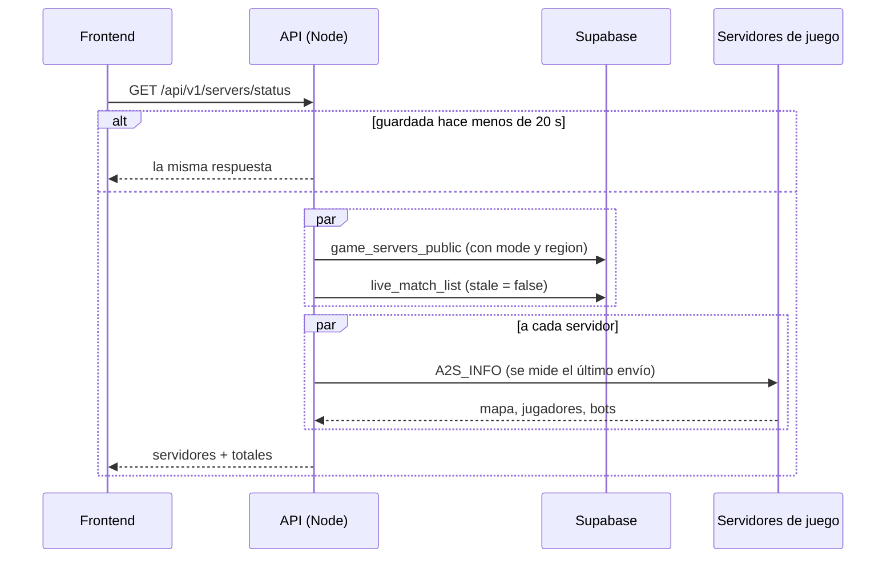

# Ping, modo, región y partidas en vivo en el estado de los servidores: documentación

## Qué hace

`GET /api/v1/servers/status` (público) ya decía si cada servidor está prendido, su mapa y sus jugadores. Ahora también entrega:

- **`mode`** y **`region`**: los carga el admin en el admin de servidores. El modo es de una lista fija y la región es texto libre.
- **`ping_ms`**: la latencia de la consulta A2S **desde el backend** hasta el servidor. No es el ping del jugador.
- **`live_matches`**: mixes en vivo en cada servidor, y su suma en `totals.live_matches`, para la línea "N partidas en vivo · N jugadores en el servidor".



## Respuesta

```json
{
  "servers": [
    { "id": "…", "name": "v34frag #1", "address": "ip:27062", "mode": "mix", "region": "Argentina",
      "online": true, "ping_ms": 18, "map": "de_inferno", "players": 10, "max_players": 12, "bots": 1, "live_matches": 1 }
  ],
  "totals": { "servers": 2, "online": 2, "players": 14, "live_matches": 1 },
  "checked_at": "2026-10-19T03:10:00Z"
}
```

| Campo | Qué es | Si el servidor no responde |
|---|---|---|
| `mode` | `mix`, `competitive`, `public`, `deathmatch`, `retakes` o `practice`; `null` si no está cargado | Viene igual |
| `region` | Texto libre de 2 a 30 caracteres; `null` si no está cargada | Viene igual |
| `ping_ms` | Milisegundos que tardó la respuesta con la información | `null` |
| `live_matches` | Mixes de ese servidor con foto en los últimos 10 minutos | Viene igual (sale de la base) |
| `totals.live_matches` | Suma de `live_matches` de los servidores de la lista | |

## El ping

- **El ping del jugador no se puede medir desde la web.** El juego usa UDP y el navegador no puede mandar paquetes UDP a un servidor de juego.
- `ping_ms` es lo que tarda la respuesta desde el backend (el VPS, cuando esté desplegado) hasta el servidor. Sirve para mostrar si responde bien, no lo que va a ver un jugador.
- **Cómo se mide:** se mide solo el último envío de la consulta, el que trae la información. No cuenta abrir el socket ni el desafío que pide el servidor real; así no suma dos idas y vueltas.
- Se redondea a milisegundos enteros.

## Partidas en vivo

- Son los mixes de `live_match_list` con `stale = false`: tienen foto en los últimos 10 minutos. Son los mismos que `GET /api/v1/mixes/live` muestra en curso.
- Un mix en vivo de un servidor que no está en la lista (revocado o con la licencia vencida) no cuenta en el total.
- La consulta va en paralelo con la de los servidores. Si la base falla, la ruta responde `500` y no guarda el error en la caché (como antes).

## Modo y región en la base

| Columna | Tipo | Regla |
|---|---|---|
| `game_servers.mode` | `text` | `check`: uno de `mix`, `competitive`, `public`, `deathmatch`, `retakes`, `practice`, o `null` |
| `game_servers.region` | `text` | `check`: sin espacios a los lados y de 2 a 30 caracteres, o `null` |

- `game_servers_public` y `admin_server_list` los suman al final. La búsqueda del admin (`q`) también busca en la región.
- `admin_create_server` acepta `p_mode` y `p_region`.
- Un modo nuevo necesita una migración que cambie el `check`, y sumarlo a `SERVER_MODES` en `web/backend/src/schemas/servers.ts`.

## Admin de servidores

- `POST /api/v1/admin/servers` y `PATCH /api/v1/admin/servers/{id}` aceptan `mode` y `region` (`null` o `""` los borra). La API recorta los espacios de la región.
- `GET /api/v1/admin/servers` y su detalle los devuelven. El listado filtra por `mode`.

## Dónde está cada cosa

| Qué | Archivo / ubicación |
|---|---|
| Migración | `supabase/replanteo/20_servidores_modo_region.sql` |
| Reversa y pruebas SQL | `docs/bitacora/2026-10-14-replanteo-modelo-datos/reversas/20_servidores_modo_region.sql` y `pruebas/20_servidores_modo_region.sql` |
| Medición del ping | `web/backend/src/lib/a2s.ts` (`a2sInfo`) |
| Armado del estado | `web/backend/src/services/servers.ts` |
| Ruta pública | `web/backend/src/routes/servers.ts` |
| Admin | `web/backend/src/routes/admin-servers.ts` y `web/backend/src/schemas/servers.ts` |
| Contrato del frontend | `docs/frontend/contrato/partidas.md` (8e) y `admin.md` |
