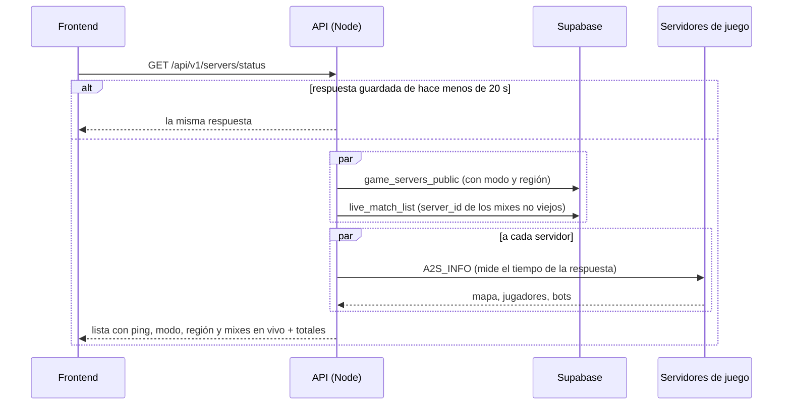

# Plan: ping, modo, región y partidas en vivo en el estado de los servidores

> Planeación original. Estado: **aprobado** por Daniel el 2026-10-19 (pedido directo; modo con lista fija y región en texto libre, elegidos por él).

## El pedido

Daniel pidió el 2026-10-19 que `GET /api/v1/servers/status` entregue, además de lo que ya da:
1. El **ping** de cada servidor, si es posible.
2. El **modo** y la **región** de cada servidor.
3. Un total para la línea "N partidas en vivo · N jugadores en el servidor".

## Lo que ya existe

| Pedido | Hoy | Falta |
|---|---|---|
| Ping | A2S_INFO por UDP desde el backend, sin medir el tiempo | Medir cuánto tarda la respuesta |
| Modo y región | Nada: `game_servers` no los tiene | Columnas nuevas, editables desde el admin |
| Total | `totals.players` (jugadores conectados entre todos) | Cuántos mixes hay en vivo |

## Decisiones tomadas

| Tema | Decisión | Origen |
|---|---|---|
| Ping | **No se puede medir el ping del jugador**: el navegador no habla UDP con el servidor de juego. Se entrega `ping_ms`, la latencia de la consulta A2S **desde el backend (VPS)** hasta el servidor. Sirve como indicador ("responde rápido", "lento"), no como el ping que verá el jugador en el juego | Propuesta de Claude, por la limitación técnica |
| Cómo se mide | Solo el último envío de la consulta (el que devuelve la información), sin contar abrir el socket ni el desafío | Para que no sume dos idas y vueltas en el servidor real, que pide desafío |
| Modo | **Lista fija**: `mix`, `competitive`, `public`, `deathmatch`, `retakes`, `practice`. El frontend los traduce. Uno nuevo necesita migración | Daniel, 2026-10-19 |
| Región | **Texto libre**, de 2 a 30 caracteres (por ejemplo "Argentina" o "Buenos Aires") | Daniel, 2026-10-19 |
| Sin modo o región cargados | `null`. El frontend no los muestra | |
| Partidas en vivo | Mixes con foto en los últimos 10 minutos (`live_match_list` con `stale = false`), los mismos que se ven en `GET /api/v1/mixes/live` como en curso | |
| Dónde va el total | `totals.live_matches`, y también `live_matches` en cada servidor (sale de la misma consulta) | |

## 1. El flujo



## 2. Base de datos: replanteo `20_servidores_modo_region.sql`

- `game_servers.mode` (`text`, `check` con la lista) y `game_servers.region` (`text`, `check` de 2 a 30 caracteres sin espacios a los lados).
- `game_servers_public` suma `mode` y `region` al final.
- `admin_server_list` suma `mode` y `region` al final, y la búsqueda incluye la región.
- `admin_create_server` acepta `p_mode` y `p_region` (se borra la firma vieja y se crea la nueva).
- Reversa en `docs/bitacora/2026-10-14-replanteo-modelo-datos/reversas/20_servidores_modo_region.sql`.

## 3. API

**`GET /api/v1/servers/status`**: cada servidor suma `mode`, `region`, `ping_ms` y `live_matches`; `totals` suma `live_matches`.

```json
{
  "servers": [
    { "id": "…", "name": "v34frag #1", "address": "ip:27062", "mode": "mix", "region": "Argentina",
      "online": true, "ping_ms": 18, "map": "de_inferno", "players": 10, "max_players": 12, "bots": 1, "live_matches": 1 }
  ],
  "totals": { "servers": 2, "online": 2, "players": 14, "live_matches": 1 },
  "checked_at": "2026-10-19T03:10:00Z"
}
```

**Admin de servidores** (`POST`, `PATCH`, `GET /api/v1/admin/servers`): `mode` y `region` se cargan, se editan (`null` o `""` los borra) y se devuelven. El listado filtra por `mode`.

## 4. Documentación

- Contrato del frontend: `partidas.md` (sección 8e), `admin.md` (servidores), novedades del `README.md` y `decisiones.md`.
- `supabase/replanteo/README.md` con la fila de la `20`.
- `PENDIENTES.md`.

## 5. Requisitos antes de empezar

- Docker prendido para la Supabase local (`pnpm db:reset`, `pnpm db:types` y las pruebas de integración).

## 6. Orden de implementación

1. Migración `20` y su reversa.
2. `a2s.ts` mide el tiempo; `services/servers.ts` suma modo, región, ping y mixes en vivo.
3. Esquemas y rutas del admin.
4. Tipos de la base, pruebas unitarias y de integración.
5. Contrato del frontend, bitácora y pendientes.
