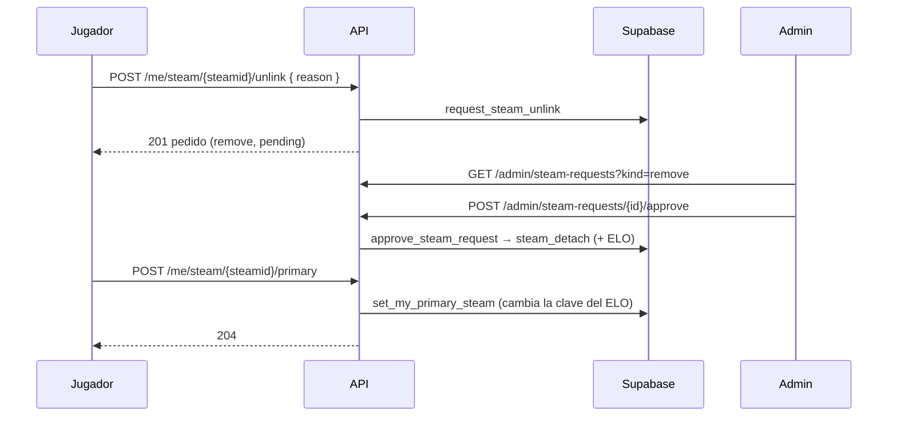
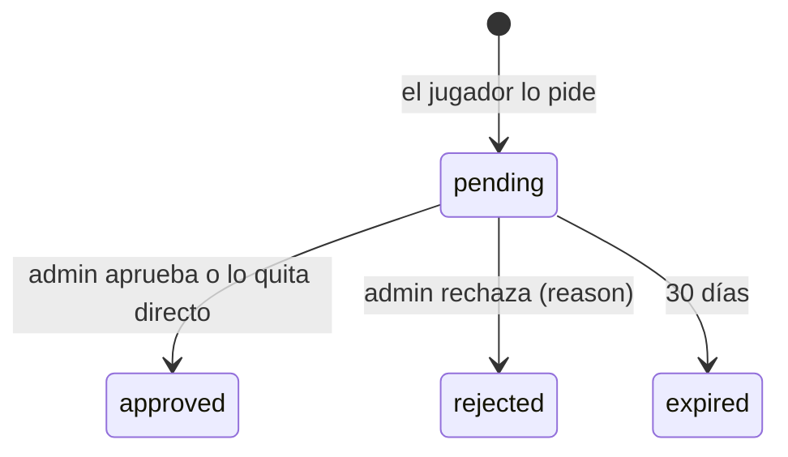

# Desvincular un SteamID y elegir el principal: documentación

## Qué hace

Un jugador con varios SteamID en su ficha puede, desde Mi perfil:

- **Pedir que se desvincule** uno de sus SteamID. El pedido queda pendiente hasta que un admin lo aprueba o lo rechaza, en la misma bandeja donde aprueba los SteamID adicionales que llegan por `!claim`.
- **Elegir cuál es su SteamID principal**, sin aprobación, una vez cada 24 horas.

Antes de esto solo el admin podía hacer las dos cosas (`DELETE /api/v1/admin/steam/{steamid}` y `POST /api/v1/admin/steam/{steamid}/primary`). Esos endpoints siguen igual.

## Pedido para desvincular

| Regla | Detalle |
|---|---|
| Quién | El dueño de la cuenta, sobre un SteamID de su ficha (principal o adicional) |
| Motivo | Opcional, hasta 200 caracteres (`note`). Lo ve el admin |
| Uno por SteamID | Si ya hay un pedido pendiente para ese SteamID, falla. El pedido pendiente reserva el SteamID |
| El único | **No se puede pedir para el único SteamID** de la ficha, contando los otros pedidos pendientes: la ficha tiene que quedar con al menos uno. El admin sí puede sacarlo con `DELETE /api/v1/admin/steam/{steamid}` |
| Vencimiento | A los 30 días, como los pedidos de adicional |
| Al aprobar | Lo mismo que `admin_remove_steam`: las partidas de ese SteamID vuelven a quedar sin ficha (perfil sin reclamar) y, si la ficha tenía varios, **se recalcula el ELO de todos**. Si era el principal, el adicional más viejo pasa a serlo. Falla si el SteamID ya no es de esa ficha o si quedó como el único |
| Admin directo | Si el admin lo quita con `DELETE /api/v1/admin/steam/{steamid}` o `POST /api/v1/admin/steam/link` con `player_id: null`, el pedido pendiente queda aprobado |

## SteamID principal

| Regla | Detalle |
|---|---|
| Quién | El dueño de la cuenta, sobre un SteamID adicional de su ficha. Hacer principal al que ya lo es no hace nada (y no cuenta para el límite) |
| Límite | Una vez cada 24 horas (`players.primary_steam_changed_at`). El admin no tiene límite y su cambio no cuenta |
| Pedido pendiente | Un SteamID con pedido para desvincularlo no puede ser principal |
| ELO | **No cambia.** El ELO de la ficha vive en `player_elo` con la clave del principal (`elo_key`), y los adicionales no tienen fila propia: el cambio pasa la fila a la clave nueva. Da lo mismo que recalcular todo (probado). Si un adicional tuviera fila propia (no debería pasar), se recalcula todo, y eso solo lo puede hacer un admin |

El cambio del admin (`admin_set_primary_steam`) usa la misma función (`steam_make_primary`), así que **tampoco recalcula todo**. Antes lo hacía.

## Fecha de cada SteamID

Pedido de Daniel el 2026-10-19, después del plan: la lista de Mi perfil muestra cuándo se vinculó cada SteamID.

- `GET /api/v1/me/claim-code` trae `added_at` en cada SteamID de `steam_ids` (sale de `player_steam_all.added_at`).
- **La fecha es del SteamID, no del lugar que ocupa:** al cambiar el principal (el jugador o el admin) o al subir un adicional porque se quitó el principal, cada uno conserva la suya.
- El primer SteamID de una ficha (`!claim` o el admin) toma la fecha de ese momento.
- **`null` = no se sabe.** Para los principales que ya existían, la migración toma el primer `!claim` aceptado (`claim_log`) o la aprobación del pedido (`steam_requests`). Los que vinculó un admin en el sistema viejo no tienen ninguno de los dos y quedan en `null`, igual que si después pasan a adicional. Por eso `player_extra_steam_ids.added_at` ahora admite `null`.
- Al quitar el principal, sube el adicional más viejo; los que no tienen fecha cuentan como los más viejos.

## Datos

| Tabla / columna | Qué guarda |
|---|---|
| `steam_requests.kind` | `add` (SteamID adicional, con `!claim`; el valor de los pedidos anteriores) o `remove` (desvincular) |
| `steam_requests.note` | Motivo del jugador (solo `remove`) |
| `steam_requests.reason` | Motivo del rechazo (sin cambios; lo ve el jugador) |
| `players.primary_steam_changed_at` | Último cambio de principal hecho por el jugador |
| `players.steam_added_at` | Cuándo se vinculó el SteamID principal (`null`: no se sabe) |
| `player_extra_steam_ids.added_at` | Cuándo se vinculó el adicional. Ahora admite `null` |
| `player_steam_all.added_at` | La fecha de cada SteamID; antes era `null` en el principal |
| `admin_steam_requests` | Suma `kind` y `note` al final. `shares_match` es siempre `false` en `remove` |

## Funciones de Supabase

| Función | Quién | Qué hace |
|---|---|---|
| `request_steam_unlink(p_steam, p_note)` | Usuario | Crea el pedido `remove` y devuelve su id |
| `set_my_primary_steam(p_steam)` | Usuario | Cambia su principal con las reglas de arriba |
| `steam_make_primary(p_steam, p_by)` | Interna | Cambia el principal, pasa la fila de `player_elo` a la clave nueva y conserva la fecha de cada SteamID |
| `steam_attach`, `steam_detach` | Internas | Guardan la fecha del principal (al vincular el primero y al subir un adicional) |
| `admin_set_primary_steam(p_steam)` | Admin | Ahora usa `steam_make_primary` |
| `approve_steam_request(p_id)` | Admin | Distingue `add` y `remove` |
| `admin_remove_steam(p_steam)`, `link_steam_id(p_steam, null)` | Admin | Además aprueban el pedido `remove` pendiente |

## API

| Endpoint | Qué hace |
|---|---|
| `POST /api/v1/me/steam/{steamid}/unlink` | Body opcional `{ reason }`. `201` con el pedido (`id`, `kind`, `steam_id`, `nick`, `status`, `note`, `reason`, `created_at`, `resolved_at`) |
| `POST /api/v1/me/steam/{steamid}/primary` | `204` |
| `GET /api/v1/me/steam-requests` | Suma `kind` y `note`, y el filtro `kind` |
| `GET /api/v1/me/claim-code` | Cada SteamID de `steam_ids` suma `added_at` y `unlink_pending`; `pending_requests` cuenta los dos tipos |
| `GET /api/v1/admin/steam-requests` | Suma `kind` y `note`, y el filtro `kind` |
| `POST /api/v1/admin/steam-requests/{id}/approve` · `/reject` | Sirven para los dos tipos |

Los errores de las reglas salen como `400` con el mensaje de la base (por ejemplo, "Es tu único SteamID: no se puede desvincular").

## Dónde está cada cosa

| Qué | Archivo / ubicación |
|---|---|
| Migración | `supabase/replanteo/21_steam_desvincular.sql` |
| Inversa | `docs/bitacora/2026-10-14-replanteo-modelo-datos/reversas/21_steam_desvincular.sql` |
| Pruebas SQL | `docs/bitacora/2026-10-14-replanteo-modelo-datos/pruebas/21_steam_desvincular.sql` |
| Rutas | `web/backend/src/routes/claim.ts` |
| Esquemas | `web/backend/src/schemas/claim.ts` |
| Pruebas | `web/backend/test/unit/claim-routes.test.ts`, `web/backend/test/integration/claim.test.ts` |
| Contrato del frontend | `docs/frontend/contrato/jugadores.md` (5b), `admin.md`, `api.md`, `README.md`, `decisiones.md` |
