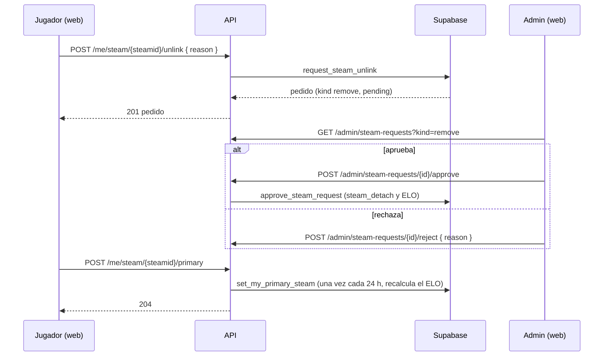
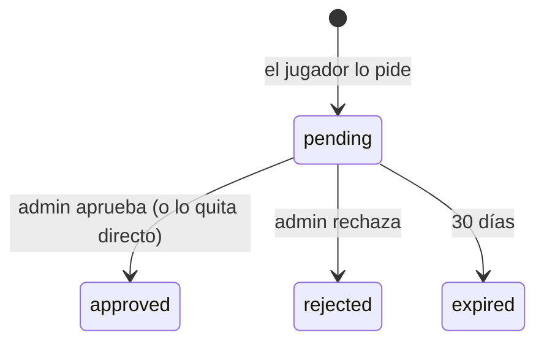

# Plan: desvincular un SteamID (con aprobación) y elegir el principal desde Mi perfil

> Planeación original. Estado: **aprobado** por Daniel el 2026-10-19 (pedido directo: "si no lo tenemos, créalo"). Las decisiones marcadas como "Propuesta de Claude" no las eligió él.

## El pedido

Daniel pidió el 2026-10-19 revisar si la API tiene:
1. Un endpoint para **desvincular un SteamID**, que tiene que ser **una solicitud que aprueba un admin**.
2. Un endpoint para **poner un SteamID como principal**.

## Lo que ya existe

| Pedido | Hoy | Falta |
|---|---|---|
| Desvincular | `DELETE /api/v1/admin/steam/{steamid}` (`admin_remove_steam`): el admin lo saca directo | Que el **jugador** lo pida y el admin apruebe o rechace |
| Principal | `POST /api/v1/admin/steam/{steamid}/primary` (`admin_set_primary_steam`): solo el admin | Que el **jugador** elija su principal |

`steam_requests` hoy solo guarda pedidos de SteamID **adicional** (los crea `!claim`).

## Decisiones tomadas

| Tema | Decisión | Origen |
|---|---|---|
| Dónde se guarda el pedido | En la misma `steam_requests`, con una columna nueva `kind` (`add` o `remove`). El admin ve los dos tipos en la misma bandeja y los aprueba con los mismos endpoints | Propuesta de Claude: reusa la bandeja, el vencimiento a los 30 días y la reserva del SteamID |
| Motivo del jugador | Columna nueva `note` (opcional, hasta 200 caracteres), la ve el admin. `reason` sigue siendo el motivo del rechazo, que ve el jugador | Propuesta de Claude |
| El único SteamID | **No se puede pedir desvincular el único SteamID de la ficha** (ni dejarla sin ninguno sumando pedidos). Sin SteamID no puede estar en un equipo. El admin sí puede con `DELETE /api/v1/admin/steam/{steamid}` | Propuesta de Claude |
| Desvincular el principal | Se puede: al aprobarlo, el adicional más viejo pasa a ser el principal (lo que ya hace `steam_detach`) | |
| Aprobar | Saca el SteamID de la ficha: sus partidas vuelven a quedar sin ficha (perfil sin reclamar) y, si la ficha tenía varios, **recalcula el ELO de todos** | Igual que `admin_remove_steam` |
| Principal | **Lo cambia el jugador directo, sin aprobación**: los dos SteamID ya son suyos y aprobados. Recalcula el ELO de todos (cambia la clave del ELO) | Propuesta de Claude |
| Límite del principal | **Una vez cada 24 horas** por ficha, porque cada cambio recalcula el ELO de todos. El cambio del admin no cuenta ni está limitado | Propuesta de Claude |
| Principal con pedido de desvincular pendiente | No se puede hacer principal un SteamID que tiene pedido de desvincular | |
| El admin lo quita directo | Si el admin lo saca con `DELETE` o `link` con `player_id: null`, el pedido pendiente queda aprobado | |

## 1. El flujo

## 2. Base de datos: replanteo `21_steam_desvincular.sql`

- `steam_requests.kind` (`add` por defecto, o `remove`) y `steam_requests.note`.
- `players.primary_steam_changed_at`: último cambio de principal hecho por el jugador.
- `request_steam_unlink(p_steam, p_note)`: el SteamID tiene que ser de la ficha de la cuenta, sin pedido pendiente, y la ficha tiene que quedar con al menos uno.
- `set_my_primary_steam(p_steam)`: el SteamID tiene que ser adicional de la ficha de la cuenta, sin pedido de desvincular pendiente, y pasadas 24 h del último cambio.
- `approve_steam_request` distingue `add` y `remove`.
- `admin_remove_steam` y `link_steam_id` (desvincular) dan por aprobado el pedido pendiente.
- `admin_steam_requests` suma `kind` y `note` (`shares_match` solo para `add`).
- Reversa en `docs/bitacora/2026-10-14-replanteo-modelo-datos/reversas/21_steam_desvincular.sql`.

## 3. API

| Endpoint | Qué hace |
|---|---|
| `POST /api/v1/me/steam/{steamid}/unlink` | Body `{ reason? }`. Crea el pedido. `201` con el pedido |
| `POST /api/v1/me/steam/{steamid}/primary` | Lo hace principal. `204` |
| `GET /api/v1/me/steam-requests` | Suma `kind` y `note`, y el filtro `kind` |
| `GET /api/v1/me/claim-code` | Cada SteamID suma `unlink_pending` |
| `GET /api/v1/admin/steam-requests` | Suma `kind` y `note`, y el filtro `kind` |

## 4. Documentación

- Contrato del frontend: `jugadores.md` (5b), `admin.md`, `api.md` (filtros), novedades del `README.md` y `decisiones.md`.
- `supabase/replanteo/README.md` con la fila de la `21`.
- `PENDIENTES.md` y el índice de la bitácora.

## 5. Requisitos antes de empezar

- Docker prendido para la Supabase local.

## 6. Orden de implementación

1. Migración `21` y su reversa.
2. `pnpm db:reset` y `pnpm db:types`.
3. Esquemas y rutas.
4. Pruebas unitarias y de integración.
5. Contrato del frontend, bitácora y pendientes.
