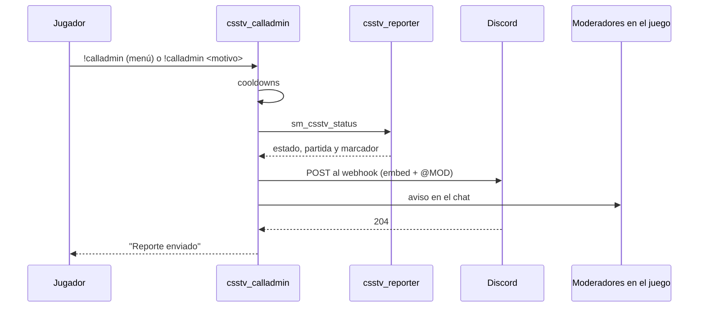
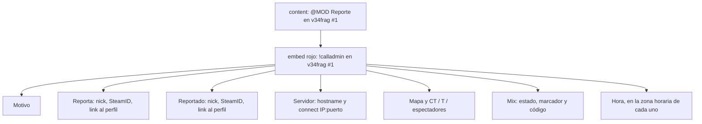
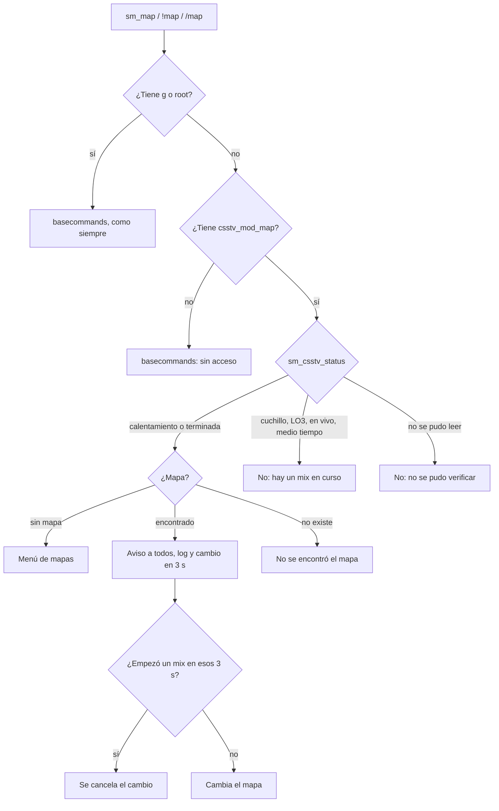

# `!calladmin` con Discord y rol de moderador: documentación

## Qué hace

`csstv_calladmin` es un plugin aparte, independiente de `csstv_reporter`. Hace dos cosas:

- **`!calladmin`**: un jugador avisa que pasa algo (un cheater, alguien tóxico). El aviso llega al canal de reportes de Discord por un webhook y menciona al rol `@MOD`. El mensaje dice quién reportó, a quién, desde qué servidor y, si hay un mix, el código y el marcador para buscar la demo. El servidor real (`v34frag #1`) y RBK (`v34frag #2`) mandan al mismo canal.
- **`!map` del moderador**: el moderador puede cambiar el mapa, pero solo si no hay un mix en curso.

El rol de moderador es un grupo de SourceMod (`Moderador`) con permisos de moderación: kick, ban por tiempo, mute y gag, slay. No puede cancelar un mix, ni cambiar el mapa durante uno, ni tocar a un admin.



## `!calladmin`

| Uso | Qué hace |
|---|---|
| `!calladmin` | Menú 1: a quién reportas (jugadores conectados, sin bots ni uno mismo, o "Ningún jugador en particular"). Menú 2: motivo (Cheats, Tóxico o insultos, Molesta al equipo, Otro motivo) |
| "Otro motivo" | Pide el motivo por el chat. El siguiente mensaje (en 45 s) es el motivo y **no se muestra** a los demás. `cancelar` no envía nada |
| `!calladmin <texto>` | Manda el texto directo, sin reportado (o con el que eligió en el menú, si venía de "Otro") |

- **Cooldowns:** 120 s por jugador y 30 s entre dos reportes del servidor. El del jugador se cuenta por SteamID (reconectarse no lo saltea); sin un SteamID propio (`STEAM_ID_LAN`, `STEAM_ID_PENDING`), por IP. Solo cuentan los reportes que llegaron a Discord.
- **Un reporte por vez:** mientras se envía uno, los demás esperan.
- **Aviso en el juego:** los conectados con acceso a `csstv_calladmin_notify` (por defecto flag `b`, es decir admins y moderadores) reciben el reporte en el chat.
- **Si Discord falla:** "No se pudo enviar el reporte. Prueba de nuevo en un rato." Queda en `logs/calladmin.log` y en el log de errores. Si Discord responde 429 (demasiados mensajes), se reintenta una vez a los 2 s.
- **Log:** cada reporte queda en `addons/sourcemod/logs/calladmin.log`.

### El mensaje en Discord



- **Menciones:** se envía `allowed_mentions` con solo el rol de `csstv_calladmin_role`. Además, cada `@` que escribe un jugador lleva un espacio de ancho cero, así que `@everyone` o `<@&id>` no avisan a nadie.
- **Markdown:** los textos de jugadores (nick, motivo) se escapan: `**`, `_`, `[link](…)` salen tal cual se escribieron.
- **Hora:** `<t:unix:f>`, que Discord muestra en la hora de cada lector.
- **Tamaño:** System2 no manda cuerpos de más de 2047 bytes. Un reporte normal ocupa unos 750. Si uno se pasara, no se envía y se le pide al jugador un motivo más corto.
- **Mix:** sale de `sm_csstv_status`. Con un mix: "en vivo · 5-3" y el código de la partida (`srv1-20261019T…`), que es el nombre de la demo.

## Rol de moderador

En `configs/admin_groups.cfg` de cada servidor:

```
"Moderador"
{
    "flags"     "bcdfj"
    "immunity"  "50"
    "Overrides"
    {
        "csstv_mod_map"   "allow"
    }
}
```

En `configs/admin_overrides.cfg`:

```
"sm_cancelmatch"   "g"
```

Cada moderador se agrega en `configs/admins_simple.ini` con `"STEAM_0:X:Y"  "@Moderador"`. Hoy son los mismos en los dos servidores (Daniel, 2026-10-19). Los admins quedan con `z` (root) e inmunidad 99.

| Puede | No puede |
|---|---|
| `sm_admin` (menú), `sm_who` | Cancelar un mix (`sm_cancelmatch` pide `g`) |
| `sm_live`, `sm_swap` | Cambiar el mapa con un mix en curso |
| `sm_kick` | Desbanear ni banear para siempre (sin `e`, SourceMod no lo deja) |
| `sm_ban` por tiempo, `sm_addban` | Votaciones de admin (`sm_votekick`, `sm_voteban`) |
| `sm_mute`, `sm_gag`, `sm_silence` y sus `un-` | `sm_cvar`, `sm_execcfg`, `sm_rcon`, contraseña, cheats |
| `sm_say`, `sm_csay`, `sm_psay` | Tocar a un admin (inmunidad 50 contra 99) |
| `sm_slay`, `sm_slap`, `sm_rename`, `sm_beacon` | Ver "Cambiar mapa" en `sm_admin` |
| `!map <mapa>` sin mix en curso | |

## `!map` del moderador



- **Sin choque con el `sm_map` de SourceMod:** un listener de `sm_map` corre antes que `basecommands`. A los admins, a quienes no son moderadores y a la consola los deja pasar sin tocar nada. El pedido del moderador lo resuelve el plugin y corta el comando, así `basecommands` no le contesta "sin acceso". Atrapa `sm_map` en la consola del jugador y `!map` y `/map` en el chat.
- **Aviso y log iguales a los de `sm_map`:** `[SM] Changing map to …` para todos y `"<moderador>" changed map to "<mapa>" (moderador, sin mix en curso)` en el log de SourceMod.
- **Nombre del mapa:** exacto, o con `de_` o `cs_` adelante (`dust` → `de_dust`). Si no, el único mapa de la lista que lo contiene (`mirage` → `de_mirage_rc1`). La lista es la sección `csstv` de `configs/maplists.cfg` (la misma que la votación de los jugadores) o el mapcycle.
- **`!map` sin mapa:** abre un menú con la lista.
- **Cómo sabe si hay mix:** lee la primera línea de `sm_csstv_status` con `ServerCommandEx` (`estado: …`). No depende del separador `·`, que según cómo se compiló el plugin de los mixes no siempre tiene los mismos bytes. Si no puede leerlo, no cambia el mapa.
- **"Cambiar mapa" de `sm_admin`:** ese menú de SourceMod cambia el mapa sin pasar por `sm_map`, así que no se podría controlar. Por eso el moderador no tiene `g` y no lo ve.

## Cvars

En `cfg/sourcemod/csstv_calladmin.cfg`. En el repo la URL va vacía: en cada servidor se escribe a mano (copia en el `.env`, `DISCORD_CALLADMIN_WEBHOOK`).

| Cvar | Por defecto | Qué es |
|---|---|---|
| `csstv_calladmin_enabled` | `1` | Activa `!calladmin` |
| `csstv_calladmin_webhook` | vacío | URL del webhook (`FCVAR_PROTECTED`). Vacía: "!calladmin no está configurado en este servidor" |
| `csstv_calladmin_role` | `1561742511045738526` | Rol de Discord a mencionar (`@MOD`). Vacío: sin mención |
| `csstv_calladmin_server` | vacío (= `hostname`) | `v34frag #1` en el nuestro, `v34frag #2` en RBK |
| `csstv_calladmin_address` | vacío (= `ip:hostport`) | IP:puerto público para el `connect`. Detrás del panel `ip` puede ser `0.0.0.0`: entonces no sale |
| `csstv_calladmin_cooldown` | `120` | Segundos entre reportes del mismo jugador |
| `csstv_calladmin_global_cooldown` | `30` | Segundos entre reportes del servidor |
| `csstv_calladmin_modmap` | `1` | `!map` del moderador. Con `0`, el moderador no cambia el mapa (`basecommands` le dice que no tiene acceso) |

Overrides que usa el plugin (se cambian en `admin_overrides.cfg` o por grupo): `csstv_mod_map` (por defecto solo root) y `csstv_calladmin_notify` (por defecto `b`).

## Dónde está cada cosa

| Qué | Archivo / ubicación |
|---|---|
| Código | `server/addons/sourcemod/scripting/csstv_calladmin.sp` |
| Plugin compilado | `server/addons/sourcemod/plugins/csstv_calladmin.smx` (el mismo para los dos servidores, sin licencia) |
| Config con las cvars (sin la URL) | `server/cfg/sourcemod/csstv_calladmin.cfg` |
| URL del webhook e ID del rol | `.env`: `DISCORD_CALLADMIN_WEBHOOK`, `DISCORD_MOD_ROLE_ID` |
| Grupo y overrides | `configs/admin_groups.cfg` y `configs/admin_overrides.cfg` de cada servidor (no se versionan) |
| Log de reportes | `addons/sourcemod/logs/calladmin.log` de cada servidor |
| Pruebas | `pruebas/calladmin.sh` y `pruebas/lib.sh` |
| Guía de comandos para los moderadores (2026-10-19) | `GUIA_COMANDOS_MODERADORES.pdf`, generado desde `guia_mods.html` con Edge (`--headless --print-to-pdf`) |
