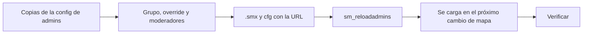

# `!calladmin` con Discord y rol de moderador: guía de implementación

## Estado

Hecho y **probado con bots en el servidor local** (2026-10-19), con 3 reportes de prueba al canal real de Discord. **Subido al servidor real y a RBK el 2026-10-19**, junto con `csstv_sell`. Se carga en el próximo cambio de mapa. **Todavía no hay moderadores:** Daniel los agrega después en `admins_simple.ini` de cada servidor.

## Archivos

| Archivo | Cambio |
|---|---|
| `server/addons/sourcemod/scripting/csstv_calladmin.sp` | Nuevo: plugin 1.0.0 |
| `server/addons/sourcemod/plugins/csstv_calladmin.smx` | Nuevo: build normal (21 266 bytes, md5 `bcbf3360b2d751bc264a35939a8f7988`) |
| `server/cfg/sourcemod/csstv_calladmin.cfg` | Nuevo: cvars, con la URL vacía |
| `.env` (no se versiona) | `DISCORD_CALLADMIN_WEBHOOK` y `DISCORD_MOD_ROLE_ID` |
| `docs/bitacora/2026-10-19-calladmin-moderadores/` | Esta bitácora, con `pruebas/` |
| `docs/bitacora/README.md`, `docs/PENDIENTES.md` | Fila y punto 1.9 |
| Servidor real y RBK | `.smx`, cfg con la URL, nombre y dirección, grupo `Moderador` y override de `sm_cancelmatch` (ver Despliegue) |

## Despliegue (hecho el 2026-10-19)

Hecho el 2026-10-19, a pedido de Daniel, en la misma tanda que `csstv_sell`, por SFTP (`sftp` de OpenSSH; la clave del host del puerto 2022 se tomó con `ssh-keyscan`: `SHA256:wCs9fwFD2eKPndyKDYEEgkBJcvXnL0gj2sVY8V0t8UA`).

| Servidor | Qué se subió | Verificación |
|---|---|---|
| **Real** (`SFTP_CSS_*`) | `csstv_calladmin.smx`, `cfg/sourcemod/csstv_calladmin.cfg` (`v34frag #1`, `45.235.98.57:27062; password <la del servidor>`), grupo `Moderador` y `"sm_cancelmatch" "g"`. Copias: `admin_groups.cfg.bak_20261019` y `admin_overrides.cfg.bak_20261019` | Todo bajado de nuevo y comparado (md5 del `.smx` `bcbf3360b2d751bc264a35939a8f7988`) |
| **RBK** (`SERVER1_*`) | Lo mismo, con `v34frag #2` y `45.235.98.57:27055; password <la del servidor>` | Igual |

- **Primer moderador, Juanma** (2026-10-19, a pedido de Daniel): sus 2 SteamID (`STEAM_0:0:1500257138` y `STEAM_0:0:1113757173`, sacadas de `players`, `match_player_stats` y los logs del servidor real) con `"@Moderador"` en `admins_simple.ini` de los dos servidores. Copia previa: `admins_simple.ini.bak_20261019`. Subido y verificado.
- **Segundo moderador, traica** (2026-10-19, a pedido de Daniel): `STEAM_0:0:829553320` con `"@Moderador"` (y el comentario `// traica, moderador (2026-10-19)`) al final de `admins_simple.ini` del **servidor real** y de **RBK**. Antes de escribir se comprobó que el archivo no hubiera cambiado y que el SteamID no estuviera. Copia previa: `admins_simple.ini.bak_20261019_traica`. Verificado bajándolo de nuevo (md5 real `d54664d38aafafd345dafeb371f2814d`, RBK `d357c09de7c2a68307c3f7f0a5df38f2`). Sin `sm_reloadadmins`: se aplica en el próximo cambio de mapa.
- **No se ejecutó nada en las consolas:** SourceMod vuelve a leer la config de admins y carga los plugins nuevos en el próximo cambio de mapa.
- En `admins_simple.ini` del servidor real ya había una entrada con flags `bce` y sin inmunidad: era Juanma. Se reemplazó por `"@Moderador"`, así que perdió `e` (desbanear).
- Falta la verificación del paso 8 y publicar el changelog.

Pasos:

Sin licencia: **el mismo `.smx` va a los dos servidores**, como `csstv_allchat` y `csstv_sell`. Todo en la misma tanda.

En cada servidor (**servidor real** por `SFTP_CSS_*`, **RBK** por `SERVER1_*`):

1. **Antes de tocar nada:** comprobar que ningún plugin registre `sm_calladmin` ni escuche `sm_map`, y bajar `configs/admins_simple.ini`, `admins.cfg`, `admin_groups.cfg` y `admin_overrides.cfg`. Guardar copias con la fecha (`*.bak_20261019`). Revisar que los 2 admins tengan `z` e inmunidad 99.
2. En `admin_groups.cfg`, el grupo `Moderador` (ver `DOCUMENTACION.md`). En `admin_overrides.cfg`, `"sm_cancelmatch" "g"`.
3. En `admins_simple.ini`, una línea `"STEAM_0:X:Y" "@Moderador"` por moderador (los mismos en los dos).
4. Subir `csstv_calladmin.smx` a `addons/sourcemod/plugins/`, volver a bajarlo y comparar el md5.
5. Subir `cfg/sourcemod/csstv_calladmin.cfg` con:
   - `csstv_calladmin_webhook` = `DISCORD_CALLADMIN_WEBHOOK` del `.env`;
   - `csstv_calladmin_server` = `"v34frag #1"` en el nuestro, `"v34frag #2"` en RBK;
   - `csstv_calladmin_address` = la IP:puerto público de cada uno.
   Se sube a mano: en el servidor real los plugins no pueden escribir su cfg (le pasa a `CM_PickupWeapon`).
6. `sm_reloadadmins` en la consola del panel. No corta un mix.
7. **Sin recargar nada más:** el plugin se carga en el próximo cambio de mapa. No reiniciar con un mix en curso.
8. **Verificar:**
   - `sm plugins list` muestra "CSSTV CallAdmin (1.0.0)".
   - Un moderador: `sm_who` lo muestra con sus flags; `!map` en el calentamiento cambia el mapa y durante un mix dice "Hay un mix en curso".
   - Un `!calladmin prueba` llega al canal con el nombre del servidor correcto.
   - El log de errores de SourceMod no tiene excepciones de `csstv_calladmin.smx`.
9. Publicar `CHANGELOG_DISCORD.txt`.

## Pruebas

### Con bots en el servidor local (2026-10-19)

Servidor local (`E:\CSS DEDICATED SERVER\server`, SourceMod 1.10) con la build `CALLADMIN_DEBUG`, `csstv_reporter` 1.7.0 con `csstv_send 0` (también en el cfg mientras duraron las pruebas, porque se cambió de mapa varias veces) y `csstv_include_bots 1` para poder empezar un mix con 4 bots. El grupo `Moderador` y el override de `sm_cancelmatch` se agregaron a la config local. Script: `pruebas/calladmin.sh`.

**SourceMod nunca le da acceso a un bot en `CheckCommandAccess`**, ni siendo root. Por eso, en la build de depuración, a los bots se les revisa el AdminId con `CheckAccess` (incluye los overrides). La build normal usa `CheckCommandAccess`.

| # | Caso | Resultado |
|---|---|---|
| 1 | Permisos del moderador | Sí: `sm_live`, `sm_swap`, `sm_kick`, `sm_ban`, `sm_mute`, `sm_slay`, `sm_admin`, `csstv_mod_map`. No: `sm_cancelmatch`, `sm_map`, `sm_unban`, `sm_rcon`, `sm_cvar`, `sm_votekick`. El root sí tiene `sm_cancelmatch` |
| 2 | `sm_map` de un jugador sin permisos y de un root | El plugin los deja pasar sin hacer nada |
| 3 | Moderador sin mix: `sm_map de_dust` | `"Rick<5><BOT><>" changed map to "de_dust" (moderador, sin mix en curso)` y el mapa cambia. Una sola línea: `basecommands` no actuó |
| 4 | Moderador con mix en vivo: `sm_map`, `!map`, `/map` y `sm_map` sin mapa | Las 4: "Hay un mix en curso (en vivo): no se puede cambiar el mapa". El mapa no cambia |
| 5 | `!calladmin` con `@everyone`, `**negrita**`, `[link](…)`, `<@&123>`, `\`, ñ y emoji, con mix en vivo | Discord lo aceptó (754 bytes). Avisó al moderador y al root. El embed trae "en vivo · 0-0" y el código de la partida |
| 6 | Menú: reportado + Cheats | Enviado, con el campo "Reportado" |
| 7 | Menú: reportado + "Otro" y el motivo por el chat | Enviado con el motivo. El mensaje no aparece en el log de chat del juego (no lo vio nadie) |
| 8 | Otro reporte del mismo jugador | "Ya enviaste un reporte. Puedes enviar otro en 116 s." |
| 9 | Cooldown global de 30 s | "Hace un momento se envió un reporte. Espera 14 s." |
| 10 | "Otro" y `cancelar` | "Reporte cancelado." |
| 11 | Webhook inválido | Discord: HTTP 404 `Unknown Webhook`. El jugador: "No se pudo enviar el reporte". Queda en `calladmin.log` |
| 12 | Webhook vacío | "!calladmin no está configurado en este servidor." |
| 13 | Empieza un mix en los 3 s del cambio de mapa del moderador | "Cambio de mapa del moderador a "de_dust" cancelado: empezó un mix". El mapa no cambia |
| 14 | `sm_map` desde la consola | Solo `basecommands` (`"Console<0>…" changed map to "de_dust"`); el plugin no aparece |
| 15 | Moderador con `!map mirage` en el chat | Cambia a `de_mirage_rc1` |

### Sin probar

- **Con un jugador de verdad:** los menús (los bots no pueden usarlos), los colores del chat, que el moderador no vea "Cambiar mapa" en `sm_admin` y que `basecommands` le conteste "sin acceso" a un jugador común. Es lo primero que conviene mirar después de subirlo.
- **Que suene la mención `@MOD`** en Discord: los mensajes de prueba la llevan, pero no se comprobó si avisó a alguien.
- **Con `csstv_reporter` 2.1 (servidor real y RBK):** se probó con la 1.7.0 del servidor local. La línea de `sm_csstv_status` es la misma desde la 1.7.0 hasta la 2.2.0.

## En qué se apartó del plan

- **Cooldown por jugador sin SteamID propio:** el plan lo contaba solo por SteamID. Los jugadores con `STEAM_ID_LAN` o `STEAM_ID_PENDING` habrían compartido el cooldown, así que en ese caso se cuenta por IP.
- **Nombre del mapa:** además de la búsqueda en la lista, prueba `de_<texto>` y `cs_<texto>`. Con la lista sola, `!map dust` en el servidor local llevó a `de_dust2_ob` (el único "dust" del mapcycle).
- **`csstv_calladmin_modmap`:** una cvar para apagar el `!map` del moderador sin descargar el plugin. No estaba en el plan.
- **Lectura del estado del mix:** no depende del separador `·` de `sm_csstv_status`: en el servidor local ese carácter no llegó como UTF-8.

## Incidentes durante las pruebas

- **`ServerCommandEx` vacío desde RCON:** el comando de depuración `csstv_calladmin_mixstate`, llamado por RCON, recibe la salida vacía porque corre dentro de otro comando de servidor. Desde un comando de un jugador (`!map`, `!calladmin`, el menú) y desde un timer lee bien, que es como lo usa el plugin.
- **Los bots no tienen acceso:** ver arriba (`CheckAccess` en la build de depuración).
- **URL del webhook cortada por RCON:** sin comillas, la consola parte la URL en los `:`. En el cfg va entre comillas.

## Cómo revertir

En cada servidor:
1. `sm plugins unload csstv_calladmin` y mover `csstv_calladmin.smx` a `plugins/disabled/`. Con eso el moderador ya no cambia el mapa y `!calladmin` deja de existir.
2. Para sacar el rol: volver a las copias `*.bak_20261019` de `admin_groups.cfg`, `admin_overrides.cfg` y `admins_simple.ini`, y `sm_reloadadmins`.
3. Para cortar solo Discord: `csstv_calladmin_enabled 0`, o borrar el webhook en Discord.
